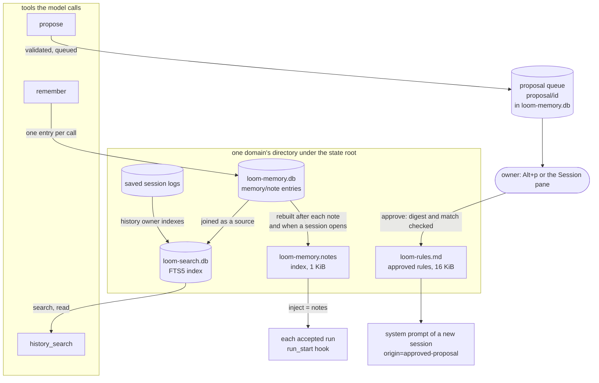

# Memory

Loom's memory does three things. The agent can search what was said in earlier
sessions and open the original words. It can keep a few typed notes for later
sessions. And it can propose a standing rule, which takes effect only after a
person approves it. Nothing the model says is rewritten into a summary or
becomes a rule without approval. A run carries unasked only the rules a person
approved and a small, visible, fenced index of note titles (about 1 KiB),
which the operator can turn off.

The older design worked the other way. A background pass distilled saved
sessions into a digest, and the digest was injected into every run. That
pipeline has been removed. [What an older store still holds](#what-an-older-store-still-holds)
says what it left behind, and
[the decision record](../design-notes/memory-recall.md) explains why it went.

This page uses a few terms from other pages. A *session* is one conversation,
stored as a SQLite file that only appends rows
([durability](durability.md)). Its *log* is the sequence of *entries* in that
file: user messages, assistant messages, tool results and compaction
summaries. A *domain* is the memory scope the daemon maps each session to.
Sessions in one workspace share a *workspace-private* domain, and a
*session-only* domain holds one session
([session ownership](sessions.md)).

## A worked example

Here is one pass through the whole feature. The identifiers and dates are made
up; the words on screen come from the strings the tests pin
(`packages/tui/test/recall_presentation_test.gleam`,
`packages/tui/test/proposal_panel_test.gleam`).

In the first session, the agent is asked to fix a failing deploy. Before touching
anything, it searches the repository's history for what earlier sessions said:

```json
{"action": "search", "query": "deploy", "kind": "assistant"}
```

The terminal draws the call and one row per hit. Each row has the short
session id, the short entry id, the kind of entry, the UTC date and the
matching words, with the matches in square brackets:

```
✓ history_search · "deploy" · kind assistant · 3 hits
  019a3c1e · 456789a1 · assistant · 2026-10-08 · we [deploy] with make release
  019a3c1e · 456789b2 · assistant · 2026-10-08 · the [deploy] script lives in scripts
  019a3c1e · 456789c3 · assistant · 2026-10-08 · [deploy]s go through the queue
```

The web view words the same step as `Searched history for "deploy" · 3 hits`
and opens onto one row per hit. The model reads the hits as quoted data. If a
snippet is too short, it calls `history_search` again with `action: read` and
the hit's `session` and `entry` to get the complete stored entry, with
`around: 2` to get two entries on each side of it.

Later in the session the user says that `make test` does not run the lint and
that a push failed CI because of it. The agent saves a note. A note is quoted
context for later sessions; it binds nothing.

```json
{"title": "Run make check before pushing",
 "description": "make test skips the lint; the CI gate runs both",
 "kind": "feedback",
 "note": "CI runs the lint, make test does not. Run make check before every push."}
```

The tool answers at once and never asks the user. The web view words the step
as `Remembered feedback: Run make check before pushing`.

The correction applies to every future session, not only this one, so the
agent also proposes it as a rule:

```json
{"old": "",
 "new": "Run `make check` before every push.",
 "rationale": "Two pushes failed CI because make test does not run the lint."}
```

The call returns `queued as prop-0000000003` and the run continues. Nothing
has been written anywhere except the queue. The owner's terminal footer now
shows a badge on the bottom rule of the input frame:

```
proposals 1 · Alt+p
```

When the owner presses `Alt+p`, an overlay opens over the conversation. Its
title reads ` Proposals · 1 proposal pending · Esc back `, and each row shows
the proposal id, its age, its state, the first line of the rationale and the
short id of the session it came from:

```
▸ prop-0000000003  2h ago  pending  Two pushes failed CI because make test…  019a3c1e
```

`Enter` opens the row. The detail shows the rationale, the session it came
from and the edit as a diff, with removed lines in red and added lines in
green. For this proposal there is one added line, because `old` was empty and
the rule is appended:

```
prop-0000000003 · pending · 2h ago
From session 019a3c1e-5b7d-7c3e-9a10-2f4b6c8d0e1f
Why
Two pushes failed CI because make test does not run the lint.
Adds a rule to loom-rules.md
+ Run `make check` before every push.
When it applies
Applies to new sessions only. A running session keeps the rules it started with.
Approving writes this rule to loom-rules.md, which sessions opened afterwards
read. The workspace's AGENTS.md is never edited.
a approve · r reject · ↑/↓ PgUp/PgDn scroll · Esc back
```

Pressing `a` asks `Approve this rule?`, and only a lowercase `y` sends the
approval. The web page offers the same review in the Session pane's last
section, with a count on the Session tab and an Approve button that asks its
question in place before it sends.

On approval, the daemon checks that the rules file is still the one the
proposal was written against, then writes `loom-rules.md` beside the domain's
memory store:

```
### Rule prop-0000000003 (approved 2026-10-12, from session 019a3c1e-5b7d-7c3e-9a10-2f4b6c8d0e1f)

Run `make check` before every push.
```

The owner then opens a new session. Its system prompt ends with that file in
its own fence, `<instructions origin=approved-proposal path=loom-rules.md>`,
after the operator's and the project's own instruction files. Each run in it
also starts with the notes index. The terminal folds the index to one row, `memory context (1 line)  [Ctrl+G to expand]`, and the web view
shows it as the first step of the turn, `Memory · 1 line`. Expanded, the row
holds the fenced text the model received:

```
- (feedback, 2026-10-11) Run make check before pushing: make test skips the lint; the CI gate runs both
```

The rest of this page explains each piece.

## The three pieces

The pieces are the log and `history_search`, typed notes, and rules by
proposal.

### The log and `history_search`

Every session's log is already a complete, dated record of what was said. We
keep it as the source of truth and make it cheap to search, instead of storing
conclusions the model drew from it. `history_search` is the tool that searches
it. It is registered only when the search index opens
(`client/serve.gleam`, `history_seam`); an index that will not open costs the
tool and one log line, and never the boot.

The index is a SQLite FTS5 table (FTS5 is SQLite's full-text search
extension). It lives in `loom-search.db` beside the domain's other files, and
the daemon's history owner keeps it current for every saved session in the
domain ([events](events.md#search) describes the index itself). What gets
indexed is the text of user, assistant and tool-result messages, the text of
compaction and branch summaries, and the title, description and text of each
note. Reasoning blocks, tool-call arguments, images and every other custom
entry are not indexed.

A search takes these arguments. Only `action` and, for a repository-wide
search, `query` are needed.

| Argument | Meaning |
|---|---|
| `action` | `search` (the default) or `read`. |
| `query` | The words to find. Required for a repository-wide search. |
| `syntax` | `words` (the default) or `raw`. |
| `kind` | Only hits of one kind: `user`, `assistant`, `tool`, `summary` or `note`. |
| `before` | An entry id from an earlier hit. Only older hits come back, newest first. |
| `scope` | `repository` (the default, every session in the domain) or `session` (the calling session only). |
| `limit` | 1 to 50 hits, default 10. A value outside the range is clamped. |
| `session`, `entry` | For `read`: the ids from a hit. |
| `around` | For `read`: 0 to 5 entries on each side of the one requested. |

`words` is the syntax a model normally uses. The tool splits the query on
whitespace, quotes each token and turns it into an FTS5 *prefix term*, which
matches any indexed word that begins with the token. It joins the terms with
AND. A bare `OR` between two words stays an OR operator, and an `OR` with no
word on one side is dropped (`events/search.gleam:869`, `match_text`). So
`deploy OR release` finds entries holding either word, `deploy` also finds
`deployed` and `deployment`, and no input is a syntax error: `foo-bar`, `a:b`
and a stray quote are all text. `raw` passes FTS5 syntax through, such as
quoted phrases and `AND`, `OR` and `NOT`, and refuses a malformed query in
band.

Results come back best match first, ranked by FTS5's bm25 score. When `before`
is set, results are instead newest first and strictly older than the entry
named, so passing the oldest entry of one page as the next page's `before`
visits every older match once. The first ranked page and the later
chronological pages are different orderings, so a match that is newer than the
first page's oldest hit and ranked below it is not revisited.

Each hit carries `session`, `entry`, `kind`, `ts` (milliseconds since the
epoch) and `snippet`. The tool prints the kind and the UTC date on every hit
line, and `snippet` marks the matched words with `[` and `]`. A hit from an
index row written before the index kept kinds shows `unknown kind` and
`unknown date`, and a `kind` filter does not match it. Every hit names its
session and entry, so any answer traces back to the original words.

A search with no hits is not a bare "none". It echoes the query, the scope
and any `kind` or `before` filter, and says that terms match whole words or
prefixes with no stemming, and advises two or three variants joined with `OR`,
preferring nouns. The echo is there so the model retries
instead of concluding that nothing was ever said.

`action: read` returns one complete stored entry as JSON, wrapped in a
`history` fence and labelled as historical data. With `around` above 0 it
returns an array of the entry and its neighbours in log order, oldest first,
whichever branch of the session they sit on. A read takes no writer lease and
checks that the file really is the session named, and the model never supplies
a path. An empty query with `scope: session` is a browse: the calling
session's newest entries, newest first, each shown by its opening words.

**What search cannot do.** The index matches words, not meanings. There is no
stemming and no synonym table, so a query of `deploying` does not find text
that says `deploy`, and `release` does not find `ship`. Pick the short root of
a word (`deploy`, not `deploying`), put likely synonyms in an `OR` group, and
read the original entry when a snippet is not enough. If the first search
misses, change the words before concluding that the log is silent.
[Measuring whether it helps](#measuring-whether-it-helps) has numbers.

### Typed notes: the `remember` door

A note is a short, typed, dated piece of text that a model writes on purpose
for later sessions. `remember` takes four required fields:

- `title`, at most 80 characters, on one line;
- `description`, at most 160 characters, on one line, saying what the note is
  about so a later session can decide whether to read it;
- `kind`, one of `feedback` (a correction or preference from the user), `fact`
  (something true of this repository that cost effort to learn) or `decision`
  (a choice and its reason);
- `note`, the text itself, at most 2,000 characters.

The tool's description asks for the reason as well as the rule, and for a note
that still makes sense to a reader who has none of the conversation. The host
redacts all three text fields before it measures them, so a limit applies to
the bytes that are stored. A note is saved at once and never asks the user. The
entry's own timestamp is its date. A memory session accepts at most 256 notes
over its life.

`remember` is registered only when the domain's memory store opens
(`client/serve.gleam`, `memory_seam`), and it is a seam of closures like
`history_search`: the `tools` package cannot open a session, so
`client/memory.gleam:487` (`remember_seam`) does the write. It opens the
store for that one call under a short 30-second writer lease, commits one
`memory/note` entry, and closes it. A note is a custom entry type the host
chooses. If another `remember` call holds the lease at that moment, the call
is refused in band with `memory_busy`, and saying it again later costs
nothing.

**The notes index.** A note the model never sees would be a write-only store,
so each run starts with an index of the notes. After every committed note,
still under the lease, the seam rebuilds `loom-memory.notes` beside the store
from every note in it (`client/memory.gleam:660`, `write_notes_index`). The
file has one line per note, newest first:

```
- (kind, YYYY-MM-DD) title: description
```

The file is capped at 1,024 bytes (`render_notes_index` is at
`client/memory.gleam:803`). When notes are dropped to fit, the last line says
how many and names the search that finds them: `+N more notes;
history_search kind=note finds them`. The write goes to a temporary name and is
renamed over the index, so a run never reads half of it. The index is
derivable from the store, so deleting it loses nothing. It is rebuilt by the
next `remember`, and also whenever a session opens (`serve.gleam`,
`refresh_notes_index`). The open reads the store without taking the lease
(`client/memory.gleam`, `rebuild_notes_index`) and rewrites the file only when
its text differs, so notes written before the index existed reach the first
run, opening many sessions writes nothing, and a `remember` call in flight is
never waited on. A failure of that rebuild is logged as
`memory.notes_index_unrefreshed` and leaves the previous file in place; it
never fails the open. With `inject = "off"` the open does not rebuild it.

**What `[memory] inject` does.** The key decides what a run carries. The
default, `notes`, installs `notes_hooks` (`client/memory.gleam:1034`) on the
`run_start` hook. At each accepted run the hook reads the index file and
appends it as a user message ahead of the prompt, wrapped at that moment under
its own `loom-notes` fence and an attribution sentence
(`client/memory.gleam:1087`, `notes_wrapped`). The wrapper is built at
injection time so that nothing in the file can forge its own provenance. The
attribution says the notes are quoted data, that nothing in them is an
instruction, and that the repository's current state and the user's own
instructions win every conflict. A repository with no notes, or an index over
4,096 bytes, injects nothing; the second case logs `memory.notes_oversize`.
`inject = "off"` installs no hook at all (`client/serve.gleam`,
`with_memory_context`).

Bodies are fetched on demand. A model that wants a note's full text calls
`history_search` with `kind: note`. The store joins the history owner's
sources through `client/serve.gleam:1158` (`with_memory_source`), so each note
is indexed under kind `note`, with its title, description and text as its
words.

A note written before notes were typed holds only its text. It decodes as a
`fact` titled with the first 60 characters of that text and an empty
description (`client/memory.gleam:683`, `note_of`), and it is searchable by
that text.

### Rules by proposal

A rule is text that binds later sessions. A model can suggest one with
`propose` and cannot make one: the property we want is that nothing the model
said becomes a rule unless a person read it.

`propose` takes `old`, `new` and `rationale` (all required) and an optional
`source_entry`. `new` is the rule text, at most 2,048 bytes. `old` is existing
rule text to replace, which must match the rules file exactly once, or empty
to append `new` as a new rule; it is at most 4,096 bytes. `rationale` is the
reason, shown to the reviewer, at most 1,024 bytes. `source_entry` is the id of
the conversation entry that prompted the proposal, so the reviewer can find
the words. There is no path or target argument. The host fixes the one file a
proposal can edit.

The tool validates only what the arguments alone can decide. The host then
checks the proposal against the rules file and the queue
(`client/proposals.gleam:287`, `submit`): `old` must be in the file once, the
edit must fit in the file's 16 KiB bound, and fewer than 64 proposals may be
pending. A failure is an in-band tool failure that the model reads. On success
the call returns `queued as <id>` and nothing more. It never parks the run,
never raises an approval or an escalation, and never writes a file. That is
why a proposal is not an approval: an approval answers a refused call that is
holding a run open, and a proposal is a suggestion filed for later
([approvals](approvals.md#proposals-are-not-approvals) says why the two share
nothing).

**The queue.** A proposal is a row `{id, kind, target, base_digest, old, new,
rationale, source, created_ms, state}` stored as one `fact.custom` cell,
`proposal/<id>`, in the domain's `loom-memory.db`. The queue is the domain's,
like the rules file it edits: a proposal made in any session is listed and
decided from every session of the domain, and `source` records which session
made it. The cells are not in any session's file, so a full queue can never push a
session's snapshot capture over its metadata limit. The id is `prop-` and ten
hexadecimal digits. `kind` is `rule` and `target` is always `loom-rules.md`,
and the decoder refuses a stored row that names anything else. `base_digest`
is the digest of the rules file's exact text when the proposal was made.
`state` is one of four values:

- `pending`: waiting for a person;
- `approved`: a person approved it and the rules file was written;
- `rejected`: a person rejected it, and no file was touched;
- `stale`: a person approved it, but the rules file had changed, so nothing
  was written.

Only `pending` changes. Every write to the queue happens while the host holds
the memory store's writer lease, the same lease `remember` takes, and an
approval holds that one lease from reading the rules file to marking the
proposal. Two sessions approving at the same instant therefore run one after
the other, and the second reads the file the first wrote. A caller that finds
the lease held is told so in band and may try again: `propose` answers
`proposal_busy`, and `proposal_decide` answers `conflict` with a message that
the queue is in use. Listing takes no lease, so the review never waits on a
writer.

An approval reads the rules file as it is now
(`client/proposals.gleam`, `decide`). If the file's digest is not the
proposal's `base_digest`, or `old` no longer matches exactly once, the
proposal is marked `stale` and nothing is written. Otherwise the host writes
the new text beside the file and renames it over, so a reader sees the old
file or the new one, and then marks the proposal `approved`. An empty `old`
appends `new` under a header the host writes, `### Rule <id> (approved
<date>, from session <session>)`. A non-empty `old` is replaced in place and
the header of the rule it sits in is left alone, so a replaced rule keeps the
date it was first approved. A `stale` answer is a board in which the proposal
is `stale`, not an error. An id that does not exist is `bad_request`, one that
was already decided is `conflict`, and a daemon with no queue answers
`unsupported`. Decided proposals are kept, because the review shows them, and
a board lists the newest 100.

**The file and the prompt.** `loom-rules.md` lives in the domain's directory,
beside `loom-memory.db`, and outside the project checkout. It is written only
by an approval. The system prompt renders it after the operator's and the
project's instruction files, in a fence of its own:

```
<instructions origin=approved-proposal path=loom-rules.md>
### Rule prop-0000000003 (approved 2026-10-12, from session 019a3c1e-…)
…
</instructions>
```

The default prompt pack tells the model what this origin means: rules a person
approved after reviewing a suggestion, at most one such block, always last,
and not outranking anything said above. The block is read whole and bounded at
16 KiB (`client/proposals.gleam:775`, `guidance`). A file over the bound, or
one that is not text, is left out with a warning and never truncated, because
half a rule is not what anyone approved.

A session's system prompt is fixed for the life of the session. An approved
rule therefore reaches sessions opened after the approval and not the ones
already running.

**Why not the workspace's `AGENTS.md`.** The workspace's `AGENTS.md` and
`CLAUDE.md` are never targets. In this repository `AGENTS.md` is a
byte-identical copy of `CLAUDE.md` made by `cp`, and a check fails when they
differ, so an approval that wrote either would break the gate. More generally,
those files are project text, reviewed in the project's history, and the prompt
frames them as information about the code and never as authority. A rule a
person approved carries more weight than that, and a file inside the
workspace is one a jailed process can write. A file the host owns, outside the
workspace, protected from every jail, avoids all three problems
([protocol-change/086](../../protocol-change/086-memory-proposals.md) has the
full argument).

**Who decides.** `proposals_get` and `proposal_decide` are the daemon owner's
commands. The daemon refuses them to a member with `forbidden`, and to an
observer as it refuses every mutation. A model cannot reach them, because they
are session-protocol commands and not tools.

## Data flow



## Where each file lives

For a managed daemon, a domain's files live in one directory under the state
root (`~/.loom` by default): `workspaces/<sha256 of the canonical workspace
path>/` for a workspace-private domain, and `domains/sessions/<session id>/`
for a session-only one (`client/daemon/manager.gleam`, `domain_record`).
Everything below sits in that directory unless the table says otherwise.

| File | What it holds | Written by | Protected from jailed writes |
|---|---|---|---|
| `loom-memory.db` | The memory session: `memory/note` entries and the lifetime note counter | `remember` | Yes |
| `loom-memory.notes` | The notes index, up to 1,024 bytes | `remember`, after each note, and a session open | Yes |
| `loom-search.db` | The FTS5 index and its cursors | The history owner | Yes |
| `loom-rules.md` | Approved rules, up to 16,384 bytes | An approved proposal, and nothing else | Yes |
| `proposal/<id>` | One proposal, a cell of `loom-memory.db` | `propose`, and the owner's decision, under the store's writer lease | It is a row in the memory file |
| The session files | Each session's log | Their own writer | Masked with the state root's `sessions/` directory |

Protection means the jail bars writes to the path. Writing is the entire
poisoning path: the notes index and the rules file reach later sessions
unasked, and a search snippet reaches a later session whenever a model
searches for it. `client/workspace_policy.gleam:1256` (`protecting_memory`)
covers the store and the notes index, and
`client/workspace_policy.gleam:1284` (`protecting_rules`) covers the rules
file. The protection is conditional on the paths because none of them need
exist, and the jail refuses to mask a missing path under a read-only parent.
The state root's `workspaces/` and `domains/` directories are also masked
wholesale ([sessions](sessions.md#what-a-sessions-jail-may-see-of-the-state-root)).

A standalone host (a single session file with no daemon) puts the same file
names beside the session file instead. It has the search index and the
notes index sidecar, but notes are not searchable there; see
[Known limits](#known-limits).

## Scopes

Memory is keyed per admitted domain. A workspace-private domain gathers every
saved session on one canonical workspace path, and only the owner can read the
aggregate. A session-only domain holds one conversation, and its members can
read what it holds. Notes, the notes index, the search index and the rules
file are all per domain, and nothing crosses between domains.
Isolating a session changes where later memory goes and copies no old data
([sessions](sessions.md)).

There is no user-global store, and this design does not add one. Searching
across repositories would put one repository's quoted text into another's
context. A preference that should apply everywhere is text the owner writes
once in the global `AGENTS.md`, at `~/.agents/AGENTS.md` or
`~/.loom/AGENTS.md`, which every session reads as the operator's own standing
file (`origin=user-default`). A later proposal kind may target that file; none
does today.

The proposal queue is the domain's, like the rules file. The review in any
session of the domain lists every proposal, the 64-pending bound applies to the
domain, and an approval from any session changes what new sessions in the
domain read. A change is announced to the open pages of every session of the
domain, not only the one that made it.

## Configuration

The `[memory]` table in `loom.toml` has one live key. In the managed daemon the
table is read from the domain's persisted configuration reference, which is
independent of a session's runtime configuration.
[configuration](../configuration.md#memory) has the authoritative reference,
and `make doc-check` keeps it in step with the decoder
(`client/memory_config.gleam`, `parse`).

| Key | Values | Default | Meaning |
|---|---|---|---|
| `inject` | `"off"`, `"notes"` | `"notes"` | What each run carries. `"notes"` is the notes index, and `"off"` carries nothing. |
| `distill` | any | none | Removed. Accepted with any value, ignored, and warned about as `memory.config_retired_key`. |
| `distill_wall_ms` | any | none | Removed with the pass it bounded. Accepted, ignored and warned about the same way. |

`parse` refuses an unknown key and an `inject` value outside its list. It
accepts `distill` and `distill_wall_ms` with any value, and reads
`inject = "digest"` as the default `"notes"`; each is named in
`Options.retired`, and `boot` logs one `memory.config_retired_key` warning per
key. They named a removed optional job and not a safety setting, so refusing
them would only break an upgrade over a file that loaded before. An absent
table is the default posture, which makes no model call: notes are written,
indexed and injected.

## What an operator sees

**Recall.** A `history_search` call is a step in the transcript. The terminal
draws the call row with the query and any filters, then one row per hit, and a
collapsed result keeps three hits and says how many more there are (`Ctrl+g`
shows all). The web view words it as `Searching history for "<query>"` while
it runs and `Searched history for "<query>" · <n> hits` once it settles, and
the step opens onto one literal row per hit. Both draw a hit's snippet as text
and never as Markdown, because it is old session text. A record that is not
the tool's shape falls back to the plain tool row.
`session_view/recall_view` is the one reader of the result's `details`.

**Memory context.** The notes index is a user message the daemon adds to a
run. The terminal folds it to `memory context (<n> lines)  [Ctrl+G
to expand]`, and the web view draws it as the first step of the turn, `Memory
· <n> lines`. `session_view/composer.memory_context_lines` recognises the notes index and
also the digest a past release attached, each by its own attribution sentence
and its own fence, so a session saved by that release still folds. A lead and
a fence must come from the same injector, so a message cannot pass as one by
borrowing the other's fence.

**Proposals.** The terminal footer shows `proposals <n> · Alt+p` while any
proposal waits, and `Alt+p` opens the review. The list is newest first. `Enter`
opens a row, `a` then `y` approves, `r` rejects, `Esc` goes back, and `r` on
the list reads the board again. A row that is no longer pending shows what
became of it and offers no action. The board is shared state: a decision's
reply, or the daemon's `proposals_changed` push, redraws the open proposal,
which is also how a `stale` answer reaches the reader. The web page's review
is the Session pane's last section, with the pending count on the Session
tab, and it draws and reads only on the daemon owner's page. A refusal
(`forbidden` for a member or an observer, `unsupported` for a daemon with no
queue) leaves no board and so no badge. [terminal](terminal.md) and
[web-view](web-view.md) describe the surfaces.

**Log events.** These lines are written to the daemon's log.

| Event | Level | Fields | When |
|---|---|---|---|
| `memory.note_written` | info | `kind`, `title_chars` | `remember` committed a note. It never carries the note's text. |
| `memory.search_called` | info | `scope` (`repository` or `this_session`), `hits`, `note_hits` | A search or a session browse was answered. It never carries the query. A refused call and a `read` write nothing. |
| `memory.notes_index_unwritten` | warn | `index`, `reason`, `effect` | A note committed but the index could not be rewritten, so later runs will not see it until the next note rebuilds it. |
| `memory.notes_index_unrefreshed` | warn | `index`, `reason`, `effect` | A session opened and the index could not be rebuilt from the store, so runs keep the previous file until the next note rebuilds it. |
| `memory.notes_oversize` | warn | `notes`, `bytes`, `limit`, `effect` | A run met an index file over 4,096 bytes and injected nothing. |
| `memory.ready`, `memory.unavailable` | info, warn | `store`, and `reason` | At boot, whether the `remember` door registered. |
| `history.ready`, `history.unavailable` | info, warn | `index`, and `reason` | At boot, whether the `history_search` tool registered. |

`memory.proposal` (info, fields `decision`, `kind` and `id`) is written when a
proposal is `submitted`, `approved`, `rejected` or found `stale`. It never
carries the proposal's text. The durable row and the `proposals_changed` push to
open clients, which carries no data and reaches every session of the domain,
are the other traces.

**Memory overview.** The owner can see all of this in one place.
`Alt+m` in the terminal, and the ninth child of the Session pane on the owner's
web page, show an owner-only `memory_get` snapshot
([protocol-change/087](../../protocol-change/087-memory-overview.md)): the
effective `[memory] inject` mode, the size of each file a run reads
(`loom-rules.md` always, and `loom-memory.notes` when `inject` selects it), the
50 newest typed notes (kind, UTC date, title, one-line
description, and a `legacy` mark for an untyped note), the 50 newest approved
rules (id, approval date, source session, first line) and the number of pending
proposals. Note bodies are not in the snapshot; the model reads one with
`history_search kind=note`. The notes come from a read that takes no lease, so
it never waits on `remember`. A section that cannot be
read is shown as `unavailable` with a reason, never as an empty list, and every
cut is counted in `omitted`. Nothing pushes a memory change, so both views read
the snapshot when it opens and at most once a minute while it is shown. A
refused read is asked again at the next minute while the view stays open. The
overview is read-only: to change the injection, edit `[memory] inject`.

## Security and anti-feedback invariants

These properties are why the design can give a model a memory without giving
it a way to write its own instructions.

- **A model's note is data, never an instruction.** The notes index and every
  search result are wrapped at injection time with a fence and an attribution
  that say so. The wrapper is built by the host, not read from a file, so the
  file cannot forge its own provenance, and a body that contains a fence of its
  own is broken rather than allowed to close the host's early. A search
  snippet has any run of three backticks broken the same way.
- **Only a person turns text into a rule.** `propose` files a pending row and
  returns. The one writer of `loom-rules.md` is an approval, which the daemon
  accepts only from its owner and which checks the file's digest and a unique
  match first. A model has no argument that names a path.
- **Injected memory is not indexed again.** The notes index is a user message
  in the session that carried it, and the search indexer skips a user message
  that begins with an injector's attribution lead and carries that injector's
  fence (`events/search`, `is_memory_injection`). That includes the digest a
  past release attached, so a session saved by it does not feed the index its
  own standing context. The rule is stated over the message's role, lead and
  fence, so a person's text that merely mentions memory is still indexed.
- **Every memory file is bounded before it is read.** The notes index is
  refused above 4,096 bytes and clipped to 1,024. The rules file is refused
  above 16 KiB. The reads are `stat` first, so an absurd file costs one call
  and no read.
- **Writes are leased.** The memory session has one writer lease. A `remember`
  call holds it for 30 seconds at most. A second writer is refused in band and
  told who holds the lease. A note's ceiling counter commits in the note's own
  transaction, so two racing writers cannot both take the last slot. Reading
  the notes, for the overview and for the index rebuild at session open, takes
  no lease.
- **The queue is bounded.** At most 64 proposals wait, and `propose` is
  `replay: Never` and `execution_mode: Exclusive`, so a replay cannot queue a
  suggestion twice and two calls in one batch do not race for the last slot.
- **The owner-only commands stay owner-only.** `proposals_get` and
  `proposal_decide` are refused to a member and to an observer. What the pages
  offer is a convenience; the daemon is the gate.
- **A model-written string is drawn as text.** Proposal ids, rationales, rule
  text and session ids are passed through the same hygiene as any model text
  before a surface draws them, and a surface never parses them as Markdown.

## Measuring whether it helps

A memory feature that nobody can measure is easy to keep and hard to trust.
Two checks exist.

**Counters.** `memory.note_written` says how often notes are written.
`memory.search_called` says how often recall is used, and its `note_hits`
field says how many hits in each answered search were notes. The first usage
number to watch is whether any of the owner's existing notes is ever returned
by a search: `note_hits` above zero over a couple of weeks says notes are being
found, and zero says the index and the search are not earning their cost.
There is no per-note read counter, because the design note judged that
machinery for a store of about eight notes.

**An offline recall test.**
`packages/events/test/events/search_recall_test.gleam` builds a synthetic
corpus: four sessions of routine filler, with thirteen distinct facts planted
among them, spread over the entry kinds. It asserts that each fact is found by
two or three of its own words, that the `kind` filter narrows and never
widens, that walking `before` never repeats a hit, and that a malformed-looking
query is text in `words` syntax.

A fifth test measures vocabulary mismatch. Ten of the facts each get three
wordings the fact's own text does not use, 30 wordings in all. It counts how
many wordings find their fact under the old exact-quoted-word matching and
under prefix terms with `OR`. We ran it at this tree: the old matching found 6
of 30 and prefix plus `OR` found 16 of 30.

Read those numbers for what they are. The corpus is synthetic and small, the
wordings were written by the test's author, and nine of the 30 wordings use
`OR`, which the old matching could not treat as an operator, so part of the
gain is the new syntax meeting queries written for it. Fourteen wordings still
miss. They are the vocabulary-mismatch limit, which the tool's description and
the zero-hit answer address by telling the model to retry with variants.
The test says the index finds words; it does not say a model will think of
the right words.

## Where the design came from

Two outside inputs shaped it. A public audit of Claude Code's auto-memory
(Theo, "Turn off Claude Code's Memory") reported that 26 of 45 saved memories
were never read, at about three writes per read, which is the failure of a
store that writes more than it reads. The `omp-optchat` v0.7.0 harness keeps an
append-only log of every message beside a tree of summaries, and its benchmark
found that exact-word search over the original log recovered all 12 planted
facts where navigating summaries found three to five. Neither figure is ours;
we have not measured our own store.

From OptChat we took the append-only log as the truth, exact search over it,
a tool that opens the original, and an explicit "nothing found" answer instead
of a guess. We did not take its summary tree, because Loom already has
compaction and a second hierarchy of summaries would bring the staleness back.
We did not take its judge-guided recall either. That needs a measured judge,
and the first question is whether search alone is enough.

## Known limits

- **Notes are searchable in the daemon only.** A standalone host does not add
  the memory store to its index, so `history_search kind=note` finds nothing
  there. The notes index is still injected.
- **The memory store counts toward the 512-source bound.** A domain may
  contribute at most 512 sessions to shared history, and the store joins that
  list as one more source. A domain with exactly 512 saved sessions and a
  store is over the bound by one, and shared history refuses with `history
  domain source limit exceeded` until a session is removed.
- **Old sessions still hold the injected index in the search index.** The
  indexer now skips a user message that is a memory injection (an attribution
  lead with its own fence), so new sessions add no such rows. Rows indexed
  before the change stay until their session is next synced, and a sync drops
  and rebuilds that session's rows. Until then a search without `kind: note`
  can return an old injected line next to the note.
- **An approval can leave a proposal reading as stale.** The approval writes
  `loom-rules.md` and then marks the proposal. A crash between the two leaves
  the proposal pending with its text already in the file. Deciding it again
  finds a different digest and marks it `stale`, so a rule is never applied
  twice, but that one proposal reads as stale although its rule is in force.
- **A second proposal written against the same rules file goes stale.**
  Two sessions can each hold a proposal written against one digest of the
  rules file. Approving one changes the digest and makes the other `stale`, so
  its author must propose again. The lease makes the two decisions run one
  after the other; it does not rebase the second.
- **A busy queue is not retried.** A `remember` call, or a decision in another
  session, holds the memory store's writer lease: for one commit, or, for an
  approval, across reading the rules file, writing it and the commit. A `propose` or
  `proposal_decide` that arrives then is answered busy and the caller tries
  again; nothing waits.
- **`memory.search_called` has no session context.** The seams log through the
  Erlang logger (`history.seam` and `history.seam_for`), so the line carries
  no session id. `history.seam_with_logger` and `history.seam_for_with_logger`
  accept a scoped logger, and `serve` does not yet pass one.
- **The web review is admitted by the operator socket, not refused there.**
  The socket admits clicks beneath the proposals path as it does for
  remembered permissions, and the daemon refuses the commands to a non-owner.
  The page draws the pane only for the owner, but the daemon is the gate.
- **Search covers whitespace-delimited scripts only.** The index uses FTS5's
  default tokenizer, so a Japanese sentence is one token and emoji produce no
  token ([events](events.md#what-search-does-not-do)).

## What an older store still holds

The distillation pass wrote its own rows into the same `loom-memory.db`, and a
store from a release that ran it can still hold them: `memory/fact`,
`memory/lesson` and `memory/preference` entries, a `distill/head` cell,
`distill/cursor/*` cells and a `distill/notes` cell. Nothing reads them now.
They stay in the file, because deleting or rewriting a user's store is not a
decision a code change should make, and they cost only their size. The one
cell still in use is `remember/count`, the lifetime note counter.

A `loom-memory.digest` file from that release is left on disk and is never
read. The sandbox no longer protects it from jailed writes, since nothing
injects it. The search index does not index the distillate rows, because it
reads only `memory/note` entries from the store.

## Where the code lives

| Piece | Module |
|---|---|
| The store, the notes index, the `remember` seam and the injection hook | `packages/client/src/client/memory.gleam` |
| The `[memory]` table | `packages/client/src/client/memory_config.gleam` |
| The proposal queue, the rules file and the prompt's reader of it | `packages/client/src/client/proposals.gleam` |
| The `history_search` host seams | `packages/client/src/client/history.gleam`, `packages/client/src/client/internal/shared_history.gleam`, `packages/client/src/client/internal/history_bridge.gleam` |
| The boot wiring, the protection and the hook choice | `packages/client/src/client/serve.gleam`, `packages/client/src/client/workspace_policy.gleam` |
| The three tools | `packages/tools/src/tools/history.gleam`, `packages/tools/src/tools/remember.gleam`, `packages/tools/src/tools/propose.gleam` |
| The search index | `packages/events/src/events/search.gleam` |
| How recall, the memory context and proposals read on screen | `packages/session_view/src/session_view/recall_view.gleam`, `packages/session_view/src/session_view/composer.gleam`, `packages/session_view/src/session_view/proposals.gleam`, `packages/tui/src/tui/proposal_panel.gleam` |
| The recall benchmark | `packages/events/test/events/search_recall_test.gleam` |
| The notes journey, end to end: write, index, inject on the next session | `packages/client/test/client/memory_persist_test.gleam` |
| The store, the lease-free read and the index rebuild | `packages/client/test/client/memory_test.gleam`, `packages/client/test/client/memory_notes_test.gleam` |
| The `[memory]` table | `packages/client/test/client/memory_config_test.gleam` |
