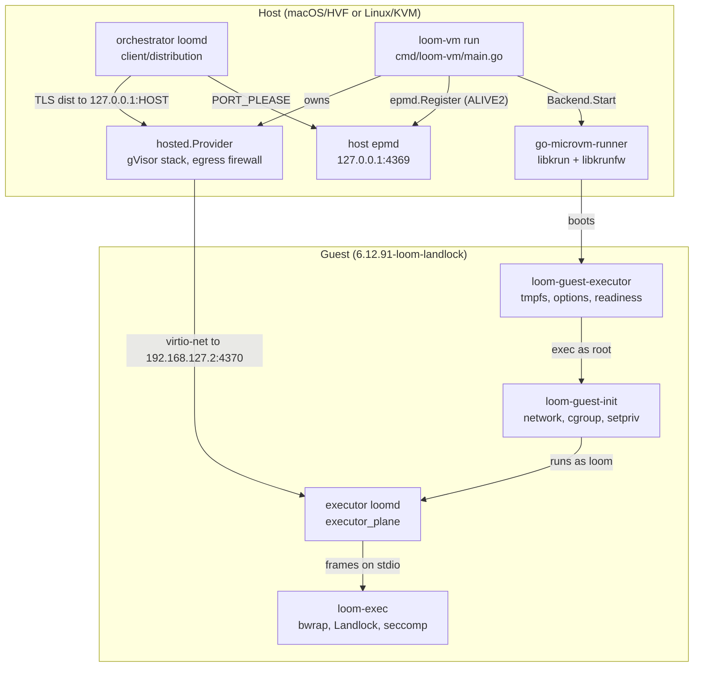
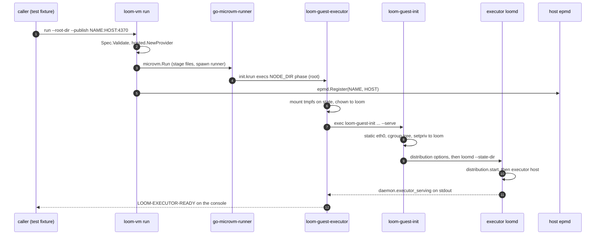
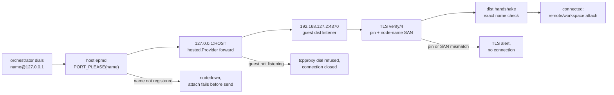
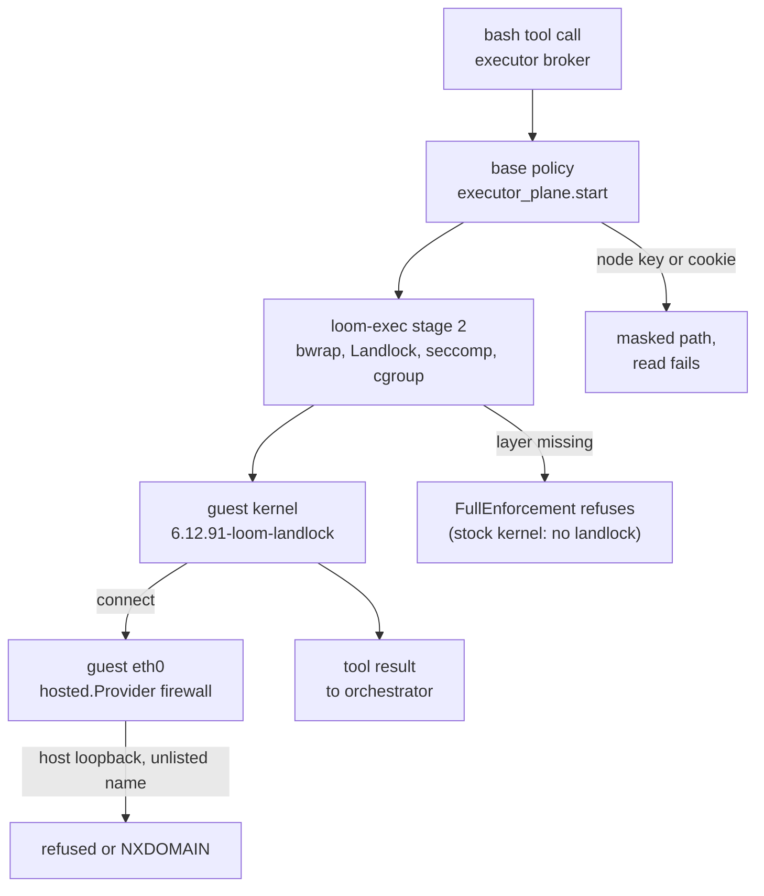
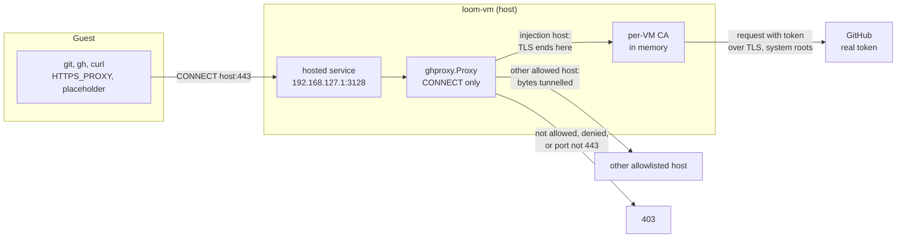
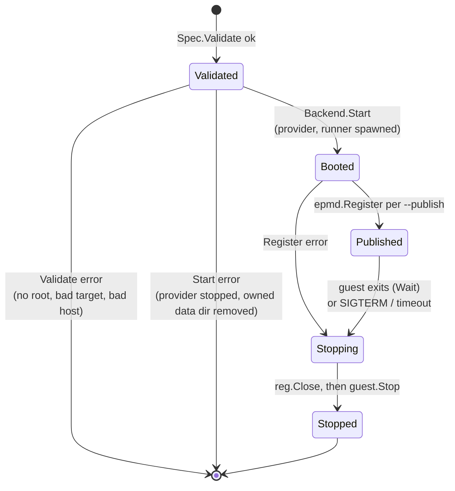

# The microVM executor tier

Loom's microVM tier runs a whole executor daemon inside a libkrun guest while
the orchestrator stays on the host. This document describes the components
that boot the guest, connect the orchestrator to the executor inside it, and
keep a jailed tool call away from the host and from the executor's own secrets.
It describes who owns which state and process, and how a `bash` call moves from
the orchestrator to a result produced on the guest's kernel. It reflects the
code at the tip of PR #1154 (branch `microvm/libkrun-launcher`).

The decisions behind the tier are in
[ADR-022](../adr/022-microvm-tier-runs-the-executor-in-a-libkrun-guest.md) and
its addendum. The executor itself is described in [executor.md](executor.md)
and [distributed.md](distributed.md), and the jail in [effects.md](effects.md).

## Components

The tier has three parts: a launcher on the host (`packages/vmm`), the guest's
own init and executor scripts (`packages/vmm/guest`), and the unchanged
executor daemon running inside the guest. The launcher owns the VM and the
host's view of it; the daemon owns everything a session does.



The edge to read first is the orchestrator's: it resolves the executor through
the host epmd and connects to a host loopback port, and the hosted provider in
the `loom-vm` process carries that connection into the guest. Nothing else on
the host can reach the guest, and the guest reaches the host only through the
same provider.

| Package or type | Owns | Does not own |
| --- | --- | --- |
| `machine.Spec`, `machine.Backend`, `machine.Machine` (`packages/vmm/machine/machine.go`) | The description of one guest: root, size, init argv, staged files, egress allowlist, forwards. `Spec.Validate` refuses a bad spec before any image pull. | Any hypervisor code. The package compiles and tests on a host with no `/dev/kvm`. |
| `libkrun.Backend` and its `guest` (`packages/vmm/machine/libkrun/libkrun.go`) | The go-microvm options for a spec, the `hosted.Provider` it creates for every guest, the data directory, and the decision whether `Stop` may delete the root. | The VMM process, which go-microvm's runner owns, and anything inside the guest. |
| `ghproxy.Proxy` (`packages/vmm/ghproxy/proxy.go`) | The per-VM CA, the placeholder, the real GitHub token, CONNECT admission, and the Authorization rewrite for the injection hosts. | Where it is served (`Spec.HostServices` and the backend) and what the guest does with it (the staged files and `loom-guest-init`). |
| `epmd.Registration` (`packages/vmm/epmd/epmd.go`) | One TCP connection to an epmd that holds one node name at one port. | The node it names. A registration says nothing about whether a listener is up behind the port. |
| `cmd/loom-vm` | Flag parsing, the lifetime of one guest, the epmd registrations of `--publish`, and copying the console to standard output. | Placement. Nothing in the daemon calls `loom-vm` yet; the end-to-end test runs it as a process. |
| `setup` (`packages/vmm/setup`) | The manifest under `$LOOM_VM_HOME`, the install of a release or a build tree into it, the unprivileged extraction of the guest image, and the doctor report. | Booting. Nothing in `setup` starts a guest; the manifest is read by whatever launches one. |
| `go-microvm-runner` | The libkrun VMM, in its own session (`setsid`), and the guest's devices. | The network stack: with a hosted provider the runner only forwards Ethernet frames over a socket. |
| `loom-guest-init` (`packages/vmm/guest/loom-guest-init`) | Guest networking, trusting the proxy CA and exporting its environment when staged, ownership of the `loom` user's directories, the delegated cgroup v2 subtree, and the privilege drop. | Which program runs. It runs its arguments. |
| `loom-guest-executor` (`packages/vmm/guest/loom-guest-executor`) | The tmpfs state root, the distribution options file rendered in the guest, the daemon's process, and the readiness markers on the console. | The daemon's configuration and credentials, which the caller stages into the root before boot. |
| executor `loomd` (`packages/client/src/client/executor_plane.gleam`) | Sessions' scopes, the broker and helper pool, and the policy every jailed child gets, including the node credential mask. | The VM. It runs as on any host and does not know it is in a guest. |

## Startup

A guest executor starts in two halves: `loom-vm` boots the VM and publishes
the node, and the guest's scripts bring up the daemon. The two halves do not
synchronise with each other; the caller waits for a console marker.



The host epmd entry exists before the daemon does, so the caller must not dial
until it reads the marker. `loom-guest-executor` prints
`LOOM-EXECUTOR-READY` only when both conditions hold: the node is listed by the
guest's own epmd, and the daemon has logged `daemon.executor_serving`
(`packages/client/src/client/daemon/main.gleam:944`). The node registers during
configuration load, well before the executor host starts, so the registration
alone is not readiness. On an Apple Silicon Mac the marker appears 1.5 to 1.8 s
after `loom-vm` starts.

The steps that need root run before the drop, in this order:

1. **State root.** `loom-guest-executor` mounts a 512 MiB tmpfs on
   `NODE_DIR/state` (`packages/vmm/guest/loom-guest-executor:89`). The guest
   root is a virtio-fs share, and the executor's SQLite ledger and code mode's
   AF_UNIX socket need a local filesystem.
2. **Ownership.** It gives `NODE_DIR` and every `/srv/workspaces/*` to `loom`
   (`packages/vmm/guest/loom-guest-executor:92`). Staged files arrive owned by
   root, and the daemon's credential checks require a 0600 file it can read.
3. **Network.** `loom-guest-init` sets `192.168.127.2/24` with a default route
   via `192.168.127.1` (`packages/vmm/guest/loom-guest-init:26`). go-microvm
   v0.0.43 serves no DHCP lease, so the address is static.
4. **Cgroups.** It builds `/sys/fs/cgroup/loom/{init,work,exec}`, enables
   `+pids +memory` from the top down
   (`packages/vmm/guest/loom-guest-init:91`), and hands the subtree to `loom`.
   The workload runs in `loom/work` and `LOOM_CGROUP_BASE` names `loom/exec`,
   which holds no process.
5. **Drop.** `setpriv` runs the second phase as uid 10000
   (`packages/vmm/guest/loom-guest-init:122`).
6. **Options.** The second phase renders the TLS options file with the guest's
   own `loomd distribution options`
   (`packages/vmm/guest/loom-guest-executor:47`). `distribution.start` compares
   that file with what the configuration renders, paths included, so a file
   rendered on the host would refuse the boot.

## The link: the orchestrator reaches the guest executor

The orchestrator dials the executor by its unchanged node name,
`<name>@127.0.0.1`, exactly as it dials an executor on the same host. The
launcher makes that name resolve to a forwarded port, and every check of the
distributed runtime runs unchanged.



The flowchart's point is that the VM adds only the middle two hops; the first
and the last three are the ordinary distributed path.

1. **Resolve.** The dial path asks the epmd at the name's host part
   (`127.0.0.1`) for the name's port. `loom-vm run --publish` holds that entry:
   `register` (`packages/vmm/cmd/loom-vm/main.go:280`) calls `epmd.Register`
   (`packages/vmm/epmd/epmd.go:60`), which sends an ALIVE2 request with node
   type 77 and protocol version 6 (`packages/vmm/epmd/epmd.go:35`). When no
   epmd answers, `register` runs `epmd -daemon` and retries for 3 s. epmd keeps
   the entry while the registering connection stays open, so the entry lives
   exactly as long as `loom-vm`.
2. **Forward.** `Spec.Forwards` becomes `microvm.WithPorts`
   (`packages/vmm/machine/libkrun/libkrun.go:255`). The hosted provider listens
   on host `127.0.0.1:HOST` only and opens a connection to the guest port,
   admitting it through the guest firewall's ingress rules.
3. **Listen.** The guest daemon's listener binds every interface, because the
   distribution FFI sets only the listen port range
   (`packages/client/src/client_distribution_ffi.erl:386`). A listener bound to
   loopback would refuse the forward.
4. **Verify.** The certificate pin, the node-name SAN and the distribution
   handshake's exact-name check are the same code a host pair runs. The guest
   node calls itself `<name>@127.0.0.1` as well, because the handshake refuses
   a peer whose name differs from the atom dialled.

The guest's own epmd is never reached from the host. The fixed guest listen
port is 4370 (`vm_spec.guest_port`, `packages/client/src/client/vm_spec.gleam:61`).

## Isolation around a tool call

A jailed `bash` call in the guest passes through four layers, each owned by a
different component. The flowchart follows one call and the paths it is
refused on.



The masks in the policy are the boundary for the node's own secrets; the guest
filesystem layout is not.

1. **Policy.** `executor_plane.start` builds the base policy from the
   workspace's read scope and adds the state-root, blob and evolution masks,
   and `workspace_policy.protecting_node_credentials`
   (`packages/client/src/client/executor_plane.gleam:606`). The node's TLS key
   and cookie come from the executor's own `[distribution]` table, read by
   `node_credentials` (`packages/client/src/client/executor_plane.gleam:310`).
   Under the default `host` read scope the jail sees the whole guest, `/srv`
   included, so this mask is what keeps model code from printing either file.
   An absent path is skipped, as for every conditional mask
   (`packages/client/src/client/workspace_policy.gleam:1612`), because the jail
   refuses to mask a missing file.
2. **Worktree Git.** The sandboxed Git that runs a repository's hooks during
   `git worktree add` reads the whole host. `worktree_git` applies the same
   mask to its policy (`packages/client/src/client/worktree_git.gleam:429`),
   with the list carried in `worktrees.Config.credentials`.
3. **Jail.** `loom-exec` is unchanged in the guest. The broker demands
   `["bwrap", "mounts", "landlock", "no-new-privs"]` on Linux
   (`packages/broker/src/broker/exec.gleam:1802`), and the stock libkrunfw
   kernel has no Landlock, so the tier needs the kernel `make vmm-firmware`
   builds.
4. **Network.** The guest's only interface is a virtio-net device whose other
   end is the hosted provider in `loom-vm`. `libkrun.Backend.Start` always
   creates that provider (`packages/vmm/machine/libkrun/libkrun.go:156`) and
   always passes a non-nil egress policy
   (`packages/vmm/machine/libkrun/libkrun.go:239`), which makes the firewall
   deny by default. A virtio-net device also turns off libkrun's TSI mode,
   under which guest sockets run on the host and reach host loopback.

## GitHub access through the credential proxy

An agent in a guest delivers its edits by pushing a branch or opening a pull
request with `git` and `gh`, which needs the developer's GitHub token. The
guest runs model-influenced code, and anything it can read it can send to any
host its egress allows, so the token must never be written into the guest: not
its disk, not its environment, not a file a jailed call can read. The token
therefore stays in the `loom-vm` process on the host. The guest holds a
placeholder, and a proxy in the launcher replaces the placeholder with the token
in flight. The code is in `packages/vmm/ghproxy`; `loom-vm run
--github-token-from gh|env` turns it on.



**How the guest reaches it.** `ghproxy.Proxy` is an `http.Handler`.
`machine.Spec.HostServices` carries it to the libkrun backend, which registers it
with `hosted.Provider.AddService` before the provider starts
(`packages/vmm/machine/libkrun/libkrun.go:156`). go-microvm serves a hosted
service with an `http.Server` listening on the gateway, 192.168.127.1, inside
the launcher's own gVisor stack, and it adds a firewall rule that admits the
guest's egress to that port. No host socket is bound, so nothing but this guest
can connect. A CONNECT arrives as an ordinary request; the handler hijacks the
connection, which clears the server's read and write deadlines, and runs the
tunnel itself. No forward from a host loopback port was needed.

**What the proxy accepts.** It accepts CONNECT only. The target must be a
hostname (not an address) on port 443, admitted by the allowlist and not matched
by the deny list; both are host globs, exact names and a leading `*.`, the
vocabulary of `machine.Egress`. `loom-vm` passes the guest's `--allow` list as
the allowlist, so the guest's egress list stays the one statement of what it may
reach. The injection list is separate and explicit: `github.com`,
`api.github.com` and `uploads.github.com` plus each `--inject-host`. A host on
the injection list that the allowlist omits is refused, because injection
decides who gets a credential and never what is reachable. Any other admitted
host is tunnelled without interception, and the guest sees its own certificate.

**What is injected.** For an injection host the proxy ends TLS with a leaf
certificate minted for the CONNECT target, reads HTTP/1.1 requests (keep-alive
included), and rewrites the `Authorization` header when its whole credential is
the placeholder: `Basic` with the placeholder as the password (git, username
`x-access-token`) or as the username, `token X`, and `Bearer X` (gh). The
request then goes to the real host over TLS with the system roots. The URL,
the body and every other header are never touched, a header that merely
contains the placeholder is not rewritten, and a request whose `Host` differs
from the CONNECT target, or a handshake whose SNI does, is refused. The
placeholder is `loomvm_` and 32 random hex characters, new for each `loom-vm`
run, so a copy taken from one guest is worthless against another proxy and
against GitHub.

**The CA.** `newCA` generates an ECDSA P-256 authority in memory when
`loom-vm run` starts. The private key is a field of an unexported type with no
accessor and is never written. The certificate expires one hour after the run's
`--timeout`, and carries a critical name constraint that permits only the
injection hosts' domains, so the copy in the guest's trust store cannot vouch for
any other site, whatever the key could sign. Leaves are minted per host on first
use and cached.

**What the guest is given.** `ghproxy.GuestFiles` renders three files, which
`loom-vm` stages through `Spec.Files`. None holds the token.

| Guest path | Holds | Used by |
| --- | --- | --- |
| `/usr/local/share/ca-certificates/loom-vm-proxy.crt` | the CA certificate | `loom-guest-init` runs `update-ca-certificates` when this file exists, before it drops privileges |
| `/etc/loom-vm/github.env` | `HTTPS_PROXY`, `https_proxy`, `NO_PROXY`, `no_proxy`, and `GH_TOKEN` and `GITHUB_TOKEN` set to the placeholder | `loom-guest-init` exports it (`set -a`) into the workload, so `loomd` inherits it |
| `/etc/gitconfig` | `http.proxy`, and for each injection host a credential helper answering `username=x-access-token` and `password=${GH_TOKEN:-<placeholder>}` | git, as the system configuration, in any shell |

The credential helper falls back to the placeholder so a jailed call whose
environment omits `GH_TOKEN` still authenticates through the proxy.

**What the executor's loom.toml needs.** The guest's init exports the
environment into `loomd`, but a jailed tool shell receives only what
`[tools]` admits and only if its network is on
([configuration.md](../configuration.md#tools)). The guest's `loom.toml` needs
these lines:

```toml
[tools]
network = "full"
env = ["HTTPS_PROXY", "NO_PROXY", "GH_TOKEN", "GITHUB_TOKEN"]
```

`network = "full"` opens the jail's network to the guest's `eth0`, whose only
host-side peer is the launcher's stack with its egress allowlist. The uppercase
names are enough: `env` accepts only `[A-Z_][A-Z0-9_]*`, git reads
`/etc/gitconfig` regardless, and curl and Go read `HTTPS_PROXY`. `loom vm up`
renders these lines into the guest's configuration when `--github` is `gh` or
`env` (`vm_spec.guest_config`), and renders none for `--github off`.

**What is logged.** One line per CONNECT (host, decision and mode, bytes each
way, duration) and one per injected request (host, method, path without its
query, status, bytes, `injected` true or false), through `slog`. The handlers are
given no header values, and `scrub` removes the token and placeholder from error
text as a backstop. A test sends the token, the placeholder and an Authorization
header through the proxy and checks the log for each.

**What it does not do.** It speaks HTTP/1.1 to the guest and to GitHub, accepts
port 443 only, and cannot carry `git` over SSH. While the VM runs, the guest can
spend the token's authority against any injection host through the proxy, so
the token should be a fine-grained one scoped to the repositories the agent
needs. The default dialer refuses loopback, link-local, unspecified and
multicast addresses after name resolution, so an allowlisted name that resolves
to the host is still not a path to it.

### Relation to the egress proxy (#214)

[Issue #214](https://github.com/roasbeef/loom/issues/214) specifies the proxy
that `Proxy(allowlist)` has lacked: CONNECT-only, a host-glob allowlist and deny
list, every other destination refused, and per-execution request logs without
secrets. `narrow_unenforceable` in `packages/broker/src/broker/policy.gleam`
still downgrades `NetworkProxy` to `NetworkOff` because nothing enforces it.
`ghproxy` matches that specification on four points: it is CONNECT-only, it
takes an allowlist and a deny list as globs, it logs one structured line per
CONNECT and per injected request with no secret, and its injection list is
separate from its allowlist. It departs from #214 in one line, "the proxy never
sees or injects credentials", which the owner has set aside for GitHub in the
microVM tier only.

It is not yet the enforcement of `Proxy(allowlist)`. For `narrow_unenforceable`
to stop downgrading for an executor in a guest, these remain, none in `ghproxy`:

1. **The proxy must be the only path.** The guest's `--allow` list still lets a
   process connect straight to an allowlisted host, bypassing the proxy and its
   deny list and logs. A proxy-only mode would give the backend an empty egress
   list, so the firewall admits only the gateway's service ports, and give the
   allowlist to the proxy alone. DNS then stops mattering to the guest.
2. **The allowlist is per guest, not per call.** The proxy sees the guest's
   address, not which execution is connecting. A narrower allowlist for one
   `bash` call needs a listener or a credential per execution, or the
   downgrade stays for calls that narrow below the guest's list.
3. **Configuration.** `loom-vm` has no deny flag, and the executor's `[tools]`
   table has no `allow` and `deny` keys; both are in the client package.
4. **A report the broker can read.** The executor's enforcement report needs a
   `network-proxy` entry that says enforced when the launcher registered the
   proxy and proxy-only mode is on, and `narrow_unenforceable` has to consult
   it. That is a change in `packages/broker`.
5. **A probe.** The self-test needs a case that shows a denied host refused and an
   allowed one reached from inside a guest.

## The machine lifecycle

A `loom-vm run` process holds one guest from validation to release. Its state
is the process's own; nothing persists it.



`guest.Stop` (`packages/vmm/machine/libkrun/libkrun.go:427`) is the one exit
and it is idempotent. It stops the hosted provider first, so no packet leaves
the guest while the VMM shuts down, then branches on who owns the root. An
`extractedRoot`, which go-microvm unpacked from an image for this guest, goes
through `VM.Remove`. A `callerRoot`, given as `Spec.Root.Dir`, goes through
`VM.Stop` only, because `VM.Remove` deletes any rootfs outside go-microvm's
image cache and would delete the caller's directory
(`packages/vmm/machine/libkrun/libkrun.go:359`). Teardown runs under its own
30 s context, so a cancelled caller still releases the VMM.

The launcher defers its teardown (`packages/vmm/cmd/loom-vm/main.go:220`), and
deferred calls run in reverse order, so the epmd names are withdrawn before the
guest stops and no
name points at a dead port for longer than the stop takes. A cancellation from
SIGTERM is a clean exit; a timeout (default 10 minutes) exits 1.

## The guest image and firmware

The guest needs three artifacts besides `loom-vm` itself. A developer builds
them with make targets; a release publishes them, and `loom-vm setup` installs
either kind (see "Installing the artifacts" below).

| Make target | Produces | Built where | Why it is separate |
| --- | --- | --- | --- |
| `vmm-runner` | `packages/vmm/build/go-microvm-runner`, codesigned with `packages/vmm/runner.entitlements` on macOS | the host, with cgo against libkrun | The runner and the go-microvm library are version-locked; Hypervisor.framework refuses an unsigned runner. |
| `vmm-firmware` | `packages/vmm/build/firmware/libkrunfw.5.dylib` | the kernel in an arm64 podman machine, the dylib on the host | Adds `CONFIG_SECURITY_LANDLOCK` and `CONFIG_SECURITYFS` to libkrunfw v5.5.0 (Linux 6.12.91). macOS only. |
| `vmm-guest-root` | `packages/vmm/build/guest-root` | natively in the arm64 podman machine `loom-build` | `make release` cannot cross-compile. The image builds from `erlang:29.0.5` and runs on `debian:trixie-slim`. |

`--firmware-dir` puts the custom libkrunfw ahead of the stock one on the
runner's library path (`libraryPath`,
`packages/vmm/machine/libkrun/libkrun.go:285`). The firmware script pins the
libkrunfw tag to a commit and the kernel tarball to a SHA-256
(`packages/vmm/guest/build-libkrunfw.sh:37`). It has a mode for each half of
the build, so that the release workflow can run the kernel on a Linux runner
(`--kernel`) and the link on a macOS one (`--link`); with neither flag it runs
both through podman, as `make vmm-firmware` does.

### Installing the artifacts

`loom-vm setup` writes `$LOOM_VM_HOME/manifest.json` (default `~/.loom/vm`),
the one file a consumer reads to learn where every artifact is. It has seven
keys: `version` (1), `revision` (the loom commit the guest root was built from,
or `dev`), and the absolute paths `loom_vm`, `runner`, `lib_dir`,
`firmware_dir` (empty for the stock libkrunfw) and `guest_root`.

| Command | Does | For |
| --- | --- | --- |
| `loom-vm setup --release TAG` | Downloads the runner and firmware from the release and checks their SHA-256 against `vmm-SHA256SUMS`; on macOS re-signs the runner ad hoc and removes the quarantine attribute; pulls `ghcr.io/<owner>/loom-guest:TAG`, checks its labels, and unpacks it into `cache/TAG/guest-root`. | A user who builds nothing. macOS on Apple Silicon only. |
| `loom-vm setup --from-build DIR` | Records the paths of a build tree and copies nothing. | A developer who ran the make targets (`make vmm-install-dev`), and any Linux host. |
| `loom-vm doctor` | Checks each manifest entry, the runner's entitlement, the digests recorded at install, the guest root's `/tmp` mode and the hypervisor probe, and lists `go-microvm-runner` processes that have no `loom-vm` parent. It kills nothing. | Diagnosis. |

The install is assembled in a staging directory and renamed into
`cache/TAG` only when complete, and the manifest is replaced last and
atomically, so an interrupted setup leaves the earlier manifest pointing at the
earlier, intact files. The guest root is extracted without privileges: the
files belong to the caller, the permission, setuid and sticky bits are applied
as the image records them whatever the umask (so `/tmp` stays 1777), symlinks
are never followed, and an entry that would write outside the root is refused.
`docs/distribution.md`, "The microVM artifacts", covers what a release
publishes and how it is verified.

The guest root is booted in place and written to, so every boot uses a fresh
clone: `cp -cRp` on APFS, where `-p` keeps directory modes. Inside a booted
guest the paths are these:

| Path | Holds | Owner and lifetime |
| --- | --- | --- |
| `/opt/loom` | the server release, bundled ERTS, `loom-exec` | image, read by everyone |
| `/srv/loom-node/loom.toml` | the executor's configuration, with guest paths | staged per boot, readable by model code (no secrets) |
| `/srv/loom-node/creds/key.pem`, `home/.erlang.cookie` | the node's TLS key and cookie | staged per boot, 0600 `loom`, masked from jails |
| `/srv/loom-node/state` | tmpfs: the state root, `dist.options`, `loomd.log` | per boot, lost on stop |
| `/srv/workspaces/<name>` | the checkout the executor serves | staged per boot, owned by `loom` |
| `/sys/fs/cgroup/loom/{init,work,exec}` | the delegated cgroup subtree | built by `loom-guest-init` each boot |

## Concurrency

Every piece of state in the tier has one owning process, and the owners
communicate only through files, sockets and signals.

| Process or goroutine | Owns |
| --- | --- |
| `loom-vm run` main goroutine | the `Spec`, the epmd `Registration`s, the deferred teardown order |
| `loom-vm` follow goroutine and its `Wait` | copying `console.log` to standard output; polling the runner's pid every 100 ms |
| `hosted.Provider` goroutines in `loom-vm` | the gVisor network stack, the egress firewall and DNS, the host loopback listeners of each forward |
| `ghproxy` handler goroutines in `loom-vm` | one goroutine per CONNECT, which owns the hijacked guest connection and its upstream; `Proxy.Close` closes them all when the run ends |
| `go-microvm-runner` (own session) | the VMM, guest memory and devices |
| guest `loom-guest-init` | stays the parent of the workload and exits with its status |
| executor `loomd` | everything a session does: scopes, broker, helper pool, ledger on the tmpfs |
| `loom-exec` helpers | one jailed execution each, as on any host |

Four rules follow from that table:

- **The runner is not `loom-vm`'s child.** go-microvm starts it with `setsid`,
  so `guest.Wait` can only poll its pid with a zero signal. A `loom-vm` killed
  with SIGKILL leaves the runner and its data directory behind (`loom-vm
  doctor` lists such runners and never kills them); SIGTERM or an interrupt
  runs the full teardown.
- **A registration is a connection.** The epmd entry vanishes when
  `loom-vm` exits for any reason, including a crash. It never outlives the
  guest, but it can precede the daemon, which is why readiness is the console
  marker.
- **Readiness is read from the console, never from the port.** A forward
  accepts a connection on the host side even when nothing listens in the
  guest; the hosted provider then closes it.
- **The test stops the guest from outside its deadline.**
  `daemon_shipped_microvm_test` boots its guest with `loom vm up` inside a
  deadline-bounded body, and runs `loom vm down` after that body, whether it
  passed or not. `down` sends SIGTERM to the recorded `loom-vm` and waits up to
  60 s for it to exit.

## A standing guest: `loom vm`

`loom vm up | down | status` (`client/vm_cli`, with its decisions in
`client/vm_spec`) is the product path that `daemon_shipped_microvm_test` drives:
the test installs a manifest with `loom-vm setup --from-build`, runs `loom vm
up`, `down` and `up` again through the shipped `loomd`, and composes nothing by
hand. It runs one standing guest executor, called `vm` unless `--name` says another,
and enrolls it as an ordinary `[executors.<name>]` row, so `loom --executor
<name> --workspace <directory name>` places a session's tools in the guest
through the same remote placement every executor has. The guest is a separate
`loom-vm run` process. The daemon does not start it and does not own it.

`up` reads `~/.loom/vm/manifest.json` (`$LOOM_VM_HOME` overrides the
directory), which names the built `loom-vm`, the runner, the libkrun and
firmware directories and the exported guest root. It refuses a manifest whose
revision is neither `dev` nor the running build's commit, because a guest
daemon from another release crashes the host on its first unmatched message.
It then:

1. provisions a two-node static deployment in process into
   `~/.loom/vm/<name>/deploy/`, with the nodes `loom_vm_<name>_orch@127.0.0.1`
   and `loom_vm_<name>_exec@127.0.0.1` and the guest's fixed port 4370. A
   second `up` reads the bundles back instead of minting new certificates;
2. installs the orchestrator bundle into the user's `loom.toml` with
   `distribution_install.install`, which merges `[distribution]` and
   `[executors.<name>]` and refuses a file that holds a different deployment.
   A newly minted deployment's `[distribution]` table also gets
   `listen_address = "127.0.0.1"` (protocol-change/106), since nothing dials
   this orchestrator. A resumed `up` installs nothing and only checks the
   `[executors.<name>]` row is still there. Because the line is not in the
   bundle, a later `loom distribution install` of another bundle into the same
   file sees a `[distribution]` table that differs and needs `--force`, which
   replaces the table and drops the line; add it back if that daemon is
   still dialled by nobody;
3. clones the guest root to `~/.loom/vm/<name>/root` (`cp -cRp` on macOS,
   `cp -a --reflink=auto` on Linux) unless the guest ran before and `--fresh`
   was not given, in which case the root and `state.img` are kept. It resolves
   the manifest's `guest_root` first, because `cp -R` copies a symbolic link
   named on its command line as a link. It then stages the executor node into
   `<root>/srv/loom-node/`, rewriting its configuration and credentials, and
   copies the workspace, with its `.git` directory, to
   `<root>/srv/workspaces/<directory name>` unless that copy exists. The copy's
   `.git/config` loses its `[credential]` sections, its `insteadOf`,
   `pushInsteadOf` and `extraheader` keys, any `[url "..."]` section whose
   header carries userinfo, and the userinfo of every `url` and `pushurl`
   value, because the guest's default read scope can read it;
4. starts `loom-vm run --publish <short name>:<free host port>:4370 --state-disk
   state.img` detached through `host/bootstrap.spawn_server`, which records the
   process's birth marker in `loom-vm.pid` before the wrapper becomes
   `loom-vm`, and waits on `weft/poll` for `LOOM-EXECUTOR-READY` in
   `loom-vm.log`. A guest that does not report is stopped, and the tail of its
   log is the error. With `--github gh|env` (the default is `gh`) `loom-vm`
   also starts the credential proxy and the guest's `[tools]` table turns the
   jail's network on; `--github off` gives the guest no egress.

`down` sends SIGTERM to the recorded process while the pid still has the
recorded birth marker, and waits for it to exit. It leaves the root and the
deployment, so the guest's checkout can be read afterwards. `status` reports
the process, the host port the host epmd lists for the executor's node name,
the manifest's revision, the root and the guest's workspaces. A daemon that
was running before `up` must be restarted to read the new `[distribution]`
table.

Two properties of the guest root came out of the first live run. A clone keeps
Git's read-only object files, and the guest's init cannot give a file to the
`loom` user when the host user cannot write it, so `up` makes the workspace
copy owner-writable. And a guest's state disk is shorter after its first boot:
the guest's `mke2fs` zeroes the last 64 KiB of the device, libkrun shortens the
backing file by that much, and the next boot's kernel refuses the filesystem
with "block count exceeds size of device". `loom-vm run` extends an existing
`--state-disk` file to the requested size, so `down` and `up` resume. A resumed
guest keeps the checkout its agent edited and the sessions its executor holds;
`--fresh` replaces the root and the state disk.

## Known gaps

- Nothing in the daemon places an executor into a guest. `loom vm up` does it
  for one standing guest from the command line; a broker or pool driver and
  the bundle transport of #1137 do not exist yet, and `loom vm` cannot copy a
  guest's work back to the host.
- Only macOS with Hypervisor.framework has booted a guest. The Linux/KVM path
  compiles and is untested, and `build-libkrunfw.sh` links only the macOS
  dylib.
- `loom-vm setup --release` has never run against a published release: none
  exists yet. Its download, checksum, signing and extraction steps are covered
  by tests against a local HTTP server and registry, and the extraction was
  compared with a real guest root. `.github/workflows/vmm-release.yml` has not
  run on a hosted runner either. A Linux host has no download, because Ubuntu
  ships no libkrun for the runner to link; it uses `--from-build`.
- Sessions local to an orchestrator do not yet mask the node's key and cookie.
- The behaviour on the stock kernel is inferred: a turn does not complete,
  which matches the broker's `landlock` demand, but the exact refusal was not
  captured.
- The host epmd entry assumes the node name's host part is `127.0.0.1`. A
  guest executor reached from another machine would need a different
  transport.
- The credential proxy is driven end to end only with a made-up token.
  `daemon_shipped_microvm_test` boots a guest with `loom vm up --github env`
  and a fake `LOOM_VM_GITHUB_TOKEN`, and a jailed `bash` call shows the
  placeholder in `GH_TOKEN`, the fake token nowhere under the guest's files, and
  (with `LOOM_VM_GITHUB_LIVE=1`) `api.github.com/zen` answering 200 and
  `/user` answering 401 through the proxy. A real push, which needs a real
  token with write access, has not been run. The test needs a guest root with
  `curl`; the one it was run with also has `gh`.
- Firecracker, the second backend ADR-022 names, has no implementation.
- This document was written from the code directly rather than from
  per-subsystem reader summaries; go-microvm's internals (`microvm.Run`, the
  hosted provider) are described from its v0.0.43 source, not re-derived here.
