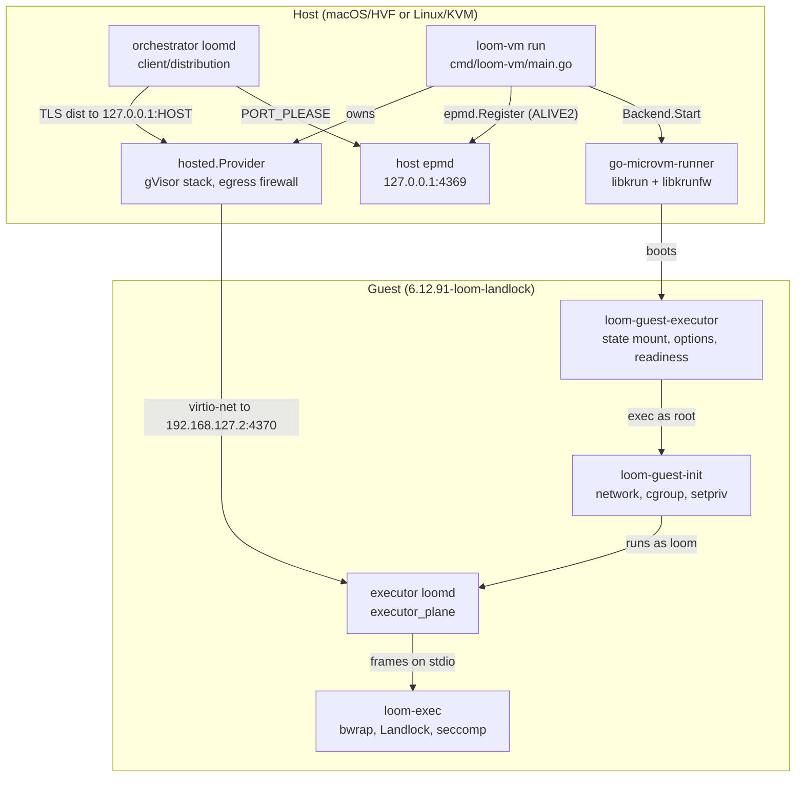
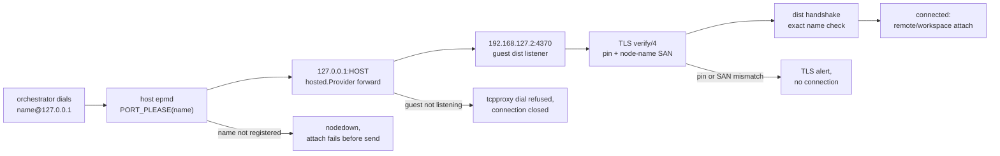
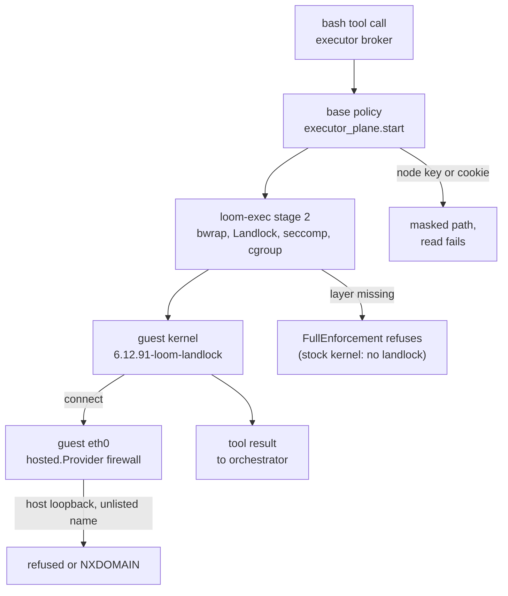
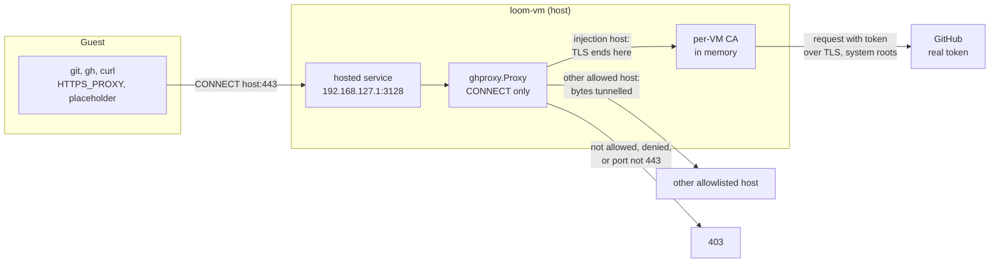
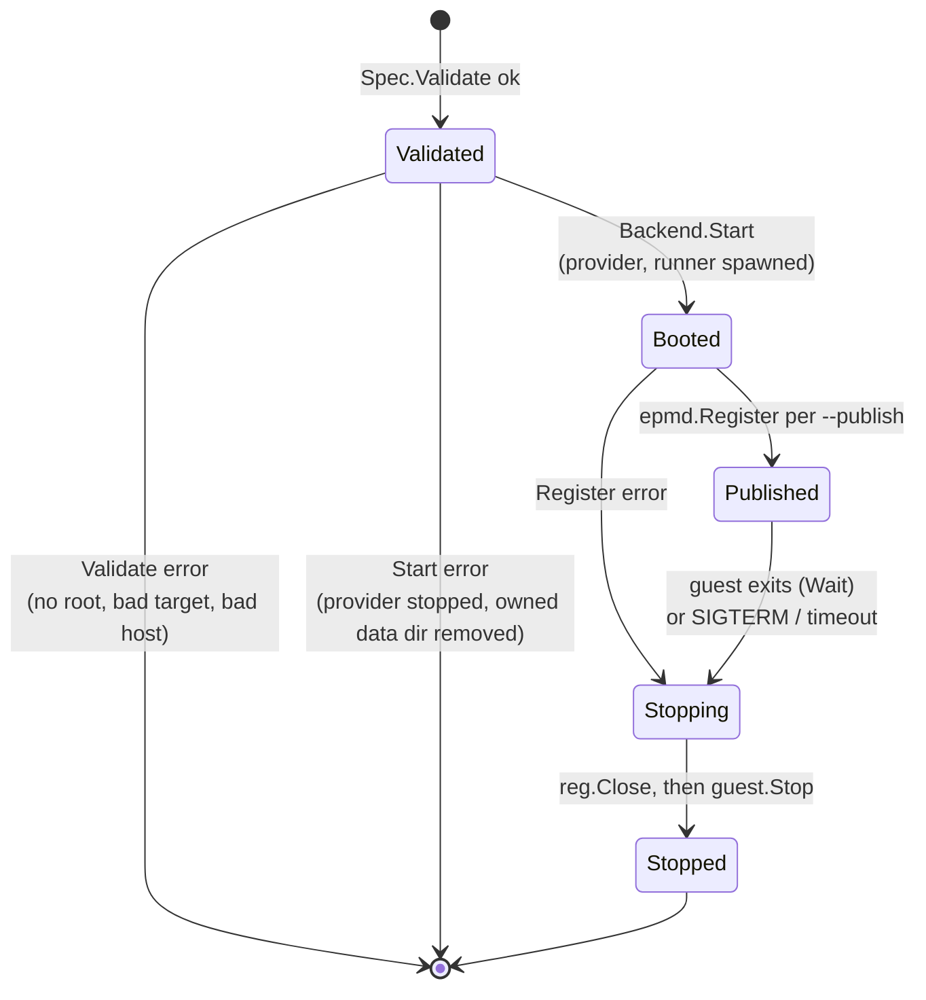

# The microVM executor tier

Loom's microVM tier runs a whole executor daemon inside a libkrun guest while
the orchestrator stays on the host. This document describes the components
that boot the guest, connect the orchestrator to the executor inside it, and
keep a jailed tool call away from the host and from the executor's own secrets.
It describes who owns which state and process, and how a `bash` call moves from
the orchestrator to a result produced on the guest's kernel. It reflects the
code at the tip of PR #1154 (branch `microvm/libkrun-launcher`).

The decisions behind the tier are in
[ADR-022](../adr/022-microvm-tier-runs-the-executor-in-a-libkrun-guest.md) and
its addendum. The executor itself is described in [executor.md](executor.md)
and [distributed.md](distributed.md), and the jail in [effects.md](effects.md).

## Components

The tier has three parts: a launcher on the host (`packages/vmm`), the guest's
own init and executor scripts (`packages/vmm/guest`), and the unchanged
executor daemon running inside the guest. The launcher owns the VM and the
host's view of it; the daemon owns everything a session does.



The edge to read first is the orchestrator's: it resolves the executor through
the host epmd and connects to a host loopback port, and the hosted provider in
the `loom-vm` process carries that connection into the guest. Nothing else on
the host can reach the guest, and the guest reaches the host only through the
same provider.

| Package or type | Owns | Does not own |
| --- | --- | --- |
| `machine.Spec`, `machine.Backend`, `machine.Machine` (`packages/vmm/machine/machine.go`) | The description of one guest: root, size, init argv, staged files, egress allowlist, forwards. `Spec.Validate` refuses a bad spec before any image pull. | Any hypervisor code. The package compiles and tests on a host with no `/dev/kvm`. |
| `libkrun.Backend` and its `guest` (`packages/vmm/machine/libkrun/libkrun.go`) | The go-microvm options for a spec, the `hosted.Provider` it creates for every guest, the data directory, and the decision whether `Stop` may delete the root. | The VMM process, which go-microvm's runner owns, and anything inside the guest. |
| `ghproxy.Proxy` (`packages/vmm/ghproxy/proxy.go`) | The per-VM CA, the placeholder, the real GitHub token, CONNECT admission, and the Authorization rewrite for the injection hosts. | Where it is served (`Spec.HostServices` and the backend) and what the guest does with it (the staged files and `loom-guest-init`). |
| `epmd.Registration` (`packages/vmm/epmd/epmd.go`) | One TCP connection to an epmd that holds one node name at one port. | The node it names. A registration says nothing about whether a listener is up behind the port. |
| `cmd/loom-vm` | Flag parsing, the lifetime of one guest, the epmd registrations of `--publish`, and copying the console to standard output. | Placement. Nothing in the daemon calls `loom-vm` yet; the end-to-end test runs it as a process. |
| `setup` (`packages/vmm/setup`) | The manifest under `$LOOM_VM_HOME`, the install of a release or a build tree into it, the unprivileged extraction of the guest image, and the doctor report. | Booting. Nothing in `setup` starts a guest; the manifest is read by whatever launches one. |
| `go-microvm-runner` | The libkrun VMM, in its own session (`setsid`), and the guest's devices. | The network stack: with a hosted provider the runner only forwards Ethernet frames over a socket. |
| `loom-guest-init` (`packages/vmm/guest/loom-guest-init`) | Guest networking, trusting the proxy CA and exporting its environment when staged, ownership of the `loom` user's directories, the delegated cgroup v2 subtree, and the privilege drop. | Which program runs. It runs its arguments. |
| `loom-guest-executor` (`packages/vmm/guest/loom-guest-executor`) | The state root mount (the persistent state disk, or a tmpfs when no device is given), the distribution options file rendered in the guest, the daemon's process, and the readiness markers on the console. | The daemon's configuration and credentials, which the caller stages into the root before boot. |
| executor `loomd` (`packages/client/src/client/executor_plane.gleam`) | Sessions' scopes, the broker and helper pool, and the policy every jailed child gets, including the node credential mask. | The VM. It runs as on any host and does not know it is in a guest. |

## Startup

A guest executor starts in two halves: `loom-vm` boots the VM and publishes
the node, and the guest's scripts bring up the daemon. The two halves do not
synchronise with each other; the caller waits for a console marker.


The host epmd entry exists before the daemon does, so the caller must not dial
until it reads the marker. `loom-guest-executor` prints
`LOOM-EXECUTOR-READY` only when both conditions hold: the node is listed by the
guest's own epmd, and the daemon has logged `daemon.executor_serving`
(`packages/client/src/client/daemon/main.gleam:944`). The node registers during
configuration load, well before the executor host starts, so the registration
alone is not readiness. On an Apple Silicon Mac the marker appears 1.5 to 1.8 s
after `loom-vm` starts.

The steps that need root run before the drop, in this order:

1. **State root.** `loom-guest-executor` mounts the state device on
   `NODE_DIR/state` as ext4, formatting it on the first boot
   (`packages/vmm/guest/loom-guest-executor:104`). `vm_spec.launch_arguments`
   passes `--state-device /dev/vda`, the `state.img` that `loom vm up` keeps, so
   the state survives `down` and `up`. Only with no device does the script mount
   a 512 MiB tmpfs (`:107`) that starts empty on every boot. The guest root is a
   virtio-fs share, and the executor's SQLite ledger and code mode's AF_UNIX
   socket need a local filesystem.
2. **Ownership.** It gives `NODE_DIR` and every `/srv/workspaces/*` to `loom`
   (`packages/vmm/guest/loom-guest-executor:92`). Staged files arrive owned by
   root, and the daemon's credential checks require a 0600 file it can read.
3. **Network.** `loom-guest-init` sets `192.168.127.2/24` with a default route
   via `192.168.127.1` (`packages/vmm/guest/loom-guest-init:26`). go-microvm
   v0.0.43 serves no DHCP lease, so the address is static.
4. **Cgroups.** It builds `/sys/fs/cgroup/loom/{init,work,exec}`, enables
   `+pids +memory` from the top down
   (`packages/vmm/guest/loom-guest-init:91`), and hands the subtree to `loom`.
   The workload runs in `loom/work` and `LOOM_CGROUP_BASE` names `loom/exec`,
   which holds no process.
5. **Drop.** `setpriv` runs the second phase as uid 10000
   (`packages/vmm/guest/loom-guest-init:122`).
6. **Options.** The second phase renders the TLS options file with the guest's
   own `loomd distribution options`
   (`packages/vmm/guest/loom-guest-executor:47`). `distribution.start` compares
   that file with what the configuration renders, paths included, so a file
   rendered on the host would refuse the boot.

## The link: the orchestrator reaches the guest executor

The orchestrator dials the executor by its unchanged node name,
`<name>@127.0.0.1`, exactly as it dials an executor on the same host. The
launcher makes that name resolve to a forwarded port, and every check of the
distributed runtime runs unchanged. This is the link of `--link distribution`,
the default. `loom vm up --link untrusted` reaches the guest over a pinned TLS
link that is not distribution instead; see "Reaching a guest over the untrusted
link (opt-in)".



The flowchart's point is that the VM adds only the middle two hops; the first
and the last three are the ordinary distributed path.

1. **Resolve.** The dial path asks the epmd at the name's host part
   (`127.0.0.1`) for the name's port. `loom-vm run --publish` holds that entry:
   `register` (`packages/vmm/cmd/loom-vm/main.go:280`) calls `epmd.Register`
   (`packages/vmm/epmd/epmd.go:60`), which sends an ALIVE2 request with node
   type 77 and protocol version 6 (`packages/vmm/epmd/epmd.go:35`). When no
   epmd answers, `register` runs `epmd -daemon` and retries for 3 s. epmd keeps
   the entry while the registering connection stays open, so the entry lives
   exactly as long as `loom-vm`.
2. **Forward.** `Spec.Forwards` becomes `microvm.WithPorts`
   (`packages/vmm/machine/libkrun/libkrun.go:255`). The hosted provider listens
   on host `127.0.0.1:HOST` only and opens a connection to the guest port,
   admitting it through the guest firewall's ingress rules.
3. **Listen.** The guest daemon's listener binds every interface, because the
   distribution FFI sets only the listen port range
   (`packages/client/src/client_distribution_ffi.erl:386`). A listener bound to
   loopback would refuse the forward.
4. **Verify.** The certificate pin, the node-name SAN and the distribution
   handshake's exact-name check are the same code a host pair runs. The guest
   node calls itself `<name>@127.0.0.1` as well, because the handshake refuses
   a peer whose name differs from the atom dialled.

The guest's own epmd is never reached from the host. The fixed guest listen
port is 4370 (`vm_spec.guest_port`, `packages/client/src/client/vm_spec.gleam:103`).

## Isolation around a tool call

A jailed `bash` call in the guest passes through four layers, each owned by a
different component. The flowchart follows one call and the paths it is
refused on.



The masks in the policy are the boundary for the node's own secrets; the guest
filesystem layout is not.

1. **Policy.** `executor_plane.start` builds the base policy from the
   workspace's read scope and adds the state-root, blob and evolution masks,
   and `workspace_policy.protecting_node_credentials`
   (`packages/client/src/client/executor_plane.gleam:606`). The node's TLS key
   and cookie come from the executor's own `[distribution]` table, read by
   `node_credentials` (`packages/client/src/client/executor_plane.gleam:323`).
   Under the default `host` read scope the jail sees the whole guest, `/srv`
   included, so this mask is what keeps model code from printing either file.
   An absent path is skipped, as for every conditional mask
   (`packages/client/src/client/workspace_policy.gleam:1612`), because the jail
   refuses to mask a missing file.
2. **Worktree Git.** The sandboxed Git that runs a repository's hooks during
   `git worktree add` reads the whole host. `worktree_git` applies the same
   mask to its policy (`packages/client/src/client/worktree_git.gleam:429`),
   with the list carried in `worktrees.Config.credentials`.
3. **Jail.** `loom-exec` is unchanged in the guest. The broker demands
   `["bwrap", "mounts", "landlock", "no-new-privs"]` on Linux
   (`packages/broker/src/broker/exec.gleam:1802`), and the stock libkrunfw
   kernel has no Landlock, so the tier needs the kernel `make vmm-firmware`
   builds.
4. **Network.** The guest's only interface is a virtio-net device whose other
   end is the hosted provider in `loom-vm`. `libkrun.Backend.Start` always
   creates that provider (`packages/vmm/machine/libkrun/libkrun.go:156`) and
   always passes a non-nil egress policy
   (`packages/vmm/machine/libkrun/libkrun.go:239`), which makes the firewall
   deny by default. A virtio-net device also turns off libkrun's TSI mode,
   under which guest sockets run on the host and reach host loopback.

## GitHub access through the credential proxy

An agent in a guest delivers its edits by pushing a branch or opening a pull
request with `git` and `gh`, which needs the developer's GitHub token. The
guest runs model-influenced code, and anything it can read it can send to any
host its egress allows, so the token must never be written into the guest: not
its disk, not its environment, not a file a jailed call can read. The token
therefore stays in the `loom-vm` process on the host. The guest holds a
placeholder, and a proxy in the launcher replaces the placeholder with the token
in flight. The code is in `packages/vmm/ghproxy`; `loom-vm run
--github-token-from gh|env` turns it on.



**How the guest reaches it.** `ghproxy.Proxy` is an `http.Handler`.
`machine.Spec.HostServices` carries it to the libkrun backend, which registers it
with `hosted.Provider.AddService` before the provider starts
(`packages/vmm/machine/libkrun/libkrun.go:156`). go-microvm serves a hosted
service with an `http.Server` listening on the gateway, 192.168.127.1, inside
the launcher's own gVisor stack, and it adds a firewall rule that admits the
guest's egress to that port. No host socket is bound, so nothing but this guest
can connect. A CONNECT arrives as an ordinary request; the handler hijacks the
connection, which clears the server's read and write deadlines, and runs the
tunnel itself. No forward from a host loopback port was needed.

**What the proxy accepts.** It accepts CONNECT only. The target must be a
hostname (not an address) on port 443, admitted by the allowlist and not matched
by the deny list; both are host globs, exact names and a leading `*.`, the
vocabulary of `machine.Egress`. `loom-vm` passes the guest's `--allow` list as
the allowlist, so the guest's egress list stays the one statement of what it may
reach. The injection list is separate and explicit: `github.com`,
`api.github.com` and `uploads.github.com` plus each `--inject-host`. A host on
the injection list that the allowlist omits is refused, because injection
decides who gets a credential and never what is reachable. Any other admitted
host is tunnelled without interception, and the guest sees its own certificate.

**What is injected.** For an injection host the proxy ends TLS with a leaf
certificate minted for the CONNECT target, reads HTTP/1.1 requests (keep-alive
included), and rewrites the `Authorization` header when its whole credential is
the placeholder: `Basic` with the placeholder as the password (git, username
`x-access-token`) or as the username, `token X`, and `Bearer X` (gh). The
request then goes to the real host over TLS with the system roots. The URL,
the body and every other header are never touched, a header that merely
contains the placeholder is not rewritten, and a request whose `Host` differs
from the CONNECT target, or a handshake whose SNI does, is refused. The
placeholder is `loomvm_` and 32 random hex characters, new for each `loom-vm`
run, so a copy taken from one guest is worthless against another proxy and
against GitHub.

**The CA.** `newCA` generates an ECDSA P-256 authority in memory when
`loom-vm run` starts. The private key is a field of an unexported type with no
accessor and is never written. The certificate expires one hour after the run's
`--timeout`, or 30 days after it starts when the timeout is 0, as it is for a
standing guest (`standingProxyLifetime`; a guest that outlives it is restarted
to mint a new one), and carries a critical name constraint that permits only the
injection hosts' domains, so the copy in the guest's trust store cannot vouch for
any other site, whatever the key could sign. Leaves are minted per host on first
use and cached.

**What the guest is given.** `ghproxy.GuestFiles` renders three files, which
`loom-vm` stages through `Spec.Files`. None holds the token.

| Guest path | Holds | Used by |
| --- | --- | --- |
| `/usr/local/share/ca-certificates/loom-vm-proxy.crt` | the CA certificate | `loom-guest-init` runs `update-ca-certificates` when this file exists, before it drops privileges |
| `/etc/loom-vm/github.env` | `HTTPS_PROXY`, `https_proxy`, `NO_PROXY`, `no_proxy`, and `GH_TOKEN` and `GITHUB_TOKEN` set to the placeholder | `loom-guest-init` exports it (`set -a`) into the workload, so `loomd` inherits it |
| `/etc/gitconfig` | `http.proxy`, and for each injection host a credential helper answering `username=x-access-token` and `password=${GH_TOKEN:-<placeholder>}` | git, as the system configuration, in any shell |

The credential helper falls back to the placeholder so a jailed call whose
environment omits `GH_TOKEN` still authenticates through the proxy.

**What the executor's loom.toml needs.** The guest's init exports the
environment into `loomd`, but a jailed tool shell receives only what
`[tools]` admits and only if its network is on
([configuration.md](../configuration.md#tools)). The guest's `loom.toml` needs
these lines:

```toml
[tools]
network = "full"
env = ["HTTPS_PROXY", "NO_PROXY", "GH_TOKEN", "GITHUB_TOKEN"]
```

`network = "full"` opens the jail's network to the guest's `eth0`, whose only
host-side peer is the launcher's stack with its egress allowlist. The uppercase
names are enough: `env` accepts only `[A-Z_][A-Z0-9_]*`, git reads
`/etc/gitconfig` regardless, and curl and Go read `HTTPS_PROXY`. `loom vm up`
renders these lines into the guest's configuration when `--github` is `gh` or
`env` (`vm_spec.guest_config`), and renders none for `--github off`.

**What is logged.** One line per CONNECT (host, decision and mode, bytes each
way, duration) and one per injected request (host, method, path without its
query, status, bytes, `injected` true or false), through `slog`. The handlers are
given no header values, and `scrub` removes the token and placeholder from error
text as a backstop. A test sends the token, the placeholder and an Authorization
header through the proxy and checks the log for each.

**What it does not do.** It speaks HTTP/1.1 to the guest and to GitHub, accepts
port 443 only, and cannot carry `git` over SSH. While the VM runs, the guest can
spend the token's authority against any injection host through the proxy, so
the token should be a fine-grained one scoped to the repositories the agent
needs. The default dialer refuses loopback, link-local, unspecified and
multicast addresses after name resolution, so an allowlisted name that resolves
to the host is still not a path to it.

### Relation to the egress proxy (#214)

[Issue #214](https://github.com/roasbeef/loom/issues/214) specifies the proxy
that `Proxy(allowlist)` has lacked: CONNECT-only, a host-glob allowlist and deny
list, every other destination refused, and per-execution request logs without
secrets. `narrow_unenforceable` in `packages/broker/src/broker/policy.gleam`
still downgrades `NetworkProxy` to `NetworkOff` because nothing enforces it.
`ghproxy` matches that specification on four points: it is CONNECT-only, it
takes an allowlist and a deny list as globs, it logs one structured line per
CONNECT and per injected request with no secret, and its injection list is
separate from its allowlist. It departs from #214 in one line, "the proxy never
sees or injects credentials", which the owner has set aside for GitHub in the
microVM tier only.

It is not yet the enforcement of `Proxy(allowlist)`. For `narrow_unenforceable`
to stop downgrading for an executor in a guest, these remain, none in `ghproxy`:

1. **The proxy must be the only path.** The guest's `--allow` list still lets a
   process connect straight to an allowlisted host, bypassing the proxy and its
   deny list and logs. A proxy-only mode would give the backend an empty egress
   list, so the firewall admits only the gateway's service ports, and give the
   allowlist to the proxy alone. DNS then stops mattering to the guest.
2. **The allowlist is per guest, not per call.** The proxy sees the guest's
   address, not which execution is connecting. A narrower allowlist for one
   `bash` call needs a listener or a credential per execution, or the
   downgrade stays for calls that narrow below the guest's list.
3. **Configuration.** `loom-vm` has no deny flag, and the executor's `[tools]`
   table has no `allow` and `deny` keys; both are in the client package.
4. **A report the broker can read.** The executor's enforcement report needs a
   `network-proxy` entry that says enforced when the launcher registered the
   proxy and proxy-only mode is on, and `narrow_unenforceable` has to consult
   it. That is a change in `packages/broker`.
5. **A probe.** The self-test needs a case that shows a denied host refused and an
   allowed one reached from inside a guest.

## The machine lifecycle

A `loom-vm run` process holds one guest from validation to release. Its state
is the process's own; nothing persists it.



`guest.Stop` (`packages/vmm/machine/libkrun/libkrun.go:420`) is the one exit
and it is idempotent. It stops the hosted provider first, so no packet leaves
the guest while the VMM shuts down, then branches on who owns the root. An
`extractedRoot`, which go-microvm unpacked from an image for this guest, goes
through `VM.Remove`. A `callerRoot`, given as `Spec.Root.Dir`, goes through
`VM.Stop` only, because `VM.Remove` deletes any rootfs outside go-microvm's
image cache and would delete the caller's directory
(`packages/vmm/machine/libkrun/libkrun.go:359`). Teardown runs under its own
30 s context, so a cancelled caller still releases the VMM.

The launcher defers its teardown (`packages/vmm/cmd/loom-vm/main.go:220`), and
deferred calls run in reverse order, so the epmd names are withdrawn before the
guest stops and no
name points at a dead port for longer than the stop takes. A cancellation from
SIGTERM is a clean exit; a timeout (default 10 minutes) exits 1.

## The guest image and firmware

The guest needs three artifacts besides `loom-vm` itself. A developer builds
them with make targets; a release publishes them, and `loom-vm setup` installs
either kind (see "Installing the artifacts" below).

| Make target | Produces | Built where | Why it is separate |
| --- | --- | --- | --- |
| `vmm-runner` | `packages/vmm/build/go-microvm-runner`, codesigned with `packages/vmm/runner.entitlements` on macOS | the host, with cgo against libkrun | The runner and the go-microvm library are version-locked; Hypervisor.framework refuses an unsigned runner. |
| `vmm-firmware` | `packages/vmm/build/firmware/libkrunfw.5.dylib` | the kernel in an arm64 podman machine, the dylib on the host | Adds `CONFIG_SECURITY_LANDLOCK` and `CONFIG_SECURITYFS` to libkrunfw v5.5.0 (Linux 6.12.91). macOS only. |
| `vmm-guest-root` | `packages/vmm/build/guest-root` | natively in the arm64 podman machine `loom-build` | `make release` cannot cross-compile. The image builds from `erlang:29.0.5` and runs on `debian:trixie-slim`. |

`--firmware-dir` puts the custom libkrunfw ahead of the stock one on the
runner's library path (`libraryPath`,
`packages/vmm/machine/libkrun/libkrun.go:285`). The firmware script pins the
libkrunfw tag to a commit and the kernel tarball to a SHA-256
(`packages/vmm/guest/build-libkrunfw.sh:37`). It has a mode for each half of
the build, so that the release workflow can run the kernel on a Linux runner
(`--kernel`) and the link on a macOS one (`--link`); with neither flag it runs
both through podman, as `make vmm-firmware` does.

### Installing the artifacts

`loom-vm setup` writes `$LOOM_VM_HOME/manifest.json` (default `~/.loom/vm`),
the one file a consumer reads to learn where every artifact is. It has seven
keys: `version` (1), `revision` (the loom commit the guest root was built from,
or `dev`), and the absolute paths `loom_vm`, `runner`, `lib_dir`,
`firmware_dir` (empty for the stock libkrunfw) and `guest_root`.

| Command | Does | For |
| --- | --- | --- |
| `loom-vm setup --release TAG` | Downloads the runner and firmware from the release and checks their SHA-256 against `vmm-SHA256SUMS`; on macOS re-signs the runner ad hoc and removes the quarantine attribute; pulls `ghcr.io/<owner>/loom-guest:TAG`, checks its labels, and unpacks it into `cache/TAG/guest-root`. | A user who builds nothing. macOS on Apple Silicon only. |
| `loom-vm setup --from-build DIR` | Records the paths of a build tree and copies nothing. | A developer who ran the make targets (`make vmm-install-dev`), and any Linux host. |
| `loom-vm doctor` | Checks each manifest entry, the runner's entitlement, the digests recorded at install, the guest root's `/tmp` mode and the hypervisor probe, and lists `go-microvm-runner` processes that have no `loom-vm` parent. It kills nothing. | Diagnosis. |

The install is assembled in a staging directory and renamed into
`cache/TAG` only when complete, and the manifest is replaced last and
atomically, so an interrupted setup leaves the earlier manifest pointing at the
earlier, intact files. The guest root is extracted without privileges: the
files belong to the caller, the permission, setuid and sticky bits are applied
as the image records them whatever the umask (so `/tmp` stays 1777), symlinks
are never followed, and an entry that would write outside the root is refused.
`docs/distribution.md`, "The microVM artifacts", covers what a release
publishes and how it is verified.

The guest root is booted in place and written to, so every boot uses a fresh
clone: `cp -cRp` on APFS, where `-p` keeps directory modes. Inside a booted
guest the paths are these:

| Path | Holds | Owner and lifetime |
| --- | --- | --- |
| `/opt/loom` | the server release, bundled ERTS, `loom-exec` | image, read by everyone |
| `/srv/loom-node/loom.toml` | the executor's configuration, with guest paths | staged per boot, readable by model code (no secrets) |
| `/srv/loom-node/creds/key.pem`, `home/.erlang.cookie` | the node's TLS key and cookie | staged per boot, 0600 `loom`, masked from jails |
| `/srv/loom-node/state` | the state disk (`state.img`, ext4): the state root, `dist.options`, `loomd.log`; a tmpfs only when no device is given | kept across `down` and `up`, replaced by `--fresh` |
| `/srv/workspaces/<name>` | the checkout the executor serves | staged per boot, owned by `loom` |
| `/sys/fs/cgroup/loom/{init,work,exec}` | the delegated cgroup subtree | built by `loom-guest-init` each boot |

## Concurrency

Every piece of state in the tier has one owning process, and the owners
communicate only through files, sockets and signals.

| Process or goroutine | Owns |
| --- | --- |
| `loom-vm run` main goroutine | the `Spec`, the epmd `Registration`s, the deferred teardown order |
| `loom-vm` follow goroutine and its `Wait` | copying `console.log` to standard output; polling the runner's pid every 100 ms |
| `hosted.Provider` goroutines in `loom-vm` | the gVisor network stack, the egress firewall and DNS, the host loopback listeners of each forward |
| `ghproxy` handler goroutines in `loom-vm` | one goroutine per CONNECT, which owns the hijacked guest connection and its upstream; `Proxy.Close` closes them all when the run ends |
| `go-microvm-runner` (own session) | the VMM, guest memory and devices |
| guest `loom-guest-init` | stays the parent of the workload and exits with its status |
| executor `loomd` | everything a session does: scopes, broker, helper pool, ledger on the state disk |
| `loom-exec` helpers | one jailed execution each, as on any host |

Four rules follow from that table:

- **The runner is not `loom-vm`'s child.** go-microvm starts it with `setsid`,
  so `guest.Wait` can only poll its pid with a zero signal. A `loom-vm` killed
  with SIGKILL leaves the runner and its data directory behind (`loom-vm
  doctor` lists such runners and never kills them); SIGTERM or an interrupt
  runs the full teardown.
- **A registration is a connection.** The epmd entry vanishes when
  `loom-vm` exits for any reason, including a crash. It never outlives the
  guest, but it can precede the daemon, which is why readiness is the console
  marker.
- **Readiness is read from the console, never from the port.** A forward
  accepts a connection on the host side even when nothing listens in the
  guest; the hosted provider then closes it.
- **The test stops the guest from outside its deadline.**
  `daemon_shipped_microvm_test` boots its guest with `loom vm up` inside a
  deadline-bounded body, and runs `loom vm down` after that body, whether it
  passed or not. `down` sends SIGTERM to the recorded `loom-vm` and waits up to
  60 s for it to exit.

## A standing guest: `loom vm`

### One flag: `loom --vm`

In any repository, `loom --vm` opens a session whose tools run in that
workspace's guest, and `loom run -p "..." --vm` does the same headless. It
replaces three commands (`loom vm setup`, `loom vm up --workspace DIR` and
`loom --executor vm --workspace NAME`) with one. The guest is still a standing
`loom-vm run` process outside the daemon; the daemon starts none and owns none,
and there is no pool driver.

**One guest per workspace.** `up` refuses a guest that runs, so a second
workspace cannot join a running guest without restarting it, and separate guests
keep one project's agent away from another project's copy. The guest's name is a
function of the workspace's canonical path (`vm_spec.guest_name_for`): the
directory's last segment, lowercased and reduced to `[a-z0-9_-]` (prefixed with
`w` when it would not start with a letter), cut so the whole name is at most 27
bytes, then `-` and the first six hex digits of the path's SHA-256. The same
directory finds the same guest on every call, and two directories with one last
segment get different guests.

**What `loom --vm` does.** The launcher refuses `--vm` together with
`--executor`, `--pool`, `--session`, `--addr` and `--state-dir`, each with a
reason: `ensure` writes `~/.loom/loom.toml` and looks for the daemon under
`~/.loom`, so another state directory would send the session to a daemon it
never configured. It then says what it is about to do, and runs `loomd vm ensure
--workspace DIR` (plus `--config`, `--github` and `--allow` when given). For
`loom --vm` DIR is the nearest `.git` ancestor of `--workspace` or the current
directory, which is where a plain interactive launch creates its sessions, so a
launch from a subdirectory finds the guest of the repository's root. For `loom
run --vm` DIR is the directory itself, as for a plain `loom run`. The launcher
reads the last line that reads as an answer, `executor=<guest> workspace=<registered
name>`, and proceeds as `--executor <guest> --workspace <registered name>`
would. A failed `ensure` ends the launch with its status, before the alternate
screen.

The launcher's port merges standard error into standard output. The interactive
launch has a terminal, so it runs `ensure` through `/bin/sh` with standard error
redirected to `/dev/tty` when that device opens (`vm_ensure.command`), and the
progress appears as it is written; where it does not open, and for `loom run
--vm`, whose standard error belongs to its caller, the progress is shown when
`ensure` ends. `--timeout` of `loom run` does not bound `ensure`, and `loom run
--vm` reports its `jail` as unverified, since the host's self-test does not
measure a guest.

**What `ensure` does.** `vm_spec.ensure_step` decides from observed facts, and
each step prints one line on standard error saying which ran
(`loom vm ensure: <guest>: ...`):

1. The guest runs, its node is in the host epmd and its console holds
   `LOOM-EXECUTOR-READY`: print the line and stop. `loom-vm` registers the node
   right after it starts the guest, long before the executor serves (up to 1800 s
   with a provisioning script), so the console is the witness, as it is for
   `await_ready`. The path reads the manifest, `loom.toml` and the daemon record,
   and writes, clones, stages and restarts nothing. It refuses a guest whose
   recorded root revision is not this build's (`loom update` happened), naming
   `loom vm down --name NAME`, since the executor protocol would refuse the
   session with no remedy; a `dev` manifest keeps its root. It prints one line
   when `--github` or `--allow` is given, since they cannot change a serving
   guest.
2. The process is there and the executor is not ready: refuse, naming `loom vm
   down` and `loom vm logs`, since `up` refuses a running guest and a second
   process on its root would corrupt it.
3. A manifest that must be refused (a development build with none, or from
   another revision) is refused as `up` always did, naming `make vmm-install-dev`.
4. The guest has no bundles, the default configuration holds a ledger
   deployment (so `up` would join it) and no daemon runs: stop with status 75
   and the last line `daemon=required`, before anything is written.
5. Otherwise `up`'s own path (`vm_cli.bring_up`), fresh or resumed, for the
   derived name. It installs a missing manifest, or one built from another
   release, first, as `up` does, so setup is not a step of its own.

Every step but the first runs under a lock on `<vm home>/<name>.lock`
(`host/bootstrap.try_launch_lock`), taken after the first reading of the facts
and followed by a second, so two `loom run --vm` in one never-booted workspace do
not stage one root together; the loser waits up to the longest boot and then
finds the guest serving.

After a boot that installed a new deployment, an idle daemon is stopped as `up`
stops it. A daemon that holds sessions is not stopped: `ensure` exits non-zero
with one sentence saying how many sessions it holds, that it must restart once to
enable microVMs, and the `kill -TERM` command. The guest stays up, so the next
`loom --vm` after the restart takes step 1. A guest that joined an existing
deployment asks for no restart. A guest that was resumed asks the running daemon
for its `deployment.status` and treats `distribution: none` as the same case,
because an earlier call may have installed the deployment and then failed to
boot, as when `gh` has no token, which `loom-vm` reads after the install. A
guest enrolled in a `--config` other than the default, whose daemon `ensure`
cannot ask, fails when a daemon is running after the install.

A first guest in a home that already has `~/.erlang.cookie` is refused before
anything is written (`vm_spec.mint_check`): the deployment's cookie is minted
fresh and cannot equal the file, and the install will not replace the cookie
every other Erlang node of the user reads. The refusal says the choice, which is
to move the file aside only if nothing relies on it. Bundles left by an install
that was refused are installed on the retry when the configuration holds no
deployment (`vm_spec.kept_step`), where before the retry reported a missing row.

**Two orderings.** The launcher runs `ensure` before it resolves the daemon,
because the first guest of a machine installs `[distribution]` into `loom.toml`
and a daemon that started earlier has not read it; `ensure` stops an idle one and
the launcher's normal resolve starts it again with the table. The second and
later guests join that deployment through the running daemon, and `up` never
starts a daemon, which is why step 4 exists: on `daemon=required` the launcher
resolves the daemon the way a local launch does, which starts one when none
runs, runs `ensure` once more, and fails with the second run's error if it still
does not succeed. One retry, no loop. `tui/vm_ensure.ensure` takes the runner
and the daemon start as arguments, so its tests script both orderings.

`up` itself now runs `loom vm setup` for a manifest from another release too,
not only for a missing one, because the refusal's remedy was always that command
and a failed setup changes nothing (`vm_spec.manifest_action`). It records
`--github` beside `--allow` in `<vm home>/<name>/github`; a resume with no flag
keeps the recorded value, an explicit flag replaces it and `--fresh` returns to
`gh` (`vm_spec.effective_github`). `loomd vm ensure` takes `--workspace`,
`--github`, `--allow` and `--config`; the name, size, `--fresh` and `--provision`
are `up`'s alone.

Tests: `vm_one_flag_test` (names, the table of `ensure_step`, the github record),
`vm_lifecycle_model_test` (a `statem` model of two guests, a daemon that is down,
idle or busy, `loom update` and crashes, over the pure decisions: `ensure` serves
exactly the live guests, boots only against a current manifest, answers
`NeedsDaemon` only for a join and then changes nothing, and each guest records
the last explicit `--github` since its last `--fresh`) and `vm_launch_test` in
`tui` (the flag, the line parser, both orderings through a scripted runner). The
model reads the process, not the pid record, so it does not exercise a stale pid
record, and it does not model `rm` clearing the deployment.

`loom vm setup | up | ensure | down | status | logs | list | rm | sync` (`client/vm_cli`,
with its decisions in `client/vm_spec`) is the product path that
`daemon_shipped_microvm_test` drives; `logs`, `list`, `rm` and `sync` are
described under "Living with a guest" below:
the test installs a manifest with `loom-vm setup --from-build`, runs `loom vm
up`, `down` and `up` again through the shipped `loomd`, and composes nothing by
hand. It runs one standing guest executor, called `vm` unless `--name` says another,
and enrolls it as an ordinary `[executors.<name>]` row, so `loom --executor
<name> --workspace <directory name>` places a session's tools in the guest
through the same remote placement every executor has. The guest is a separate
`loom-vm run` process. The daemon does not start it and does not own it. Several
guests can run at once, each with its own `--name`, directory, root, state disk,
host port and epmd name; they share one deployment (see "Three states of a
`loom.toml`").

`loom vm setup [--release TAG | --from-build DIR]` runs the `loom-vm` that ships
beside `loomd` (`install.launcher()`, `bin/loom-vm` in the server tree, which is
`$PREFIX/lib/loom/server/bin/loom-vm` once installed and is not on `PATH`) as
`loom-vm setup --home <vm home> ...`. With no flag it tries, in order, the tags
the running build may be published under (`vm_spec.release_candidates`, from
`build_identity.current()`): `commit-<commit>` when the commit is 40 lowercase
hex digits, then `v<version>`. A nightly build reports its release's version
and its own commit, so `v<version>` alone would name a different commit.
A nightly publishes its artifacts under `commit-<commit>` from the first nightly
that carries `vmm-release.yml`'s `workflow_call`; an older nightly has none, and
a nightly whose run failed has none either. Each candidate runs
`loom-vm setup --release TAG --revision <commit>`: `setup.Release` reads the
guest image's labels first, straight after locating libkrun, and refuses an
image built from another commit (`setup.Options.Revision`, a full commit or an
abbreviation of seven characters or more) before it downloads the runner or
firmware, stages anything or touches the manifest. A candidate that fails
therefore changes nothing, and the next is tried. When every candidate fails,
`setup` reports one line naming each tag with its reason, that the artifacts may
not be published for this build yet, and that `--release TAG` picks another
release of the same commit. A build whose commit is unknown or shorter than
seven digits passes no `--revision`. `--release TAG` tries only that tag and
`--from-build DIR` only the tree, and neither is checked against the running
commit. A development build reports version `dev`, has no
release, and is refused with a message that names `make vmm-install-dev`; the
same refusal applies to a tree with no `bin/loom-vm`.

`up` reads `~/.loom/vm/manifest.json` (`$LOOM_VM_HOME` overrides the
directory). When there is none, or its revision is neither `dev` nor the running
build's commit, and the build has a release, `up` prints one line saying it is
running `loom vm setup` for this build, runs it, and continues; a development
build keeps refusals that name `make vmm-install-dev`. A guest daemon from
another release crashes the host on its first unmatched message, so a stale
manifest is never booted from. The
manifest names the built `loom-vm`, the runner, the libkrun and
firmware directories and the exported guest root. It then:

1. settles the deployment before anything is minted or written
   (`vm_cli.deployment`, "Three states of a `loom.toml`"). A guest that
   already has bundles in `deploy/` reads them back and enrols nothing. A new
   guest in a `loom.toml` with no deployment gets a two-node ledger deployment
   (protocol-change/086) minted in process into `~/.loom/vm/<name>/deploy/`,
   with the nodes `loom_vm_<name>_orch@127.0.0.1` and
   `loom_vm_<name>_exec@127.0.0.1` and the guest's fixed port 4370. The bundles
   are `/2`, each carrying the signed ledger, and `deploy/ledger.log` holds the
   public copy. A second `up` reads the bundles back instead of minting new
   certificates, and reads a `/1` bundle from a guest minted before the ledger
   the same way, as a static deployment; such a guest is never converted. `up`
   keeps the authority key (see "The authority key" below), so a node can be
   enrolled into the deployment later without minting it again;
2. for a minted deployment, installs the orchestrator bundle into the user's `loom.toml` with
   `distribution_install.install`, which merges `[distribution]` and
   `[executors.<name>]` and refuses a file that holds a different deployment.
   The installed `[distribution]` table carries `ledger =` (the orchestrator's
   `orch/ledger.log`) and no `[[distribution.peers]]`; the `[executors.<name>]`
   row is still written, because the bundle's plan names it. A node that is
   linked to the executor in the ledger would derive the same row
   (`client/ledger_rows`), and a written row of the same name wins.
   A newly minted deployment's `[distribution]` table also gets
   `listen_address = "127.0.0.1"` (protocol-change/106), since nothing dials
   this orchestrator. A resumed `up` installs nothing and only checks the
   `[executors.<name>]` row is still there. Because the line is not in the
   bundle, a later `loom distribution install` of another bundle into the same
   file sees a `[distribution]` table that differs and needs `--force`, which
   replaces the table and drops the line; add it back if that daemon is
   still dialled by nobody;
3. clones the guest root to `~/.loom/vm/<name>/root` (`cp -cRp` on macOS,
   `cp -a --reflink=auto` on Linux) unless the guest ran before and `--fresh`
   was not given, in which case the root and `state.img` are kept (upgraded in
   place first when the root came from other artifacts than the manifest names, see
   "A kept root after a loom upgrade"). It resolves
   the manifest's `guest_root` first, because `cp -R` copies a symbolic link
   named on its command line as a link. It then stages the executor node into
   `<root>/srv/loom-node/`, rewriting its configuration and credentials, and,
   for a ledger bundle, the ledger beside them as `creds/ledger.log`, which the
   guest's `loom.toml` names. The ledger is written only when the root has no
   such file, because the executor appends the entries it syncs to it and a
   later `up` must not roll it back to the head it was minted at (`--fresh`
   starts from a new root and stages the bundle's). The executor boots in ledger
   mode from it, and the orchestrator reaches it through the same published
   port as before. The guest's `loom.toml` and its `creds/` hold no
   authority key, and neither does any bundle that goes there, and
   copies the workspace, with its `.git` directory, to
   `<root>/srv/workspaces/<directory name>` unless that copy exists. A linked
   worktree, whose `.git` is a file that points outside the directory, is copied
   the same way and then given a repository of its own. `git clone --no-checkout
   --no-local <worktree>` runs into `<root>/srv/loom-node/git-staging`
   (`--no-local` copies objects over Git's transport, so a source made with
   `git clone --shared` brings no `objects/info/alternates` naming host paths),
   and its `.git` is moved over the copy's `.git` file. `HEAD` is set to the
   worktree's branch (the ref is updated to the worktree's commit) or its
   detached commit, `origin` is set to the worktree's own `origin` URL (or
   removed when it has none, since the clone's `origin` is the host path), and
   `git reset` makes the index match `HEAD`, so uncommitted edits show as edits.
   The remote-tracking refs are the source repository's local branches, not
   fetched state. A failed `cp`, `chmod`, Git step or config scrub removes the
   copy, because a later `up` keeps a copy that exists; a Git failure refuses
   with one line naming the worktree. The copy's
   `.git/config` loses its `[credential]` sections, its `insteadOf`,
   `pushInsteadOf` and `extraheader` keys, any `[url "..."]` section whose
   header carries userinfo, and the userinfo of every `url` and `pushurl`
   value, because the guest's default read scope can read it;
4. starts `loom-vm run --publish <short name>:<free host port>:4370 --state-disk
   state.img` detached through `host/bootstrap.spawn_server`, which records the
   process's birth marker in `loom-vm.pid` before the wrapper becomes
   `loom-vm`, and waits on `weft/poll` for `LOOM-EXECUTOR-READY` in
   `loom-vm.log`. A guest that does not report is stopped, and the tail of its
   log is the error. With `--github gh|env` (the default is `gh`) `loom-vm`
   also starts the credential proxy and the guest's `[tools]` table turns the
   jail's network on; `--github off` gives the guest no egress beyond the hosts
   `--allow` names (see "Package registries and toolchains").

### Three states of a `loom.toml`

`vm_spec.deployment_state` reads the configuration with the daemon's own parser
(`distribution.parse`) and answers one of three, and `up` acts on it for a guest
that has no bundles yet:

- **No `[distribution]` table** (`NoDeployment`). `up` mints a deployment, installs
  the orchestrator's bundle and, as the first guest, makes the file a ledger
  deployment.
- **A `ledger` key** (`LedgerDeployment`). `up` enrols the guest as an executor
  member of that ledger and leaves the file alone. It reads the deployment id and
  the daemon's own member name from the installed ledger
  (`vm_spec.orchestrator_membership`: the member whose node is
  `[distribution] node`, which must be an orchestrator), finds the sealed key
  (`<vm home>/authority/<id>` with its `passphrase` file, then the operator's
  `~/.loom/authority/<id>` and the home recorded beside the ledger, whose
  passphrase is asked for on the terminal), and signs
  `vm_spec.guest_enrollment` (executor, `loom_vm_<name>_exec@127.0.0.1`, host
  `127.0.0.1`, port 4370, linked to the daemon's member, not in the directory)
  through the factored `ledger_cli.enroll_member`. The entry reaches the running
  daemon over `ledger.append` and the bundle is written to `deploy/`; the
  daemon derives `[executors.<name>]` from its pin table with no restart
  (`client/ledger_rows`), so `loom --executor <name>` works at once. `up`
  does not edit `loom.toml`, add the loopback listener line, stop the daemon or
  touch `.erlang.cookie`, and prints nothing about a restart. The joined guest's
  bundle holds its own key, the CA certificate and the cookie, never the
  authority's key, and `up` stages it into the guest as any other.
- **`[[distribution.peers]]`** (`StaticDeployment`). No key remains that could
  admit a node, so `up` refuses and says to re-provision in ledger mode, or to
  `loom vm rm` the guest that minted it and run `up` again. A static guest that
  has its own `deploy/` keeps resuming.

The join refuses, before it writes anything: when the daemon of the default
configuration is not running (it names `loom deployment status`, which starts
it; `up` never starts a daemon, and 086 gives a node no other way to adopt an
entry), when the key cannot be opened on this machine (it names the deployment
and the `loom distribution enroll` command the operator who holds the key
runs; the bundle is then copied to `deploy/` and `up` resumes from it), and
for a `--config` other than the default, whose daemon `up` cannot find. A
guest directory the failed join made is removed.

A joined guest has no orchestrator bundle, so a resume finds an executor
bundle alone with a ledger in it and enrols nothing. It refuses, naming
`loom vm rm`, when the daemon's installed ledger records the guest as revoked,
and refuses, naming `loom distribution import` and `loom vm up --name NAME`,
when that ledger does not hold the guest at all, because its entry never
reached the daemon and the daemon would not derive its row; neither boots a
guest. A configuration whose ledger cannot be read lets the resume go on. If the
daemon did not take the entry when the guest joined, the join fails and boots
nothing, and its message names the kept bundle and the operator's copy to import
(`vm_spec.undelivered_refusal`). The bundle stays, since the entry is signed and
it holds the only copy of the node's key; after the import `up` resumes from it.
The guest's ledger on a new root (`--fresh`
or an upgrade) is the daemon's installed ledger when that replays against the
guest's authority and holds the guest as the same node, so a certificate the
orchestrator renewed since the join does not leave the guest with a stale pin
table, and the bundle's ledger otherwise; a minted guest does the same. It has no written
`[executors.<name>]` row, so the resume checks no row either. `rm` of a joined
guest revokes it with `ledger_cli.revoke_member` when the key is on this machine,
with the checks of `loom distribution revoke` (a guest that still holds sessions
is refused and nothing is removed), and otherwise prints the revoke the operator
runs; a guest already recorded as revoked, in the operator's copy or in the
daemon's installed ledger, is treated as done,
and a refusal of the revoke does not advise `--force`, which `rm` lacks. It
removes nothing from `loom.toml`, because the `[distribution]` table and
the cookie are the deployment's. The authority directory goes only when no
remaining guest's bundle names its deployment. A guest that minted a deployment
that other guests joined is refused by `rm` until they are removed, because the
tables, cookie and key are theirs too; removing the joined guests first is the
order that never leaves a deployment without its guests' key.

### The authority key

`up` seals the deployment's authority key with `client/authority_key` in
`<vm home>/authority/<deployment id>/` (mode 0700): `key.enc`, `ca.pem`,
`ledger.log` (the operator's copy), `cookie`, and a `passphrase` file. `up`
generates the passphrase, 32 bytes from `broker/token.production_entropy`
spelled in unpadded base64url, and writes it atomically with mode 0600
(`bootstrap.atomic_write_private`). A standing guest has no terminal, and a
later `loom distribution enroll --passphrase-file` reads this file
(`authority_key.passphrase_from_file`, which needs no terminal). The key is
sealed before any bundle is written, and a failure afterwards removes the
directory. The directory is outside every guest root, and the executor's bundle
holds its own node key and the deployment's cookie but not the authority's key.

The directory is under the vm home, and the daemon's jails mask it:
`workspace_policy` masks `~/.loom/vm` (`node_home_masks`) and the state root's
`vm`, and the authority directory is below either. A `$LOOM_VM_HOME` set
anywhere else is not masked, so a jailed tool of a daemon whose home is not
under `~/.loom/vm` or the state root can read the key and its passphrase. Keep
`LOOM_VM_HOME` at the default, or under a path the daemon masks. `authority` is
not a valid guest name, since it names this directory.

`rm` deletes the directory with the guest, after the guest's directory and
unless another guest's executor bundle names the same deployment id. The id is
read from the guest's own bundle in `deploy/`, never from the guest root. A
guest minted statically has no key to remove.

A second `up` with another `--workspace` while the guest is stopped adds that
directory's copy to the root, and the guest's `loom.toml` registers every copy:
`stage_node` writes one `[workspaces.<name>]` row for the current directory and
one for each workspace the host's `checkouts` record names whose copy is in the
root (`registered_workspaces`). The names come from that record, which the host
wrote, and never from a listing of the root, which the guest wrote. A guest from
before the record registers the current copy alone. The live test brings a
stopped guest up with a second directory and runs a session in each workspace.
While the guest runs, `up` of any directory is refused (`refuse_running`). `up`
records, for each copy it makes, which directory it came from in
`<vm home>/<name>/checkouts`, one `NAME<TAB>PATH` line per copy
(`vm_spec.encode_checkouts`), outside the root because the guest writes the
root; `sync` and the registration read it.

`down` sends SIGTERM to the recorded process while the pid still has the
recorded birth marker, and waits for it to exit. It leaves the root and the
deployment, so the guest's checkout can be read afterwards. `status` reports
the process, the host port the host epmd lists for the executor's node name,
the manifest's revision, the root and the guest's workspaces. A daemon that
was running before `up` must be restarted to read the new `[distribution]`
table. When the guest's deployment is in the exact default `loom.toml` (a first
`up` or a resume: a first `up` that failed at boot leaves the daemon unread), `up` asks that daemon, through the owner control connection
(`host/access`, command `status`), how many sessions it holds (`occupied`:
resident, opening, stopping and blocked). With none, it sends `daemon.shutdown`,
waits for the process (pid and birth marker) to go, and says the next `loom`
command starts it again with the table in effect; it does not start the daemon
itself, because `loom` renders the TLS options file when it launches one
(protocol-change/106). With any session, or when the daemon does not answer, it
leaves the daemon running and prints `kill -TERM <pid>` for the pid and birth
marker it checked.

Two properties of the guest root came out of the first live run. A clone keeps
Git's read-only object files, and the guest's init cannot give a file to the
`loom` user when the host user cannot write it, so `up` makes the workspace
copy owner-writable. And a guest's state disk is shorter after its first boot:
the guest's `mke2fs` zeroes the last 64 KiB of the device, libkrun shortens the
backing file by that much, and the next boot's kernel refuses the filesystem
with "block count exceeds size of device". `loom-vm run` extends an existing
`--state-disk` file to the requested size, so `down` and `up` resume. A resumed
guest keeps the checkout its agent edited and the sessions its executor holds;
`--fresh` replaces the root and the state disk.

### A kept root after a loom upgrade

A root holds the `loomd` of the build that cloned it, and the executor protocol
negotiates exact revisions, so a resumed guest whose root came from older
artifacts would put a new orchestrator in front of an older executor. Before
this check, `check_revision` compared the manifest with the running build and
nothing compared the kept root with the manifest. `status` printed the
manifest's revision for a guest whose root was older.

`up` records the manifest revision a root was cloned from in
`<vm home>/<name>/root-revision`, beside the root and not in it
(`vm_spec.encode_root_revision`). A root with no record, from an earlier build,
counts as unknown. When the recorded revision differs from the manifest's, or is
unknown, and the manifest is not `dev`, `up` upgrades the guest in place and
prints one line saying so (`vm_spec.root_step`, `upgrade_line`). A root
recorded as `dev` under a release manifest is stale and is upgraded. A
development tree rebuilds often, so a manifest revision of `dev` keeps today's
behaviour: the root is booted as it is, whatever it was cloned from. The
upgrade replaces everything in the old root except the workspaces and the
state disk, such as `/home/loom`, `/work` and tools installed by hand. The steps:

1. checks that `srv/workspaces` and every parent of it in the old root is a real
   directory, and otherwise refuses with a line naming `--fresh`, because a link
   there would be carried into the new root;
2. clones the manifest's guest root into `<vm home>/<name>/root.building`, a
   name `up` does not read, removing a leftover `root.next` and `root.building`
   first, makes `srv` in it and removes any `srv/workspaces` the clone brought
   (`clear_workspaces_slot`), whatever the exported guest root ships;
3. renames `root.building` to `root.next`, and only then moves `srv/workspaces`
   from the old root into it with one `rename`, so a link inside it stays a link
   and nothing is followed (`upgrade_steps`). A failure of that rename is
   refused naming `--fresh`;
4. deletes the old root, renames `root.next` to `root`, and `stage` then runs on
   the new root as it does for any `up`, so provisioning runs again. The record
   is written after the script is staged. `state.img` is not touched.

An interrupted `up` can finish. Before step 3 the old root is whole, so the next
`up` repeats the upgrade from a clean start. After it, `root.next/srv/workspaces`
exists, which the next `up` reads as an upgrade whose swap is left
(`FinishUpgrade`) and completes. That directory is the evidence because only the
host writes `root.next`, and `root.next/srv/workspaces` exists only after the
last rename. After every step the workspaces are in the old root or in
`root.next`, never in the clone's own directory: a stop before the last rename
leaves a `root.next` without them, which the next `up` deletes and builds
again from the old root, and a stop after it is a finished move. An export that
ships `srv/workspaces` cannot fake that, because the slot is cleared before the
rename. The old root's `srv/workspaces` is not consulted, since the guest
writes it. A fresh clone (`replace_root`) deletes `root.building` as well. A crash before the
record only makes the next `up` upgrade once more, and the provisioning of that
`up` comes from the host's copy of the script and the new root, never from the
old root, which the swap may have partly deleted. A root with neither marker nor
script but a host copy of the script is a stop between the clone and the
staging, and the script is staged again.

Provisioning needs the script, and the root is untrusted, so the script is never
read back out of it. `up` keeps a host-owned copy at `<vm home>/<name>/provision`
from the moment `--provision` is given, and stages from that copy into a root it
has just cloned (`vm_spec.new_root_provision`), and an unfinished script is
retried from the copy too (`provision_plan`), because the script staged in the
root is whatever the previous boot left. The copy is written to a temporary
file and renamed, mode 0600. `--fresh` with no `--provision` removes the copy. A root provisioned by a loom that kept no copy cannot be
provisioned again, so its upgrade is refused with a line that says to give
`--provision SCRIPT` or `--fresh`.

The state disk is kept. The executor's ledger lives on it at
`state/root/exec-ledger.db` (`loom-guest-executor`, `executor_cli`), and
`exec_ledger.open` migrates a ledger written by an older schema forward (versions
1 to 3 to 4, each covered by `exec_ledger_test`) and refuses any other version
as unsupported. A call the old executor had in flight becomes lost on open, as
it does at every `down` and `up`, and the orchestrator re-attaches its sessions.
A scope's directory is recreated at attach, and blobs are named by their own
SHA-256. Nothing else on the disk carries a format. The direction matters: an
upgrade reads an old ledger, but a manifest older than the disk (a ledger version
newer than the executor knows) makes the executor refuse the file, and `up`
reports the executor's failed boot and its log. That case needs `--fresh`.

`up` and `rm` also refuse when a runner of the guest is still alive. `loom-vm run` starts
the virtual machine monitor as a separate process. A launcher killed with SIGKILL
leaves the pid file naming a process that is gone, so `status` correctly says
`not running` and `down` has nothing to signal, but the runner continues with
the root and `state.img` open. Measured on macOS, the runner survived
the kill with parent 1, and an `up` then started a second guest on the same root
and ext4 disk, and `rm --yes` would have deleted files a running VM holds.
`up` and `rm` now list processes (`ps`) and refuse when a command line starts
with the manifest's runner path and holds this guest's `"root_path"` or state
disk path in its specification, naming each pid and `kill <pid>`. A jailed tool
can put the same JSON in its own arguments, so the runner path is required when
the manifest can be read; when it cannot (`rm`, `down` and `status` work without
one), the JSON alone matches and the text says the process "may be" a runner.
`down` with no launcher but a runner fails and names the pid instead of saying
`not running`, and `status` adds a `runner:` line. None of them stops anything.

The GitHub token is read once, when `loom-vm run` starts (`readGitHubToken` in
`packages/vmm/cmd/loom-vm/github.go`) and held by the proxy for the guest's life,
and no refresh is attempted. After a token rotates, run `loom vm down` and `loom vm up`.

### Reaching a guest over the untrusted link (opt-in)

The link above makes the guest a trusted Erlang distribution peer of the host
daemon. Whoever takes over the guest's `loom` user holds the executor's cookie
and key, and a distribution connection is symmetric once it is up, so that
user can run code in the host daemon as the developer. Verified against a
nightly: a plain Erlang node holding only the three files `up` stages into the
guest root connected to the host daemon and ran a shell command there.
Protocol-change/109 describes an executor that is never a distribution peer,
and `loom vm up --link untrusted` reaches a guest that way. It is opt-in: the
default is still `--link distribution`, and nothing about a distribution guest
changed. The proposal is `docs/design-notes/microvm-untrusted-link.md`, which
also says what remains before this can become the default.

```sh
loom vm up --link untrusted --workspace ~/src/proj
loom vm ensure --link untrusted --workspace ~/src/proj
```

#### What `up` does

- It mints one private authority and one orchestrator leaf per vm home under
  `<vm home>/link/`, and one leaf per guest under
  `<vm home>/<name>/link-credentials/`, with the helpers `loom distribution
  provision` uses. Each file is mode 0600 in a 0700 directory. A directory is
  built beside its name as `<directory>.minting` and renamed into place, so a
  later `up` reads a directory that is whole or finds none.
- It writes `[executor_link]` (the authority, the orchestrator's leaf and its
  key, once) and `[executors.<name>]` (`trust = "untrusted"`, the loopback
  address, and the pin of the guest's leaf) into the configuration, beside
  whatever the file holds. A table that already exists with other values is
  refused, as `loom distribution install` refuses one. The one exception is the
  guest's own row at another port, which its pin identifies. A `[distribution]`
  table, a ledger deployment and every trusted row are left exactly as they are,
  and the daemon's row reader passes written rows through beside a ledger's, so
  the owner's ledger `loom.toml` takes the rows as written. No deployment,
  ledger, cookie, authority key or running daemon is involved.
- It reserves a loopback port once per guest and records it in
  `<vm home>/<name>/link-port`, reusing it on every boot. If something listens
  on the recorded port at boot (`nc -z`), it reserves another and rewrites the
  row. The pin means a stranger on the old port is never trusted, but the
  launcher cannot bind a taken port.
- It records the guest's link in `<vm home>/<name>/link` (`untrusted`). A guest
  with no record is a distribution guest, so existing guests are unchanged. A
  later `up` needs no `--link`, and asking for the other link is refused: a
  guest keeps its link for life, even under `--fresh`.
- It stages a root whose `loom.toml` has `[executor_listener]` (it listens on
  guest port 4370 on every interface, admits the orchestrator's pin, and
  presents the guest's leaf) and no `[distribution]` table. The root holds the
  authority's certificate, the guest's leaf and its key, and no cookie and no
  ledger. The key is the only secret in the guest.
- It boots with `loom-vm run --forward <host port>:4370` and no `--publish`, so
  the host's epmd lists no node for the guest. The guest script reports ready
  when the daemon has logged `daemon.executor_serving` and
  `daemon.untrusted_listener`, instead of waiting on epmd.

The credentials of a vm home and the user's `loom.toml` are shared by every
guest, so one `up` at a time changes them: the work from minting the
credentials to writing the file, and a removal's read and write of the file,
hold a kernel lock on `<vm home>/link.lock`, taken after a guest's own lock. A
leaf is checked against the current authority every time it is read, for its
chain, its validity period and its key, and one that fails is refused naming
`loom vm rm --name NAME --yes`: a leaf left by an authority that was since
replaced would otherwise be staged beside the new authority's certificate and
never complete a handshake. A guest directory that holds a minted leaf is an
untrusted guest even when its `link` record was never written, so a flagless
`up` after an interrupted first run resumes it as untrusted. `rm` removes the
guest's row only when its pin is the guest's own, so an operator's row of the
same name is left, and removes `<vm home>/link/` only when `[executor_link]` is
gone from the file, so an operator's untrusted row that relies on the table
keeps the files it names.

`status` shows the link, the address and the pin in place of the node and epmd
lines. `down`, `logs`, `list` and `sync` work as they do for any guest, and
`ensure` reads the console's ready line in place of epmd to tell that the guest
serves. `rm` removes the guest's row, and `[executor_link]` with
`<vm home>/link/` when no other untrusted guest remains; there is no ledger
entry or cookie to revoke.

The executor's jails mask the key of `[executor_listener]` the way they mask a
distribution key. Before this change `executor_plane.machine` built its list
from `[distribution]` alone, so an untrusted executor masked nothing and model
code, which runs as the same user, could read the key
(`executor_plane.masked_files`).

#### A new guest needs a daemon restart

The daemon reads `[executors.*]` and `[executor_link]` at its start and has no
command that rereads them. `up` applies the rule it has for a newly installed
deployment: with the default configuration, an idle default daemon is stopped
and the next `loom` command starts it, and a daemon that holds sessions is left
running with a note, or with `ensure`'s refusal, that names the restart. A
resumed guest whose row did not change is checked instead of assumed: the
default daemon is asked for its deployment, and one whose executor list does not
name the guest has not read the row (a first `up` whose boot failed after the
row was written), and gets the same step. A daemon that is not running or does
not answer is not claimed to lack it. The question is never whether the daemon
runs with distribution, which an untrusted guest does not need
(`vm_link.daemon_need`). With `--config` the
daemon cannot be found, and the output says it must restart. An owner-only
`executors.reload` command is the planned fix and is not built.

#### What the link lacks today

The link carries tool calls, foreground and background code mode, state
transport, placed blobs and every owner callback. It does not carry the
commands that non-tool callers run through the executor's broker, so these are
refused for a session placed on such a guest:

- project hooks;
- goal checks;
- the Changes tab and the session's Git baseline, which is probed once at the
  first open and then stored as unavailable for the session's life;
- the peer view of the worktree in multiplayer;
- remote evolution, because the link sets the executor's evolution census to
  `Uncompiled`.

The guest is also not a member of any deployment, so the ledger cannot move
its sessions between orchestrators. These gaps are why the default has not
changed. `daemon_shipped_microvm_test` boots such a guest and runs a jailed
call that settles on the guest's kernel, with these checks: the guest root has
no `.erlang.cookie` and its `loom.toml` no `[distribution]` table, the host's
epmd lists no node for it, a jailed read of the executor's key returns nothing
while the certificate beside it is readable, and `status` names the link.

## Package registries and toolchains: `--allow` and `--provision`

A guest reaches GitHub and nothing else, and its image holds no project
toolchain, so a project that needs a package registry or a compiler cannot
build. Two flags of `loom vm up` close that, and neither widens the proxy.

`--allow HOST` (repeatable) adds hosts to the guest's egress allowlist, after
the GitHub hosts. An entry is a bare hostname or a leading `*.` over at least
two labels, the rule `machine.Spec.Validate` applies; `vm_spec.valid_host`
refuses anything else in `parse`, in one line, before any file is touched. The
default stays GitHub only. With `--github off` the allowed hosts are the whole
list, there is no proxy, and the jail's network is on (`[tools] network =
"full"`, with no environment names, since there is no proxy to name). The
launcher's `--allow` list is the one statement of reachability, and
`--inject-host` is never passed for it, so an allowed host never receives the
GitHub credential; `vm_cli_test` pins that.

The allowed hosts are written to `<vm home>/<name>/allow`, one per line
(`vm_spec.encode_allow`, `decode_allow`, total and strict about each line). An
`up` with no `--allow` reuses the recorded list, an `up` with `--allow`
replaces it, `--fresh` with none clears it, and `status` prints it. A damaged
file refuses `up` naming itself, unless `--allow` replaces it or `--fresh`
ignores it. `--github` is recorded the same way in `<vm home>/<name>/github`
(one word, `gh`, `env` or `off`; `vm_spec.encode_github`, `decode_github`), and
`status` prints it. A guest first started with `--github off` therefore resumes
with no credential proxy, where before the missing flag meant the default `gh`.
A guest with no record takes `gh`.

`--provision SCRIPT` takes a host path to a script the developer wrote. Only
this flag can supply one: the workspace is untrusted input and is never
searched for a script. `up` copies it to `/etc/loom-vm/provision` in the guest
root (mode 0700). `loom-guest-init` runs it as root, once, after the network
and the proxy environment exist and before it chowns anything, starts the
executor or drops to the `loom` user, with standard output and error on the
console, so `loom-vm.log` shows them. It runs with `HOME=/root`,
`DEBIAN_FRONTEND=noninteractive` and a system `PATH`. When it exits zero the
init creates `/etc/loom-vm/provisioned`. A nonzero exit prints
`LOOM-PROVISION-FAILED status=N` and stops the guest, `up` fails with the tail
of the log, and no marker is left, so the next `up` runs the staged script
again. A resume with the marker skips it, `--fresh` replaces the root and so
runs a given script again, and `--provision` on a resume whose marker exists is
refused with a line naming `--fresh` (`vm_spec.provision_plan`). The READY wait
is 120 s, and 1800 s when a script will run, because the executor starts after
the script.

**What the script can reach.** Root in the init sees the same network the
executor does. The guest has a route to the launcher's gateway only; its
resolver answers allowlisted names and the launcher's firewall passes TCP to
their addresses on any port. When `--github` is on, the init sources
`/etc/loom-vm/github.env` with `set -a` before the script runs, so root's
`HTTPS_PROXY` points at the proxy: HTTPS clients tunnel through it, and the
proxy admits exactly the allowlist (port 443 only). Plain HTTP is not proxied
(`http_proxy` is not set) and goes direct. Measured with `loom-vm run --allow
deb.debian.org --allow security.debian.org` on the guest image
(Debian trixie), `apt-get update` and `apt-get install make` over the image's
default `http://deb.debian.org` sources succeeded as root with no proxy and no
configuration, and `make` ran. So apt needs no special approach: allow
`deb.debian.org` and `security.debian.org` and port 80 works directly. The
proxy's 443-only rule is unchanged and is not needed for it. The script's
`PATH` is the system one, but the jail's is `/opt/loom/bin`, `/usr/local/bin`,
`/usr/bin` and `/bin`. A package manager puts its tools in `/usr/bin`, which the
jail sees (the live test installs `jq` with `apt-get` and runs it from a jailed
call). A tool installed under `/root`, or in any directory off that list, is
invisible to the jail: link it into `/usr/local/bin`. A script that
installs from other registries allows their hosts, and a client that honours
`HTTPS_PROXY` reaches them through the proxy or, with `--github off`, directly.

### Host writes under the guest root

The root is a directory the guest's `loom` user can write into, so a jail
escape during one boot can leave a link where a directory belongs. `up` runs
with the guest stopped, so this is a stale link and not a race, but a write
through it would put the executor's TLS key and cookie, or the script, in a host
directory. `vm_cli.make_inside` creates each directory under the root one
component at a time and checks after each that its canonical path is the
canonical root plus the same suffix, refusing with one line that names the path
and `--fresh`. `stage_node` (`home`, `creds`, `state`), `stage_script`,
`copy_workspace` and `own_repository`'s staging directory all go through it.
`stageFile` in `libkrun.go` makes the same check on the resolved parent of each
file `loom-vm` stages.

### Trust

A provisioning script runs as root in the guest, before the jail exists, with
the guest's whole network allowlist. It is the developer's own code and is
trusted as much as `sudo` is. An allowed host can receive anything a jailed
call sends: the workspace, files the jail can read, and anything model code
can put in a request. Each `--allow` is therefore an exfiltration path the
developer chooses, and a host that accepts uploads (a paste site, an object
store, a wildcard over a hosting domain) is a bad entry. The GitHub token is
not at risk from this: the guest never holds it and the proxy injects it only
for the three GitHub hosts and `--inject-host`.

The proxy is not the only egress path. A direct connection to an allowlisted
host works and carries no credential, as before; making the proxy the only path
is #214.

## Living with a guest: `logs`, `list`, `rm` and `sync`

`down`, `status`, `logs`, `rm` and `sync` given no `--name` mean the guest of
the current directory's workspace (`vm_spec.guest_name_for`, the name `ensure`
gives it) when no guest is named `vm`, and say which on standard error; `up`
keeps `vm` as its default. A guest named `vm` keeps the name's old meaning.

A guest root is written by model-influenced code and is untrusted input to the
host once a guest has booted. These four commands read it, so they share three
rules. None runs `git` with its working directory inside the root, because a
planted `.git/config` can run commands through `core.fsmonitor`,
`core.sshCommand`, `core.hooksPath` and more. Every read of the root goes
through directories checked one component at a time to be real directories and
not links (`plain_chain`), the same check `make_inside` makes for writes. And
every line of guest text printed to a terminal goes through `vm_spec.printable`,
which drops control characters (a tab becomes a space, a newline stays), the C1
range, DEL and the bidirectional overrides.

`loom vm logs [--name NAME] [--lines N]` prints the last `N` lines (default 100,
at most 100000) of `<vm home>/<name>/loom-vm.log`, the console, which includes
the executor daemon's log, and at most the last 4 MiB of them. It runs `tail -n
N file | tail -c 4194304 | iconv -c` through `sh` with the arguments as
positional parameters (`vm_spec.log_tail_script`), so one huge line is cut and
what is not UTF-8 is dropped before the text reaches the BEAM. There is no
follow mode.

`loom vm list` prints one line for each directory of the vm home that has a
valid guest name and a `deploy/` directory: the name, `running` or `stopped`,
and the workspace copies in its root. A guest directory with no pid file, or
whose recorded process is gone, is stopped; one whose pid file cannot be read is
`unknown`. The manifest and any other file in
the home are not guests.

`loom vm rm [--name NAME] [--config PATH] [--yes]` deletes a stopped guest and
undoes its enrolment. A running guest is refused, naming `loom vm down`. Without
`--yes` it changes nothing: it refuses with the guest's workspace names, then
"Fetch committed work first with `loom vm sync`; uncommitted edits cannot be
fetched. Run again with --yes to delete it.", then what `--yes` would do to
`loom.toml`. It does not list unpushed branches: a copy's own
`refs/remotes/origin/*` is never updated by `sync`, so such a list would stay
wrong after the developer followed the advice. `list` and `status` print
`unreadable` for a workspaces directory that is a link or too large, and `none`
only for an empty one. With `--yes`:

- `[executors.<name>]` is removed when its `node` is this guest's executor node,
  and left, with a line saying so, when it names another.
- `[distribution]` (and the `[[distribution.peers]]` rows below it) and the home's
  `.erlang.cookie` are removed only when they are this guest's deployment's and
  no other `[executors.*]` table remains. The table is this guest's when its
  `node` is the guest's orchestrator node; the cookie is when it equals the one
  in `deploy/`. Otherwise both stay and the report says why. Both are shared by
  every executor of the daemon.
- The file is edited by `distribution_install.without_tables`, which parses the
  text first, removes the named sections line by line with every other line kept
  byte for byte, and parses the result again to prove each table is gone, so a
  file that cannot be parsed or a table the line edit cannot reach (a dotted key,
  an inline table) is refused with one line and nothing is removed. The file is
  written atomically before the cookie and the guest's directory are removed.
- `<vm home>/<name>/` is removed after `chmod -R u+rwX` (`remove_tree`), with
  `simplifile.delete_all`, which removes a link itself and does not follow it.

Deleting a guest loses work that was not pushed, so a person who wants it first
runs `loom vm sync`; uncommitted edits cannot be fetched and are lost.

`loom vm sync [--name NAME] [--workspace NAME] [--checkout PATH]` fetches a copy's
committed work, `loom/*` worktree branches included, into the developer's
checkout as `refs/remotes/vm/*` (issue #1155). The guest's root is a directory
on the host, so it needs no network, no token and no daemon round trip. The
copy to sync is `--workspace`, or the guest's only one. The checkout is the one
`up` recorded for that copy (`<vm home>/<name>/checkouts`, decoded by
`vm_spec.decode_checkouts`, which refuses a damaged file by line), or
`--checkout PATH`; a guest from before the record refuses naming `--checkout`.
A checkout inside the guest's directory is refused. The command is
`vm_spec.fetch_arguments`:

```
git -C <checkout> -c transfer.fsckObjects=true -c fetch.fsckObjects=true \
    -c core.hooksPath=/dev/null -c maintenance.auto=false \
    fetch --no-tags --no-recurse-submodules <copy> '+refs/heads/*:refs/remotes/vm/*'
```

The repository is the developer's checkout and the guest's copy is only the
remote, so Git's own process has the developer's configuration. Git's local
transport still starts `git-upload-pack` (and the `pack-objects` and `rev-list`
it spawns) with the copy as its directory, and those read the copy's
`.git/config`. `uploadpack.packObjectsHook` is honoured only from protected
configuration (system, global, command line), never from a repository's. The
rest was tried: a copy whose `.git/config` set `core.fsmonitor`,
`core.hooksPath` (with `reference-transaction`, `post-update`,
`pre-upload-pack`, `post-upload-pack` and `pre-auto-gc` hooks in both
`.git/hooks` and the named directory), `core.sshCommand`, `core.pager`,
`core.editor`, `core.askpass`, `core.alternateRefsCommand` (with
`objects/info/alternates` naming a real object directory), `core.gitProxy`,
`uploadpack.packObjectsHook`, `remote.origin.uploadpack`, `filter.x.process`,
`credential.helper` and `diff.external`, each a command that touches a
marker, was fetched from with Git 2.54.0 (Apple), for protocol versions 0, 1
and 2. `GIT_TRACE` showed `git-upload-pack` and `pack-objects` on the copy, and
`index-pack`, `rev-list` and `maintenance` in the developer's checkout, and no
marker appeared. The `-c` settings above do not reach `git-upload-pack`: the local transport
unsets `GIT_CONFIG_PARAMETERS` for it. `sync` therefore relies on upload-pack's
own rules, and in particular on its refusal to lazy fetch from a promisor remote,
which is what stops a planted `extensions.partialclone`, a promisor `ssh://`
remote and `core.sshCommand` from running a command on the host. Git commit
7b70e9efb18c added that refusal, and it is in 2.45.1 and the backports 2.39.4,
2.40.2, 2.41.1, 2.42.2, 2.43.4 and 2.44.1, so `sync` runs `git version` first
and refuses a release without it, or when it cannot read the version (`vm_spec.check_git_version`), and runs Git with
`GIT_NO_LAZY_FETCH=1` through `env`, which `git help git` documents. A scratch
copy with `extensions.partialclone`, a promisor `ssh://` remote, a
`core.sshCommand` that touches a marker and a deleted blob was fetched from on
2.54.0, with and without that variable: the fetch failed as a corrupt remote and
no marker appeared. The same configuration did fire when Git ran inside the copy (a plain
`git commit` there touched the `fsmonitor` and `reference-transaction` markers),
which is the case the rule exists for, and the live test repeats this with a
control repository. `-c protocol.file.allow=always` is not given: a plain fetch
from a path is allowed under the default `user` setting, and the override would
also open the file transport to a submodule. `core.hooksPath=/dev/null` keeps
the developer's own hooks (`reference-transaction`) from running on the refs the
fetch writes. `maintenance.auto=false` stops `git maintenance run --auto
--detach` from leaving a background process in the developer's checkout.
`--no-tags` and `--no-recurse-submodules` keep the fetch to branch heads. A copy
whose `.git` is a link or a file is refused before Git runs, because a link would
send `git-upload-pack` to a repository outside the root. A guest that is running
can be synced; commits made while the fetch runs may be missing from it, and the
objects are checked by `fsckObjects` as they arrive. Nothing arrives in a local
branch: refs land only under `refs/remotes/vm/*`, to be merged or checked out
with `git merge vm/<branch>`.

`loom vm sync --to-guest` goes the other way for a resumed copy, which `up`
never refreshes. It runs `git -C <checkout> bundle create --quiet <file> --branches`
into `<vm home>/<name>/to-guest-<workspace>.bundle`, beside the root where the
guest cannot reach it, then creates `/srv/host-refs` with `make_inside` and
renames the bundle to `/srv/host-refs/<workspace>.bundle` in the root (a rename
replaces a link the guest left at that name and never writes through it). It
prints the jailed command to run in the copy:

```
git fetch /srv/host-refs/<workspace>.bundle '+refs/heads/*:refs/remotes/host/*'
```

The jail reads that path under its default read scope with no configuration:
in the live run a jailed `git fetch /srv/host-refs/repo.bundle ...` exited 0 and
`refs/remotes/host/main` in the copy equalled the host's commit, which
`daemon_shipped_microvm_test` asserts. The bundle is made with `--branches`, so
it holds the local branches only: the stash, remote-tracking refs, notes and
tags stay on the host. A later `--to-guest` replaces it. Uncommitted edits on
the host are not in it.

## Known gaps

- Nothing in the daemon places an executor into a guest. `loom --vm` (through
  `loom vm ensure`) starts one standing guest for the workspace from the
  command line; a broker or pool driver, a guest per session, and the bundle
  transport of #1137 do not exist yet. The new-session form of the web view
  cannot start a guest.
- Nothing stops an idle guest. Each workspace's guest runs until `loom vm down`.
- `ensure` on a guest that already serves ignores `--github` and `--allow` and
  says so: the fast path writes nothing, so a changed flag needs `loom vm down`
  first. A serving guest is not checked against the daemon, so a daemon
  restarted without the deployment after the guest booted is found only when a
  session opens.
- Progress is live only for the interactive launch on a host where `/dev/tty`
  opens. `loom run --vm`, and a host without a terminal device, show it when
  `ensure` ends, and a first run that downloads the artifacts is silent until
  then.
- A runner of an older release is matched by its place under `<vm home>/cache/`
  as well as by the manifest's runner, so auto-setup does not hide it from `up`,
  `ensure` and `rm`.
- A session placed in a guest is not reattached after the guest restarts; that
  is `remote/reattach-after-executor-restart`.
- A guest is reached only from orchestrators on its own host: it listens on a
  forwarded loopback port, and the link from another machine is the executor-to-executor
  placement of #1137, which does not exist. Another machine uses the guest by
  spawning on the orchestrator of this host.
- There is no `loom vm shell`. A guest has no exec channel: its executor serves
  the orchestrator over the distribution link and nothing else, so a command in
  the guest runs only through a session's tools.
- Only macOS with Hypervisor.framework has booted a guest. The Linux/KVM path
  compiles and is untested, and `build-libkrunfw.sh` links only the macOS
  dylib.
- `loom-vm setup --release` has never run against a published release: none
  exists yet. Its download, checksum, signing and extraction steps are covered
  by tests against a local HTTP server and registry, and the extraction was
  compared with a real guest root. `.github/workflows/vmm-release.yml` has not
  run on a hosted runner either, and neither has its nightly path: the
  `workflow_call` from `nightly-release.yml`, the `vmm_assets` hand-off into
  `release.yml`'s `gh release create`, and the permissions the called jobs
  receive are checked by `actionlint` and by reading only. A nightly whose
  `vmm-release.yml` run failed is published without artifacts and stays
  without them. A Linux host has no download, because Ubuntu
  ships no libkrun for the runner to link; it uses `--from-build`.
- Sessions local to an orchestrator do not yet mask the node's key and cookie.
- The behaviour on the stock kernel is inferred: a turn does not complete,
  which matches the broker's `landlock` demand, but the exact refusal was not
  captured.
- The host epmd entry assumes the node name's host part is `127.0.0.1`. A
  guest executor reached from another machine would need a different
  transport.
- The credential proxy is driven end to end only with a made-up token.
  `daemon_shipped_microvm_test` boots a guest with `loom vm up --github env`
  and a fake `LOOM_VM_GITHUB_TOKEN`, and a jailed `bash` call shows the
  placeholder in `GH_TOKEN`, the fake token nowhere under the guest's files, and
  (with `LOOM_VM_GITHUB_LIVE=1`) `api.github.com/zen` answering 200 and
  `/user` answering 401 through the proxy. A real push, which needs a real
  token with write access, has not been run. The test needs a guest root with
  `curl`; the one it was run with also has `gh`.
- Firecracker, the second backend ADR-022 names, has no implementation.
- This document was written from the code directly rather than from
  per-subsystem reader summaries; go-microvm's internals (`microvm.Run`, the
  hosted provider) are described from its v0.0.43 source, not re-derived here.
