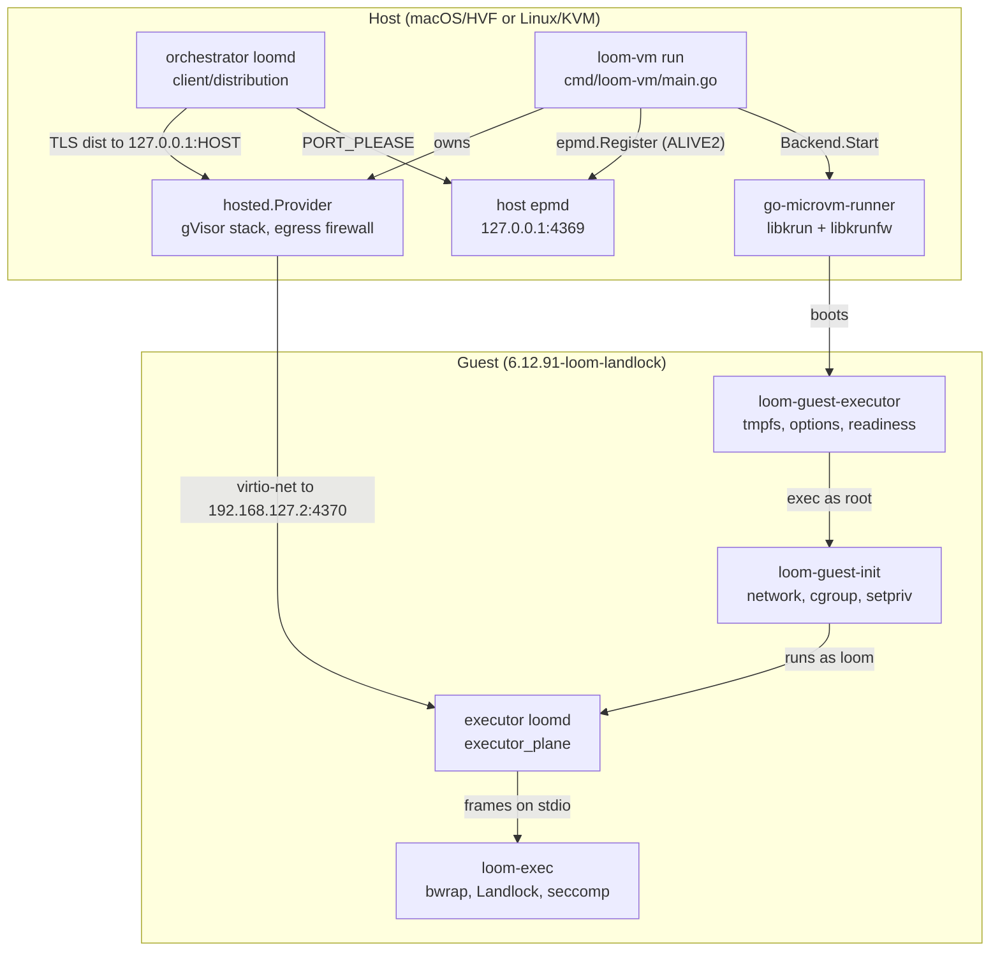
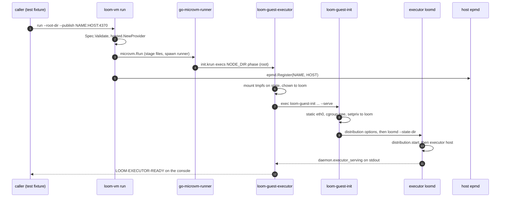
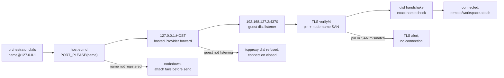
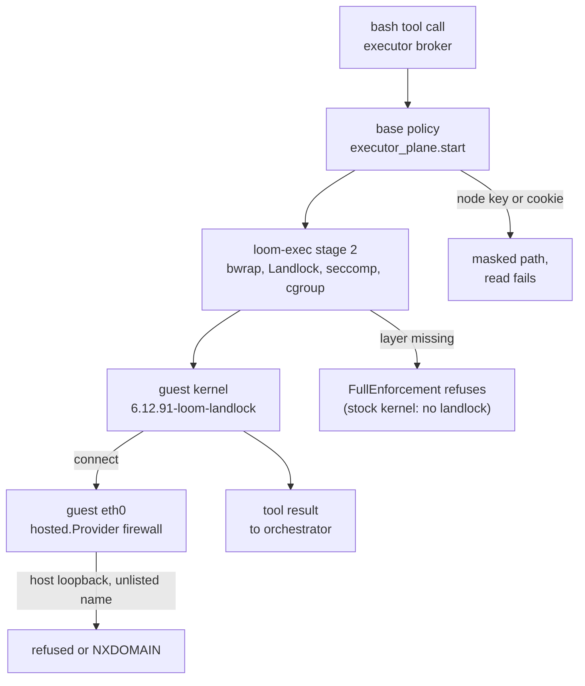
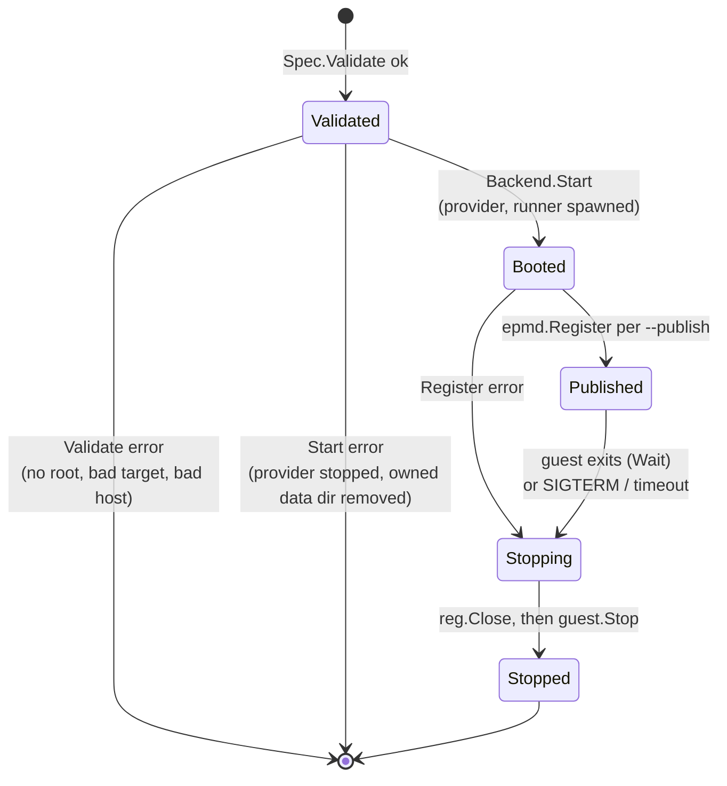

# The microVM executor tier

Loom's microVM tier runs a whole executor daemon inside a libkrun guest while
the orchestrator stays on the host. This document describes the components
that boot the guest, connect the orchestrator to the executor inside it, and
keep a jailed tool call away from the host and from the executor's own secrets.
It describes who owns which state and process, and how a `bash` call moves from
the orchestrator to a result produced on the guest's kernel. It reflects the
code at the tip of PR #1154 (branch `microvm/libkrun-launcher`).

The decisions behind the tier are in
[ADR-022](../adr/022-microvm-tier-runs-the-executor-in-a-libkrun-guest.md) and
its addendum. The executor itself is described in [executor.md](executor.md)
and [distributed.md](distributed.md), and the jail in [effects.md](effects.md).

## Components

The tier has three parts: a launcher on the host (`packages/vmm`), the guest's
own init and executor scripts (`packages/vmm/guest`), and the unchanged
executor daemon running inside the guest. The launcher owns the VM and the
host's view of it; the daemon owns everything a session does.

The edge to read first is the orchestrator's: it resolves the executor through
the host epmd and connects to a host loopback port, and the hosted provider in
the `loom-vm` process carries that connection into the guest. Nothing else on
the host can reach the guest, and the guest reaches the host only through the
same provider.

| Package or type | Owns | Does not own |
| --- | --- | --- |
| `machine.Spec`, `machine.Backend`, `machine.Machine` (`packages/vmm/machine/machine.go`) | The description of one guest: root, size, init argv, staged files, egress allowlist, forwards. `Spec.Validate` refuses a bad spec before any image pull. | Any hypervisor code. The package compiles and tests on a host with no `/dev/kvm`. |
| `libkrun.Backend` and its `guest` (`packages/vmm/machine/libkrun/libkrun.go`) | The go-microvm options for a spec, the `hosted.Provider` it creates for every guest, the data directory, and the decision whether `Stop` may delete the root. | The VMM process, which go-microvm's runner owns, and anything inside the guest. |
| `epmd.Registration` (`packages/vmm/epmd/epmd.go`) | One TCP connection to an epmd that holds one node name at one port. | The node it names. A registration says nothing about whether a listener is up behind the port. |
| `cmd/loom-vm` | Flag parsing, the lifetime of one guest, the epmd registrations of `--publish`, and copying the console to standard output. | Placement. Nothing in the daemon calls `loom-vm` yet; the end-to-end test runs it as a process. |
| `go-microvm-runner` | The libkrun VMM, in its own session (`setsid`), and the guest's devices. | The network stack: with a hosted provider the runner only forwards Ethernet frames over a socket. |
| `loom-guest-init` (`packages/vmm/guest/loom-guest-init`) | Guest networking, ownership of the `loom` user's directories, the delegated cgroup v2 subtree, and the privilege drop. | Which program runs. It runs its arguments. |
| `loom-guest-executor` (`packages/vmm/guest/loom-guest-executor`) | The tmpfs state root, the distribution options file rendered in the guest, the daemon's process, and the readiness markers on the console. | The daemon's configuration and credentials, which the caller stages into the root before boot. |
| executor `loomd` (`packages/client/src/client/executor_plane.gleam`) | Sessions' scopes, the broker and helper pool, and the policy every jailed child gets, including the node credential mask. | The VM. It runs as on any host and does not know it is in a guest. |

## Startup

A guest executor starts in two halves: `loom-vm` boots the VM and publishes
the node, and the guest's scripts bring up the daemon. The two halves do not
synchronise with each other; the caller waits for a console marker.

The host epmd entry exists before the daemon does, so the caller must not dial
until it reads the marker. `loom-guest-executor` prints
`LOOM-EXECUTOR-READY` only when both conditions hold: the node is listed by the
guest's own epmd, and the daemon has logged `daemon.executor_serving`
(`packages/client/src/client/daemon/main.gleam:944`). The node registers during
configuration load, well before the executor host starts, so the registration
alone is not readiness. On an Apple Silicon Mac the marker appears 1.5 to 1.8 s
after `loom-vm` starts.

The steps that need root run before the drop, in this order:

1. **State root.** `loom-guest-executor` mounts a 512 MiB tmpfs on
   `NODE_DIR/state` (`packages/vmm/guest/loom-guest-executor:89`). The guest
   root is a virtio-fs share, and the executor's SQLite ledger and code mode's
   AF_UNIX socket need a local filesystem.
2. **Ownership.** It gives `NODE_DIR` and every `/srv/workspaces/*` to `loom`
   (`packages/vmm/guest/loom-guest-executor:92`). Staged files arrive owned by
   root, and the daemon's credential checks require a 0600 file it can read.
3. **Network.** `loom-guest-init` sets `192.168.127.2/24` with a default route
   via `192.168.127.1` (`packages/vmm/guest/loom-guest-init:26`). go-microvm
   v0.0.43 serves no DHCP lease, so the address is static.
4. **Cgroups.** It builds `/sys/fs/cgroup/loom/{init,work,exec}`, enables
   `+pids +memory` from the top down
   (`packages/vmm/guest/loom-guest-init:73`), and hands the subtree to `loom`.
   The workload runs in `loom/work` and `LOOM_CGROUP_BASE` names `loom/exec`,
   which holds no process.
5. **Drop.** `setpriv` runs the second phase as uid 10000
   (`packages/vmm/guest/loom-guest-init:104`).
6. **Options.** The second phase renders the TLS options file with the guest's
   own `loomd distribution options`
   (`packages/vmm/guest/loom-guest-executor:47`). `distribution.start` compares
   that file with what the configuration renders, paths included, so a file
   rendered on the host would refuse the boot.

## The link: the orchestrator reaches the guest executor

The orchestrator dials the executor by its unchanged node name,
`<name>@127.0.0.1`, exactly as it dials an executor on the same host. The
launcher makes that name resolve to a forwarded port, and every check of the
distributed runtime runs unchanged.

The flowchart's point is that the VM adds only the middle two hops; the first
and the last three are the ordinary distributed path.

1. **Resolve.** The dial path asks the epmd at the name's host part
   (`127.0.0.1`) for the name's port. `loom-vm run --publish` holds that entry:
   `register` (`packages/vmm/cmd/loom-vm/main.go:244`) calls `epmd.Register`
   (`packages/vmm/epmd/epmd.go:60`), which sends an ALIVE2 request with node
   type 77 and protocol version 6 (`packages/vmm/epmd/epmd.go:35`). When no
   epmd answers, `register` runs `epmd -daemon` and retries for 3 s. epmd keeps
   the entry while the registering connection stays open, so the entry lives
   exactly as long as `loom-vm`.
2. **Forward.** `Spec.Forwards` becomes `microvm.WithPorts`
   (`packages/vmm/machine/libkrun/libkrun.go:247`). The hosted provider listens
   on host `127.0.0.1:HOST` only and opens a connection to the guest port,
   admitting it through the guest firewall's ingress rules.
3. **Listen.** The guest daemon's listener binds every interface, because the
   distribution FFI sets only the listen port range
   (`packages/client/src/client_distribution_ffi.erl:386`). A listener bound to
   loopback would refuse the forward.
4. **Verify.** The certificate pin, the node-name SAN and the distribution
   handshake's exact-name check are the same code a host pair runs. The guest
   node calls itself `<name>@127.0.0.1` as well, because the handshake refuses
   a peer whose name differs from the atom dialled.

The guest's own epmd is never reached from the host. The fixed guest listen
port is 4370 (`packages/client/test/support/microvm_executor.gleam:51`).

## Isolation around a tool call

A jailed `bash` call in the guest passes through four layers, each owned by a
different component. The flowchart follows one call and the paths it is
refused on.

The masks in the policy are the boundary for the node's own secrets; the guest
filesystem layout is not.

1. **Policy.** `executor_plane.start` builds the base policy from the
   workspace's read scope and adds the state-root, blob and evolution masks,
   and `workspace_policy.protecting_node_credentials`
   (`packages/client/src/client/executor_plane.gleam:606`). The node's TLS key
   and cookie come from the executor's own `[distribution]` table, read by
   `node_credentials` (`packages/client/src/client/executor_plane.gleam:310`).
   Under the default `host` read scope the jail sees the whole guest, `/srv`
   included, so this mask is what keeps model code from printing either file.
   An absent path is skipped, as for every conditional mask
   (`packages/client/src/client/workspace_policy.gleam:1612`), because the jail
   refuses to mask a missing file.
2. **Worktree Git.** The sandboxed Git that runs a repository's hooks during
   `git worktree add` reads the whole host. `worktree_git` applies the same
   mask to its policy (`packages/client/src/client/worktree_git.gleam:429`),
   with the list carried in `worktrees.Config.credentials`.
3. **Jail.** `loom-exec` is unchanged in the guest. The broker demands
   `["bwrap", "mounts", "landlock", "no-new-privs"]` on Linux
   (`packages/broker/src/broker/exec.gleam:1802`), and the stock libkrunfw
   kernel has no Landlock, so the tier needs the kernel `make vmm-firmware`
   builds.
4. **Network.** The guest's only interface is a virtio-net device whose other
   end is the hosted provider in `loom-vm`. `libkrun.Backend.Start` always
   creates that provider (`packages/vmm/machine/libkrun/libkrun.go:156`) and
   always passes a non-nil egress policy
   (`packages/vmm/machine/libkrun/libkrun.go:231`), which makes the firewall
   deny by default. A virtio-net device also turns off libkrun's TSI mode,
   under which guest sockets run on the host and reach host loopback.

## The machine lifecycle

A `loom-vm run` process holds one guest from validation to release. Its state
is the process's own; nothing persists it.

`guest.Stop` (`packages/vmm/machine/libkrun/libkrun.go:409`) is the one exit
and it is idempotent. It stops the hosted provider first, so no packet leaves
the guest while the VMM shuts down, then branches on who owns the root. An
`extractedRoot`, which go-microvm unpacked from an image for this guest, goes
through `VM.Remove`. A `callerRoot`, given as `Spec.Root.Dir`, goes through
`VM.Stop` only, because `VM.Remove` deletes any rootfs outside go-microvm's
image cache and would delete the caller's directory
(`packages/vmm/machine/libkrun/libkrun.go:349`). Teardown runs under its own
30 s context, so a cancelled caller still releases the VMM.

The launcher defers its teardown (`packages/vmm/cmd/loom-vm/main.go:194`), and
deferred calls run in reverse order, so the epmd names are withdrawn before the
guest stops and no
name points at a dead port for longer than the stop takes. A cancellation from
SIGTERM is a clean exit; a timeout (default 10 minutes) exits 1.

## The guest image and firmware

The guest needs three artifacts built on the host, none of which a release
carries yet.

| Make target | Produces | Built where | Why it is separate |
| --- | --- | --- | --- |
| `vmm-runner` | `packages/vmm/build/go-microvm-runner`, codesigned with `packages/vmm/runner.entitlements` on macOS | the host, with cgo against libkrun | The runner and the go-microvm library are version-locked; Hypervisor.framework refuses an unsigned runner. |
| `vmm-firmware` | `packages/vmm/build/firmware/libkrunfw.5.dylib` | the kernel in an arm64 podman machine, the dylib on the host | Adds `CONFIG_SECURITY_LANDLOCK` and `CONFIG_SECURITYFS` to libkrunfw v5.5.0 (Linux 6.12.91). macOS only. |
| `vmm-guest-root` | `packages/vmm/build/guest-root` | natively in the arm64 podman machine `loom-build` | `make release` cannot cross-compile. The image builds from `erlang:29.0.5` and runs on `debian:trixie-slim`. |

`--firmware-dir` puts the custom libkrunfw ahead of the stock one on the
runner's library path (`libraryPath`,
`packages/vmm/machine/libkrun/libkrun.go:277`). The firmware script pins the
libkrunfw tag to a commit and the kernel tarball to a SHA-256
(`packages/vmm/guest/build-libkrunfw.sh:25`).

The guest root is booted in place and written to, so every boot uses a fresh
clone: `cp -cRp` on APFS, where `-p` keeps directory modes. Inside a booted
guest the paths are these:

| Path | Holds | Owner and lifetime |
| --- | --- | --- |
| `/opt/loom` | the server release, bundled ERTS, `loom-exec` | image, read by everyone |
| `/srv/loom-node/loom.toml` | the executor's configuration, with guest paths | staged per boot, readable by model code (no secrets) |
| `/srv/loom-node/creds/key.pem`, `home/.erlang.cookie` | the node's TLS key and cookie | staged per boot, 0600 `loom`, masked from jails |
| `/srv/loom-node/state` | tmpfs: the state root, `dist.options`, `loomd.log` | per boot, lost on stop |
| `/srv/workspaces/<name>` | the checkout the executor serves | staged per boot, owned by `loom` |
| `/sys/fs/cgroup/loom/{init,work,exec}` | the delegated cgroup subtree | built by `loom-guest-init` each boot |

## Concurrency

Every piece of state in the tier has one owning process, and the owners
communicate only through files, sockets and signals.

| Process or goroutine | Owns |
| --- | --- |
| `loom-vm run` main goroutine | the `Spec`, the epmd `Registration`s, the deferred teardown order |
| `loom-vm` follow goroutine and its `Wait` | copying `console.log` to standard output; polling the runner's pid every 100 ms |
| `hosted.Provider` goroutines in `loom-vm` | the gVisor network stack, the egress firewall and DNS, the host loopback listeners of each forward |
| `go-microvm-runner` (own session) | the VMM, guest memory and devices |
| guest `loom-guest-init` | stays the parent of the workload and exits with its status |
| executor `loomd` | everything a session does: scopes, broker, helper pool, ledger on the tmpfs |
| `loom-exec` helpers | one jailed execution each, as on any host |

Four rules follow from that table:

- **The runner is not `loom-vm`'s child.** go-microvm starts it with `setsid`,
  so `guest.Wait` can only poll its pid with a zero signal. A `loom-vm` killed
  with SIGKILL leaves the runner and its data directory behind; SIGTERM or an
  interrupt runs the full teardown.
- **A registration is a connection.** The epmd entry vanishes when
  `loom-vm` exits for any reason, including a crash. It never outlives the
  guest, but it can precede the daemon, which is why readiness is the console
  marker.
- **Readiness is read from the console, never from the port.** A forward
  accepts a connection on the host side even when nothing listens in the
  guest; the hosted provider then closes it.
- **The test retires from outside its deadline.** `daemon_shipped_microvm_test`
  sends the guest handle from its deadline-bounded body to the test process,
  which sends SIGTERM to `loom-vm` and waits up to 60 s for it to exit
  (`packages/client/test/support/microvm_executor.gleam:340`), whether the
  body passed or not.

## Known gaps

- Nothing in the daemon places an executor into a guest. The end-to-end test
  stages configuration, credentials and the checkout into a cloned root and
  runs `loom-vm` itself; a broker or pool driver, copy-in of a real checkout
  and the bundle transport of #1137 do not exist yet.
- Only macOS with Hypervisor.framework has booted a guest. The Linux/KVM path
  compiles and is untested, and `build-libkrunfw.sh` produces only the macOS
  dylib.
- Sessions local to an orchestrator do not yet mask the node's key and cookie.
- The behaviour on the stock kernel is inferred: a turn does not complete,
  which matches the broker's `landlock` demand, but the exact refusal was not
  captured.
- The host epmd entry assumes the node name's host part is `127.0.0.1`. A
  guest executor reached from another machine would need a different
  transport.
- Firecracker, the second backend ADR-022 names, has no implementation.
- This document was written from the code directly rather than from
  per-subsystem reader summaries; go-microvm's internals (`microvm.Run`, the
  hosted provider) are described from its v0.0.43 source, not re-derived here.
