# Project mode

Project mode lets one long-lived router session decide what becomes work for a repository, and runs each piece of work in its own ordinary session. This document describes who owns which state, which process touches it, and how a request moves from a post or a GitHub comment to a durable result. It reflects the code at `be5a7b58e` on `project/super-agent-mode`.

For why the design has this shape, see the [design note](../design-notes/project-mode.md). For the wire formats, see [protocol-change/106](../../protocol-change/106-project-mode.md) and section 3.32 of [client-protocol.md](../client-protocol.md). For the sessions a project is built from, see [sessions.md](sessions.md), and for the instrument behind a verdict, see [evaluation.md](evaluation.md).

## Components

All decisions live in the pure package `packages/project`, and one actor per project performs them. The engine takes an event and returns the next state and a list of effects as data, or a refusal that changes nothing. The actor writes the event and its effect rows to the ledger in one transaction, and only then performs the effects. Everything that touches a process, a file or a network is reached through the actor's `Ports`, so the engine runs under a model-based test with no processes.

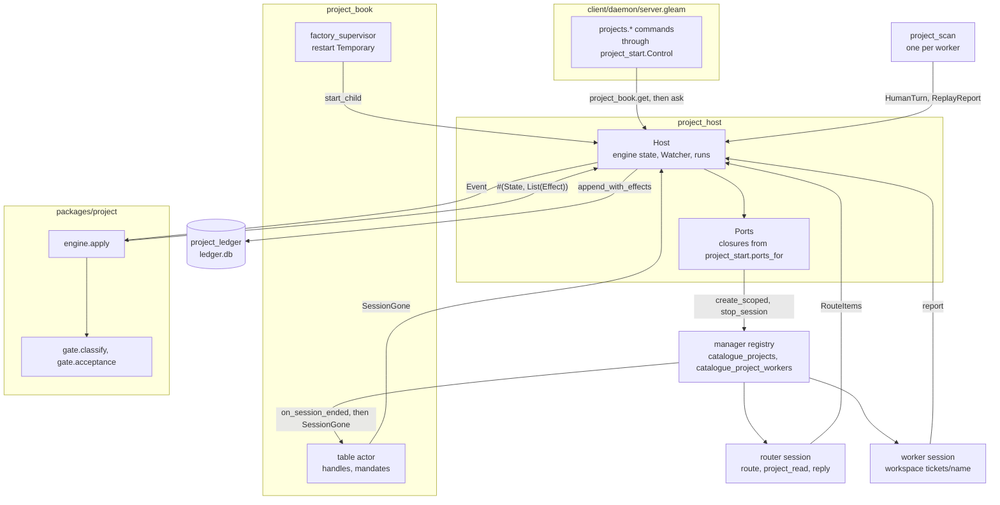

A project is a catalogue row and a role over ordinary sessions, with no session kind of its own. `client/project_standing` lifts a session's catalogue row to `Ordinary`, `Router(project)` or `Worker(project, ticket, seq)`, and `serve.seat_project` applies the `Seat` that goes with it: prompt pack, tool ceiling, jail and scan feed.

| Type or module | Owns | Does not own |
| --- | --- | --- |
| `project/engine`, `intake`, `queue`, `route`, `schedule`, `work` | Every transition of `State`, and the effects each one owes | Persistence, execution of effects, any clock |
| `project/gate` | A trigger's strength, and whether a rule's mode lets inferred work proceed | Any model output, which it never reads |
| `project/readiness`, `project/host` | The `Ready` state, buildable only from the opaque `CheckPassed` | Running a check |
| `project/policy` | `WorkerPolicy` derived from a `Mandate` by type | The broker policy, which `client/project_jail` maps it onto |
| `project_host` (`Host`) | The engine state in memory, the ledger connection, `Watcher`, the in-memory `runs` | The catalogue, sessions, Git and GitHub, reached through `Ports` |
| `project_book` | A table of each project's `Handle` and each ticket's `Mandate` | Any decision: the table never calls into an actor |
| `project_start` | Making a project, `ports_for`, `seat`, `reopen` | Ticket state |
| `storage/project_ledger` | The SQLite file's schema and its transactions | A process: it runs in the actor |
| `client/project_repo`, `project_publish` | `host.git`, per-ticket clones, check trees, the push and the pull request | Whether a commit may be published, which the engine decides |
| `client/project_poller`, `project_watcher`, `project_github` | One bounded pass over GitHub, its schedule, and translation to triggers | Admission, which the gate decides |
| `project/tape`, `judge`, `standing`, `client/project_judge`, `project_judge_session` | Recorded tapes, verdict arithmetic, scratch judgement sessions | The `auto` decision, which `state.verdict_of` reads from the engine |

## Boot

Boot rebuilds each project's actor from its ledger before any session is opened, because a session's builder reads the actor's seam and the ticket's `Mandate`.

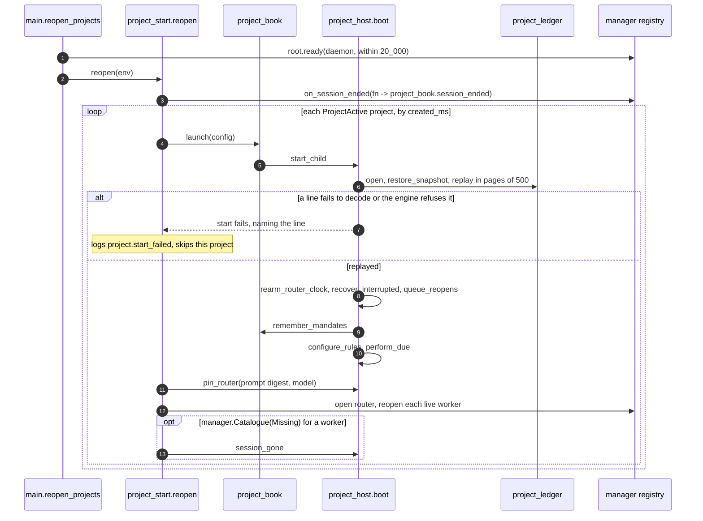

Mandates reach the book before `perform_due` because performing can start or open a worker, and that worker's builder runs in the registry while the actor waits for it, so it can't ask the actor. `pin_router` writes nothing when the digest and model are unchanged, and a change returns any `auto` rule to `observe` in that same event.

The opens at the end of boot are one try each, and a session file can refuse them. A daemon killed with `kill -9` runs no release, so its writer lease on each session file lasts until it expires (60 seconds from the last renewal), and a daemon restarted inside that window is refused with `lease_held`. A second live daemon is refused the same way for as long as it lives, and nothing here weakens that. `queue_reopens` therefore writes a `reopen` row for the router and one for each session that holds a slot, due after the first tick, which is when the project's handle is in the table and a session builder can find it. The row calls `open_session`, which waits for the open to settle (`project_start.open_and_wait`) so that a refusal comes back with the registry's own words. A refusal defers the row under the usual back-off, and the ninth failure, about three minutes in, is final. A worker is then failed with `the worker's session did not reopen after 9 attempts: <reason>`, and the router, which the next offer opens on demand, is logged. A `reopen` row for a session whose assignment has since ended is settled without opening it. The `recover` row for the restart note goes through the same open and has the same nine attempts, so the note reaches the worker as soon as the lease is gone, with nobody to ask.

## Commit, then perform

Every state change takes one path through `commit`, and an outside action is a ledger row before it happens. A crash anywhere leaves either nothing, or an event with its rows still due.

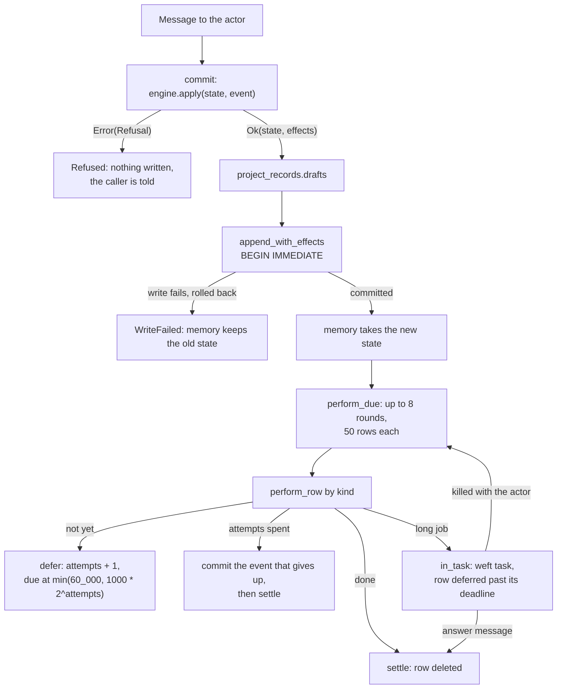

The row's key makes a repeat harmless. `start` carries `request_key`, `project:<project>:<ticket>:<seq>`, so a repeated start finds the same reservation, registration and session. A delivery's receipt is `trigger:session`, and a pull request is looked up by branch before one is created. A task killed with the actor leaves its row, so the next boot performs it again.

| Kind | Performer | Gives up |
| --- | --- | --- |
| `start` | `start_worker` | 5 attempts, then `WorkerFailed` with the failure's text |
| `deliver` | `deliver_to_worker` | 5 attempts, then `InputFailed` and stage `person/delivery` |
| `recover` | `recover_worker` | 9 attempts, then settled: the `reopen` row owns the ticket |
| `reopen` | `reopen_session` | 9 attempts, then `WorkerFailed` with the refusal's text for a worker, a log line for the router |
| `offer` | `offer_to_router` | 10 attempts, then `RouterTurnEnded` |
| `observe` | `observe_head` | 5 attempts |
| `check` | `start_check` | `max_task_attempts` of 3, then a review |
| `publish` | `start_publish` | 3 task starts, or 5 failed pushes, then a review |
| `github_reply` | `start_reply` | `max_reply_attempts` of 5, leaving a draft |
| `stop` | `stop_worker` | 5 attempts to release the clone, leaving the tree |
| `reply` | none | Due at `never_ms`, so it stays a draft on the board |

Upserting a row that is still due resets its `attempts` to 0.

## From a trigger to a ticket

Each input is a `Trigger`, and the gate gives it a strength before any model sees it. A person's post arrives through `post_now`, and a GitHub item through `poll_settled`, each as a recorded `TriggerText` and then `TriggerArrived`.

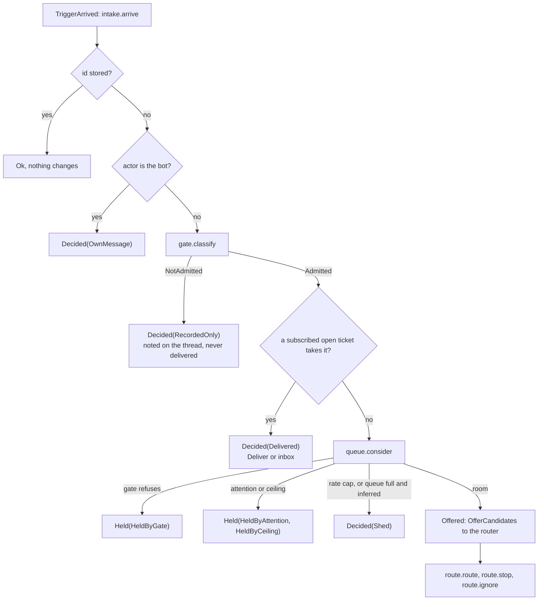

| Sender and relation | `gate.classify` | Needs `auto` |
| --- | --- | --- |
| `Owner` | `Explicit` | No |
| `Person`, addressing the agent or following up on their own ticket | `Explicit` | No |
| `Person`, not addressing it | `Inferred` | Yes |
| `ListedBot`, `CiFailure` | `Inferred`, not past `max_generation` of 2 | Yes |
| `Unlisted`, with a matching rule | `Inferred` | Yes |
| `Unlisted`, no rule | `NotAdmitted(SenderUnlisted)` | |

1. **Offer.** `queue.offer` sends at most `max_offer` (20) candidates, explicit first, when the router is `RouterIdle`, and sets it `RouterBusy`. `offer_to_router` delivers each under a receipt holding its offer count, so a re-offer wakes the session.
2. **Route.** The router's `route` tool carries a trigger id, a capped title and typed relations, and no free text for a worker. `route_now` commits each item alone, so a refused item doesn't undo the others. `route.route` refuses a trigger that isn't `Offered`, a reference it doesn't hold, and anything the gate refuses.
3. **Accept under `observe`.** `gate.acceptance` returns `RecordOnly`, the trigger settles `WouldAccept`, and no ticket opens. These fill the board's "would have done" list, which `would_limit` caps at 50.
4. **End the turn.** A router run that ends after the batch was delivered posts `RouterRunEnded`, and `tick` also ends a turn past `router_turn_ms` (120 s). `queue.turn_ended` returns undecided candidates to the queue, and a candidate offered `max_offers` (3) times settles `Unrouted` for a person.
5. **Schedule.** `work.open` builds the immutable `Mandate`, and `schedule.run` gives a worker slot, with one reserved slot that only a person's demand can take. `start_worker` tells the book the Mandate, cuts or adopts the clone, reserves, binds and calls `manager.create_scoped`. `project_jail.jail_for` then derives the worker's base policy, approval seam and tool ceiling while its session is built.

An inferred Mandate gets `NetworkOff`, since the broker refuses every allowlist, and approvals are refused with `escalate.none` unless its rule grants them. No worker holds a credential at either strength, and `set_config` takes no key that names a network, an approval route or a sandbox.

## Done means verified

A worker's report says what it did, and nothing a worker sends can produce `Ready`. The host reads the commit from the clone into `host.git`, tests the changed paths, and runs the check itself.

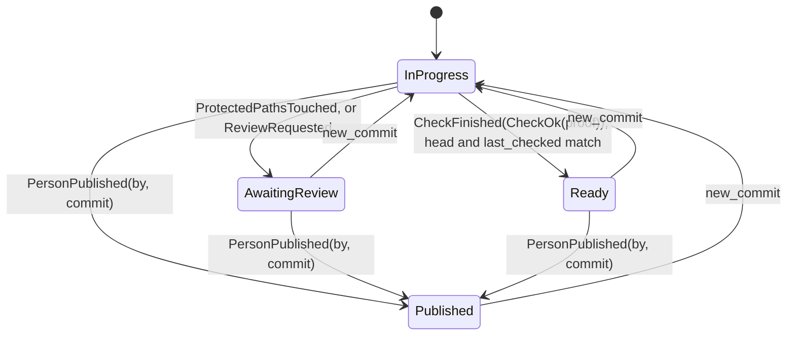

`check_passed` from any state but `InProgress` is an error that `work` maps to `Stale`, and a rejected check changes no readiness. It sets `rejected` and leaves `last_checked` at that commit, so only a new commit or a retry runs the check again. `PublishBranch` follows a pass on an explicit Mandate, or a person's publish, and the host turns it into a `PublishingOff` review when `[project].publish` is off. A pass on an inferred Mandate makes the ticket `Ready` and asks the host for nothing: `work.vouched` sets the `InferredWork` review reason, and only `PersonPublished` publishes the commit. The host publishes with the owner's credentials, and a worker that a stranger's text steered can commit anything its sandbox reads, so a passing check is not enough to send that commit outward.

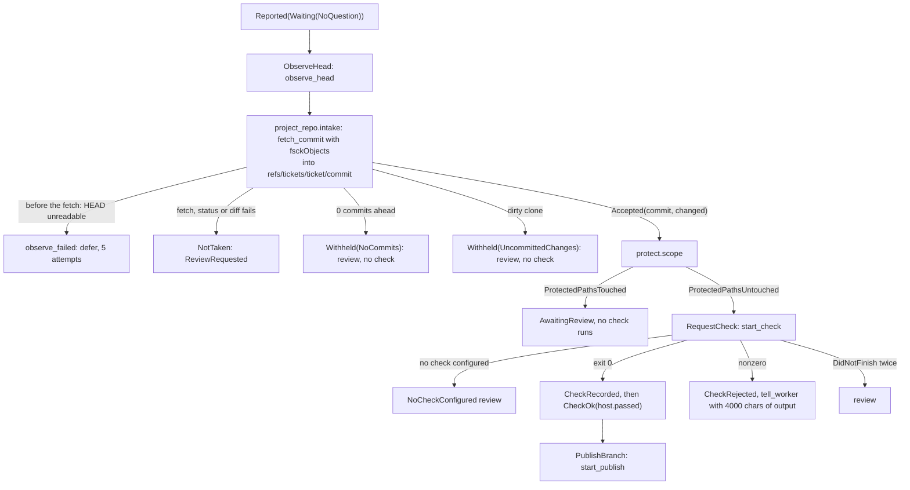

1. **Intake.** `project_repo.intake` reads the commit id from the clone, fetches exactly that id into `host.git`, and requires `host.git` to report the same id. The diff is `base...commit`, read in `host.git`, with `base` fetched from the owner just now.
2. **Protected paths.** `protected_patterns` joins `[project]` settings, `protect.default_paths` (`Makefile`, `GNUmakefile`, `makefile`, `.github/**`) and every word of the check command that isn't a flag or an assignment. A match sends the ticket to a person, so an edited build file never runs on this path.
3. **Check.** `check_tree` builds a new repository under `checks/`, fetches the commit from `host.git`, and runs `bash -o pipefail -c <command>` through `worktrees.check_runner`. The network is off and the tree is its only writable root. The tree is removed afterwards whatever happened.
4. **Record.** A pass writes `CheckRecorded` first, because `CheckPassed` names the ledger entry that holds the result.
5. **Publish.** A ticket with an explicit Mandate reaches this step on a pass, and an inferred one only after a person publishes it. `project_publish.publish` runs `git -C host.git push --no-verify` with hooks off and no force, to the URL pinned in `loom-origin-url` when the project was created. It then looks for an open pull request on `project/<ticket>` and creates one only if there's none, so a crash between the two doesn't open a second. The push and `gh` run in the daemon process, outside any jail, and the owner's global Git config applies to them, because that's where the owner's credentials are configured. Only a pinned GitHub URL is published: for any other origin the publish is unavailable and neither the push nor `gh` runs.

A later report with no head goes through `ObserveHead` again, and a new commit returns readiness to `InProgress`.

## A ticket's life

A ticket's stage is computed from its facts, never stored, and the board reads only that. An assignment is one binding of a ticket to a session, and a ticket can have several.

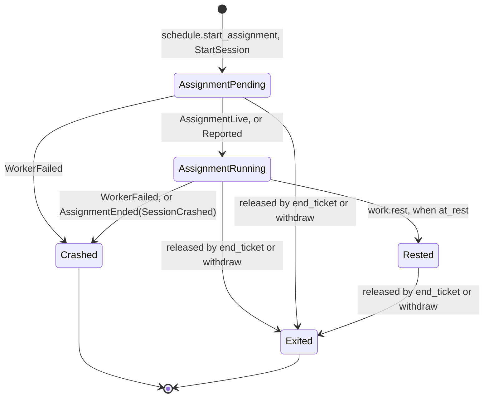

`Rested`, `Exited` and `Crashed` are `AssignmentDone(SessionRested)`, `(SessionExited)` and `(SessionCrashed)`. Only pending and running assignments hold a slot. A rested assignment gives its slot back when its work waits for a person and the worker is idle, while its session and clone stay. `rested_session` binds the next assignment to the same session, and `tree_seq` keeps naming the original clone.

`stage.of` takes the first match: `ended/<outcome>`, `person/delivery`, `person/answer`, `person/review`, `person/blocked`, `person/failed`, `queued`, then `idle` or `working`.

| Row | Stage | Condition |
| --- | --- | --- |
| 1 | `ended/<outcome>` | The ticket ended |
| 2 | `person/delivery` | An input failed to reach the worker |
| 3 | `person/answer` | An open question for a person |
| 4 | `person/review` | Awaiting review, or a pull request open on a ready or published ticket, unless a running assignment's worker is at work |
| 5 | `person/blocked`, `person/failed` | The latest report says so and no person has spoken since |
| 6 | `queued` | Never assigned, the assignment is pending, or a session is wanted |
| 7 | `idle` | The latest report is `waiting`, or the latest assignment ended |
| 8 | `working` | Otherwise |

A worker is at work when its latest assignment is running and a person has spoken since its latest report, or it has reported nothing or only progress. A resumed assignment starts with no report, so a ticket that was in review reads `working` for as long as the new worker changes the work, and `person/review` again when that worker reports `waiting`. A pending assignment, an ended one and a worker whose latest report is `waiting`, `blocked`, `failed` or `dropped` leave the review row in force, and a question or a failed input still outranks it.

| Event | `outcome` | `authority` | Can resume |
| --- | --- | --- | --- |
| `PersonClosed` | `Closed` | `Granted` | Yes, by a router `resume` |
| `Concluded(Merged)`, `Concluded(Closed)` | `Merged`, `Closed` | `Granted` | Yes |
| `Reported(Dropped)` | `Abandoned` | `Granted` | Yes |
| `PersonStopped`, `RoutedStop` | `StoppedByPerson` | `Withdrawn` | No, never |

All four stop the newest session and free the slot. A resume starts a new assignment. Its clone starts from the ticket's recorded head, fetched from `host.git`, unless the owner's `HEAD` already contains that commit, and a later push then fast-forwards.

A session that ends unreported ends the assignment too. The registry's `on_session_ended` reaches every actor as `SessionGone`, and `session_lost` commits `WorkerFailed` for an assignment that still holds its slot and is bound to that session. It ignores rested workers and sessions the host stopped, and the registry doesn't ring during its own shutdown. The registry rings only for a session that was running: a build that was refused, such as an open that finds the writer lease still held, retires its slot without a ring, because that is the end of an attempt and not of a session.

## The GitHub source

One `[[project.source]]` is read by polling, and each pass runs outside the actor. `tick` calls `poll_when_due`, which runs `project_poller.poll` in a weft task with a `poll_wall_ms` of 300 s, and the answer returns as `PollSettled`.

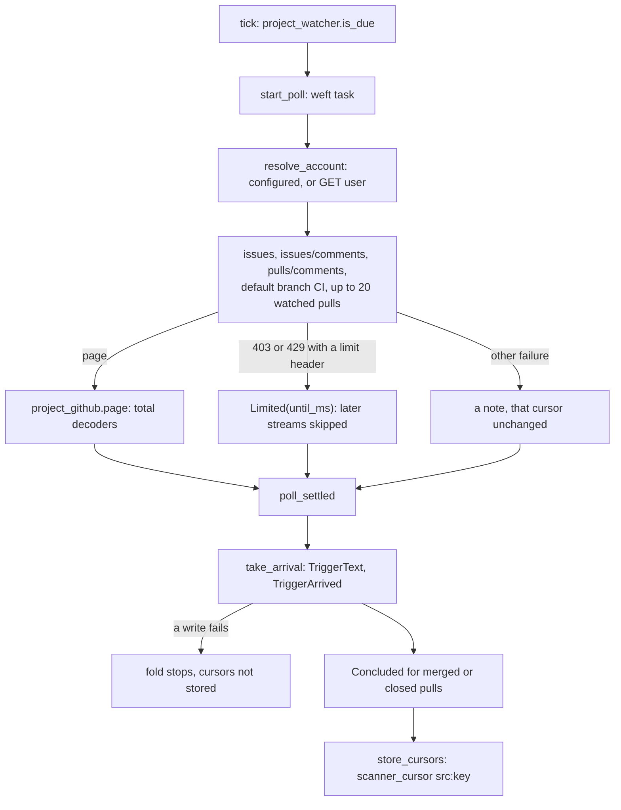

- **Scope.** It reads the repository the pinned URL names and nothing else. Only a GitHub URL names one: `https://github.com/o/n`, `git@github.com:o/n` and `ssh://git@github.com/o/n`, each with an optional `.git`, and with the host in any letter case (`project_publish.repository_of`). A local path, another host, a user, a port or an extra path part names none, and the board's source note says `the project's origin is not a GitHub URL, so its source is not read`. Nothing is polled and no pull request is opened for such an origin, and the push still goes to the pinned URL. GitHub Enterprise hosts aren't recognised. A stream with no cursor stores the present and fetches nothing, so earlier history is never read. The query asks for the oldest `page_size` (100) items since the cursor, and a repeat of an equal timestamp is dropped by the engine's id check.
- **Senders.** A login in `allow` is `Person`, in `bots` is `ListedBot`, and anything else is `Unlisted`. GitHub never produces `Owner`. Addressing needs an exact `@account` token, and the agent's own account is dropped at the poller and again at `intake.arrive`.
- **Text.** The body is stored up to `stored_chars` (32768), delivered up to `inline_chars` (4000) with a pointer to `project_read`, and delivered under `TriggerOrigin`, whose fence the body can't close.
- **Back-off.** `limit_until` honours `retry-after`, then `x-ratelimit-reset`, clamped by `longest_wait_ms`. A remaining allowance at or below `low_remaining` (5) defers the next pass, and a broken pass doubles the wait up to `longest_backoff_ms` (one hour).
- **Load.** `queue_limit` (100) and `attention_limit` (5) bound a source, and `actor_cap` (20 per hour) bounds one actor. Shed work counts on the board, and an explicit trigger is never shed.
- **Replies.** A reply on a GitHub thread becomes a `github_reply` row only when publishing is on, and otherwise stays a draft. `reply_body` replaces `@ < > #` and strips invisible characters, and a marker in the comment makes a repeated row post once.
- **Retention.** `compact_now` runs at most daily after at least `min_events` (200) events. `snapshot.retire` drops ended tickets and settled triggers older than 30 days that nothing remaining names, keeping each dropped trigger's decision up to `max_gone` (20000), and never drops a labelled trigger. An ended ticket older than that can't be resumed.

## Modes and the verdict

A rule's mode decides what inferred work may do, and only a current live pass lets a rule reach `auto`. Explicit work reads none of this.

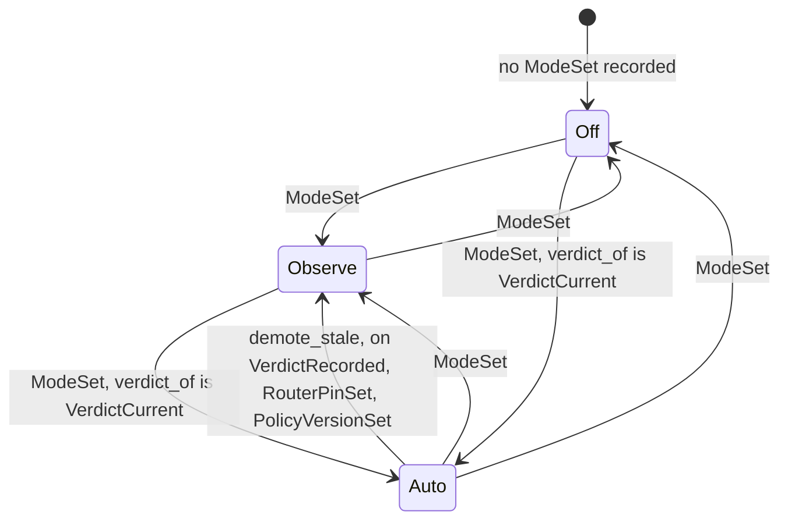

`verdict_of` is `VerdictCurrent` only for a pass with `Covers.lane == Live` whose pin equals the policy version, prompt revision and model in force. A rule configured as `auto` starts in `observe` unless that already holds. `standing.of` turns this into the words on the board: `Unmeasured`, `Failing`, `Stale`, `ReplayOnly` or `Current`.

A verdict needs `needed_labels` (30) triggers labelled by the owner, through `projects.label`. `tape.record` then captures each trigger with the thread as it stood at that trigger, and `judge.judge` builds `evalstat` rows in which a trial passes when the decision matches the label.

| Lane | Candidate | Claim | Unlocks `auto` |
| --- | --- | --- | --- |
| `Replay` | The current gate, serving the router's recorded answers back | The same inputs give these decisions | No: an unchanged gate agrees with its own recording whatever the labels say |
| `Live` | A scratch session, `live_trials` (3) per trigger | How that router judged these triggers, to the bound the finding carries | Yes |

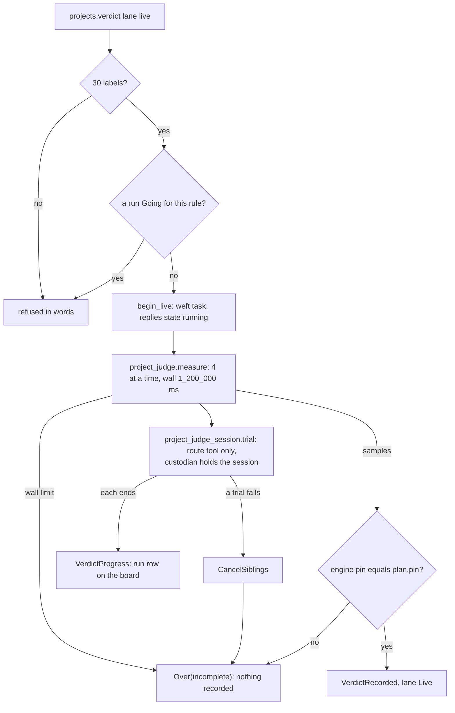

`judge.outcome_of` passes when the instrument's verdict is neither `Harmed` nor `Incomplete`, the interval's lower bound stays within `max_bound_points` (30), and agreement with the labels reaches `min_agreement_points` (75). The bound rules out a large drop against the recording, and the floor rules out a router that was already wrong on both arms. A pass doesn't show parity with the recording.

The scratch session's `route` tool has the router's schema, and its executor records the items and applies nothing, so a run writes no routing, ticket or assignment. Each trial's session is held by a custodian actor that closes it when the run cancels or the trial process goes down. A restart forgets a running run, since `runs` lives in memory, and starts nothing.

## Git layout

A worker's clone is under the state root, not a linked worktree, because a linked worktree would give it write access to the owner's `.git`.

| Path under `<state>/projects/<id>` | Written by | Read by |
| --- | --- | --- |
| `ledger.db` | The project actor | Masked from worker sessions |
| `host.git` | Jailed Git run by host code, for `refresh_base` and `fetch_commit` | Jailed Git, and the push outside the jail. Masked from worker sessions |
| `host.git/loom-origin-url` | The daemon, once, from the owner's checkout | The daemon |
| `tickets/<name>` | The worker. The daemon on release | Its worker, and other workers, which can read it and not write it |
| `checks/chk-<ticket>-<hex>` | Jailed Git, then the check. The daemon deletes it | The check |

`project_repo.clone` builds under `tickets/.<name>.making` and renames, so the final name exists only for a whole clone, and a clone on disk is adopted and never replaced. `FromOwner` clones the owner's checkout with `--no-hardlinks` and removes `origin`. `FromCommit` runs `git init --template=` and fetches one commit from `host.git` by path, so nothing in its config names `host.git`. `release` removes a clone only when `status` is clean and every ref's commit is in `host.git`, and otherwise records `TreeKept`.

## Storage

One SQLite file per project holds the ledger, and the catalogue holds a project's row and each worker's standing. There are no foreign keys between the two, since they are separate files.

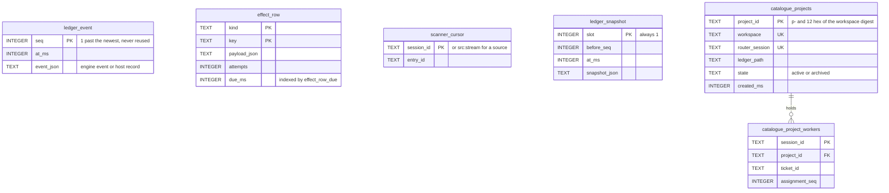

`append_with_effects` and `compact_before` each run in one `BEGIN IMMEDIATE` transaction with `synchronous = FULL`, and single-row `settle`, `defer` and `set_cursor` each run as their own. Some pairs are two writes on purpose: `TriggerText` then `TriggerArrived`, and `CheckRecorded` then `CheckFinished`. A crash between them leaves a harmless record, and the same key repeats the rest. `catalogue_project_workers` holds `UNIQUE(project_id, ticket_id, assignment_seq)`. The engine state isn't stored apart from its events, except that `compact_before` writes a snapshot and deletes the events below it, keeping the newest so `seq` never repeats.

## Concurrency

Everything mutable in a project has one owning process, and every other process reaches it by message.

| Process | Owns | Reached by |
| --- | --- | --- |
| Project actor (`project_host`) | Engine state, ledger connection, `Watcher`, `runs`, `replying` | `ask` with a 10 s wait, casts, a `Tick` every `tick_ms` (2 s) |
| `project_book` table | `handles`, `mandates` | Calls with a 2 s wait, casts |
| Registry (`manager`) | Catalogue connection, sessions | `manager.with_catalogue`, run in the registry's turn |
| Check, publish, reply, poll tasks | A subprocess or an HTTP call | Each answers the actor by message and never touches the ledger |
| `project_scan`, one per worker | Its read position | Sends `HumanTurn`, `ReplayReport`, `ScanCheckpoint` to the actor |
| Live run task and custodians | Trial sessions | Sends `VerdictProgress`, `VerdictMeasured` to the actor |

Three rules follow from the table.

- **The session builder can't call the actor.** The actor waits for a build when it starts or opens a worker, and the builder runs in the registry. So the builder reads the `Mandate` from the book, and the actor tells the book first.
- **A timed-out `ask` says nothing about the outcome.** The caller sees "the project is not answering" after 10 s, and the actor may still commit the request. A repeat of a post with the same request id replies `Repeated`.
- **A person's message can race a worker's rest.** A report sent by a worker whose assignment already rested is refused as stale, and the scanner creates the next assignment.

## Known gaps

This document rests on four reader summaries against `be5a7b58e`. Its constants were checked by grep, and its flows were spot-checked and not re-derived line by line.

- A session that dies between `create_scoped` returning and `SessionBound` being recorded rings before the assignment is bound, so that assignment looks running.
- `project_book` starts actors with restart `Temporary`, so a crashed project actor isn't restarted, and its stale `Handle` stays until the next boot or `Put`. Calls then fail after the 10 s `ask` wait.
- `project_settings` parses `token_ceiling`, and no reader found a consumer of it. The engine handles `CeilingChanged`, and nothing in the daemon emits it, so the ceiling never engages outside tests.
- An explicit ticket whose rule pair is in `auto` takes an inferred comment on its thread (`intake.takes`), and its Mandate stays explicit. A stranger's text that matched a rule can therefore steer that worker, and the commit it writes is published after a pass. The Mandate's strength is fixed at open, so `work.vouched` does not see the inferred input.
- A router's `clarify` or `decline` reply to an inferred trigger is posted to that trigger's GitHub thread when publishing is on. Its text is the router's, which has read the stranger's text, and `reply_body` removes `@ < > #` and invisible characters and nothing else, so it can carry a link. It goes to one thread, under the owner's account, and is limited by the router's tools (`project_read`, `reply`, `route`).
- The check runner's policy has `readable_roots ["/"]` with the state-root masks and without the per-project masks a worker session gets. Worker-authored code in a check can therefore read other projects' files, and up to 4000 characters of its failing output go back to the worker.
- `protecting_projects` masks only what exists when a session's policy is built, so a `checks/` directory made later isn't masked for that session.
- `fetch_commit` runs against a worker-writable clone with `host.git` writable to that jailed Git. Whether the clone's repository config can affect `upload-pack` there wasn't verified.
- `project_github.Page.own` is counted and never read, and `release` excludes `.codemode` from its clean test, so a clone with changes only there is removed.
- The live lane asks the router directly and doesn't apply `gate.classify`, so its trials can differ from what `auto` would admit.
- A person stopping a worker session from outside the project fails its ticket.
- The restart note is queued once per assignment, so a second restart of the same assignment reopens its session through the `reopen` row and doesn't tell the worker again.
- A `deliver` row gives up after 5 attempts, about 15 seconds, which is shorter than a writer lease. An input that was queued for a worker when the daemon was killed can become `person/delivery` while the lease runs out, where the restart note and the reopen wait it out.
- One worker whose session had last been attached by a terminal read `worker_failed` after a graceful restart in a live drive. A graceful stop with terminals attached to two workers records no loss in `project_daemon_test`, and no cause is established. A refused build no longer rings, which closes one way a client's open of a project session could have failed an assignment.
- Remote workers depend on the #1137 bundle work, so workers run on the owning machine. Whether `active_tool_names` alone closes every effect path for a router on a remote executor hasn't been tested.
