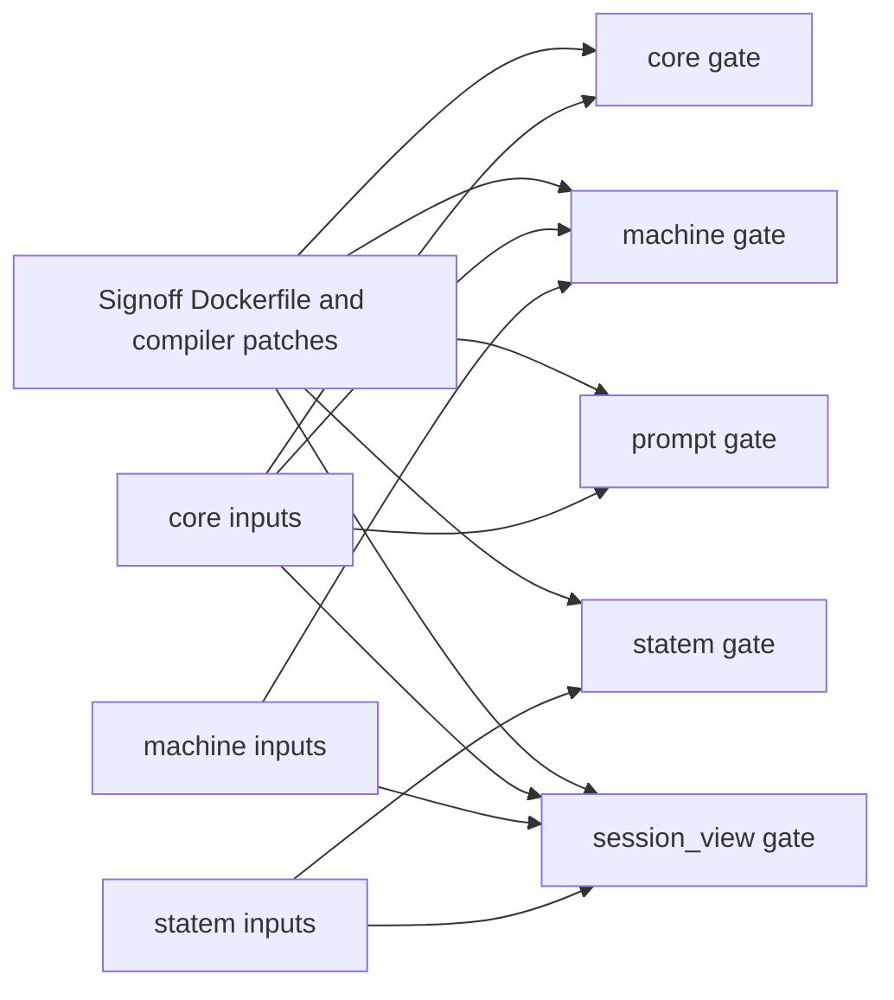

# Dagger pilot

We’re trying Dagger as an optional cache for five package gates: `core`,
`machine`, `prompt`, `statem` and `session_view`. The pilot runs the existing
`scripts/check.sh <package>` command in a Linux amd64 container, with the
repository's signoff toolchain built from `scripts/signoff/Dockerfile`.
It doesn't alter GitHub Actions, required statuses, or `make signoff`.
There is no Dagger Cloud configuration.

## Run it

The wrapper needs Python 3.11 or later, Git, Docker and Dagger
`1.0.0-beta.19`. Install the pinned CLI using the
[official installer](https://docs.dagger.io/getting-started/install/):

```sh
curl -fsSL https://dl.dagger.io/dagger/install.sh -o "$TMPDIR/dagger-install.sh"
DAGGER_VERSION=1.0.0-beta.19 BIN_DIR="$HOME/.local/bin" \
  sh "$TMPDIR/dagger-install.sh"
dagger version
```

The installer verifies the downloaded archive against its published checksum.
Inspect the installer before running it. The wrapper verifies the CLI version
and explicitly selects the matching engine image. It ignores ambient Cloud
selection variables. It runs one authenticated loopback GraphQL session without
installing an SDK or a workspace module. A temporary home/config directory
keeps saved Dagger Cloud login credentials out of the process as well.

Inspect the selected inputs without starting Dagger:

```sh
python3 scripts/dagger_pilot.py --plan
python3 scripts/dagger_pilot.py machine --plan
```

Run on the local Docker daemon:

```sh
python3 scripts/dagger_pilot.py --output build/dagger-pilot/first
python3 scripts/dagger_pilot.py --output build/dagger-pilot/repeat
```

Or run the same commands against a private Docker host over SSH:

```sh
export DOCKER_HOST=ssh://gilgamesh
python3 scripts/dagger_pilot.py --output build/dagger-pilot/first
python3 scripts/dagger_pilot.py --output build/dagger-pilot/repeat
```

These commands use Docker's SSH transport, not Dagger's `ssh://` engine
selector. The CLI runs locally and transfers the selected source snapshots;
Docker starts the engine on the selected Docker host. No TCP listener is
published by the default engine launcher. The engine
runs as a privileged Docker container and retains a cache volume on that host.
Treat Docker access as host-administrator access and share the engine only
within a trusted group. The trial adds a persistent
`dagger-engine-v1.0.0-beta.19` container; it does not reconfigure Loom's daemon.
After coordinating with other users of the shared engine, stop idle compute
without deleting the cache with
`docker --host "$DOCKER_HOST" stop dagger-engine-v1.0.0-beta.19`. The next pilot
invocation starts it again. Avoid a blanket Docker prune on this shared host.

The raw-test login is `gilgamesh`, not the Docker-admin login used by the
initial experiment. Locally, the `gilgamesh` SSH alias resolves to user
`gilgamesh` on the machine named Obelisk; `gilgamesh-signoff` uses a separate
gated identity. The account initially could not access the Docker socket. The owner then
provisioned Docker access, verified through a fresh Gilgamesh login against
Docker 23.0.1. The existing beta19 engine is reachable through that account.
Engine trust separation, resource limits, cache lifecycle and GitHub access
still require validation before CI/signoff cutover. The historical measurements below used
the earlier `roasbeef@obelisk` Docker engine, not the Gilgamesh test account.

The container targets Linux amd64 because the existing signoff Dockerfile's
OTP and Go downloads target amd64. Obelisk runs that architecture natively;
an arm64 local Docker host needs amd64 emulation. The first invocation builds
the toolchain, including the patched Gleam compiler, so its setup cost is not
a representative warm-check time. Subsequent runs reuse that build.

The default output directory is `build/dagger-pilot`, which Git ignores.
Use separate directories when comparing runs. Each directory contains
`summary.json`, per-package test logs and the complete Dagger trace in
`engine.log`. A final summary marked
`passed` means every requested gate succeeded or reused a previous success.
A `running` summary without a final `passed` verdict is incomplete, not green.
Commands fail on a failed test, a GraphQL error, or an engine error; there are
no automatic retries and no posted GitHub statuses.

## What gets reused

Each package gets a separate source snapshot and check operation. The wrapper
follows both ordinary and development path dependencies from `gleam.toml`.
For example, `machine` includes `core`; `session_view` includes `machine`,
`core` and `statem`. A change to `prompt` doesn't enter any other package's
snapshot. A change to `core` enters the snapshots of its consumers.



Snapshots contain tracked source, tests, development modules, fixtures under
`priv`, native package configuration, and the scripts that run the gate.
They exclude existing build outputs, Git history, unrelated packages and
untracked files. Tracked working-tree edits and deletions are reflected.
Stage new source and tests with `git add` before running; otherwise the wrapper
refuses the run rather than silently ignoring them. Symlink inputs are refused.
A new path dependency outside these five packages also fails closed, so the
pilot cannot silently grow into a different set of checks.

The cache is conservative. A dependency's test-only edit can invalidate a
consumer too, since the complete dependency package is copied. The wrapper
runs gates sequentially to bound shared-host resource use. It doesn't share
mutable compiled build directories between gates, and it doesn't yet expose
individual EUnit tests as native Dagger test artifacts.

The toolchain Dockerfile still fetches mutable apt packages and Rust's stable
channel. Its cached result is the environment actually built, not proof that
all upstream inputs are immutable. `--fresh` reruns checks, not a cold toolchain
installation. Keep the existing cold-build coverage when evaluating adoption.

## Fresh runs and flakes

A cached success is evidence about the earlier run with the same inputs. It
isn't another execution, and it doesn't prove that a flaky test stopped
flaking. Use `--fresh` to force the package check operations to execute again
while retaining the toolchain build cache:

```sh
python3 scripts/dagger_pilot.py --fresh --output build/dagger-pilot/fresh
```

The pilot checks pure package behavior, not Linux jail enforcement, external
services, wall-clock behavior or the full release. Those paths still need
their existing fresh-run gates. Broader adoption requires proving all relevant
inputs, preserving the skip census, validating nested namespaces and delegated
cgroups, and retaining periodic cold runs. Dagger caching alone is not a reason
to drop those tests or weaken their assertions.

For feedback-loop cost, the useful measurement is a typical edit, not only an
identical rerun. Compare a repeated success, an isolated package edit, a shared
dependency edit and an intentional failure in a disposable checkout. Traces
must confirm which check operations were cached. Keep cached output out of an
agent's normal context: read the summary first, then the failing package log.
The wrapper saves complete logs instead of printing every successful test.

## Trial evidence

Measured on Obelisk with beta19, Linux amd64, using the native patched
toolchain Dockerfile. The final wrapper's first run passed 1,021 tests; its
repeat reused all five successful checks. Times below are inside the Dagger
session, including source uploads; CLI startup adds a few seconds. These are
single observations on a shared host, not a general benchmark.

| Run | Session time | Observed check execution |
| --- | ---: | --- |
| Final wrapper, first run | 64.8 s | All five checks executed; 1,021 tests passed. |
| Identical repeat | 1.2 s | All five `withExec` operations marked `CACHED`. |
| `prompt` source edit in disposable checkout | 19.0 s | Only `prompt` executed; the other four checks were cached. |
| `core` source edit in disposable checkout | 56.5 s | `core`, `machine`, `prompt` and `session_view` executed; `statem` was cached. |
| Explicit `--fresh` | 77.3 s | All five checks executed; none reused a check result. |
| Intentional failing prompt test | Exit 1 | EUnit reported 1 failed, 103 passed; no final success summary. |

The edit/fresh/failure controls preceded the final ignored-input/pathspec
hardening; that hardening changes input discovery, not the Dagger check graph.
The final two-run comparison was repeated after it. The initial engine pull
and startup took about 109 seconds; the first toolchain build took roughly
three minutes, before these check timings. Neither setup cost is hidden in the
warm-cache comparison.

The negative control first rejected an unformatted edit, then an assertion
that generated a compiler warning. The final control used a formatted,
warning-free `assert list.length([1]) == 2` test and failed in EUnit. These
failures were not retried to obtain a pass; each tested a different gate.
Original package sources were never modified for these controls.

At the initial pilot base `3cf6bdc09`, local wrapper verification passed all
13 stdlib tests and `make doc-check` passed. This is historical validation, not
a green documentation-gate claim for the newer PR checkout described below. The broader scripts suite ran 136 tests before the final extra input
regression was added, with five failures: four install-pruning fixtures and
`test_the_gate_fetches_with_the_state_directory_as_home`. All five reproduced
against the unchanged baseline scripts in the disposable checkout. They are
not fixed or waived by this pilot. The full Loom CI/signoff was not run or
replaced.

Local evidence is under `build/dagger-pilot/`: `bounded-first`,
`bounded-repeat`, `prompt-edit-formatted`, `core-edit`, `fresh`, and
`failure-runtime`. The unformatted and compiler-warning controls are retained
separately. Logs are ignored build artifacts, not a durable CI attestation.

## Gilgamesh validation at the first PR base

After the owner provisioned Docker access, the same wrapper was run through
`DOCKER_HOST=ssh://gilgamesh` from an isolated checkout based on `369726deb3`.
All 1,094 tests passed in 63.470 seconds inside the session (the newer
`session_view` has 683 tests). An unchanged second invocation took 1.696 seconds
and all five check operations were marked `CACHED`. The existing engine and
toolchain cache were reused; this is not a cold engine-install measurement.

All 14 wrapper unit tests pass in that checkout. The native development-
dependency regression also fails under an in-memory mutation that omits
`dev_dependencies` from closure discovery, without modifying production files. Its full documentation gate
is blocked by two unchanged baseline citations in the archived
`terminal-design/C-fable.md` note: both name approval-panel `render` at line
305, while the source now places it at 298. The first PR does not repair or
waive those unrelated baseline errors, and does not claim a green full gate.
The earlier `make doc-check` success above belongs to the initial pilot base.
