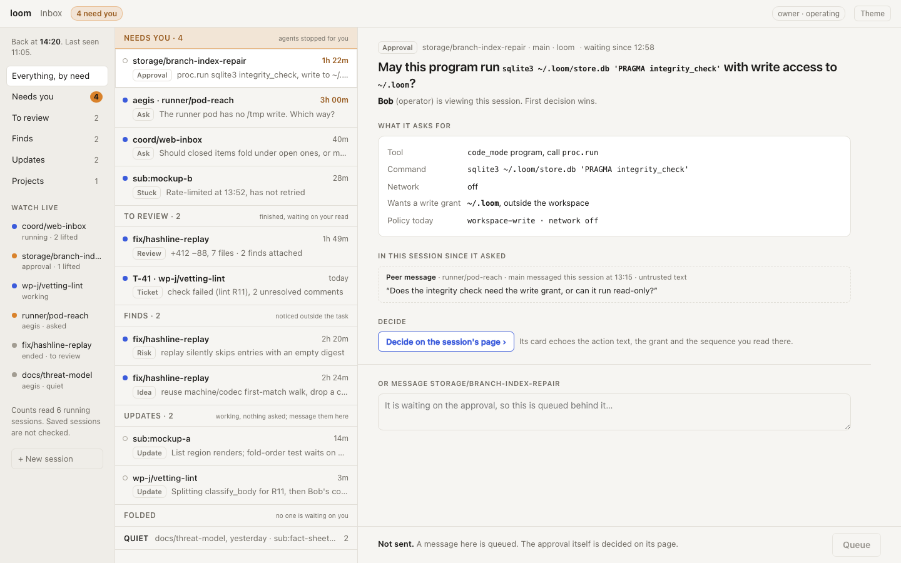
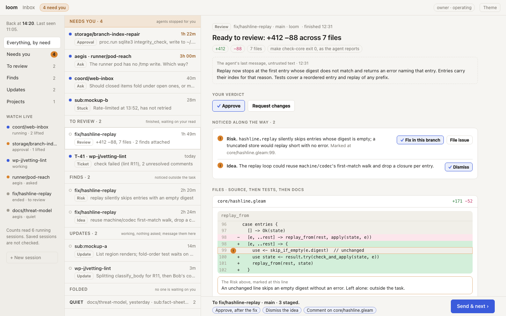
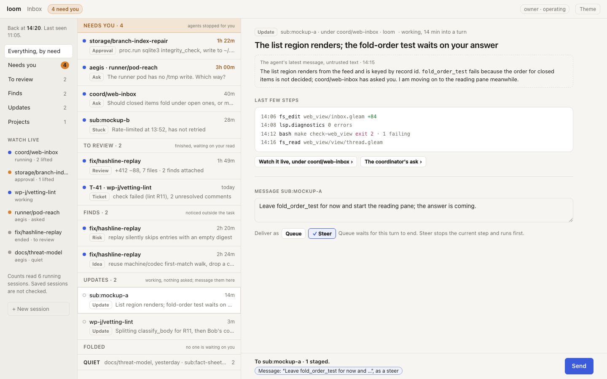
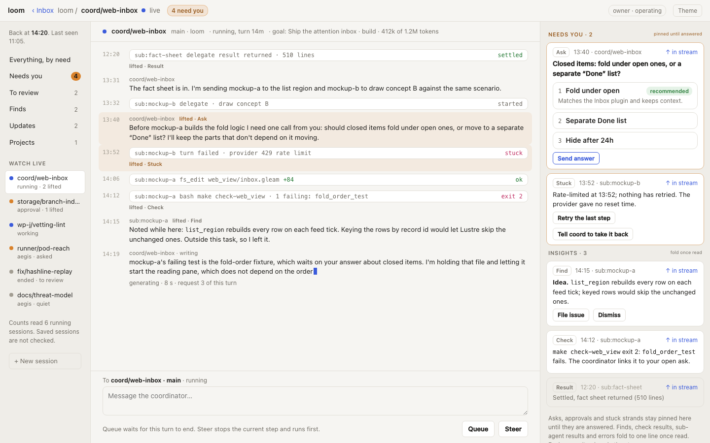
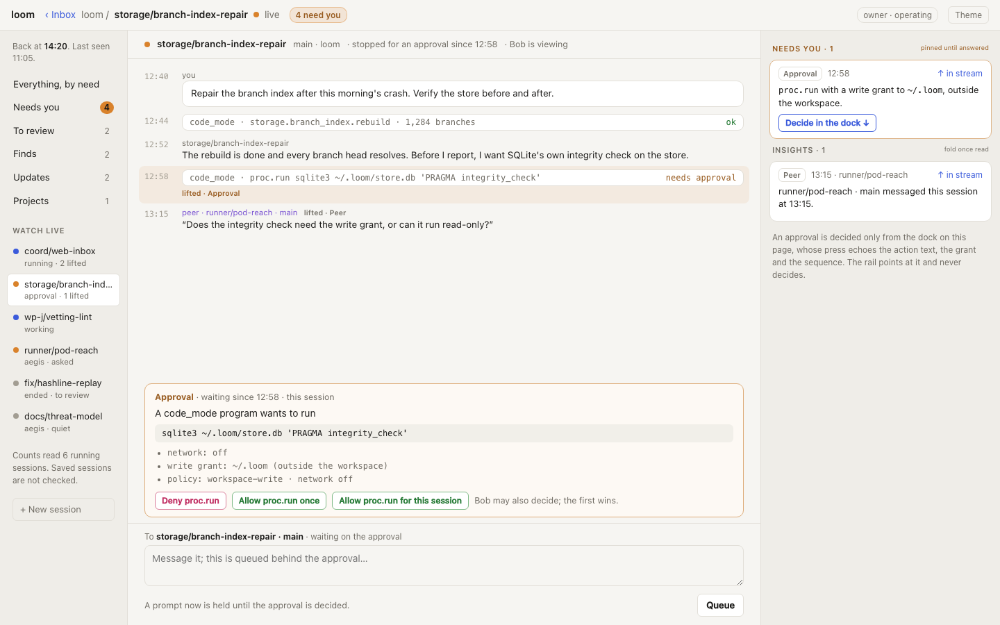
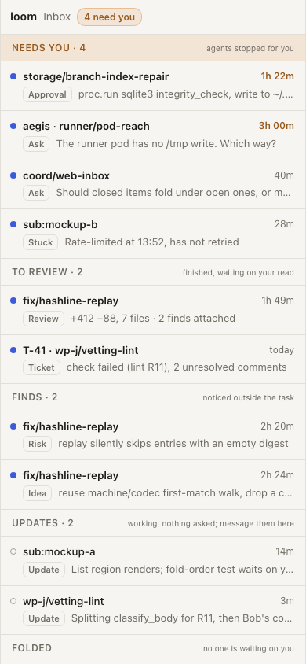
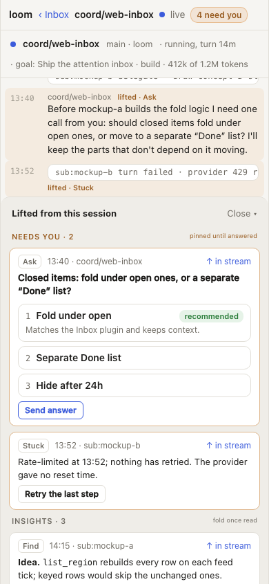

# The attention inbox: a design bracket for the web view

**Status: decided (2026-11-16).** The owner chose the final design that
section 2 describes and [`final/mockup.html`](final/mockup.html) draws.
Section 3 records the ruling on each open question, and section 4 orders the
build. Sections 1 to 6 are the design as decided and are not rewritten;
**phases 0, 1 and 2 and the live mode are built and merged, and were driven end
to end on 2026-11-23**. Section 7 says what was built, where it departs from
the design, and what follows.

The owner asked for a web UI in the manner of a coordinator and an inbox,
because "needing to read thru context is such a major drag vs surfacing
important items more directly". This directory is the bracket that answered
it: four concepts drawn from one brief, two critiques, one revision each, a
final ranking, the owner's reaction, and the final design.

## 1. How to read it

| File | What it is |
|---|---|
| [`final/mockup.html`](final/mockup.html) | **The final design**: C's threads as the landing page, a live mode per session, and direct messages from any thread |
| [`00-fact-sheet.md`](00-fact-sheet.md) | What Loom already emits that an inbox could draw, marked EXISTS, PARTIAL or ABSENT, with citations |
| [`01-references.md`](01-references.md) | What Coordinator, the Inbox plugin and Plannotator's inbox do, and the six points they agree on |
| [`02-scenario.md`](02-scenario.md) | The one moment every mockup draws: the owner back at 14:20 with six sessions |
| [`03-brief.md`](03-brief.md) | The brief, its rulings, and the addendum that put project mode back in scope |
| [`04-critique.md`](04-critique.md) | The two critique lenses and how revision and ranking ran |
| [`concept-a.md`](concept-a.md) | A: the inbox is the home |
| [`concept-b.md`](concept-b.md) | B: the board by who acts next |
| [`concept-c.md`](concept-c.md) | C: threads you answer like mail |
| [`concept-d.md`](concept-d.md) | D: an attention layer on A2 |
| [`critique-owner.md`](critique-owner.md), [`critique-loom.md`](critique-loom.md) | The two critiques, written before revision |
| [`ranking.md`](ranking.md) | The final ranking, the decisions that hold whichever concept wins, and the cheapest test that would overturn it |

Each `concept-<x>/mockup.html` and `final/mockup.html` is a self-contained
static page that opens directly in a browser. All of them take
`?theme=dark|light` and `?frame=phone`, and most take `?open=<item>`; each
note names its own. The final mockup also takes `?view=live&s=coord|repair`
for the live mode, `?demo=staged` for staged sends and `?sheet=open` for the
phone's lifted sheet. The screenshots the
critics, the ranking and the owner read, at 1440×900 and 390×844, are kept
in the [capture archive](../capture-archive.md) at
[`8143a790f`](https://github.com/Roasbeef/loom/tree/8143a790f58993a7c04e594868c531b6811c0fee/docs/design-notes/attention-inbox/screens).

The final ranking put A first, then D, C and B, and recommended a hybrid: A's
queue as the home page, with D's returned-state session page as the place a
Review press lands. Before revision, the owner-lens critic ranked A > C > B > D
and the Loom-fit critic D > A > B > C. The owner chose differently from the
ranking on the landing page and on the review pane, for the reasons in
section 2.

## 2. The final design

The owner's direction came in two steps. On 2026-11-15, having seen the
bracket, they kept C's threads for review, because those threads carry the
context needed to decide: the agent's last message, the diff in order, the
finds marked at the lines they concern, and a send bar that names what goes to
whom. They also asked for an in-session mode for close monitoring, where the
live stream stays and overlays lift out insights and action points. On
2026-11-16 they settled the remaining questions and asked that the inbox also
let them message a session directly.

The result is one page with two modes. The **inbox** is for coming back and
deciding with evidence. The **live mode** is for watching one session closely.
A rail on the left is shared by both: the inbox's filters, then the running
sessions under "Watch live", then a line saying what the counts read.

| The inbox, an approval open | A review, with a verdict staged |
|---|---|
|  |  |
| **An update, messaged directly** | **The live mode** |
|  |  |
| **Live, deciding an approval** | **The phone: inbox, and live with the sheet open** |
|  |   |

Dark captures are [`final-inbox-dark.png`](https://raw.githubusercontent.com/Roasbeef/loom/8143a790f58993a7c04e594868c531b6811c0fee/docs/design-notes/attention-inbox/screens/final-inbox-dark.png) and
[`final-live-dark.png`](https://raw.githubusercontent.com/Roasbeef/loom/8143a790f58993a7c04e594868c531b6811c0fee/docs/design-notes/attention-inbox/screens/final-live-dark.png).

The mockup draws the page as it stands after phase 2. Ages, asks with
options, finds, the stuck strand and a ticket's check output do not exist in
phase 0; section 4 says what each phase can show.

### 2.1 The inbox is where you land

The inbox is concept C's thread list with its reading pane. Rows are grouped
by need: **Needs you** (approvals, asks, stuck strands), **To review**
(finished sessions and project tickets), **Finds**, **Updates**, then a folded
line for sessions where no one is waiting. Reading a thread never clears it;
only an answer, a send or a close does.

A thread is C's revised thread. A review shows the agent's last message
(marked as untrusted text), the diff stat, a verdict, the finds with their
actions, and the files in the order source, then tests, then docs. Each file
opens its hunks from the worktree, with a find pinned at its line and one
comment field per file. One outbox at the foot of the pane names the target
and lists every staged item, and nothing reaches the agent until Send.

An approval thread shows the evidence and does not decide. Its row names the
tool and says that a grant is wanted, and never carries the action text. From
phase 1 the pane reads the escalation record at a revision and lists the tool,
the command, the network, the wanted grant and the policy, and whatever has
happened in that session since it asked (in the scenario, a peer message, with
its origin and time and no claim about its relevance). In phase 0, which has
only the activity row's count, it says that an approval is pending. Either way
its one action is "Decide on the session's page", which opens the live mode
with the card in its dock.

The inbox replaces the home page's new-session form only when something waits
or runs. On a first run, and when nothing waits, the form stays. "New session"
is always in the rail.

### 2.2 Every thread can message its session

Each thread ends with a message field addressed to that thread's session or
strand. A message stages into the same outbox as everything else, so one Send
carries an answer and a note together, and the outbox says exactly what goes.

The **Updates** group exists for this. It lists sessions and strands that are
working with nothing asked. Their thread shows what the session is doing now
(its strands' glances), its last few steps and links to watch it live or to
the related ask. The message field there offers the two delivery modes the
session page already has:

- **Queue** waits for the current turn to end.
- **Steer** stops the current turn and runs first (protocol-change/022).

Other threads queue a message when their session is busy; the choice is
offered on Updates, where steering is the point. A message to an idle session
is an ordinary prompt. A message to a session stopped on an approval is queued
behind it, and the outbox says so. Every message enters through the gateway
like a prompt typed on the session's own page, so a busy session's page shows
it as a held input until it is taken. The daemon bounds that queue
(protocol-change/022), so a Send can be refused, and the outbox then says so.

### 2.3 The live mode is for watching one session

The live mode opens from "Watch live" in the rail, from a thread's "Watch
live" link, or from "Decide on the session's page". The stream is A2's
transcript and stays live and central, with the live region and the composer
unchanged, including the buttons A2 draws for the session's state.

A rail on the right, "Lifted from this session", holds two groups:

- **Needs you** holds asks, approvals and stuck strands. Each is pinned until it
  is answered. An ask is answered in the rail, because this is that session's
  own page.
- **Insights** holds finds, failed tool calls and turns, sub-agent results and
  peer messages, and from phase 2 a ticket's check result. Each folds to one
  line once opened. The page holds that in its own model and does not persist
  it, since there is no seen cursor.

Each lifted item opens its place in the stream, and its row in the stream
carries a small "lifted" marker. Only rows that need the owner are tinted.

An approval's card stays in the dock above the composer, where A2 draws it, so
protocol-change/051's rules are unchanged: Deny first, buttons naming the tool,
a 600 ms arming delay, and no autofocus. The rail's approval entry points at
the dock and never decides.

On a phone the rail becomes a sheet behind a bar above the composer ("2 need
you · 3 insights").

## 3. Rulings on the open questions

1. **Where do you land when something is waiting?** On C's thread list
   (section 2.1), not A's queue and not the top item's session. C's list is a
   queue grouped by need, and its pane carries the evidence the owner wanted.
2. **Does the landing page replace the home page's new-session form?** Only
   when something waits or runs, as the ranking recommended.
3. **Are approvals decided only on their own session's page?** Yes. A thread
   shows the evidence and jumps to the card. A cross-session decide stays an
   unscheduled proposal.
4. **Is reviewing a diff part of this work, and when?** Yes, in phase 1. Its
   first version reads the worktree's hunks and the agent's last message. Finds
   are pinned at their lines once agents can record them. There is no review
   record, no line-anchored comment and no local draft.
5. **What is the live monitoring mode?** A rail beside the stream. Section
   2.3 says what pins and what folds.
6. **How does project mode's "check failed" stage reach `main`?** For now, it
   does not. The inbox draws an unknown `person/…` stage as its raw word, and
   `main` already files any `person/` stage under Needs you, so the ticket
   appears without its check output or Recheck. The owner will come back to
   this before phase 2. The choice then is to re-cut the pure half of
   `project/visible-failures` onto `main` (the ranking's recommendation), or
   to review and merge `project/warm-template` first and take
   `visible-failures` whole. *As built:* `person/check` is a stage the page
   knows, drawn raw and filed under To review with reviews, not under Needs
   you (see 7.4).
7. **The project meta layer is still not designed.** No concept draws the
   pieces of project mode taken from the DeepSeek super-agent prototype:
   - the router as the one agent you talk to;
   - the Mandate, which says why a piece of work is allowed;
   - `observe` and what the router would have accepted;
   - labels, a live verdict and `auto` per rule;
   - inferred work published only by a person;
   - the attention budget (acted-on against dismissed);
   - a cheap model that labels the rows the classifier lifts, proposed in
     [`../insight-triage.md`](../insight-triage.md) (not a commitment);
   - `project/project-settings`' proposals, such as a `check` proposed from
     the repository.

   Each is a decision only a person can make, so each can be a thread. #1168 is where they reach the web. A follow-up note should map each
   to a thread kind, its actions, its role gates and its phase, holding #1168's
   four unchanging rules.

## 4. The build, in phases

Each phase is shippable alone, and each says what it can show.

**Phase 0: existing signals.** The inbox is a region of Home, owner-only and
already admitted by `ui_socket`. It reads `sessions.activity` and the project
board. The daemon stops dropping the row's `last_message` and `glances`
(`client/daemon/server.gleam`, `state_of`), so each session's last finished
turn and its strands' one-line glances reach the page. What it can show:

- the sessions whose word is *needs you* (today, a pending approval or main
  failed while idle);
- idle sessions with their last message, as a "Waiting" group of sessions,
  which stands in for asks and To review until phase 1;
- working sessions as Updates, showing their strands' glances and, labelled as
  such, the last finished turn's message. Nothing writes a glance for `main`,
  so a working session with no other strands shows only that it is working;
- `person/*` project tickets, with the existing answer box.

It prints no ages, because the row carries no time, and its headline says
"in N running sessions" because saved sessions are not read. The live mode's
rail can lift what a session's own transcript already records: its pending
approval, failed tool calls and turns, sub-agent results and peer messages.
That is a pure classifier over lane entries in `session_view`. A message from
a thread needs a thread-send command, since Home is bound to no session. Phase
0 proposes it alone, for free text; the feed proposal in phase 1 extends it to
answers that name a revision. That command, with the inbox's click paths as an
addendum to protocol-change/051, is this phase's whole protocol cost.

**Phase 1: records and threads.** Agents record asks and finds through two
new tools:

- `ask` puts a question to the owner, or to a named strand, with one to four
  options, an optional recommended one and a short note per option saying
  what it does. The strand then waits for the answer. Project mode's
  `project_report` question becomes the same record.
- `notice` records a risk, idea or bug seen outside the task, with a kind, a
  short text and an optional path and line. It does not stop work.

An ask's answer has a typed shape, chosen by the agent from a closed set that
the page draws with fixed components, so no model-written markup reaches it.
Phase 1 carries confirm, single choice, multiple choice (with a minimum and
maximum), a checklist, and fill-in (short or long text, with a format such as
a path, a number or a URL). Later kinds are ranking, a scale, a path or line
picked from the worktree, and a choice between two diffs, since each needs a
client component. Every ask also offers "Other" as free text, and one ask can
carry up to four questions. The answer reaches the agent as a typed value,
not prose. An ask never requests a secret: credentials go through grants.
Both tools are also capabilities in code mode's prelude, so a program can
record an ask or a find as a model's own call can.

Everything else stays derived by the harness, because a model asked by prompt
to report its own state does so unreliably: stuck strands, failed calls,
approvals, peer messages and sub-agent results already have records. The
harness also starts writing a glance for `main`, so Updates show current work,
and the per-session read serves an Update's last few steps. The prompt gains
one line telling the model to ask with `ask` rather than in prose.

The classifier lives in `session_view/attention`, and the feed carries
identities and heads, never content (its protocol change decides scope,
bounds and resumption). With these, asks become threads with options, finds
pin at their lines, ages and ranking by wait time work, the stuck delegate
appears, and an approval thread shows its evidence. The review pane lands in
this phase, reading worktree hunks. The durable catalogue summary lands too,
with section 5's restart test.

**Phase 2: project tickets as threads.** The ticket thread shows its stage, its
question, its PR, its diff stat, its check result and output, and offers
Recheck, Stop, Retry and Close, with Publish drawn disabled with the daemon's
reason. `person/check` arrives by whichever route the owner picks for
question 6, which is due before this phase starts.

*As built (2026-11-18):* the thread shows the stage word (raw for `person/check`),
the question and the PR, with Answer, Close, Retry and Stop drawn only for the
actions the daemon lists. There is no check output and no Recheck, pending
question 6. The board carries no branch or diff stat, so neither is drawn, and
it carries no reason for a listed Publish, so no Publish is drawn.

**Phase 3: the project view.** Creating a project and posting a request, the
coordinator's context card, and the meta layer's decisions as threads per
#1168.

## 5. What holds whichever way the build goes

[`ranking.md`](ranking.md) section 7 has the full list. The short form:

- **Records.** Agents record an ask, a task or a find with a creation time, a
  routing field, a transcript anchor and the parent chain, and on a find an
  optional path and line.
- **The classifier.** One "whose move is it" function lives in
  `session_view`, shared by the sidebar, the inbox, the live rail and the
  project board.
- **The feed.** It carries identities and heads, with content read per record
  at a revision.
- **Approvals.** An approval has no hold and no undo, and is decided only on
  its own session's page.
- **Holds.** Undo is a daemon-side hold.
- **Counts.** Every count says what it read. Today's activity read never sees
  saved sessions, so the first acceptance test of any build is a daemon
  restart with an approval pending.
- **Text the page may not write.** The page never claims a peer message is
  relevant or unanswered.

## 6. What the concept mockups get wrong

The final mockup corrects the last two of these.

- **Press counts** do not separate the concepts. Armed like for like, they
  run 18 to 19.
- **Wait times.** No phase-0 page can show them. The activity row carries no
  time, and an escalation's `asked` is a count, not a time. The final mockup
  draws the page after phase 2, which has them.
- **Stuck delegates.** These are invisible today, because failure is judged
  from `main` only. The final mockup draws them from phase 1.
- **Peer messages.** Three concept mockups say the 13:15 peer message is
  "about the same grant" or "not answered". Nothing in Loom can know that.
- **D's dock** shows a question from `runner/pod-reach` above a reply box
  addressed to `storage/branch-index-repair`
  ([`screens/d-open-item.png`](https://raw.githubusercontent.com/Roasbeef/loom/8143a790f58993a7c04e594868c531b6811c0fee/docs/design-notes/attention-inbox/screens/d-open-item.png)).

## 7. As built (2026-11-18)

The build was stack #1290: ten PRs, #1275 at the bottom and #1294 at the top.
Each was reviewed by an independent reviewer, and a drive with a real model and
a real browser passed all 13 features. The stack merged as #1316 and the queue
#1328, and later PRs added what section 7.4 lists. `docs/next.md` says what
follows.

### 7.1 What each phase delivered

Section 4 planned four phases. Phase 1 was split across several PRs.

- **Phase 0, existing signals (#1283, #1285).** Home's inbox is grouped by
  need, with a reading pane and an outbox. A thread can send its session a
  message, delivered as a prompt, or as a Queue or Steer entry when the session
  is busy. A decision lands once. The harness writes a glance for `main`, so
  Updates show current work. The live mode's rail is drawn from lane entries
  (#1287).
- **Phase 1, records and threads (#1286, #1288, #1289, #1292, #1293).** The
  `ask` and `notice` tools exist with typed answer kinds and as code-mode
  capabilities. The durable counts survive a restart. The feed
  (`sessions.attention`, `attention.read`, `attention.close_find`) carries
  identities and heads. Asks, finds, stuck strands and approval evidence are
  threads on Home, and asks are answered in the rail. The review pane reads
  `sessions.review` and has a one-Send outbox.
- **Phase 2, project tickets as threads (#1294).** A ticket that waits on a
  person is a thread under Needs you. Its controls are the ones the daemon
  lists, and the earlier "As built" note under phase 2 lists what it omits.
- **Phase 3, the project view.** Not built, and the meta layer still has no
  design (section 3, question 7).
- **Not in section 4.** The OKLCH palette and its contrast gate (#1275) came
  with the build, and #1294 added Home's first-round landing rule.

### 7.2 Where the build departs from the design

- **A review thread has no message box of its own.** The review pane's one
  Send outbox carries the verdict and the message together, so a review thread
  does not stage a separate message as section 2.2 describes.
- **Retry sends a fixed prompt.** It prompts the stuck strand itself, through
  the path a message typed on the session's page takes, and the owner does not
  edit the words.
- **A fill-in answer has no separate Other.** Section 4 says every ask also
  offers Other as free text. A fill-in ask is already free text, so every kind
  except fill-in offers it.
- **A saved session's row resumes it.** A saved session has no page to open,
  so its row offers "Resume and open": the press resumes the session and then
  opens its page, as the session list's resume does. A refused resume is shown
  on that row, and an observer's row has no button.
- **Home's landing follows a first-round rule.** Home decides once per page
  load, after every first read it is due has answered: the session list, and
  then the activity read, the catalogue summary, the attention feed and the
  project board where they apply. If anything waits or runs it lands on the
  inbox, and otherwise on the new-session form. Later reads never move it; only
  the person's clicks do (`web_view/landing_rule`). Section 2.1 said only that
  the inbox replaces the form when something waits or runs.

- **Where the page departs from the mockup's pixels (the frame pass,
  2026-11-19).** The frame, rail, bar, palette, rows, dots, titles and wording
  are the mockup's. What differs is data the page lacks or a rule: a ticket's
  check output and Recheck (`ticket_thread.Offer.check`); an approval's message starts a turn now and is not queued behind the
  approval (`thread_send.hold_note`), so its words say that and not the mockup's;
  the outbox bar's chips say `Message, as a steer` and do not echo the draft,
  since the draft is not page state; a session's page draws the rail's folders
  with no count and a press of one goes to Home without choosing it; a running
  row's "N lifted" is read only where the page reads the feed, so a session's
  page shows the state without it.

- **Where the page departs after the data wiring (2026-11-19).** The times,
  policy rows, peer messages, steps, coordinator card, last command, stuck
  sentence and committed files are drawn from the data the daemon sends. What
  still differs: an approval's title names the tool (`May bash reach the
  network?`) because the escalation records no program call or command, and the
  page says nothing of the escalation's sequence number; an update's title is
  the session's head and not a summary of its message; an update's links are
  "Watch it live" and the session's own open ask, since no record links a
  session to a coordinator's ask; a live daemon reported `provider_error` for its failed runs, so the
  rate-limited sentence is pinned by tests and not seen in a drive.

- **Where the page departs after the fidelity polish (2026-11-19,
  `web/fidelity-polish`).** The stuck row names the time it failed
  (`Rate-limited at 13:52, has not retried`, a `<loom-time>` in the row's head);
  a "To review" row reads `+412 −88, 7 files · 2 finds attached` from the scan's
  read of the tree and falls back to the message's head until that read lands; a
  turn's age reads `running, turn 14m` (`<loom-elapsed form="minutes">`); the
  rail's first line is the browser's clock (`<loom-time now>`) and not a time the
  server holds; the review's first file opens with its hunks, its last-command
  chip shares the counts' line where there is room, and the agent's message is
  labelled "last message", as the mockup does, though the field is still only the
  last finished turn (protocol-change/121). On a phone the bar is `loom`,
  `‹ Inbox`, the name, `● live` and the need pill; the strand panel is not drawn
  above the stream, and the rail is a sheet whose header reads `Lifted from this
  session · Close ▾`. What still differs: Home keeps the sidebar's toggle on a
  phone, because the folders live in the sidebar; a session's page on a phone has
  no Strands, Changes, Trace or Session panes, since the mockup draws none; the
  review keeps a "Comment" verdict button, because a comment-only review is a
  state of `review_stage_rule`; and the gutter's times for spawn and result rows
  follow the rows' placement in the stream, which is the order the lane puts them
  in, so a spawn's time can precede the tool lines drawn above it.

Known gaps carried forward:

- `person/check` is drawn as its raw stage word, pending question 6.
- A `queued` answer delivery can be dropped by a later drain while the record
  says answered (protocol-change/120, residual risk).

### 7.3 Which protocol change covers what

| Change | Covers |
|---|---|
| protocol-change/118 | The thread-send command for a message from Home. |
| protocol-change/119 | The `ask` and `notice` tools, answer kinds and reserved records. |
| protocol-change/120 | The attention feed, typed answers and strand sends, and the `approval.read` addendum. |
| protocol-change/121 | The glance for `main`. |
| protocol-change/122 | Catalogue version 22 and the durable attention counts. |
| protocol-change/123 | `sessions.review` and the review hunks. |
| 051 addenda | "The attention inbox on Home", "the live rail", "the live rail, answered", "the review pane" and "project tickets on Home", which cover the page's click paths. |

### 7.4 Built since, and the end-to-end drive (2026-11-23)

These PRs merged after the stack. Together with section 7.1, phases 0, 1 and 2
and the live mode are built.

- **Asks.** An open ask is a card above the composer, and its answer is drawn
  as readable text, not the wire record (#1348, protocol-change/130). Asks have
  a thread and a rail entry (#1350). While an ask is open, wakes are held and
  placed after the answer (#1355, an addendum to protocol-change/119). The
  terminal draws the same card (#1362). The sidebar shows "asked" for other
  sessions, counted on the `sessions.activity` row (#1363, an addendum to
  protocol-change/050), and a stopped page marks its rail out of date and offers
  "Go back".
- **Folders and navigation.** The inbox folders are drawn on every page that can
  mint a home ticket (#1345). The composer has a folder picker (#1353,
  protocol-change/132).
- **Stuck strands, insights and quotes.** A stuck strand can be dismissed (#1351,
  protocol-change/131). Insights fold into Updates (#1358) and a band lists the
  top items across sessions (#1359). Quotes are drawn as Markdown, and
  `last_message` keeps its newlines (#1364, addenda to protocol-change/125 and
  050).

A fresh daemon on `main` at `d0a8d99d0`, with the model scripted by
`scripts/web_seed`, ran thirteen checks, all passing: Home lands on the threads
or on the new-session form; an approval thread shows its evidence and is decided
from the session's dock; an ask with every answer kind delivers typed values; a
notice appears under Finds, in the live rail and in the review pane; the review
pane shows worktree hunks and sends a verdict, a find action and a file comment
in one Send with a receipt; Queue and Steer work from an Update thread and show
the held input; the rail pins asks, approvals and stuck strands, folds insights
and jumps to the stream row; a stuck delegate's thread retries; a project ticket
at `person/answer` has Answer, Close and Stop; ask and notice work from
`code_mode`; a restart keeps a pending approval counted; the phone viewport shows
the inbox and the live sheet; and an observer sees the threads with no controls.
A second drive on main 29c5c06f7 reached `person/check` with a failing project
check, and found the thread drew it as "check failed"; the thread now draws
`person/check`. The same drive showed Retry on a ticket whose worker session was
stopped, and pressing it started a new worker.

**What still differs from the final mockup.**

- `person/check` is drawn as its raw stage word, with no check output and no
  Recheck, until the owner rules on question 6. It is filed under To review,
  not Needs you. The daemon lists `recheck` and carries the check output, and
  the page draws neither yet. Retry shows only for a ticket with no session.
- The drive checked behaviour and not pixels. The comparison at desktop and phone
  widths has not been repeated since these PRs, and the owner's order is a
  fidelity pass to the mockup's frames.
- The departures in 7.2 stand.

**Follow-ups that belong to the inbox.**

- A session page's sidebar never shows "to review" for other sessions, because
  `component.gleam` hard-codes `NothingToRead`.
- The stopped notice overlaps the top bar's chips, and "N running" stays stale on
  a stopped page.
- Some text is flat where Markdown is expected: the project worker's question
  (`projects.gleam`) and the remote's said text (`peek.gleam`).
- The Projects folder popover may stay drawn after a ticket thread is clicked
  (seen once, unconfirmed).
- The admin page and a session page opened from a bare link cannot get back to
  the inbox, because neither can mint a home ticket.
- The `.loom-inbox` CSS hides some facts: `tag-code` on the admin page, the state
  headings, the session subtitle, and the role chip on a phone.
- On the terminal, each attached client reconnects every 4 s to read asks even
  when none is open, `ask_control` does not repaint on a session mismatch, and
  the Asks job is not cancelled at quit.
- The native client's slices 3 to 5 and the insight triage proposal are tracked
  in `docs/next.md`.
