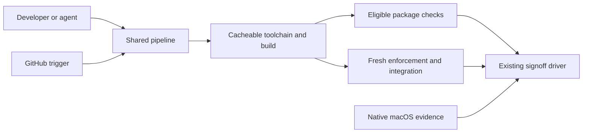

# Faster CI feedback with Dagger

**Status**: measured plan; optional pilot only · **Date**: 2026-10-24 · **Relates to**: [#1104](https://github.com/Roasbeef/loom/issues/1104)

**Keep the existing check and signoff obligations while progressively replacing
redundant execution with dependency-aware reuse.** The tracking issue owns the
PR sequence. This note records the baseline and the limits behind that plan;
it is not authorization to weaken a required gate.

## What we measured

GitHub's complete run/job/step API records were collected for seven recent CI
runs. Every sampled run was attempt 1. The two successful workflows below each
returned 21 jobs with `per_page=100`, so pagination did not truncate the result.
Completion is the final runner-backed job timestamp, not `updated_at`.

| Run | Linux fan-in from run start | macOS fan-in / full workflow | Concurrent runner work, summed |
| --- | ---: | ---: | ---: |
| [40065784204](https://github.com/Roasbeef/loom/actions/runs/40065784204) | 35m29s | 96m32s | 205m37s |
| [40063975698](https://github.com/Roasbeef/loom/actions/runs/40063975698) | 47m42s | 142m08s | 219m00s |

These are two observations, not a percentile or service-level guarantee.
Summed runner work overlaps and must not be read as elapsed time. Workflow
success alone also does not prove an advisory test passed: the macOS check
step uses `continue-on-error`. In run 40063975698 the inspected raw advisory
logs show all test commands exiting zero; expected negative-fixture diagnostics
were not classified as real failures merely because they contained “error”.

The approximate thirty-minute estimate describes the shorter Linux path, not
the whole hosted workflow. macOS dependency jobs had creation-to-start delays
of 38m19s and 56m01s. Later macOS jobs also started late. These timestamps show
scheduling/start delay, not a direct measurement of pure runner-queue time.
Dependent jobs can spend time waiting for prerequisites as well.

Actual work was substantial too. macOS advisory `make check` steps took
28m10s, and 29m30s / 24m12s in the other run. A 41m44s advisory job included
28m10s in that check, about 11m35s before it, and a tail afterward. The Linux
client steps took 13m37s / 14m40s and 18m49s / 15m48s. Linux deliverables took
10m14s / 10m48s. macOS bootstrap steps took 12m16s / 9m46s. The first sample's
Linux fast bucket took 11m40s, so its name does not mean it is cheap today.

In run 40065784204 all Linux client checks had finished by 05:48:40 UTC, but
the Linux fan-in was created only when stock-compiler macOS coverage finished
at 05:54:34. The workflow's `stock-compiler` matrix is an upstream dependency
of both fan-ins. Removing that dependency from Linux would change which
platform evidence blocks it; it is a separate policy decision, not a cache fix.

Short red runs are not fast complete runs. The newer
[40072207177](https://github.com/Roasbeef/loom/actions/runs/40072207177)
failed upstream in roughly four minutes. Logs identify incorrect arity and a
duplicate argument in `vendor/ext/src/ext/internal/live_runtime.gleam`, followed
by the code-mode seed build failing. Downstream jobs were skipped. Other
sampled failures, 40068351735, 40068126469 and 40065794988, also failed named
seed/build steps; their root errors were not all classified. Do not call those
failures flakes or use their short duration as a full-suite baseline.

## Existing caching and the first opportunities

The successful run's Linux dependency job
[120790342373](https://github.com/Roasbeef/loom/actions/runs/40065784204/job/120790342373)
hit the patched Gleam, Go and Hex caches. Compiled Gleam restored a compatible
prefix key ending `f759...`, built the changed inputs, then saved the new exact
key ending `4dc416...`. Downstream Linux checks hit that exact key. macOS deps
showed the same compatible-restore-to-exact-save pattern. This is working
caching, not evidence that the workflow starts from nothing every time.

The audit was checked against source revision `369726deb3`, separately from
the older successful run revisions. The relevant implementation is
[ci.yml](https://github.com/Roasbeef/loom/blob/369726deb3/.github/workflows/ci.yml)
and [setup-toolchain](https://github.com/Roasbeef/loom/blob/369726deb3/.github/actions/setup-toolchain/action.yml).

Both macOS advisory shards run full `make check`, with only the client package
partitioned. Their logs confirm repeated non-client package sections. A small
PR can remove one duplicate pass while retaining a complete non-client pass,
both client halves, global checks and the strict skip census. That preserves
coverage; changing what is advisory or required is not part of it.

Another candidate is cache completeness rather than cache-key weakening.
Standalone roots in the Linux fast bucket spend roughly sixty seconds each
building tools, cap, ext and harness, with repeated esqlite C compilation. The
deps job publishes its compiled-tree cache before those check roots run. An
exact cache hit cannot subsequently overwrite that immutable cache entry.
Verify which root/profile outputs the producer actually contains before
choosing producer prewarming or separate consumer caches. Dependency compile
output for a module is not proof that its standalone root's test build exists.

Pinned tool installation is a smaller independent opportunity. In the first
successful run gopls installation took 29 seconds in Linux conformance,
30/43 seconds in the macOS shards and 62 seconds in jail. Cache or distribute
the pinned binary only after checking platform/toolchain identity and cold
installation behavior. Do not trade correctness for a broad restore prefix.

## Where Dagger fits

[Dagger](https://github.com/dagger/dagger) supplies the container execution
engine, operation graph, cache and traces. The Dagger team maintains that
engine; Loom maintainers own the Gleam adapter and the declared inputs that
make reuse correct. The [beta announcement](https://dagger.io/blog/dagger-10-beta/)
is motivation, not evidence that our EUnit tests already have native individual
test artifacts. The pilot caches package checks through the existing scripts.
No compiler plugin or Gleam SDK is required to start.

GitHub-hosted Linux runners can start the pinned engine with Docker without
Dagger Cloud. Their local engine storage is ephemeral: a warm repeat in one
job does not establish cross-run cache reuse. A persistent trusted engine or
self-hosted runner needs explicit authentication, resource/cancellation bounds,
storage/GC and cache trust separation. Fork PRs must not receive SSH secrets
or run untrusted code in a privileged trusted engine. Native macOS coverage
stays native.

The raw-test login is Gilgamesh. Its SSH alias uses the `gilgamesh` account on
the machine named Obelisk; `gilgamesh-signoff` is the separate gated identity.
The owner provisioned Docker access during this work, after an initial denial.
A fresh login verified Docker 23.0.1 and the existing beta19 engine. This
removes the access blocker, not the rest of the engine security/operations work.
The historical pilot used a different Docker-admin login; do not silently
reattribute its measurements to the intended raw-test account.

The pilot strips ambient Dagger variables and isolates HOME/XDG config so a
saved OAuth login cannot enable Cloud trace export. The isolated trace-status
probe reported `not emitting / no credential`. `DAGGER_NO_NAG` only suppresses
a prompt; it is not the no-Cloud mechanism. See [the pilot guide](../dagger-pilot.md)
for commands, cache invalidation controls and limitations.

## Delivery and proof

The first PR publishes this baseline and the optional reviewed pilot without
changing CI or signoff behavior. Subsequent small PRs should remove proven
GitHub duplication, separate compiled artifacts from test verdicts, add a
non-authoritative Linux Dagger parity job, validate persistent Gilgamesh engine
operations, and finally migrate Linux signoff at unchanged obligations. Each
step must have cold/warm and failing controls before the existing path is cut
over. The checklist and policy boundaries are in [#1104](https://github.com/Roasbeef/loom/issues/1104).

A cached success is evidence of a prior execution, not proof that a flaky test
became reliable. Timing, concurrency, kernel enforcement and external-state
checks need fresh execution. Fresh tests should still be able to reuse compiled
artifacts. Periodic cold builds remain necessary, including while the toolchain
Dockerfile fetches mutable apt packages and Rust's stable channel.

The pilot's initial unchanged comparison was 64.8 seconds versus 1.2 seconds
inside the session for 1,021 tests, plus CLI/setup costs. It is not a prediction
of the improvement for all CI. Measure representative edits, Linux fan-in,
full-workflow latency and runner work separately before making that claim.
