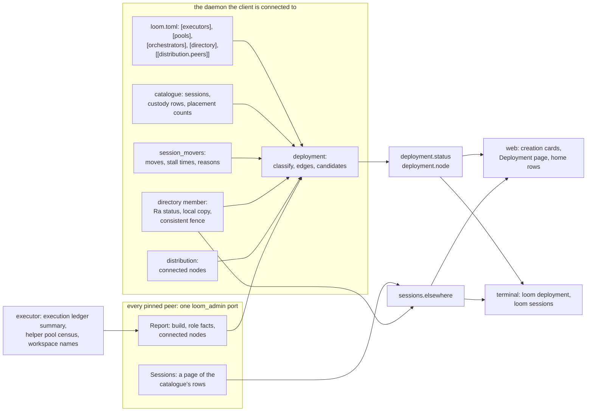

# Operator surface for the distributed runtime: executor choice, one session list, health and topology

Status: **proposed, for the owner's review, 2026-10-11. Nothing here is built.**
It is written against `distributed/simplify` (PR #923, the distributed runtime)
with the Khepri directory of `directory/khepri` (PR #934, protocol-change/083)
on top. The interface changes are drafted in
[protocol-change/085](../../protocol-change/085-distributed-admin-surface.md).
It also leaves room for three branches that are not in this tree: the peer mail
reach work (PR #937, which adds `Describe`, `Roster` and a `NotOpen` answer to
the orchestrator port), remote code mode and MCP on executors (PR #938, which
raises `protocol.version` to 3), and subagents on another orchestrator (PR #939,
design only, protocol-change/084 on that branch).

The design does not change a rule of [protocol-change/051](../../protocol-change/051-web-view-route.md)
or of [protocol-change/053](../../protocol-change/053-owner-admin-and-claims.md).
Where the web page needs a rule 051 does not have (a fourth page scope), slice 8
of section 11 names the addendum and protocol-change/085 says what it decides.

## 1. The question

The owner's words, after reading the follow-ups of PR #934, were: "So we're have
no web admin support? I'd expect to be able to: select an executor when making a
session, see unified sessions across all orchestrators, see system health,
toplogy diagram, etc."

The answer today is "partly, and the rest is not there at all". Section 2 is the
inventory. Sections 5 to 9 take the owner's four wishes and the operator actions
in turn, and each says what exists, what is missing, the read or command that
would supply it, the web design, the terminal design and the tests that prove it.
Section 10 lists what is deliberately not proposed. Section 11 is the plan, as
small slices, and section 12 lists the questions that only the owner can settle.

## 2. What exists today

| Need | What exists | What is missing |
|---|---|---|
| Choose an executor when making a session | `sessions.create` takes `executor` or `pool` and a registered workspace name. The web home has a "New session on an executor" form with a select of executor names and a typed workspace name. The terminal has `--executor` and `--pool` with `--workspace`. | Pools in the web form. Any state about an executor before the choice. The names of the workspaces an executor serves. |
| See sessions across orchestrators | `sessions.get` and `sessions.open` answer `not_owner` for the owner principal, naming the orchestrator that holds the session. The Khepri copy knows every session's owner. | A list. `sessions.list` and both clients' pickers show this daemon's catalogue only. |
| See system health | `status` (this daemon's slots), `directory.status` (this member's view of Ra), `hello` (this daemon's build). | Everything about the other nodes. Whether a Khepri copy has caught up. Executor capacity. Stalled moves. |
| See topology | The configuration tables, read by a person. | Any read. |
| Operate | `sessions.move` and `loom sessions move`. Abandon and `directory.status` are control commands only. | A way to pick a destination. A web or terminal surface for abandon. |

**Choosing an executor.** `sessions.create` decodes `executor` and `pool` as
exclusive names and then reads `workspace` as a registered name, not a path
(`created_workspace`, `client/daemon/protocol.gleam:929`; `executor_field`,
`client/daemon/protocol.gleam:891`; `pool_field`, `client/daemon/protocol.gleam:911`).
The daemon holds the names from its `[executors.<name>]` and `[pools.<name>]`
tables, with each executor's declared platform, enforcement and toolchains
(`Executor`, `client/executors.gleam:68`). The web home is told only the names
(`HomeAttachment`, `client/daemon/server.gleam:240`, whose `executors` field is
`List(String)`), draws them in a select, and asks the owner to type the workspace
name (`CreatingRemote`, `web_view/home.gleam:688`). The terminal builds a
`Placement` from launch flags (`Placement`, `tui/placement.gleam:31`) and cannot
change it inside a running terminal. Neither client can show whether an executor
answers, is full, or contradicts its declaration. That is learned at the attach,
when `contradiction` (`client/executors.gleam:369`) compares the executor's census
with the declaration and the open fails. A typo in a workspace name is learned the
same way. [The setup guide](../distributed-setup.md) tells an operator to check a
connection with `epmd -names`, `lsof` or `ss`.

**The session list.** `sessions.list` reads this daemon's catalogue
(`ListSessions`, `client/daemon/server.gleam:3056`). The Khepri copy on a member
knows `{Owner, State}` for every session and nothing else: no name, no workspace,
no executor ([directory architecture](../architecture/directory.md), "What the
store holds"). The orchestrator port answers `Owns` and the move messages
(`Message`, `client/remote/orchestrator_port.gleam:69`). Nothing answers "what
sessions do you hold".

**Health.** The pieces exist and none is readable from a client. The live
connections are the BEAM's, and `client/distribution` knows only the configured
peers (`Membership`, `client/distribution.gleam:100`). The executor's census is
returned in `Attached` (`client/remote/protocol.gleam:108`) and kept by the live
plane. The execution ledger holds the scope rows, the byte budget, the
unacknowledged results and the scopes that block a reopen, and the only reader is
`loomd executor release`, which runs with the daemon stopped. The helper pool has
`pool_census` (`broker/exec.gleam:3230`) per plane and no node-level read. A move
stalls with a reason that goes to one log line (`Stalled`,
`client/session_mover.gleam:233`) and is forgotten, and the movers keep only the
time the stall began (`Entry`, `client/session_movers.gleam:140`). Peer mail
backlog is rows in each session's store, with no total. `directory.status`
reports the configured members, Ra's members with their votes, the leader and
this member's applied index (`directory_status_json`,
`client/daemon/server.gleam:2539`). It does not compare the applied index with
the leader's, so it cannot say whether this copy has caught up. The only
"not caught up" signal today is `voter: false`, which holds while a joining
member is a non-voter.

**Operating.** `MoveSession` and `AbandonMove` are owner-only control commands
(`client/daemon/server.gleam:3179`, `client/daemon/server.gleam:3151`). `loom
sessions move <id> --to <name>` exists (`parse_sessions`, `tui/src/tui.gleam:1209`),
and the destination name must be remembered, since nothing lists the choices.
`sessions.list` records do not carry the move state that `sessions.get` carries,
so neither client can draw a `moving` or `moved` session
([the handoff](../next.md) lists this as a known limit).

## 3. The decisions in brief

1. **One read-only port per daemon, `loom_admin`, with its own closed message
   type.** Every probe goes there. A probe is never sent to the executor host or
   to the orchestrator port, because an older node cannot match a new
   constructor and its port or host exits, which ends the daemon (section 4.1).
2. **Three new owner-only control commands, one extended and one decorated:**
   `deployment.status`, `deployment.node` and `sessions.elsewhere` are new.
   `directory.status` gains a `copy` member. `sessions.list` records gain the
   `moving` and `moved` members that `sessions.get` already has. No existing
   member changes meaning, and no command needs the new ones to keep working.
3. **The daemon classifies and the clients draw.** A node is `ok`, `degraded`,
   `down` or `unsupported`, and the reasons are fixed words. The terminal and the
   web page implement no health policy of their own.
4. **Every statement is "as seen from the daemon the client is connected to".**
   There is no cache, no history and no push. A client polls.
5. **Health is advisory at creation.** The form shows an executor's state and
   never blocks on it. The daemon still decides at the open, as it does today.
6. **A foreign session is a read-only row.** It names its owner and the command
   that reaches it. The local daemon does not attach to it (section 6).
7. **Web:** executor and pool cards in the existing creation form, a `Deployment`
   page (a fourth page scope beside session, home and admin), a Move chooser in
   the home row's action group, and Abandon in the Deployment page.
8. **Terminal:** commands first, text output, `--json` for scripts. Overlays inside
   the running terminal wait for the terminal revamp.
9. **Stay on the command line:** `loomd executor release`, `loomd directory
   bootstrap`, `loom distribution provision` and `install`, and any future
   membership removal or failover (section 9).
10. **No new configuration key and no new catalogue table.**
11. **Ten slices.** The first three add no new command or port (section 11).

## 4. How the pieces fit

The daemon a client is connected to is the only place the client talks to. It
combines what it already knows with what its pinned peers report.



### 4.1 Why a separate port

The executor host's message type and the orchestrator port's are closed, and a
peer is assumed to be the same build. A constructor the receiver cannot match
crashes the host, "which halts the executor daemon"
([the architecture page](../architecture/distributed.md), "What the closed
vocabularies limit"), and the orchestrator port is linked so that its abnormal
exit ends the daemon (`start_orchestrator_port`,
`client/daemon/main.gleam:593`). Health is read most often during an upgrade or
after a failure, which is when builds differ. A probe that adds a constructor
to either type would turn "ask an old node for its status" into "stop an old
node". So the probe goes to a new registered name, `loom_admin`, whose process is
supervised and restartable and is not linked to the daemon's fate. An older node
has no such name, the send is dropped after the connection is made, and the node
is reported `unsupported`: reachable, build unknown. An admin port that receives
a message it cannot match restarts and costs the asker one timeout. Every ask
runs in a weft task, so a reply of the wrong shape fails that task and not the
daemon.

The executor host answers the admin port through a private event, not through
`HostMessage`: the host's `Event` type gains a `Summary` constructor that only the
in-VM admin port sends on a subject only it holds (`Event`,
`client/remote/host.gleam:207`, which is private to the module). The wire vocabulary of the host does not change, so
`protocol.version` does not change.

### 4.2 The node report

`Report` returns one plain-data record, built without opening any session. Role
facts are present only for a role the node plays, since one daemon may be an
orchestrator, an executor and a directory member at once.

- **Every node:** its node name, `build_version`, `build_commit`, the daemon epoch,
  its own start time and current time on its own clock (the asker computes uptime
  from the two and never compares them with its own clock), and the nodes it holds
  a live distribution connection to, hidden and visible.
- **Executor facts:** `protocol.version`, the scope counts by state (`ScopeState`,
  `storage/exec_ledger.gleam:211`), the limit on scopes that are not cleanly
  closed (`Limits`, `storage/exec_ledger.gleam:191`), the scopes that block a
  reopen (`closing`, or closed with unknown cleanup) with their session ids, bytes
  held against the ledger budget, the count of unacknowledged results, the helper
  pool size and how many helpers are borrowed, the platform label, the
  enforcement and toolchains from the most recent attach census (`unknown` until
  one has happened), and the names, never the paths, of the registered
  workspaces.
- **Orchestrator facts:** slots (the `status` counts), whether it can receive
  sessions, the executor names it configures, session counts by executor and
  residency from the catalogue's existing `executor` column, and the moves in
  flight with their stall time and last reason.
- **Directory facts:** the body of `directory.status` plus `copy` (section 7).

A report is bounded by construction. Unclean scopes are at most the limit (16 by
default), workspace names are capped at 64, and placement rows at 32. The reply to
`deployment.status` leaves the long lists out, and `deployment.node` carries them
for one node, so the 64 KiB control message limit is not approached.

### 4.3 Classification

`client/deployment.classify` is a pure function of the reports and the daemon's
own configuration. It runs on the asking daemon, so both clients show one verdict.

| State | Meaning |
|---|---|
| `ok` | Reachable, answered, nothing below applies. |
| `degraded` | Reachable and answered, with one or more fixed reasons. |
| `down` | No distribution connection could be made within the deadline. The reason word is the one `distribution.describe` gives. |
| `unsupported` | Connected, no `loom_admin` port. Treated as reachable for placement. |

The degraded reasons are: `unclean_scope` (a scope that blocks a reopen exists),
`scopes_near_limit` (the unclean-capable scopes are at 75 percent of the limit or
more), `scopes_full` (at the limit, so the next attach is refused
`CapacityExhausted`), `ledger_near_limit` (80 percent of the byte budget),
`declaration_contradicted` (the executor's census disagrees with its
`[executors.<name>]` row, using `contradiction`), `build_differs` and
`protocol_differs` (against the asking daemon), `directory_no_leader`,
`directory_copy_unconfirmed`, and `directory_quorum_lost` (fewer reachable voters
than a majority, from the asker's view). The thresholds are constants in
`client/deployment` and the owner can move them (section 12). The whole
deployment is as bad as its worst node, in the order `down`, `degraded`,
`unsupported`, `ok`.

### 4.4 Authority and trust

The new control commands are owner-only. A member principal gets `forbidden`, as
for `directory.status`. The admin port answers any pinned peer, the way the
orchestrator port answers `Owns`. That is not a boundary: a pinned peer already
has the privileges of an Erlang node on the machine
([the architecture page](../architecture/distributed.md), "Trust and transport"),
and the port exists to keep each reader to its job. The report carries no
credential, no key, no cookie, no path of a workspace root and no pin. The
`Sessions` page carries what the answering daemon's own owner sees in
`sessions.list`, and the asking daemon gives it only to its own owner, on the
rule that one operator administers every orchestrator of a deployment. A
deployment where two people own two orchestrators and do not trust each other
should not pin them to each other at all.

### 4.5 Cost and failure of a read

`deployment.status` makes one fan-out: a connection attempt to each configured
peer (1.5 seconds) and a `Report` ask (1.5 seconds), all under one weft deadline
of two seconds, the bound the directory's lookup uses (`deadline_ms`,
`client/session_directory.gleam:90`). It connects to executors that were idle,
which is what a session open would do. A
peer that does not answer is `down` in this reply and nothing is remembered. The
clients poll: the Deployment page every 10 seconds, the home every 30 seconds
for the strip and the elsewhere list, the creation cards when the form opens.
Health changes on the scale of minutes, so there is no push, and no health event
on the session lane.

## 5. Executor selection at session creation

**Today.** Section 2. Local placement is the default in both clients and stays so.

**Gap.** No state before the choice, no pools in the web form, no workspace names,
and a blind typed name. The cost of a wrong choice is a `reserved` session and an
`executor_unavailable:` failure after the open, which the guide documents. That is
a cheap failure, so the proposal is advisory: it informs the choice and refuses
nothing.

**Surface.** `deployment.status` carries a `placements` object: one entry per
configured executor and per pool. An executor entry has the asking daemon's name
for it, its node, a state word, the free scope count when known, its declaration
and any contradiction. The states are `ready`, `degraded`, `full`, `down` and
`unsupported`, derived from section 4.3 (`full` is `scopes_full`). A pool entry
lists its executors in the order `pools.candidates` returns them and marks which
are eligible now. The daemon does not reorder a pool by health; the pool's trial
order is the rule, and a first open still moves to the next candidate only on a
failed connection or `CapacityExhausted`. `deployment.node` for an executor
returns the registered workspace names. These are the reuse points: the
configuration tables, `contradiction` and `pools.candidates` are existing code,
and the only new data is the executor's own report.

**Web.** The existing form opens as it does. Instead of a select of names, the
panel shows one card per executor and per pool: the name, a state pill (the
existing `online`, `pending` and `ended` tints, so no new colour), "N scopes
free", the platform and enforcement, and the contradiction text if there is one.
A card has a "Choose" button, and the choice opens the form for that executor or
pool with a select of the executor's reported workspace names (option values are
positions, labels are text nodes, as the profile select already works). When the
executor did not report its workspaces, or for a pool whose members disagree, the
form falls back to today's typed field and says why in one line. Cards use clicks
and the form uses the submit that the owner's socket already admits beneath the
home table, so no new event class is admitted. The page is told the cards once
when the form opens (a weft task runs the read; the runtime never waits) and the
creation path (`create_for`) is untouched except that it accepts a pool, which
`creations.Registered` gains as a variant. It re-checks the name against its
configuration as it does for executors.

**Terminal.** `loom deployment executors` prints the same candidates: name, node,
state, scopes, platform, enforcement, workspaces and the pools each belongs to,
with `--json` for the raw reply. `loom --executor box --workspace app` is
unchanged. An overlay that picks an executor from inside the running terminal
needs the session picker work of the terminal revamp, so it is not in these
slices.

**Tests.** `client/deployment` tests of the candidate and state rules, including a
declaration the census contradicts and a pool with one unreachable member. A
`web_view` simulation test of the cards, the choice, and a form whose select
carries only the positions the page drew. A route test that a forged executor
index creates nothing. A terminal golden test of the table.

## 6. One session list across orchestrators

**Today.** Section 2. A daemon answers for the sessions it holds, and the owner is
sent elsewhere with the launch line for the owning daemon
(`redirect_words`, `tui/daemon/selection.gleam:779`).

**What a daemon can answer about sessions it does not own.** Three tiers, each
weaker than the one before.

1. **Rows from the owning orchestrator.** The owner's catalogue knows everything
   `sessions.list` shows: the id, the name and subtitle, the workspace (a path on
   that machine for a local session, a registered name for a remote one), the
   executor or pool, the creation time, the residency status, and the move
   state. A new `Sessions` ask on the admin port returns a page of these rows,
   in the same record shape as `sessions.list` so a client draws a foreign row
   with the code that draws a local one. The answering daemon leaves out archived
   sessions and `moved` tombstones.
2. **Rows from the directory copy.** On a Khepri member the local copy lists every
   record: the id, the owner node, and `serving`, `moving` or `local`. This needs
   no network. It fills in sessions whose owner did not answer, and sessions the
   owner does not list because of a lag in the other direction. It carries no name.
3. **Nothing.** A non-member whose owner is down shows the orchestrator as silent
   and lists none of its sessions. There is no source of the ids.

`sessions.elsewhere` (owner-only, paged by session id with an `after` cursor and
the same 60,000 byte page rule as `sessions.list`) merges these and returns, beside
the rows, one entry per configured orchestrator saying `answered`, `silent` or
`unsupported`. A row has a `source` of `catalogue` or `directory`. A directory-only
row has `state: "unconfirmed"` and no name. When two orchestrators list the same
id, which happens between the receiver's activation and the source's retirement
in a move, the merge keeps the row that is not `moving`. `sessions.list` itself is
unchanged except for the decoration below, because its revision counter and
authorization belong to the local catalogue and a merged list could not keep
either.

**The `moving` and `moved` members on `sessions.list`.** The local catalogue's
tombstone row for a moved session lists as saved today. In a merged view that
would show the session twice. The records of `sessions.list` gain the optional
`moving` and `moved` objects that `sessions.get` already carries
([client protocol, section 3.5](../client-protocol.md)). They are optional members, which
the protocol already tells clients to ignore when unknown. The web home hides a
`moved` row from its lists and draws a `moving` row with its destination, and the
terminal does the same. This is also what lets the terminal render the two states
its handoff says it cannot.

**What a click on a foreign session does.** The row is read-only. Its detail
shows the owning orchestrator's name, its node, the session state, and the launch
line that reaches it, as text and in a copy box. The line is the one the terminal
already prints for `not_owner`, so there is one wording. The web page draws no link
to the other daemon, since the owner's web view there needs its own ticket from
its own credential and listens on that machine's loopback; a person reaches it by
the tunnel they already use. Not proposed: attaching the local daemon to a foreign
session. The local daemon holds no credential for the other and neither first-party
client does. The alternative is to let a peer link carry a gateway attach, which
would make one orchestrator's web page a console for the other's conversations
and would break the stated purpose of the orchestrator port's closed vocabulary,
which is that a peer cannot read a session's conversation through it. That is the
owner's decision (section 12, question 1).

**How the `not_found` catch-up gap shows.** A member's copy can lack a record the
leader has, after a join or a long outage
([directory architecture](../architecture/directory.md), "Reading an owner"). The
list does not hide this. `directory.status` gains `copy`, either `current` or
`unconfirmed`: the daemon runs a consistent read (`read_consistent`,
`client/directory/store.gleam:352`, which fences before it reads, and `consistent`
in `client_khepri_ffi.erl:159`) under a short deadline and reports `current` only
when it completed. No quorum, or a copy so far behind that the fence times out,
reads `unconfirmed`. The merged list repeats `copy` in its header. The web home
draws one quiet line, "This daemon's directory copy is not confirmed current:
sessions created in the last seconds may be missing", and the terminal prints the
same sentence as a footer. A `not_found` answer on a member that reaches the
terminal gets that sentence appended when `copy` is `unconfirmed`, which is one
extra `directory.status` call on a path that has already failed.

**Web.** The home gets a section after "Other folders": "On other orchestrators",
one group per orchestrator headed by its name and a state pill, rows below it,
and a quiet line for an orchestrator that did not answer ("bravo did not answer;
2 sessions are recorded in the directory"). It follows the existing rules for
rows: text nodes for every name and path, no left-edge colour bar, no shadow, a
hairline between rows. A foreign row's trailing control is a "Where" button that
opens the detail in the row, with the launch line in a `<loom-copy>`. The read is
a weft task on the home socket, started when the page opens and every 30 seconds
with the sessions list, and its answer is a message the page ignores if a newer
read has started (a read number, as the admin page does).

**Terminal.** `loom sessions list` prints the local sessions as it does, then a
section per orchestrator when the daemon lists any, each row prefixed by its
owner; `--local` leaves the section out and `--json` prints the raw reply of both
commands. When `sessions.elsewhere` fails, one line says so and the exit status
is unchanged. The picker inside the terminal (`/sessions`) adds the foreign group
after the revamp.

**Tests.** The merge function (duplicates, ordering, the `source` and
`unconfirmed` rows, a silent orchestrator) as a pure test. The admin port's
`Sessions` ask against two daemons in one VM (the existing `remote_duo` and
`peer_rig` fixtures), with the paging cursor crossing a page boundary. A shipped
test with three members: create sessions on each, stop one member's daemon, and
check that its sessions appear as `directory` rows and the stopped orchestrator
as `silent`. A shipped test that a member whose store was wiped lists
`copy: unconfirmed` and then `current` after the join promotes it. Route tests
that a member principal's `sessions.elsewhere` is `forbidden`.

## 7. System health

For each item in the owner's list: what exists, where it lives, and the proposal.

| Item | State today | Proposal |
|---|---|---|
| Orchestrator and executor reachable | Internal: `distribution.connect` results, and a link keeper for directory members only (`connect`, `client/distribution.gleam:403`) | `state` on each node in `deployment.status` |
| Executor census (platform, enforcement, toolchains) | Returned at attach and kept in the live plane | Executor facts, from the last attach; `unknown` before the first |
| Capacity and live scopes | Ledger rows and the limit (`default_limits`, `storage/exec_ledger.gleam:443`; `LOOM_EXECUTOR_MAX_SCOPES`) | Executor facts: counts by state, the limit |
| Helper pool | `pool_census` per plane, no node total | Executor facts: size and borrowed, summed over planes |
| Ledger bytes, unacknowledged results | Ledger only | Executor facts |
| Scopes that block a reopen | Ledger only; the operator learns of one from a refused open | Executor facts: session ids and state, with the `loom executor release` line in the page |
| Khepri membership, leader, applied index | Control command `directory.status` | Unchanged; also embedded in `deployment.status` |
| Whether this copy has caught up | Missing | `copy` member (section 6) |
| Stalled moves | Internal: `Entry` and one log line | Orchestrator facts: session, destination, phase, stalled time, last reason |
| Peer mail outbox backlog | Rows in each session's store; the drainer retries every five seconds (`retry_interval_ms`, `client/peer_outbox_drain.gleam:79`) | Last slice and optional: a total and the age of the oldest row |
| Pinned TLS peers connected | Internal: BEAM `nodes()` | Node report: connected node names |
| Build and protocol versions | `hello` for the connected daemon; the executor's `protocol.version` is checked at attach only | Node report; `build_differs` and `protocol_differs` reasons |

Most of these read what is already kept. Four need a small change to existing
code. The movers' `Entry` stores the last stall reason, which
`Stalled` already carries. `exec_ledger` gains one read-only `summary` query
beside `scope`, with SQL in `storage/sql/exec_ledger.sql` and a `make gen-sql`
regeneration in its own commit. The distribution FFI module gains one function
that lists all connected nodes, hidden ones included, because `gleam_erlang`
lists only visible nodes; this is the one new Erlang function in the design,
it lives in the existing `client_distribution_ffi.erl`, and its comment says why
no Gleam alternative exists. The Khepri FFI gains one list primitive for section 6.

**Web.** A one-line strip under the home's bar shows the verdict ("Deployment ·
4 nodes · 1 degraded") in a pill, and is a button to the Deployment page. It is
drawn only for the owner's operating page and only when the daemon lists a peer.
The strip is the only health on the home. The Deployment page (section 8) holds
the rest.

**Terminal.** `loom deployment status` prints the verdict, the nodes, the links,
the directory and the moves (example in section 8). `loom directory status` prints
`directory.status` as a short table. Both take `--json`.

**Tests.** The classification table as pure tests, one case per reason and one
for the worst-node rule. A report test against a real ledger with an unclean
scope, a full ledger and an `open` scope. A mixed-build test: a node without the
port is `unsupported`, a message sent to an admin port that cannot match it
restarts the port and the daemon survives. A shipped test with an executor
daemon restarted under a live session (the case the setup guide's
troubleshooting describes) that asserts the scope appears as `unclean_scope`
with the right session id and that `loomd executor release` clears it.

## 8. The topology view

**Data.** Nodes are the node names of the asking daemon, its configured executors
and orchestrators, the directory members and every `[[distribution.peers]]` row.
A node is shown under the asking daemon's own key for it when it has one
(`[executors.box]`, `[orchestrators.bravo]`), otherwise under the peer name, as
the directory already does when it answers a client. The relations come from
configuration and the catalogue, and the state of each link comes from what the
two ends report.

| Edge | Source | Meaning |
|---|---|---|
| serves | the orchestrator's placement counts | an orchestrator holds N open sessions on an executor |
| peer | `[orchestrators]` of either end | peer mail and moves can go this way |
| member | `[directory] members` and Ra's membership | a Khepri link; marked voter or non-voter, leader starred |

Each edge also has a link state: `connected` when both ends list each other in
their report's connected nodes, `one_way` when only one does, and `none`. The
difference matters. `one_way` is what a half-open or recently restarted
connection looks like, and a person debugging a partition needs to see which end
believes what. Where a session sits is the `serves` count on its edge and, for a
named session, the executor field of its row.

**Web.** The Deployment page draws an inline SVG built by a pure layout function
in `web_view/topology`: orchestrators in a left column, executors in a right
column, one rounded rectangle per node with its name, role and state pill, and
one line per edge. Line styles are solid (serves, with the count as a text
label), dashed (peer) and dotted (member), and the link state is the stroke
(`--color-divider` for `connected`, the `pending` tint for `one_way`, the
`ended` tint for `none`). A node rectangle uses `--color-bg-raised` and a
hairline border; a selected node gets a one-pixel outline in `--color-current`.
There are no accent bars on the left edge and no shadows. All colour comes from
literal classes over existing tokens, so no inline style is needed and the
content security policy does not change. Every label is a text node. Layout is a
function of the snapshot alone, so it is deterministic and has golden tests.

The SVG is a view of the node table, not a second control surface. Clicking a
node selects the same row the table selects, the table is always drawn and is
the keyboard path, and the SVG has a `role="img"` label that states the verdict.
Selecting a node reads `deployment.node` and fills the detail pane beside the
table: executor facts as three bars (scopes, ledger bytes, helpers), the
registered workspace names, the unclean scopes each with its `loom executor
release` line in a copy box, the orchestrator's slots and moves, and the node's
connected nodes.

**Terminal.** A compact rendering, from the same snapshot:

```
deployment as seen from alpha, 3 of 4 nodes answered, 14:02:11
state: degraded (exec2 down; box has 1 scope that needs a release)

NODE   ROLE                   STATE     BUILD     SCOPES  NOTE
alpha  orchestrator, member   ok        b4eeb50c  -       8 slots, 2 resident, 1 move in flight
bravo  orchestrator, member   ok        b4eeb50c  -       directory leader
box    executor, member       degraded  b4eeb50c  4/16    1 scope needs release: 0198c0de
exec2  executor               down      -         -       timeout

LINKS  == both ends connected   -> one end only   .. configured, not connected
alpha == bravo   peer, member
alpha == box     serves 3, member
bravo -> box     serves 1, member
alpha .. exec2   serves 0

DIRECTORY  3 members, 3 voters, leader bravo, this copy current
MOVES      1 in flight: 0198c0de alpha -> bravo, waiting 4m, receiver did not answer
```

The order is stable: orchestrators first, then executors, each by name, so two
runs diff cleanly. A line is cut at the terminal width on a character boundary,
and a name is drawn as text with control characters removed (the terminal's
existing `text_hygiene`). `--watch` is not proposed; `watch` does it.

**Tests.** The edge function over reports with each link state. The layout
function's goldens for one, two and six nodes, a node named with markup, and a
node with no edges. A simulation test that a click selects a row and that no
other handler exists on the page. The terminal rendering's golden file for the
example above and for a daemon with no peers (it prints the self row only).

## 9. Operator actions

**Move a session** (`sessions.move`). *Today:* a control command and `loom
sessions move <id> --to <name>`; nothing lists valid destinations. *Gap:* picking
the destination. A destination is valid when it is reachable, can receive sessions
(it started an importer), is not this daemon, and configures the executor the
session is on, since the receiver refuses a session whose executor it does not
list. The node report carries the first two facts and the executor names it
configures. *Surface:* no new command. The orchestrator facts in
`deployment.status` give the destination list, and the client intersects it with
the row's `executor`. A row with no `executor` (a local session, or a pooled one
that never opened) has no Move, with the reason as a title. The daemon still
decides authoritatively and the refusals are the ones in the protocol. *Web:* the
home row's action group (the Stop, Archive and Delete group in `view/home_table`)
gains "Move" for the owner's fresh, operating home. Pressing it reads the
destinations and replaces the row's words with one button per eligible
orchestrator and, for each ineligible one, its name and a reason. The second
press, on a destination, is the two-step confirm that Delete and Stop already use,
and it calls the registry through the function the control command uses, so both
share one code path. The row then reads "moving to bravo", from the `moving`
member. *Terminal:* `loom sessions move <id>` with no `--to` prints the same
candidates and exits with a nonzero status; with `--to` it is unchanged. *Tests:*
a pure candidate test, a route test that a non-owner and a resumed (not fresh)
home cannot press it, and the existing shipped move test driven once through the
web function.

**Abandon a move** (`sessions.move` with `abandon: true`). *Today:* a control
command, and a directory member only. *Why it can be a button:* its safety rests
on the record and not on the reader. The abandon is a compare-and-set that fails
once the receiver has activated, and the mover then keeps the move and finishes
it ([directory architecture](../architecture/directory.md), "Abandoning a
move"). A mistaken press cannot create two owners. What a person adds is the
judgement that thirty minutes of waiting is too long, which the page can inform by
showing the stall time and reason. *Web:* the Deployment page's Moves table lists
each move with the source, destination, phase, stall time and last reason, and an
"Abandon" button with the usual two-step confirm and the sentence "If bravo has
already taken the session, the move finishes instead." The row on the home shows
the same button for a `moving` session. A daemon that is not a member shows no
button, and says why in the table, since the command would be refused
`not_movable`. *Terminal:* `loom sessions move <id> --abandon`. *Tests:* a
simulation test of the two-step, a route test of owner and freshness, and the
shipped abandon test run through the web function once.

**`directory.status`.** It becomes `loom directory status` and the Directory
section of the Deployment page (members, voters, leader, applied index, `copy`).
Nothing in it is an action.

**What stays on the command line, and why.**

- `loomd executor release` runs with the executor daemon stopped and records that
  a person verified the scope's processes are gone. The safety is the person's
  reading of the machine, not a check the daemon can make, and the daemon being
  stopped means a page served by it cannot run it. The Deployment page shows the
  scope and the exact command (`usage` in `client/daemon/executor_cli.gleam`
  describes it) and does not run it.
- `loomd directory bootstrap` creates a cluster once, with the daemon stopped, and
  refuses to make a second. It is a deployment-time act.
- `loom distribution provision` and `install` handle private keys and the cookie,
  and no command prints either. They never go through a web page.
- Membership removal does not exist. If it is built (`ra:remove_member/3` behind a
  `loomd directory forget`), it stays on the command line: removing the wrong
  member can cost the quorum, and the command should show the voter count and
  require the member to be down first. The Deployment page would show what it
  needs to decide (voters, who is down) and nothing more.
- Failover does not exist. When it does, the takeover is a decision that a person
  makes after reading who is gone, so it too is a command that the page informs.
- `daemon.shutdown` is a control command already; no page offers to stop the
  daemon that serves it.

## 10. What is not proposed

- **A cache or history of reports.** A node that does not answer shows its failure
  word and nothing else. A cache would add a process, an eviction rule and a
  staleness label for a question the next poll answers. The failure cost of its
  absence is that a node that is down shows no last-seen time.
- **A push or a health event on the session lane.** Health moves in minutes and a
  poll is cheaper to reason about than a subscription.
- **Forwarding a command to a foreign orchestrator.** Move and abandon are the
  source's, and the source is the daemon the owner connects to.
- **A per-session executor ping.** The cards show the executor, and the open
  decides.
- **Certificate expiry.** Node certificates last five years (`client_pki_ffi.erl`
  sets 1825 days) and rotation is later work. The failure is total and late. It
  becomes worth a field when rotation exists.
- **A boot-time census on an executor.** The enforcement and toolchains shown are
  from the last attach. A census at boot would spawn a helper at start for a
  field that is `unknown` only until the first session. Section 12, question 5.
- **Remote subagent state.** A delegate session on a remote orchestrator would
  appear in `sessions.elsewhere` as any session does. The design reserves no
  field for it. PR #939 adds an optional `delegate_of` member in its own
  protocol-change, and clients ignore members they do not know.
- **Executor-to-executor moves, failover, membership change.** They do not exist.

## 11. The plan

Each slice ends green on its package gates, `make lint` and `make doc-check`, and
updates the CLAUDE.md of any package it changes. The dependency named is the PR
whose code the slice needs. Slices 1 to 3 add no wire.

1. **`sessions.list` carries custody.** *Scope:* optional `moving` and `moved`
   members on each record; `tui` decodes and renders them; `web_view` hides
   `moved` rows and marks `moving`. *Files:* `client/daemon/server.gleam` (the
   list body), `client/daemon/manager.gleam` (one custody read for a page),
   `tui/daemon/protocol.gleam`, `tui/session_table.gleam`, `web_view/sessions.gleam`,
   `docs/client-protocol.md`. *Tests:* protocol round trip, a table render, a home
   test of a moved row. *Exit:* a moved session no longer lists as saved on the
   source. *Depends on:* #923.
2. **`deployment.status` without the port.** *Scope:* `client/deployment` (pure
   candidates, edges and classification), reachability by connecting to each
   configured peer under a deadline, placements, `loom deployment status` and
   `loom deployment executors`, both with `--json`. *Files:* new
   `client/deployment.gleam`, `client/daemon/protocol.gleam`,
   `client/daemon/server.gleam`, `tui/src/tui.gleam`, `tui/daemon/protocol.gleam`,
   a new `tui/deployment_view.gleam`. *Tests:* classification and candidates as
   pure tests, a two-daemon test that a stopped executor is `down`, terminal
   goldens. *Exit:* `loom deployment executors` names the unreachable executor
   before a session is created. *Depends on:* #923.
3. **Executor and pool cards in the web form.** *Scope:* `Start.deployment`
   (the placements, read by a weft task when the form opens), cards, the choice,
   pool creation through `creations.Registered`. *Files:* `web_view/home.gleam`,
   `web_view/view/create.gleam`, `web_view/creations.gleam`,
   `client/daemon/ui_socket.gleam`, `client/daemon/server.gleam`. *Tests:*
   simulation, route and socket admission tests. *Exit:* the form shows state on
   each card and creates a pooled session. *Depends on:* slice 2.
4. **The admin port and node reports.** *Scope:* `client/admin_port`,
   `client/admin_report`, `client/admin_ask`; the host's private `Summary` event;
   `exec_ledger.summary`; the `Plane` helper accessor; the connected-nodes FFI
   function; the daemon starts the port beside the orchestrator port and the
   executor host. *Files:* `client/remote/host.gleam`, `client/executor_plane.gleam`,
   `storage/exec_ledger.gleam` with its SQL and generated module (own commit),
   `client/daemon/main.gleam`, `client_distribution_ffi.erl`,
   `client/internal/ffi_distribution.gleam`. *Tests:* report tests against a
   real ledger, the mixed-build tests of section 7, a shipped executor test.
   *Exit:* `Report` returns executor facts for a live executor, and an old-style
   node is `unsupported`. *Depends on:* #923.
5. **Full `deployment.status` and `deployment.node`.** *Scope:* replace the
   reachability-only nodes with reports; add the stall reason to the movers'
   `Entry` and a `moves` read to `Control`; the text topology; workspace names
   in the form's select. *Files:* `client/deployment.gleam`,
   `client/session_movers.gleam`, `tui/deployment_view.gleam`,
   `web_view/view/create.gleam`. *Tests:* edge and link-state tests, topology
   goldens, a shipped test with an unclean scope. *Exit:* the terminal shows
   the example in section 8 from a live deployment. *Depends on:* slice 4.
6. **`sessions.elsewhere`.** *Scope:* the `Sessions` ask, the merge, the command,
   the CLI section and the web home group. *Files:* `client/admin_port.gleam`,
   `client/daemon/server.gleam`, `client/daemon/ui_socket.gleam`,
   `web_view/home.gleam`, a new `web_view/view/elsewhere.gleam`,
   `tui/src/tui.gleam`. *Tests:* the merge, the port against two daemons, a
   paging test, a shipped test with a silent orchestrator. *Exit:* a session on
   the other orchestrator is listed with its owner and its launch line.
   *Depends on:* slice 4.
7. **Directory facts.** *Scope:* `copy` on `directory.status`, the directory block
   in `deployment.status`, `loom directory status`, the list primitive in the
   Khepri FFI, directory-only rows in `sessions.elsewhere`, the quorum reason.
   *Files:* `client/directory/member.gleam`, `client/directory/store.gleam`,
   `client_khepri_ffi.erl`, `client/daemon/server.gleam`. *Tests:* a one-member
   store test of `copy`, the shipped quorum and rejoin tests extended.
   *Exit:* a member that lost its disk reports `unconfirmed` until promoted.
   *Depends on:* #934, and slices 5 and 6.
8. **The Deployment page.** *Scope:* a fourth page scope with its exchange, page and
   socket, the `web_view/deployment` component, `view/topology`, the node table,
   the detail pane, the Directory and Moves sections (read-only), a 051 addendum.
   *Files:* `client/daemon/ui_sessions.gleam`, `client/daemon/ui_http.gleam`,
   `client/daemon/ui_socket.gleam`, `client/daemon/server.gleam`,
   `web_view/deployment.gleam`, `web_view/topology.gleam`,
   `web_view/page.gleam` (routes), `web_client` (a copy shape). *Tests:* the
   route suite for the new scope (a ticket spent at the wrong exchange is
   refused), socket admission with its near misses, simulation, topology goldens,
   the CSS check. *Exit:* the page shows a live three-node deployment and ends at
   its lifetime. *Depends on:* slices 5 and 7.
9. **Move and Abandon in the web, and in the terminal.** *Scope:* the Move chooser,
   the Abandon button in the Moves table and the `moving` row, `loom sessions
   move` candidates and `--abandon`. *Files:* `web_view/view/home_table.gleam`,
   `web_view/actions.gleam`, `client/daemon/ui_socket.gleam`,
   `client/daemon/server.gleam` (one function shared by the control command and the
   page), `tui/src/tui.gleam`, `tui/daemon/selection.gleam`. *Tests:* section 9.
   *Exit:* a session is moved and a stalled move abandoned from the page.
   *Depends on:* slices 1, 5 and 8; abandon needs #934.
10. **Optional.** The peer mail backlog total (a read through each resident
    session's Agency, so no new daemon state), the in-terminal `/deployment` and
    executor picker once the terminal revamp lands, and a boot census. Each is
    its own change, and any may be dropped.

Documentation moves with each slice: [the architecture page](../architecture/distributed.md)
gets a section "Reading the deployment" in slice 5, [the web view](../architecture/web-view.md)
gets the cards, the home group and the page in slices 3, 6 and 8, [the client protocol](../client-protocol.md)
gets the commands, [the setup guide](../distributed-setup.md) replaces the `epmd
-names` and `lsof` checks with `loom deployment status`, and
[the handoff](../next.md) loses the lines that these slices close.

## 12. Open questions for the owner

1. **Attach to a foreign session through the local daemon?** The proposal is no:
   a foreign row names the owner and the launch line. Doing it would let one
   orchestrator's web page read and drive the other's sessions over the pinned
   link, which is technically available to a pinned peer and which protocol-change
   078 chose not to build into the port. Say if you want it, and it becomes its own
   protocol-change.
2. **The Deployment page's lifetime and its freshness rule.** The proposal is an
   hour, openable from any operating owner home including one resumed from a
   bookmark, with Move and Abandon requiring a fresh home as the Admin page does.
   The alternative is to treat it exactly as Admin: fifteen minutes and fresh only.
3. **Is Abandon a web button at all?** The argument for it is that the record makes
   it safe. The argument against is that the thirty minute give-up already covers
   the usual case, and the rare case is a person who has read the stall reason
   and could use a command line.
4. **`loom sessions list` by default.** The proposal prints the elsewhere section
   whenever the daemon lists orchestrators, with `--local` to turn it off. A script
   that parses the default output would see new lines. The alternative is a flag
   to turn it on.
5. **A boot-time census on executors.** Without it, an executor's enforcement and
   toolchains read `unknown` until a session has attached, so a declaration that
   the machine contradicts is found at the first open, as it is today. With it,
   the cards show the contradiction before any session exists, at the cost of
   spawning a helper at executor start.
6. **The thresholds** in section 4.3: 75 percent of the scope limit, 80 percent of
   the ledger budget, and the two second deadline.
7. **The peer mail backlog total** (slice 10): worth a field, or dropped.
8. **Naming.** The proposal uses `deployment` because `loom distribution show` and
   `system.json` already use "deployment" for the whole set of nodes, and
   "cluster" already means the Khepri cluster here. Say if you prefer another word.
