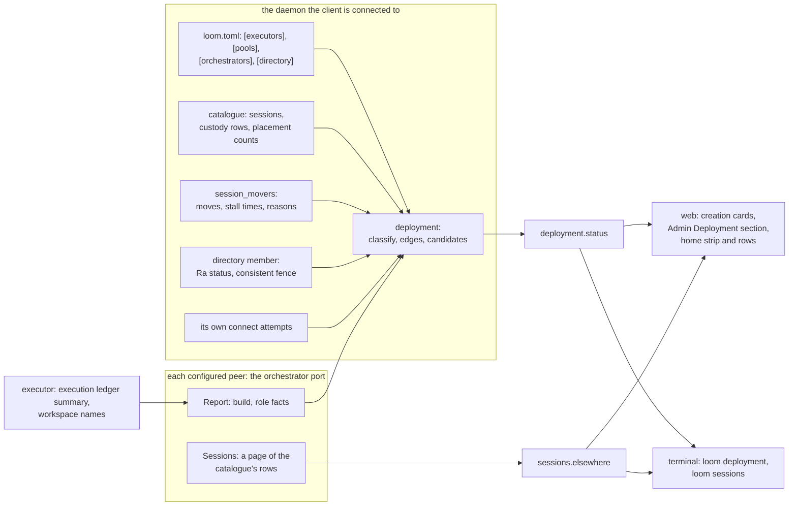

# Operator surface for the distributed runtime: executor choice, one session list, health and topology

Status: **proposed, for the owner's review, 2026-10-11 (revised after review).
Nothing here is built.** It is written against `distributed/simplify` (PR #923,
the distributed runtime) with the Khepri directory of `directory/khepri` (PR
#934, protocol-change/083) on top. The interface changes are drafted in
[protocol-change/085](../../protocol-change/085-distributed-admin-surface.md).
It also leaves room for three branches that are not in this tree: the peer mail
reach work (PR #937, which adds `Describe`, `Roster` and a `NotOpen` answer to
the orchestrator port), remote code mode and MCP on executors (PR #938, which
raises `protocol.version` to 3), and subagents on another orchestrator (PR #939,
design only, protocol-change/084 on that branch).

The design changes no rule of [protocol-change/051](../../protocol-change/051-web-view-route.md)
or of [protocol-change/053](../../protocol-change/053-owner-admin-and-claims.md).
It adds no page scope: the web additions are a section of the existing Admin
page and capabilities on the owner's home (section 8 says why no 051 addendum is
needed).

## 1. The question

The owner's words, after reading the follow-ups of PR #934, were: "So we're have
no web admin support? I'd expect to be able to: select an executor when making a
session, see unified sessions across all orchestrators, see system health,
toplogy diagram, etc."

The answer today is "partly, and the rest is not there at all". Section 2 is the
inventory. Sections 5 to 9 take the owner's four wishes and the operator actions
in turn, and each says what exists, what is missing, the read or command that
would supply it, the web design, the terminal design and the tests that prove it.
Section 10 lists what is deliberately not proposed. Section 11 is the plan, as
small slices, and section 12 records the decisions this note takes and the one
question that only the owner can settle.

## 2. What exists today

| Need | What exists | What is missing |
|---|---|---|
| Choose an executor when making a session | `sessions.create` takes `executor` or `pool` and a registered workspace name. The web home has a "New session on an executor" form with a select of executor names and a typed workspace name. The terminal has `--executor` and `--pool` with `--workspace`. | Pools in the web form. Any state about an executor before the choice. The names of the workspaces an executor serves. |
| See sessions across orchestrators | `sessions.get` and `sessions.open` answer `not_owner` for the owner principal, naming the orchestrator that holds the session. | A list. `sessions.list` and both clients' pickers show this daemon's catalogue only. |
| See system health | `status` (this daemon's slots), `directory.status` (this member's view of Ra), `hello` (this daemon's build). | Everything about the other nodes. Whether a Khepri copy has caught up. Executor capacity. Stalled moves. |
| See topology | The configuration tables, read by a person. | Any read. |
| Operate | `sessions.move` and `loom sessions move`. Abandon and `directory.status` are control commands only. | A way to pick a destination. A web or terminal surface for abandon. |

**Choosing an executor.** `sessions.create` decodes `executor` and `pool` as
exclusive names and then reads `workspace` as a registered name, not a path
(`created_workspace`, `client/daemon/protocol.gleam:1005`; `executor_field`,
`client/daemon/protocol.gleam:891`; `pool_field`, `client/daemon/protocol.gleam:987`).
The daemon holds the names from its `[executors.<name>]` and `[pools.<name>]`
tables, with each executor's declared platform, enforcement and toolchains
(`Executor`, `client/executors.gleam:76`). The web home is told only the names
(`HomeAttachment`, `client/daemon/server.gleam:254`, whose `executors` field is
`List(String)`), draws them in a select, and asks the owner to type the workspace
name (`CreatingRemote`, `web_view/home.gleam:730`). The terminal builds a
`Placement` from launch flags (`Placement`, `tui/placement.gleam:31`) and cannot
change it inside a running terminal. Neither client can show whether an executor
answers, is full, or contradicts its declaration. That is learned at the attach,
when `contradiction` (`client/executors.gleam:375`) compares the executor's census
with the declaration and the open fails. A typo in a workspace name is learned the
same way. [The setup guide](../distributed-setup.md) tells an operator to check a
connection with `epmd -names`, `lsof` or `ss`.

**The session list.** `sessions.list` reads this daemon's catalogue
(`ListSessions`, `client/daemon/server.gleam:3227`). The orchestrator port answers
`Owns` and the move messages (`Message`, `client/remote/orchestrator_port.gleam:113`).
Nothing answers "what sessions do you hold".

**Health.** The pieces exist and none is readable from a client. The executor's
census is returned in `Attached` (`client/remote/protocol.gleam:162`) and kept by
the live plane. The execution ledger holds the scope rows, the byte budget, the
unacknowledged results and the scopes that block a reopen, and the only reader is
`loomd executor release`, which runs with the daemon stopped. A move stalls with a
reason that goes to one log line (`Stalled`, `client/session_mover.gleam:233`) and
is forgotten, and the movers keep only the time the stall began (`Entry`,
`client/session_movers.gleam:140`). `directory.status` reports the configured
members, Ra's members with their votes, the leader and this member's applied index
(`directory_status_json`, `client/daemon/server.gleam:2652`). It does not compare
the applied index with the leader's, so it cannot say whether this copy has caught
up. The only "not caught up" signal today is `voter: false`, which holds while a
joining member is a non-voter.

**Operating.** `MoveSession` and `AbandonMove` are owner-only control commands
(`client/daemon/server.gleam:3179`, `client/daemon/server.gleam:3151`). `loom
sessions move <id> --to <name>` exists (`parse_sessions`, `tui/src/tui.gleam:1209`),
and the destination name must be remembered, since nothing lists the choices.
`sessions.list` records do not carry the move state that `sessions.get` carries,
so neither client can draw a `moving` or `moved` session
([the handoff](../next.md) lists this as a known limit).

## 3. The decisions in brief

1. **Two new constructors on the orchestrator port,** `Report` and `Sessions`,
   answered through the port's existing `detached` path and wired by closures from
   `main`, as `catalogue_holds` and `peer_command` are (section 4.1). No new port.
   Mixed builds stay unsupported, as for every other constructor.
2. **Two new owner-only control commands and two decorations.** `deployment.status`
   (with an optional `node` filter) and `sessions.elsewhere` are new.
   `sessions.list` records gain the `moving` and `moved` members that
   `sessions.get` already has. `directory.status` is unchanged.
3. **The daemon classifies and the clients draw.** A node is `ok`, `degraded` or
   `down`, and the reasons are fixed words. The terminal and the web page implement
   no health policy of their own, and the policy has no thresholds.
4. **Every statement is "as seen from the daemon the client is connected to".**
   There is no cache, no history and no push. A client polls. Reachability is the
   asking daemon's own connect attempt.
5. **Health is advisory at creation.** The form shows an executor's state and
   never blocks on it. The daemon still decides at the open, as it does today.
6. **A foreign session is a read-only row** that names its owner and the command
   that reaches it. The local daemon does not attach to it.
7. **Web:** executor and pool cards in the existing creation form, a Deployment
   section in the existing Admin page under Admin's rules, a Move chooser in the
   home row's action group, and an elsewhere group on the home.
8. **Terminal:** commands first, text output, `--json` for scripts. Overlays inside
   the running terminal wait for the terminal revamp.
9. **Stay on the command line:** `loomd executor release`, `loomd directory
   bootstrap`, `loom distribution provision` and `install`, and any future
   membership removal or failover (section 9).
10. **No new configuration key, catalogue table, port or Erlang function.**
11. **Eight slices.** The first adds optional members to a record and the second
    adds `deployment.status`; neither adds a port, and the first three add no
    constructor to the orchestrator port (section 11).

## 4. How the pieces fit

The daemon a client is connected to is the only place the client talks to. It
combines what it already knows with what its configured peers report.



### 4.1 Where the reads are answered

The orchestrator port already grew `PeerCommand`, `Import`, `ImportStatus` and
`Activate` without a version gate, and the architecture page already says both ends
of a connection are upgraded together and that a peer built from a different
vocabulary can halt a node ("What the closed vocabularies limit",
[the architecture page](../architecture/distributed.md)). The two new reads follow
that rule and add no second mechanism. Mixed builds stay unsupported, as for every
other constructor.

`Message` (`client/remote/orchestrator_port.gleam:113`) gains `Report(reply)` and
`Sessions(after, limit, reply)`. `answer` (`client/remote/orchestrator_port.gleam:530`)
serves both through `detached` (`client/remote/orchestrator_port.gleam:579`), the
path `Activate` uses: the computation runs in a run that dies with the requester and
with the port, so a read never keeps an `Owns` question waiting. The port does not
know the catalogue, the ledger or the movers. `start_with` takes one more closure
record, and `start_orchestrator_port` (`client/daemon/main.gleam:910`) builds it
from the registry, the movers and the executor host, the way it builds
`catalogue_holds` (`client/daemon/main.gleam:943`) and `peer_command`
(`client/daemon/main.gleam:651`). The function runs on every daemon that has a
`[distribution]` table, executors included, so a pure executor answers `Report`
too. It answers with no orchestrator facts when it has no catalogue to describe.

The executor host answers the closure through a private event, not through
`HostMessage`: the host's `Event` type gains a `Summary` constructor that only the
in-VM closure sends, on a subject only it holds (`Event`,
`client/remote/host.gleam:207`, which is private to the module). The host's wire
vocabulary does not change, so `protocol.version` does not change.

### 4.2 The node report

`Report` returns one plain-data record, built without opening any session. Role
facts are present only for a role the node plays, since one daemon may be an
orchestrator, an executor and a directory member at once.

- **Every node:** its node name, `build_version`, `build_commit`, the daemon epoch,
  its own start time and current time on its own clock (the asker computes uptime
  from the two and never compares them with its own clock), and the nodes of its
  configured `[[distribution.peers]]`.
- **Executor facts:** `protocol.version`, the scope counts by state (`ScopeState`,
  `storage/exec_ledger.gleam:211`), the limit on scopes that are not cleanly
  closed (`Limits`, `storage/exec_ledger.gleam:191`), the scopes that block a
  reopen (`closing`, or closed with unknown cleanup) with their session ids, bytes
  held against the ledger budget, the count of unacknowledged results, the platform
  label, the enforcement and toolchains from the most recent attach census
  (absent until one has happened), and the names, never the paths, of the
  registered workspaces. The helper pool's size and borrowed count are deferred:
  `pool_census` blocks for each plane, so summing it over planes would make the
  report as slow as the number of open sessions (section 10).
- **Orchestrator facts:** slots (the `status` counts), whether it can receive
  sessions, the node of each executor it configures, session counts by executor
  and residency from the catalogue's existing `executor` column, and the moves in
  flight with their stall time and last reason.
- **Directory facts:** the body `directory.status` already builds, plus `copy`,
  `current` when a consistent read (a fence, then a read; `read_consistent`,
  `client/directory/store.gleam:352`) completes within its deadline and
  `unconfirmed` when it does not. `directory.status` itself is unchanged.

A report is bounded by construction. Unclean scopes are at most the limit (16 by
default), workspace names are capped at 64, and placement rows at 32. The long
lists appear only when `deployment.status` is asked for one node, so the 64 KiB
control message limit is not approached.

### 4.3 Classification

`client/deployment.classify` is a pure function of the reports and the daemon's
own configuration. It runs on the asking daemon, so both clients show one verdict.

| State | Meaning |
|---|---|
| `ok` | Reachable, and no reason below applies. |
| `degraded` | Reachable, with one or more fixed reasons. |
| `down` | No distribution connection could be made within the deadline. The reason is one of the fixed words `timeout` (the connection did not settle in time), `unreachable` (refused, or the host could not be reached; a wrong pin or certificate reads this way) and `unavailable` (the daemon has no distribution, or the node is not one it pinned). `distribution.describe` gives an operator's sentence with a remedy, which is too long for a state, so the words are chosen from the fault (`client/deployment.why_of`). |

The degraded reasons are: `unclean_scope` (a scope that blocks a reopen exists),
`full` (the scopes that are not cleanly closed are at the limit, so the next attach
is refused `CapacityExhausted`), `declaration_contradicted` (the executor's census
disagrees with its `[executors.<name>]` row, using `contradiction`),
`build_differs` and `protocol_differs` (against the asking daemon),
`directory_no_leader`, `directory_copy_unconfirmed`, and `directory_quorum_lost`
(fewer reachable voters than a majority, from the asker's connect attempts). There
are no near-limit thresholds. The scope counts, the ledger bytes and their limits
are reported as numbers, and a person reads them.

The whole deployment reads from the nodes the asking daemon is configured with,
not counting itself, which is always reachable. It is `ok` when every node is
`ok`, `down` only when no node is reachable, and `degraded` in between: one dead
executor among several is a degraded deployment, not a dead one. A reachable node
that is itself `degraded` counts as reachable and not `ok`.

### 4.4 Authority and trust

The new control commands are owner-only. A member principal gets `forbidden`, as
for `directory.status`. The port answers any pinned peer, the way it answers
`Owns`. That is not a boundary: a pinned peer already has the privileges of an
Erlang node on the machine ([the architecture page](../architecture/distributed.md),
"Trust and transport"). The report carries no credential, no key, no cookie, no
path of a workspace root and no pin. The `Sessions` page carries what the answering
daemon's own owner sees in `sessions.list`, and the asking daemon gives it only to
its own owner, on the rule that one operator administers every orchestrator of a
deployment. Foreign rows therefore show other machines' workspace paths to the
asking owner, which is acceptable because it is the same operator. A deployment
where two people own two orchestrators and do not trust each other should not pin
them to each other at all.

A name in a request never causes a connection. The nodes the daemon asks are the
nodes in its own configuration (`[executors]`, `[orchestrators]`, and the directory
members), and the `node` filter of `deployment.status` selects among them by their
configured key.

### 4.5 Cost and failure of a read

`deployment.status` makes one fan-out under one weft deadline of three seconds.
Each node gets a connection attempt bounded at one second and then a `Report` ask
bounded at one second, so the inner bounds sum to two seconds and the third second
is slack for scheduling and for the tasks the deadline abandons. A first TLS
handshake to a loaded machine can take longer than one second; the handshake
continues in the background and the node is `down` in this reply and `ok` in the
next poll. The read connects to executors that were idle, which is what a session
open would do. A node that does not answer is `down` in this reply and nothing is
remembered. The clients poll: the Admin section every 10 seconds, the home every
30 seconds for the strip and the elsewhere group, the creation cards when the form
opens. Health changes on the scale of minutes, so there is no push and no health
event on the session lane.

## 5. Executor selection at session creation

**Today.** Section 2. Local placement is the default in both clients and stays so.

**Gap.** No state before the choice, no pools in the web form, no workspace names,
and a blind typed name. The cost of a wrong choice is a `reserved` session and an
`executor_unavailable:` failure after the open, which the guide documents. That is
a cheap failure, so the proposal is advisory: it informs the choice and refuses
nothing.

**Surface.** `deployment.status` carries a `placements` object: one entry per
configured executor and per pool. An executor entry has the asking daemon's name
for it, its node, a state word, the free scope count when known, its declaration
and any contradiction. The states are `ready`, `degraded`, `full` and `down`,
derived from section 4.3. A pool entry lists its executors in the order
`pools.candidates` returns them and marks which are eligible now. The daemon does
not reorder a pool by health; the pool's trial order is the rule, and a first open
still moves to the next candidate only on a failed connection or
`CapacityExhausted`. Asked with `node` set to an executor's configured name, the
reply carries that executor's registered workspace names. The reuse points are
the configuration tables, `contradiction` and `pools.candidates`; the only new data
is the executor's own report.

**Web.** The existing form opens as it does. Instead of a select of names, the
panel shows one card per executor and per pool: the name, a state pill (the
existing `online`, `pending` and `ended` tints, so no new colour), "N scopes
free", the platform and enforcement, and the contradiction text if there is one.
A card has a "Choose" button, and the choice opens the form for that executor or
pool with a select of the executor's reported workspace names (option values are
positions, labels are text nodes, as the profile select already works). When the
executor did not report its workspaces, or for a pool whose members disagree, the
form falls back to today's typed field and says why in one line. Cards use clicks
and the form uses the submit that the owner's socket already admits beneath the
home table, so no new event class is admitted. The page is given the executor and
pool names when it opens (`Start.executors` and `Start.pools`) and starts the
read of their states each time the panel opens (`Start.placements`; a weft task
runs it and the runtime never waits). The panel is drawn at once from the names,
with each card marked "not checked", and the answer replaces them; it is numbered,
so an older read cannot overwrite a newer one. The read connects to the executors
alone, because the orchestrators are no part of a creation. The chosen card is
the page's own state and not a field of the form, so the submit carries only the
workspace and session names and a forged executor or pool field refuses the event.
The creation path (`create_for`) accepts a pool through a new `creations.Pooled`
place beside `creations.Registered`, makes either session-only, and re-checks the
name against its configuration as it does for executors (`executor_unknown`,
`pool_unknown`).

**Terminal.** `loom deployment executors` prints the same candidates: name, node,
state, scopes, platform, enforcement, workspaces and the pools each belongs to,
with `--json` for the raw reply. `loom --executor box --workspace app` is
unchanged. An overlay that picks an executor from inside the running terminal
needs the session picker work of the terminal revamp, so it is not in these
slices.

**Tests.** `client/deployment` tests of the candidate and state rules, including a
declaration the census contradicts and a pool with one unreachable member. A
`web_view` simulation test of the cards, the choice, and a form whose select
carries only the positions the page drew. A route test that a forged executor
index creates nothing. A terminal golden test of the table.

## 6. One session list across orchestrators

**Today.** Section 2. A daemon answers for the sessions it holds, and the owner is
sent elsewhere with the launch line for the owning daemon
(`redirect_words`, `tui/daemon/selection.gleam:847`).

**What a daemon can answer about sessions it does not own.** One thing: what the
owning orchestrator's catalogue says. A new `Sessions` ask on the port returns a
page of the rows that `sessions.list` would show that daemon's owner, in the same
record shape, so a client draws a foreign row with the code that draws a local one:
the id, the name and subtitle, the workspace (a path on that machine for a local
session, a registered name for a remote one), the executor or pool, the creation
time and the residency status. The answering daemon leaves out archived sessions
and every session whose custody is `moving` or `moved`, as it already leaves out
tombstones. Therefore no id can be listed by two orchestrators, and the asker needs
no merge or dedupe rule. The cost is that a session in the middle of a move is
listed on no other orchestrator until the receiver activates it; its owner sees it
on the source as `moving`, which is where the move is decided. The Khepri copy is
not used for listing: it holds no names, and an orchestrator that does not answer
shows as "did not answer" with no rows.

`sessions.elsewhere` (owner-only) returns the rows grouped per orchestrator. Each
group has the asking daemon's name for the orchestrator, a state of `answered`
or `silent`, its rows, and its own `more`. There is no global cursor. A request
with no body member returns the first page of every group, up to 20 rows each and
fewer if the reply would pass 60,000 bytes, the bound `sessions.list` uses; a
group cut by the bound reports `more`. A request with `orchestrator` set to a
configured key and `after` set to a session id returns that group's next page. A
key that is not configured is `not_found`, and nothing is dialled.

**The `moving` and `moved` members on `sessions.list`.** The local catalogue's
tombstone row for a moved session lists as saved today, so the home would show it
beside the receiver's row in the elsewhere group. The records of `sessions.list`
gain the optional `moving` and `moved` objects that `sessions.get` already carries
([client protocol, section 3.5](../client-protocol.md)). They are optional members,
which the protocol already tells clients to ignore when unknown. The web home hides
a `moved` row from its lists and draws a `moving` row with its destination, and the
terminal does the same. This is also what lets the terminal render the two states
its handoff says it cannot.

**What a click on a foreign session does.** The row is read-only. Its detail shows
the owning orchestrator's name, its node, the session state, and the launch line
that reaches it, as text and in a copy box. The line is the one the terminal
already prints for `not_owner`, so there is one wording. The web page draws no link
to the other daemon, since the owner's web view there needs its own ticket from its
own credential and listens on that machine's loopback; a person reaches it by the
tunnel they already use. The local daemon does not attach to a foreign session (a
decision, section 12).

**How the `not_found` catch-up gap shows.** A member's copy can lack a record the
leader has, after a join or a long outage
([directory architecture](../architecture/directory.md), "Reading an owner"). The
directory block of `deployment.status` carries `copy`. The home strip says, when it
is `unconfirmed`, "This daemon's directory copy is not confirmed current: sessions
created in the last seconds may be missing", the Admin section shows it beside the
leader and the applied index, and `loom deployment status` prints `this copy
current` or `this copy unconfirmed`. The elsewhere list does not depend on the
copy.

**Web.** The home gets a section after "Other folders": "On other orchestrators",
one group per orchestrator headed by its name and a state pill, rows below it, and
a quiet line for an orchestrator that did not answer ("bravo did not answer").
It follows the existing rules for rows: text nodes for every name and path, no
left-edge colour bar, no shadow, a hairline between rows. A group with `more`
has a "Show more" click that asks for that group's next page. A foreign row's
trailing control is a "Where" button that opens the detail in the row, with the
launch line in a `<loom-copy>`. The read is a weft task on the home socket, started
when the page opens and every 30 seconds with the sessions list, and its answer is
a message the page ignores if a newer read has started (a read number, as the
admin page does).

**Terminal.** The text output of `loom sessions list` prints the local sessions as
it does, then a section per orchestrator when the daemon lists any; `--local`
leaves the section out, and an orchestrator that did not answer is one line. Any
machine-readable output of `sessions list` is unchanged and local only. `loom
sessions elsewhere --json` prints the raw reply. When `sessions.elsewhere` fails,
one line says so and the exit status is unchanged. The picker inside the terminal
(`/sessions`) adds the foreign group after the revamp.

**Tests.** The port's `Sessions` ask against two daemons in one VM (the existing
`remote_duo` and `peer_rig` fixtures), including a `moving` and a `moved` session
that must not be listed and a page boundary. A route test that a configured key is
required and a member principal is `forbidden`. A shipped test with two
orchestrators: create sessions on each, stop one daemon, and check that it shows as
`silent` with no rows.

## 7. System health

For each item in the owner's list: what exists, where it lives, and the proposal.

| Item | State today | Proposal |
|---|---|---|
| Orchestrator and executor reachable | Internal: `distribution.connect` results, and a link keeper for directory members only (`connect`, `client/distribution.gleam:506`) | `state` on each node in `deployment.status`, from the asker's own connect attempt |
| Executor census (platform, enforcement, toolchains) | Returned at attach and kept in the live plane | Executor facts, from the last attach; absent before the first |
| Capacity and live scopes | Ledger rows and the limit (`default_limits`, `storage/exec_ledger.gleam:459`; `LOOM_EXECUTOR_MAX_SCOPES`) | Executor facts: counts by state and the limit, as numbers |
| Helper pool | `pool_census` per plane, no node total | Deferred (section 10) |
| Ledger bytes, unacknowledged results | Ledger only | Executor facts, as numbers |
| Scopes that block a reopen | Ledger only; the operator learns of one from a refused open | Executor facts: session ids and state, with the `loom executor release` line in the page |
| Khepri membership, leader, applied index | Control command `directory.status` | Unchanged; the same body is embedded in `deployment.status` |
| Whether this copy has caught up | Missing | `copy` in the directory block of `deployment.status` (section 6) |
| Stalled moves | Internal: `Entry` and one log line | Orchestrator facts: session, destination, phase, stalled time, last reason |
| Peer mail outbox backlog | Rows in each session's store | Not proposed (section 10) |
| TLS peers connected | Internal: BEAM `nodes()` | The asker's own connect attempt per configured node; nothing about links between other nodes |
| Build and protocol versions | `hello` for the connected daemon; the executor's `protocol.version` is checked at attach only | Node report; `build_differs` and `protocol_differs` reasons |

Most of these read what is already kept. Two need a small change to existing code.
The movers' `Entry` stores the last stall reason, which `Stalled` already carries.
`exec_ledger` gains one read-only `summary` query beside `scope`, with SQL in
`storage/sql/exec_ledger.sql` and a `make gen-sql` regeneration in its own commit.
No Erlang function is added.

**Web.** A one-line strip under the home's bar shows the verdict ("Deployment · 4
nodes · 1 degraded") in a pill, and the copy line when it applies. It is plain
text, drawn only for the owner's operating page and only when the daemon lists a
peer; the detail is in the Admin page, which the existing Admin button reaches.

**Terminal.** `loom deployment status` prints the verdict, the nodes, the links,
the directory and the moves (example in section 8). `loom directory status` prints
`directory.status` as a short table. Both take `--json`.

**Tests.** The classification table as pure tests, one case per reason and one for
the whole-deployment rule (all `ok`, some down, none reachable). A report test against a real ledger with an unclean scope, a
full ledger and an `open` scope. A shipped test with an executor daemon restarted
under a live session (the case the setup guide's troubleshooting describes) that
asserts the scope appears as `unclean_scope` with the right session id and that
`loomd executor release` clears it.

## 8. The topology view

**Data.** Nodes are the asking daemon, its configured executors and orchestrators,
and the directory members. A node is shown under the asking daemon's own key for
it (`[executors.box]`, `[orchestrators.bravo]`), otherwise under its node name, as
the directory already does when it answers a client. The relations come from
configuration and the catalogue, and the only link state is the asking daemon's own.

| Edge | Source | Meaning |
|---|---|---|
| serves | the orchestrator's placement counts | an orchestrator holds N open sessions on an executor |
| peer | the `peers` each report lists | peer mail and moves can go this way |
| member | `[directory] members` and Ra's membership | a Khepri link; marked voter or non-voter, leader starred |

An edge that touches the asking daemon has a link state, `connected` or `none`,
from its own connect attempt. An edge between two other nodes is shown as a
relation with no link state, because the asker cannot observe it. That is a loss
against a design where each node reports its connections: a half-open link between
two other nodes is not visible. It is accepted because that report needs a function
that lists hidden nodes, which `gleam_erlang` does not have. Where a session sits
is the `serves` count on its edge and, for a named session, the executor field of
its row.

**Web.** The Deployment section of the Admin page draws an inline SVG built by a
pure layout function in `web_view/topology`: orchestrators in a left column,
executors in a right column, one rounded rectangle per node with its name, role and
state pill, and one line per edge. Line styles are solid (serves, with the count as
a text label), dashed (peer) and dotted (member), and the link state is the stroke
(`--color-divider` for `connected`, the `ended` tint for `none`, and the plain
divider for a relation with no link state). A node rectangle uses `--color-bg-raised`
and a hairline border; a selected node gets a one-pixel outline in
`--color-current`. There are no accent bars on the left edge and no shadows. All
colour comes from literal classes over existing tokens, so no inline style is
needed and the content security policy does not change. Every label is a text node.
Layout is a function of the snapshot alone, so it is deterministic and has golden
tests.

The SVG is a view of the node table, not a second control surface. Clicking a node
selects the same row the table selects, the table is always drawn and is the
keyboard path, and the SVG has a `role="img"` label that states the verdict.
Selecting a node reads `deployment.status` with that node's configured key and fills
the detail pane beside the table: executor facts as numbers (scopes, ledger bytes),
the registered workspace names, the unclean scopes each with its `loom executor
release` line in a copy box, the orchestrator's slots and moves, and the node's
configured peers. The section also holds the Directory block and the Moves table.

The section is part of the Admin page and follows Admin's rules: it is reached from
the owner's fresh home by the existing Admin button, the page lives `admin_ms`
(`client/daemon/ui_sessions.gleam:130`, fifteen minutes), and a bookmark-resumed
home cannot open it. No protocol-change/051 addendum is needed. There is no new
scope, route, ticket, lifetime or content security policy change, and every handler
of the section sits beneath `admin.body_path`, which the Admin socket already admits
and nothing else (`admin_accepts`). The existing 065 admin addendum's description of
the page in [the web view](../architecture/web-view.md) gets a paragraph for the
section. Its reads run in weft tasks with a read number, next to the people and
session reads (`admin_read_task`, `client/daemon/ui_socket.gleam:5026`).

**Terminal.** A compact rendering, from the same snapshot:

```
deployment as seen from alpha, 3 of 4 nodes answered, 14:02:11
state: degraded (exec2 down; box has 1 scope that needs a release)

NODE   ROLE                   STATE     BUILD     SCOPES  NOTE
alpha  orchestrator, member   ok        b4eeb50c  -       8 slots, 2 resident, 1 move in flight
bravo  orchestrator, member   ok        b4eeb50c  -       directory leader
box    executor, member       degraded  b4eeb50c  4/16    1 scope needs release: 0198c0de
exec2  executor               down      -         -       timeout

LINKS  == connected from alpha   .. not connected from alpha   -- relation, not observable from alpha
alpha == bravo   peer, member
alpha == box     serves 3, member
bravo -- box     serves 1, member
alpha .. exec2   serves 0

DIRECTORY  3 members, 3 voters, leader bravo, this copy current
MOVES      1 in flight: 0198c0de alpha -> bravo, waiting 4m, receiver did not answer
```

The order is stable: orchestrators first, then executors, each by name, so two
runs diff cleanly. A line is cut at the terminal width on a character boundary,
and a name is drawn as text with control characters removed (the terminal's
existing `text_hygiene`). `--watch` is not proposed; `watch` does it.

**Tests.** The edge function over reports, including an edge with no link state.
The layout function's goldens for one, two and six nodes, a node named with
markup, and a node with no edges. A simulation test that a click selects a row and
that the section adds no handler outside `admin.body_path`. The terminal
rendering's golden file for the example above and for a daemon with no peers (it
prints the self row only).

## 9. Operator actions

**Move a session** (`sessions.move`). *Today:* a control command and `loom sessions
move <id> --to <name>`; nothing lists valid destinations. *Gap:* picking the
destination. A destination is valid when it is reachable, can receive sessions (it
started an importer), is not this daemon, and configures the executor the session
is on, since the receiver refuses a session whose executor it does not list. The
node report carries the second and last facts. *Surface:* no new command. The
orchestrator entries in `deployment.status` give the destination list, and the
client intersects it with the row's `executor`. A row with no `executor` (a local
session, or a pooled one that never opened) has no Move, with the reason as a
title. The daemon still decides authoritatively and the refusals are the ones in
the protocol. *Web:* the home row's action group (the Stop, Archive and Delete
group in `view/home_table`) gains "Move" for the owner's fresh, operating home.
Pressing it reads the destinations and replaces the row's words with one button per
eligible orchestrator and, for each ineligible one, its name and a reason. The
second press, on a destination, is the two-step confirm that Delete and Stop
already use. It runs `manage_for`'s existing re-check (the page is open and fresh,
the credential authenticates as the owner) and calls the registry through the
function the control command calls, so both share one code path. The row then reads
"moving to bravo", from the `moving` member. *Terminal:* `loom sessions move <id>`
with no `--to` prints the same candidates and exits with a nonzero status; with
`--to` it is unchanged. *Tests:* a pure candidate test, a route test that a
non-owner and a resumed (not fresh) home cannot press it, and the existing shipped
move test driven once through the web function.

**Abandon a move** (`sessions.move` with `abandon: true`). *Today:* a control
command, and a directory member only. *Why it could be a button:* its safety rests
on the record and not on the reader. The abandon is a compare-and-set that fails
once the receiver has activated, and the mover then keeps the move and finishes it
([directory architecture](../architecture/directory.md), "Abandoning a move"). A
mistaken press cannot create two owners. *Terminal:* `loom sessions move <id>
--abandon`, in these slices. *Web:* the Moves table in the Admin section lists each
move with the source, destination, phase, stall time and last reason, read-only. A
web Abandon button is the owner's question (a) in section 12. If the owner wants
it, it is an Admin change with the usual two-step confirm, run by `admin_for`
(`client/daemon/ui_socket.gleam:5031`) with Admin's fresh-and-owner re-check, and
worded "If bravo has already taken the session, the move finishes instead." A
daemon that is not a member shows no button, since the command would be refused
`not_movable`. *Tests:* a simulation test of the two-step, a route test of owner and
freshness, and the shipped abandon test run through the web function once.

**`directory.status`.** It becomes `loom directory status` and the Directory block
of the Admin section (members, voters, leader, applied index, `copy`). Nothing in it
is an action.

**What stays on the command line, and why.**

- `loomd executor release` runs with the executor daemon stopped and records that
  a person verified the scope's processes are gone. The safety is the person's
  reading of the machine, not a check the daemon can make, and the daemon being
  stopped means a page served by it cannot run it. The Admin section shows the
  scope and the exact command (`usage` in `client/daemon/executor_cli.gleam`
  describes it) and does not run it.
- `loomd directory bootstrap` creates a cluster once, with the daemon stopped, and
  refuses to make a second. It is a deployment-time act.
- `loom distribution provision` and `install` handle private keys and the cookie,
  and no command prints either. They never go through a web page.
- Membership removal does not exist. If it is built (`ra:remove_member/3` behind a
  `loomd directory forget`), it stays on the command line: removing the wrong
  member can cost the quorum, and the command should show the voter count and
  require the member to be down first. The Admin section would show what it needs
  to decide (voters, who is down) and nothing more.
- Failover does not exist. When it does, the takeover is a decision that a person
  makes after reading who is gone, so it too is a command that the page informs.
- `daemon.shutdown` is a control command already; no page offers to stop the
  daemon that serves it.

## 10. What is not proposed

- **A cache or history of reports.** A node that does not answer shows its failure
  word and nothing else. A cache would add a process, an eviction rule and a
  staleness label for a question the next poll answers.
- **A push or a health event on the session lane.** Health moves in minutes and a
  poll is cheaper to reason about than a subscription.
- **Forwarding a command to a foreign orchestrator.** Move and abandon are the
  source's, and the source is the daemon the owner connects to.
- **A per-session executor ping.** The cards show the executor, and the open
  decides.
- **Near-limit thresholds.** Numbers are reported and a person reads them.
- **The helper pool census.** `pool_census` blocks for each plane (up to a second
  each), so a node total would make the report as slow as the number of open
  sessions. It returns when the pool can publish its census without a call.
- **A list of connected nodes in the report.** It would need an Erlang function
  that lists hidden connections. Link state is known only for edges that touch the
  asker.
- **Directory-only rows in the session list.** They carry no names, need a Khepri
  list primitive, and an orchestrator that does not answer simply shows as "did
  not answer".
- **A hint on `not_found`.** The copy state shows in the strip, the Admin section
  and `loom deployment status`; a failed lookup does not trigger a fan-out.
- **Peer mail backlog.** Queued mail heals itself and the model already sees
  `queued`; a total is not worth a read through each resident session.
- **A boot-time executor census.** The enforcement and toolchains shown are from
  the last attach; a census at boot would spawn a helper at start for a field that
  is absent only until the first session.
- **Certificate expiry.** Node certificates last five years (`client_pki_ffi.erl`
  sets 1825 days) and rotation is later work.
- **Remote subagent state.** A delegate session on a remote orchestrator would
  appear in `sessions.elsewhere` as any session does. The design reserves no
  field for it; PR #939 adds an optional member in its own protocol-change, and
  clients ignore members they do not know.
- **Executor-to-executor moves, failover, membership change.** They do not exist.

## 11. The plan

Each slice ends green on its package gates, `make lint` and `make doc-check`, and
updates the CLAUDE.md of any package it changes. The dependency named is the PR
whose code the slice needs. Slice 2 adds the control command `deployment.status`;
slices 1 to 3 add no port and no constructor to the orchestrator port. From slice
2 the node members of `deployment.status` other than `node`, `name`, `roles` and
`state` (and `reason` on a node that is down) are optional, so a later slice adds
members and replaces none.

1. **`sessions.list` carries custody.** *Scope:* optional `moving` and `moved`
   members on each record; `tui` decodes and renders them; `web_view` hides `moved`
   rows and marks `moving`. *Files:* `client/daemon/server.gleam`,
   `client/daemon/manager.gleam` (one custody read for a page),
   `tui/daemon/protocol.gleam`, `tui/session_table.gleam`, `web_view/sessions.gleam`,
   `docs/client-protocol.md`. *Tests:* protocol round trip, a table render, a home
   test of a moved row. *Exit:* a moved session no longer lists as saved on the
   source. *Depends on:* #923.
2. **`deployment.status` without the port.** *Scope:* `client/deployment` (pure
   candidates, edges and classification), reachability from the asker's connect
   attempts, placements, the `node` filter (a configured key, looked up before
   anything is dialled), `loom deployment status` and `loom deployment executors`,
   both with `--json`. Reachable nodes are `ok` with no optional members. *Files:*
   new `client/deployment.gleam`, `client/daemon/protocol.gleam`,
   `client/daemon/server.gleam`, `tui/src/tui.gleam`, `tui/daemon/protocol.gleam`,
   a new `tui/deployment_view.gleam`. *Tests:* classification and candidates as
   pure tests, a two-daemon test that a stopped executor is `down`, terminal
   goldens. *Exit:* `loom deployment executors` names the unreachable executor
   before a session is created. *Depends on:* #923.
3. **Executor and pool cards in the web form.** *Scope:* `Start.pools` and
   `Start.placements` (the states, read by a weft task from the executors alone
   each time the panel opens), cards, the choice, pool creation through
   `creations.Pooled`. *Files:* `web_view/home.gleam`, `web_view/placements.gleam`,
   `web_view/view/create.gleam`, `web_view/creations.gleam`,
   `client/deployment.gleam`, `client/daemon/ui_socket.gleam`,
   `client/daemon/server.gleam`. *Tests:*
   simulation, route and socket admission tests. *Exit:* the form shows state on
   each card and creates a pooled session. *Depends on:* slice 2.
4. **Reports, the node filter and the directory copy.** *Scope:* the `Report`
   constructor on the orchestrator port, answered through `detached` and wired by a
   closure from `main`; the host's private `Summary` event;
   `exec_ledger.summary`; the movers' stall reason and a `moves` read; `copy`;
   the full node members of `deployment.status`, the workspace names and long
   lists that the `node` filter returns, the text topology, and the workspace
   select in the form.
   *Files:* `client/remote/orchestrator_port.gleam`, `client/daemon/main.gleam`,
   `client/remote/host.gleam`, `storage/exec_ledger.gleam` with its SQL and
   generated module (own commit), `client/session_movers.gleam`,
   `client/deployment.gleam`, `tui/deployment_view.gleam`, `web_view/view/create.gleam`.
   *Tests:* the port's `Report` against two daemons, report tests against a real
   ledger, edge and classification tests, topology goldens, a one-member store
   test of `copy`, a shipped executor test with an unclean scope. *Exit:* the
   terminal shows the example in section 8 from a live deployment, and an
   executor daemon answers `Report`. *Depends on:* #923; the directory block
   and `copy` need #934.
5. **`sessions.elsewhere`.** *Scope:* the `Sessions` constructor and its ask, the command, the CLI
   section and `loom sessions elsewhere --json`, and the web home group. *Files:*
   `client/remote/orchestrator_port.gleam`, `client/daemon/server.gleam`,
   `client/daemon/ui_socket.gleam`, `web_view/home.gleam`, a new
   `web_view/view/elsewhere.gleam`, `tui/src/tui.gleam`. *Tests:* the port against
   two daemons, a paging test, a `moving` and a `moved` session left out, a shipped
   test with a silent orchestrator. *Exit:* a session on the other orchestrator is
   listed with its owner and its launch line. *Depends on:* slice 4.
6. **The Admin page's Deployment section.** *Scope:* `web_view/admin.gleam` gains
   the section (node table, SVG topology, detail pane, Directory block, read-only
   Moves table) and its read; `web_view/topology`. The home strip. *Files:*
   `web_view/admin.gleam`, `web_view/topology.gleam`, `client/daemon/ui_socket.gleam`
   (`admin_read_task`), `web_view/home.gleam`, `web_client` (a copy shape for the
   release command). *Tests:* simulation, topology goldens, `admin_accepts` near
   misses, the CSS check. *Exit:* the Admin page shows a live three-node
   deployment. *Depends on:* slice 4.
7. **Move, and terminal Abandon.** *Scope:* the Move chooser on the home row,
   `loom sessions move` candidates and `--abandon`; the web Abandon button only if
   the owner asks for it (question (a)). *Files:* `web_view/view/home_table.gleam`,
   `web_view/actions.gleam`, `client/daemon/ui_socket.gleam`,
   `client/daemon/server.gleam` (one function shared by the control command and the
   page), `tui/src/tui.gleam`, `tui/daemon/selection.gleam`. *Tests:* section 9.
   *Exit:* a session is moved from the page and a stalled move abandoned from the
   terminal. *Depends on:* slices 1 and 4; abandon needs #934.
8. **Optional.** The in-terminal `/deployment` and executor picker once the terminal
   revamp lands. Its own change.

Documentation moves with each slice: [the architecture page](../architecture/distributed.md)
gets a section "Reading the deployment" in slice 4, [the web view](../architecture/web-view.md)
gets the cards, the home group and the Admin section in slices 3, 5 and 6,
[the client protocol](../client-protocol.md) gets the commands, [the setup
guide](../distributed-setup.md) replaces the `epmd -names` and `lsof` checks with
`loom deployment status`, and [the handoff](../next.md) loses the lines that these
slices close.

## 12. Decisions taken, and the one question left open

Decided in this note, with the reason in the section named:

- **No attach to a foreign session** through the local daemon. A foreign row names
  its owner and the launch line (section 6).
- **The Deployment section follows Admin's rules:** a fresh home, fifteen minutes,
  Admin's fresh-and-owner re-check for any change (section 8).
- **`loom sessions list` text output shows the elsewhere section by default,** with
  `--local` to leave it out. Machine-readable output of `sessions list` is
  unchanged, and `loom sessions elsewhere --json` is the raw reply (section 6).
- **No boot-time executor census, no thresholds, no peer mail backlog** (section 10).
- **Foreign rows show other machines' workspace paths** to the asking owner, which
  is acceptable because it is the same operator (section 4.4).
- **The name is `deployment`** (ruled by the owner, 2026-10-11). `loom
  distribution show` and `system.json` already use the word for the whole set of
  nodes, and "cluster" already means the Khepri cluster.

Left for the owner:

(a) **Does Abandon get a web button, or only the terminal's `--abandon`?** The
argument for a button is that the record makes it safe. The argument against is
that the thirty minute give-up already covers the usual case, and the rare case is
a person who has read the stall reason and could use a command line. Slice 7
builds the terminal path either way.
