# Web view navigation and session placement: one sidebar, one composer

Status: **accepted, 2026-10-21.** The owner authorised the revamp end to end,
including the protocol changes it needs, and asked for a design lead to pick
among three mockup directions. This note records the choice, the final design
screen by screen, and the implementation plan. The interface changes are
[protocol-change/094](../../protocol-change/094-cross-orchestrator-sessions.md)
(top-level sessions on another orchestrator, driven from this page) and
[protocol-change/095](../../protocol-change/095-worktree-workspaces.md)
(a worktree per session on an executor workspace). Issues #1050, #1051 and
#1052 track the work.

## 1. The problem, in the owner's terms

The owner wants to start a session in any combination of "where the agent
runs" and "where the code lives", from one place:

- agent on the laptop, code on the remote executor;
- agent on the remote box, code on the remote executor;
- agent on the laptop, code in a laptop folder; and so on.

In the owner's words: "ideally I can just use the left bar to make a session
with diff drop downs instead of needing to go all the way into the admin page,
the Claude page as an example." The owner also uses the page from a phone over
Tailscale.

Today's page does not answer those two questions. Its "Runs on" cards mix an
orchestrator ("laptop (this machine)") with tool locations ("exec executor",
"linux pool"). The form sits below the whole session list. The combination
"agent on box, code on exec" has no card at all, because a page can only create
a session on the daemon that serves it, and sessions on box are listed as
information with a command line to copy, not as rows that open. The critique
that preceded the mockups lists these problems in full; the parts that shaped
the decision are:

1. **Two axes, one control.** Agent location and code location are separate
   choices and need separate controls.
2. **"This machine" changes meaning by page.** Each daemon draws its own page,
   so the page must say which daemon serves it.
3. **State is what the user returns for.** "What needs me" matters more than
   "which machine", so the list is grouped by state.
4. **Per-row button strips** (Rename, Move, Archive, Delete) are most of the
   visual weight on desktop and phone.
5. **Admin is a status page**, not a place to find or start sessions.

## 2. The three directions

Three designers worked from one brief and the critique. Each produced the same
set of screens. All three assumed two planned backend features: creating and
driving a session on another orchestrator from this page, and a worktree per
session on executor workspaces.

### Direction A: the Claude app's structure

A persistent sidebar with "New session", sessions grouped by state (Needs you,
Working, Idle, Archived) and a footer machine switcher. New session is a
centred composer with four chips under it (Agent, Code, Model, Profile), a
"Recent" list of one-click placements above it, and a sentence that restates
the choice.

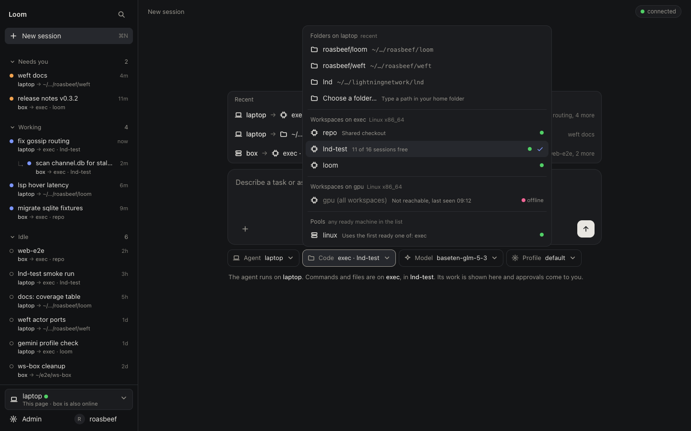

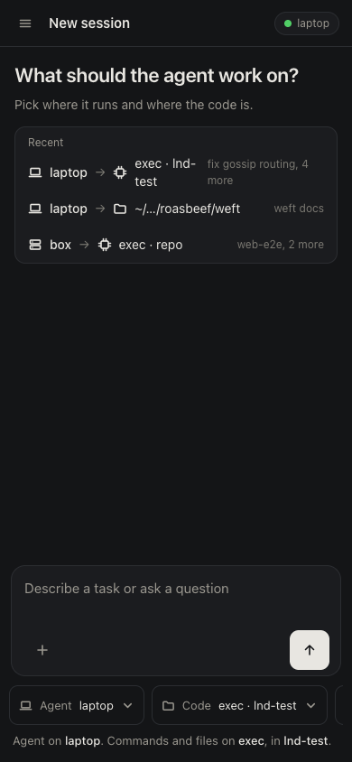

Weaknesses: the footer machine switcher was never shown open, so it was not
decided whether it sets the agent or filters the list. State grouping hides the
machine unless the row tag is read, and there is no machine filter. Four chips
where three would do (Profile belongs with Model). The code picker has no
search and grows with every executor.

### Direction B: fleet first

The sidebar is a map of the fleet: each agent machine is a collapsible section
with a health dot, a roll-up of counts and its own "+" button; executors are a
smaller group below with their workspaces. A pinned "Needs you" strip collects
approvals from every machine. The phone gets a banner with the first waiting
item and a count on the menu button. A scale screen shows collapse behaviour.

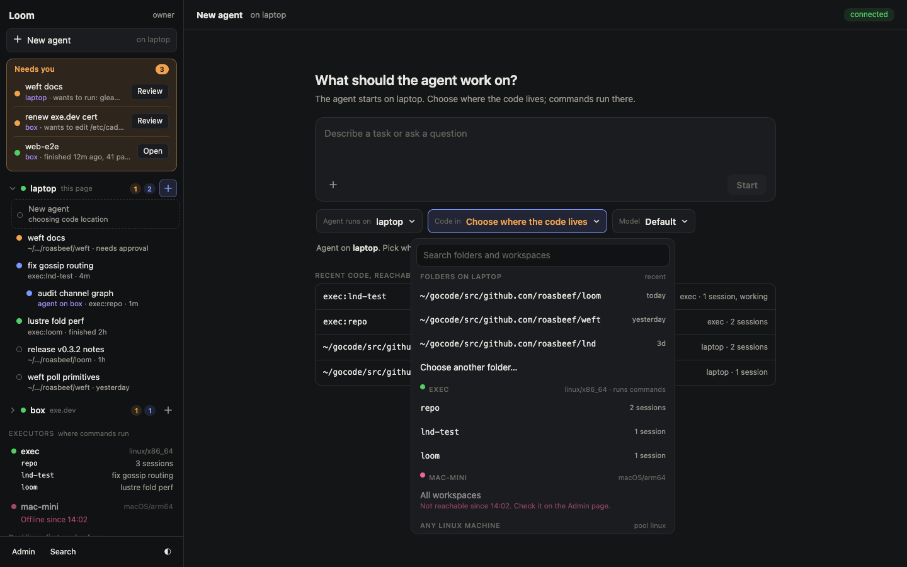

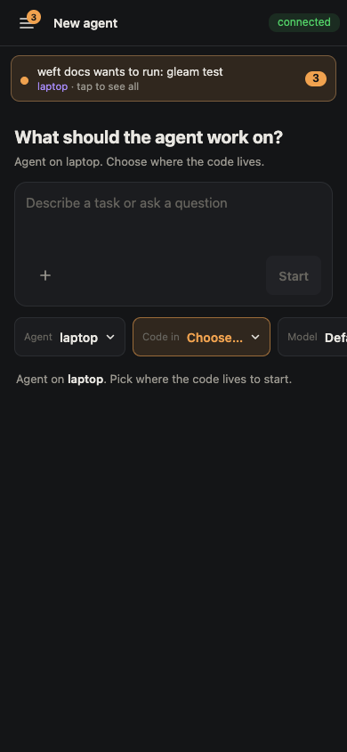

Weaknesses: sessions are grouped by machine, so "everything that is working"
needs the roll-ups or a filter that was not drawn. A busy machine makes a long
section. There are two ways to start a session (global "New agent" and a "+"
per machine), and the strip duplicates rows that also appear under their
machine. The executors group spends sidebar space on information that belongs
in Admin.

### Direction C: two explicit card lists and a sentence

The sidebar is a plain state-grouped list. New session shows two side-by-side
lists of radio cards, "Agent runs on" and "Code lives in", with a generated
sentence pinned below ("The agent runs on box. Its commands run on exec, in a
fresh copy of repo."). Invalid choices stay visible with a plain reason, for
example "box cannot read laptop's files", and an agent change that invalidates
the code choice clears it with a note.

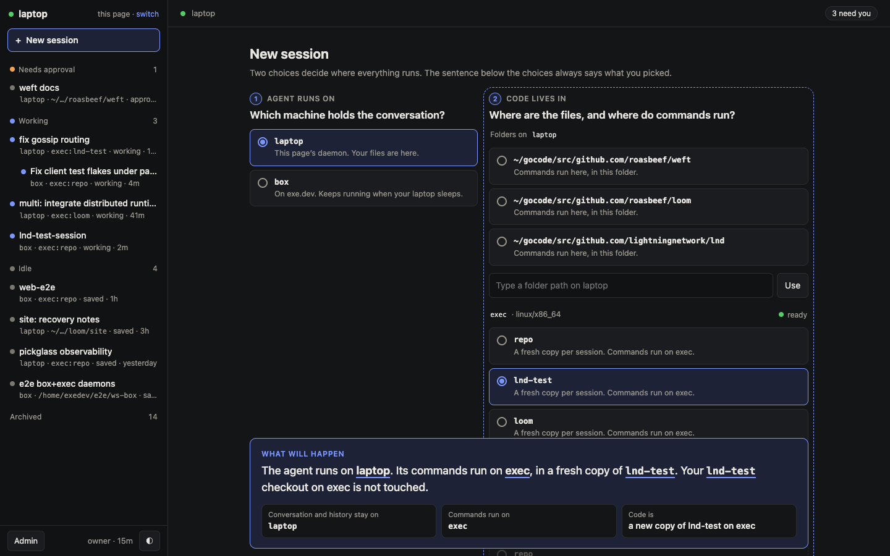

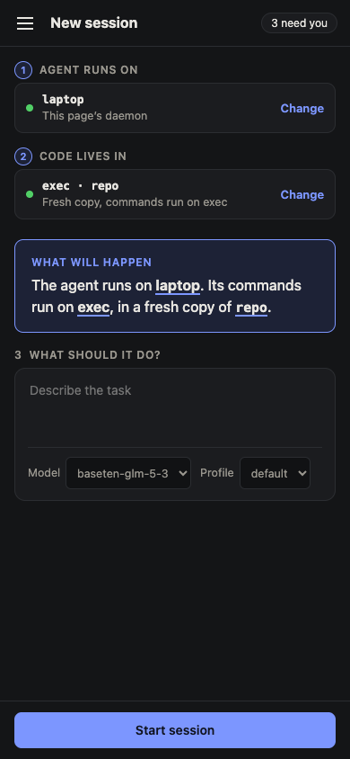

Weaknesses: it is the least like the Claude app the owner pointed to. Two
question blocks and a summary make New tall, every start shows both questions
even for users who always take the defaults, and the card list scrolls on
desktop once there are a few executors.

## 3. The decision

**Direction A is the base, with B's machine awareness and C's rules for
invalid choices folded in.** This follows the owner's lean toward "a combo of
A+B", with one departure: B's machine sections and per-machine "+" are not
taken. Machine becomes a filter over a state-grouped list, not the grouping.

What is taken from each, and why:

| From | Taken | Why |
|---|---|---|
| A | State-grouped sidebar with a placement tag on every row, nested children, one "New session" | It is the Claude app's shape, which the owner named, and state is what a returning user looks for. |
| A | Centred composer with chips; "Start again where you worked" list of recent placements; a sentence written from the chips | One click repeats a known combination; the chips answer the two questions without a form. |
| B | Machine filter pills with health dots and counts at the top of the list | Keeps B's fleet view at the cost of one row. It answers "what is on box" without making machine the grouping. |
| B | Phone: count badge on the menu button and a banner with the first item that needs you | On a phone the drawer is closed most of the time; the banner is how an approval is seen. |
| B | Code picker with a search field, "Any Linux machine" as the label for a pool, and the rule that switching agent keeps the code choice when the new machine can use it | Plain labels for pools; search is the answer to scale. |
| B | Admin as one Machines table with a "Show its sessions" link per machine | The link sets the sidebar filter, so Admin points at sessions without listing them. |
| C | Disabled rows with a plain reason ("box cannot read laptop's files", "Not answering since 09:12") | A choice that will fail should look different and say why. |
| C | Header strip on the session page: Agent on, Commands on, branch | The placement of an open session is read in one line. |

Rulings on the questions the designers left open:

1. **A's footer machine switcher is dropped.** It neither sets the default
   agent nor filters. The daemon's identity moves to the sidebar's top line
   ("Loom · laptop", with a health dot), and filtering moves to the pills. The
   Agent chip defaults to this daemon. One coupling is kept: pressing New
   session while a pill names an agent machine preselects that machine as the
   agent. That gives B's per-machine "+" without a second button.
2. **B's duplicate entry points are resolved to one.** There is one "New
   session" button and no "+" per machine. The "Needs you" group replaces B's
   strip, since state grouping already puts waiting sessions first.
3. **Grouping is by state, with a machine tag on every row and a machine
   filter.** A pill filters by agent machine or code machine (laptop, box,
   exec). A parent row stays visible when one of its children matches, so a
   child is never shown without its parent.
4. **Profile merges into the Model chip.** The chip reads "default ·
   glm-5-3"; its list has a Profile section and a Main model section.
   Shareable moves to the session menu, where inviting happens.
5. **The code picker at scale.** Sections in a fixed order: folders on the
   agent machine (recent first, then "Choose a folder..."), then one section
   per executor with its workspaces, then "Any Linux machine" for each pool.
   A search field is always present and filters across sections. An executor
   that is down shows one disabled row with the reason. An executor the agent
   machine has no route to is not listed as a row; a single line at the end
   names it ("Not offered from laptop: mac-mini, only box is set up to use
   it"). Options come from the agent machine's configuration, so choosing box
   as the agent lists box's folders, box's executors and box's pools.
6. **Session titles come from the first message**, as in the Claude app. The
   name field is gone.

## 4. The design, screen by screen

The mockups are static HTML using Loom's tokens from
`packages/web_view/priv/static/web_client.css`. They are kept outside the repo
with their generator; the screenshots below are the record.

### 4.1 New session

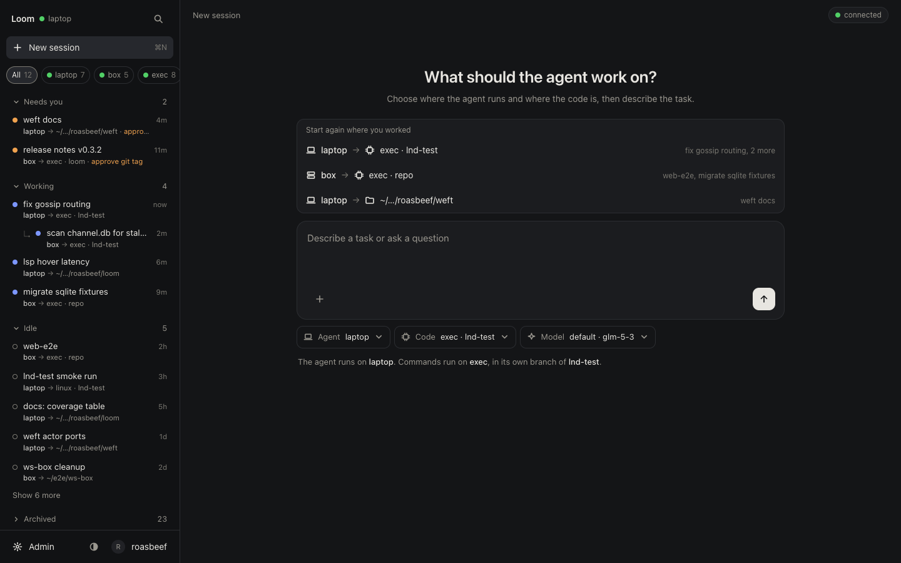

The sidebar, top to bottom: "Loom" and the serving daemon's name with a health
dot; "New session"; the machine filter pills (All, laptop, box, exec, gpu,
each with a count); the state groups (Needs you, Working, Idle with "Show 6
more", Archived collapsed); and a footer with Admin, the theme toggle and the
owner. Each row is two lines: the title, then "agent → code" with the reason
for a waiting row ("approve git tag"). A remote child is nested under its
parent with a hook mark. Row actions move into the session menu; the list has
no buttons.

The main pane: a heading, the recent placements (each row is agent → code and
the sessions that used it), the composer, three chips and the sentence. The
recent list is drawn from this daemon's catalogue (and, for box, from the
sessions this daemon created there under 094), newest first, at most three.

### 4.2 Agent picker

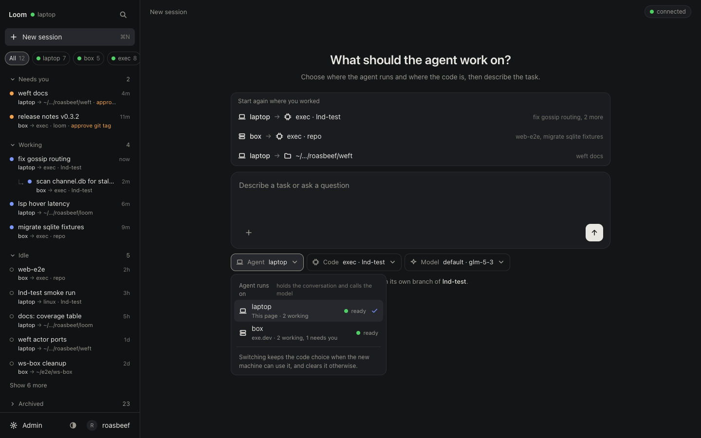

Lists this daemon and every orchestrator whose `[spawners.<this daemon>]` on
the other side admits top-level sessions (protocol-change/094). Each row shows
health and a short count. The note at the bottom states the switching rule.

### 4.3 Code picker

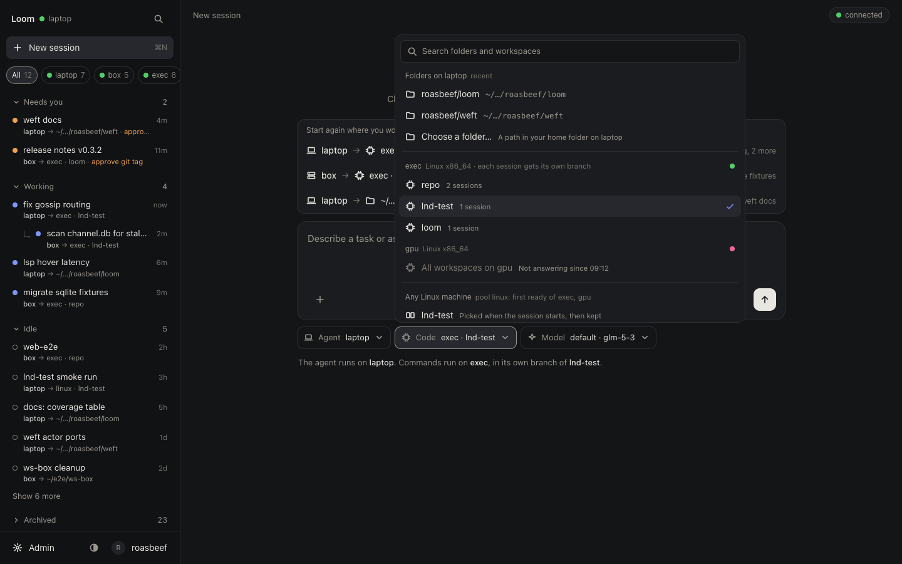

With the agent on laptop: laptop's folders, exec's workspaces, gpu disabled
with its reason, the linux pool under "Any Linux machine", and the
not-offered line. "Each session gets its own branch" appears on an executor
whose workspaces are in worktree mode (protocol-change/095).

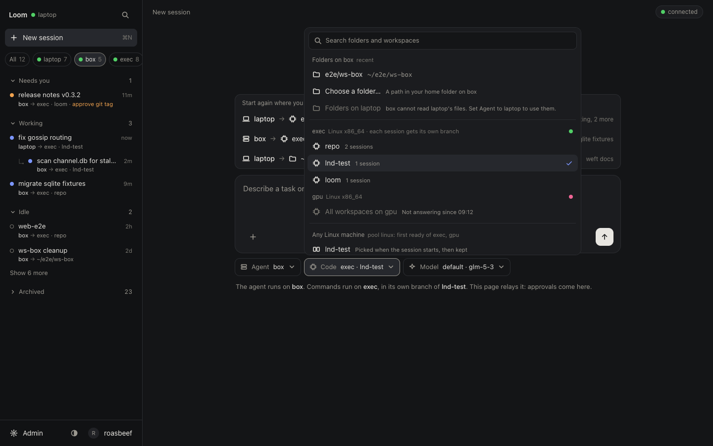

With the agent on box (and the box pill selected): box's folders, laptop's
folders disabled with "box cannot read laptop's files. Set Agent to laptop to
use them.", and box's executors and pools. The sentence adds "This page relays
it: approvals come here."

### 4.4 Session

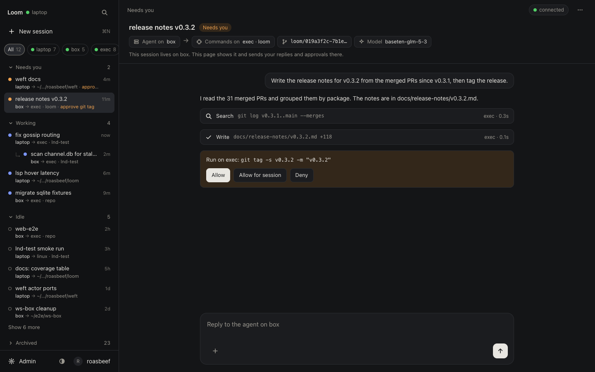

The session shown runs on box and is opened from laptop's page. The header
carries the title, the state, and the placement strip: Agent on box, Commands
on exec · loom, the session's branch, and the model. One line says where the
session lives and that this page relays replies and approvals. The approval
card is the existing one; under 094 the decision is sent to box, which judges
it. The session menu (the three dots) holds Rename, Move, Share, Archive and
Delete.

### 4.5 Admin

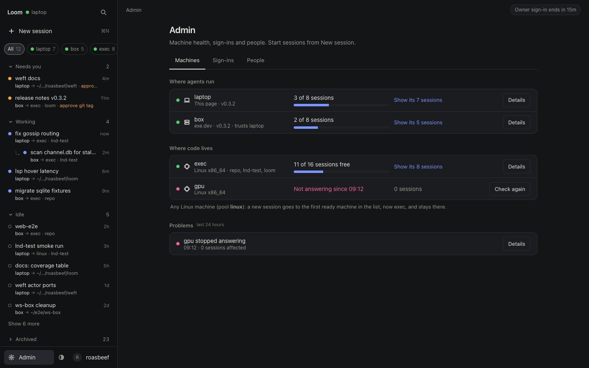

Three tabs: Machines, Sign-ins, People. Machines has "Where agents run" and
"Where code lives" tables, each row with health, capacity in sessions (not
"scopes" or "slots"), a "Show its sessions" link that sets the sidebar filter,
and Details for platform, enforcement, toolchains and ledger state. The pool is
one line under the code table. A short Problems list sits below, because a
failure is why the owner opens Admin. Sign-ins group unused links into one row
with "Revoke all unused". Admin starts nothing.

### 4.6 Light theme

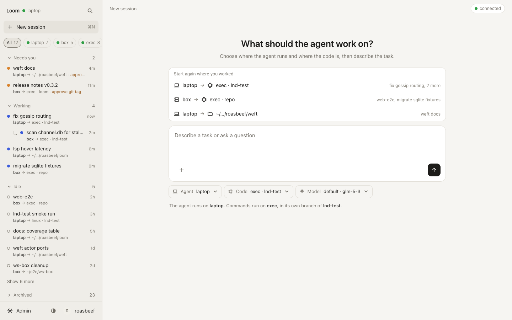

## 5. Phone

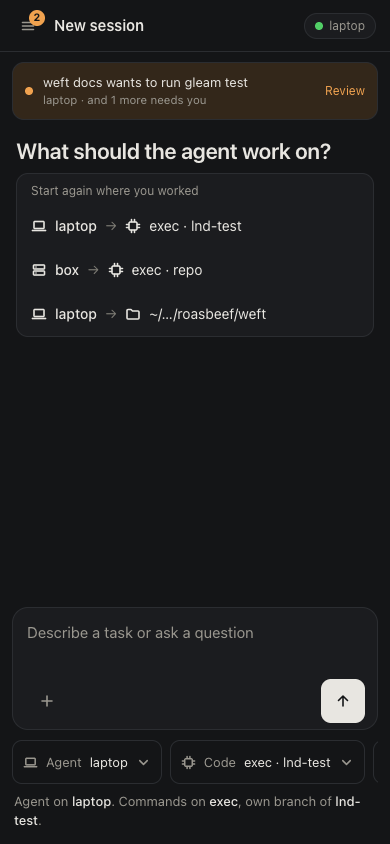

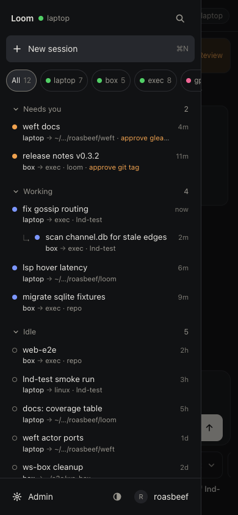

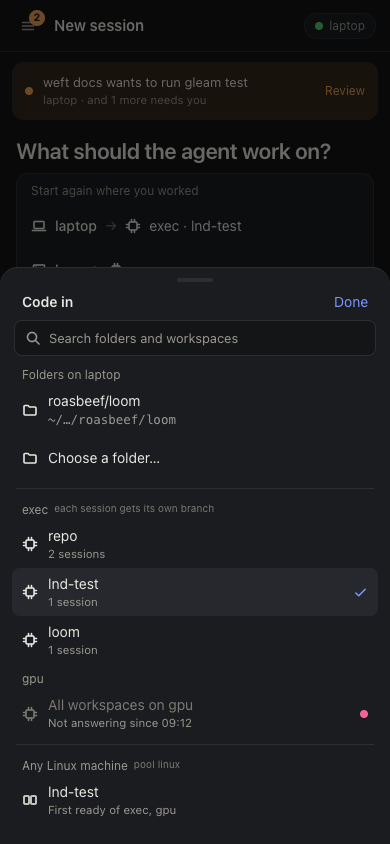

The phone layout follows from the desktop one:

- The top bar has the menu button with a count of sessions that need you, the
  title, and the daemon's name.
- Under it, a banner shows the first session that needs you; tapping it opens
  that session.
- The composer sits at the bottom, within thumb reach. The chips are one row
  that scrolls sideways, and each chip opens a bottom sheet with the same
  sections as the desktop popover, including search and disabled reasons.
- The sidebar is a drawer with the same content as on desktop. Rows and pills
  are at least 44 px tall.
- Admin's tabs are separate pages on the phone, Machines first.

Over Tailscale the phone reaches one daemon's page, normally the laptop's or
the box's. Under 094 either page can start and drive sessions on the other, so
the phone does not need two bookmarks.

## 6. What is pure UI and what needs backend

| Piece | Kind | Where |
|---|---|---|
| Sidebar, state groups, row tags, filter pills, session menu, nested local and remote children | UI over existing reads: `sessions.list` rows already carry `executor`, `pool` and `workspace`; remote children come from the 090 snapshot | S1 |
| Composer, chips and sentence for this daemon's agent, with folders, executor workspaces and pools | UI over today's `sessions.create`; options stay positions in lists the server drew | S1 |
| Recent placements | A catalogue read, no frozen change | S1 |
| Slimmed Admin and phone layout | UI | S1 |
| Agent on another orchestrator: list its placements, create, list with activity, open, reply, approve | New orchestrator-port messages and a spawner table key | S2, protocol-change/094 |
| A worktree and branch per session on an executor workspace | Executor and ledger change, a workspace key | S3, protocol-change/095 |
| Removal of the old home form, "Where" box, `sessions.elsewhere` web group | Cleanup | S4 |

**S1 changes no frozen interface.** It changes the web view's admission
tables (`home_accepts` and `home_owner_accepts` in
`packages/client/src/client/daemon/ui_socket.gleam`), which are pinned by
`ui_socket_test` and reviewed under `docs/lustre.md`, but those are not Part 1
interfaces. Listing another orchestrator's sessions with activity state is
part of 094 and travels on the orchestrator port, which is not Part 1.

## 7. Implementation plan

Each slice is one branch and one PR, merged when its exit criteria pass.

### S1: the web view shell over today's backend

- **Scope.** Persistent sidebar (identity line, New session, filter pills,
  state groups, row tags, nested children, footer); the New view with
  composer, Agent chip (this daemon only, other orchestrators not yet listed),
  Code chip (folders, executor workspaces, pools, search, disabled reasons),
  Model chip (profile and main model) and the sentence; recent placements; the
  session header strip and session menu; slimmed Admin with tabs; phone
  drawer, banner and bottom sheets. The old home form stays reachable behind a
  link until S4.
- **Packages.** `web_view` (views, CSS), `client` (`daemon/ui_socket`,
  `daemon/ui_sessions`, the home and admin projections), `session_view` if a
  row projection is shared.
- **Tests.** `ui_socket_test` pins for every new admitted path and refusals
  for forged values (a chip value that is not a drawn position, a filter that
  names no machine); projection tests for state grouping and child nesting;
  a test that a non-owner page draws no composer; recent-placement ordering
  with fixed data.
- **Exit.** `make check` and `make doc-check` green; a live drive on the
  laptop and box daemons creating a local-folder session, an executor
  session and a pool session from the composer; the phone layout checked at
  390 px.

### S2: top-level sessions on another orchestrator (protocol-change/094)

Split in two so the read path lands first.

The protocol is pull-only: every message goes from the laptop to the box,
dialled on demand, and the box sends nothing on its own.

- **S2a, placements, create and list.** Box answers `Placements` (read at each
  composer open) and `TopCreate` (reserving the registration and the relayed
  row in one catalogue transaction that judges the caps), and pages
  `TopSessions` with activity, pending requests and `request_id`. Laptop's
  Agent chip lists box, the Code chip lists box's options, the composer
  creates on box and sends the first message with `TopSend`, and box's
  sessions appear in laptop's sidebar with their state, re-read every 5 s
  while a page is open.
- **S2b, open and drive.** `TopHistory`, `TopSend`, `TopStop`, `TopArchive`
  and `TopResolve` (judged on the box in the session hub's turn, as
  `remote_decision` does for 089); request cards drawn from the pending
  records on each `TopSessions` row; the relayed session page at
  `/ui/p/<key>/orchestrators/<name>/sessions/<id>`.
- **Packages.** `client` (`remote/orchestrator_port`, a relay worker under
  `daemon/`, `ui_socket`), `storage` (a `catalogue_relayed_sessions` table, its
  schema module and the reserving transaction), `web_view`.
- **Tests.** Port tests for each constructor's refusals (unknown spawner,
  `top_level` off, cap reached, placement not offered, session not relayed,
  ceiling exceeded); a catalogue test that two concurrent creates at the cap
  do not both pass, and that a `TopCreate` resent after the transaction and
  before the store exists answers the same session and finishes it; a two-daemon test in the shape
  of the 084 S9 tests covering link loss, resend after loss, reconciliation of
  a lost create by `request_id`, and same-build checks; the web socket's
  admission pins for relayed rows.
- **Status.** The backend of both halves is built (the `top_level` table, the
  eight port messages, the reserving transaction, the relay client and the view
  that keeps the last list); the web view pages and composer join it after S1.
- **Exit.** Live drive: from the laptop's page start "agent on box, code on
  exec" and "agent on box, folder on box", reply, approve, see the state in
  the sidebar; a pending request survives a laptop restart and is decided
  after it; the same from a phone.

### S3: worktree per session (protocol-change/095)

- **Scope.** `mode = "worktree"` on `[workspaces.<name>]`; creation at attach,
  removal at a clean close (ignoring Loom's `.codemode`), kept when it holds
  user changes, recreation on reopen; orphaned trees of deleted sessions
  reported in the census and removed by `loomd executor release`; the census
  reports the mode; the branch is shown in the session header.
- **Packages.** `client` (`executor_plane`, `remote/host`, `workspaces`,
  `remote/protocol`), `storage` (`exec_ledger`), docs.
- **Tests.** Executor-plane tests against a real temporary repository:
  create, two sessions on one workspace getting two trees, clean close
  removing the tree and keeping the branch, dirty close keeping the tree,
  reopen recreating from the branch, a failed `git worktree add` leaving no
  directory behind, crash between intent and `git worktree add` reconciled at
  start, the linked-worktree widening applied to the new tree, and a worktree
  session unable to read `<state root>/scopes/<other>`.
- **Exit.** `make check`, `make e2e` and a live drive with two sessions on
  `exec:repo` editing the same file without interfering; a tree whose only
  untracked content is `.codemode` is removed at close.

### S4: removal and docs

- **Scope.** Remove the old home form, the "Runs on" cards, the "Sessions on
  other orchestrators" group with its "Where" button and CLI box, and the
  routes and admission paths only they used; update
  `docs/architecture/web-view.md`, `docs/configuration.md` and
  `docs/distributed-setup.md`; rewrite `docs/next.md`.
- **Packages.** `client`, `web_view`, docs.
- **Tests.** Admission tests that the removed paths are refused; doc-check.
- **Exit.** No reference to the removed capabilities remains; `make check`
  and `make doc-check` green.

## 8. What this note does not decide

- The terminal client's equivalent of the Agent chip. 094 adds no control
  command; the TUI can follow once the web path is proven.
- Branch cleanup policy beyond "Loom never deletes a branch" (095).
- A merged list in `sessions.list`. 078 and 085 rejected it for control
  clients, and 094 keeps that ruling: the merge happens in the page's
  projection, not in the control protocol.
