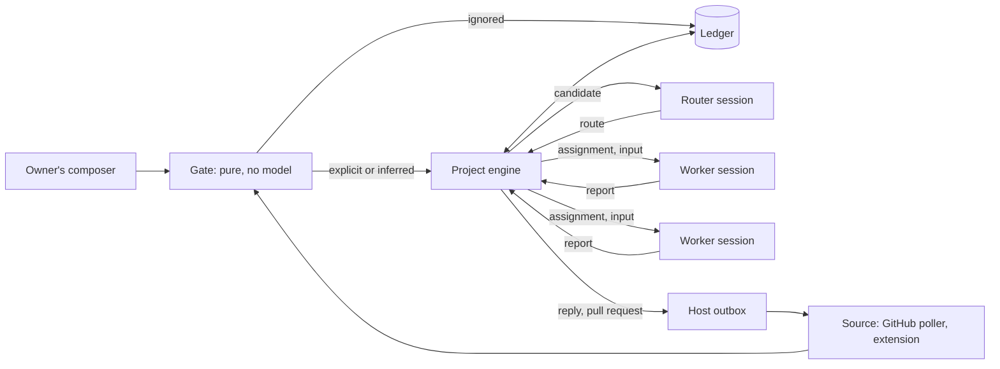

# Project mode: one agent for a repository, many sessions underneath

Status: **built on draft PR #1164, not merged.** [docs/architecture/project-mode.md](../architecture/project-mode.md) describes the code as it stands. The owner asked on 2026-11-01 for a version
of DeepSeek's [Super-agent design](https://github.com/deepseek-ai/dsh-superagent-prototype)
as a default mode of Loom, and said to aim higher than the prototype. The owner
accepted the five decisions in [section 2](#2-decisions-already-made). The wire and
durable formats are drafted in
[protocol-change/106](../../protocol-change/106-project-mode.md). Where this note
and that proposal disagree on a format, the proposal wins.

In this note, we describe what a project is, what it reuses, the properties we
want from it that the prototype doesn't have, and the order to build it in.

## 1. The problem, and what we took from the prototype

Today the unit of work a person manages is a session. A person running several
tasks switches between sessions by hand and remembers what each one holds. The
post puts the practical limit at three to five active sessions, and the bottleneck
at that point is human attention, not the model.

A project moves that burden into the system. You talk to one agent. It decides
what becomes work, runs each piece in its own session, and comes back when a
person has to act. Sessions stay real and can be opened at any time, but you no
longer have to manage them.

The post's own experiments are synthetic: coding is replaced by a tool that
consumes time, so they measure scheduling and say nothing about output quality.
Two results still matter here. A single session delegates unreliably when
delegation rests on a prompt (with a neutral prompt, the model delegated in none
of five runs), so the system should enforce delegation. And pass-through of
follow-ups cut cache-read tokens by about 37% without changing completion times,
so it's a cost feature. The design also costs more tokens in total: 23.2M per run
against 6.1M and 10.8M for the single-session variants. A project therefore needs
a budget from the first version.

The prototype is narrower than the post: one repository, one host, one locked
process and one SQLite file. Its router still holds `bash`, and avoiding code
reads is a prompt rule. Its workers run commands without approval as the
operator's OS user, and its docs say the wrappers around them aren't a security
boundary. It has no watchdog and no retention, and it lists its trust model as an
open question. Its best ideas are in authorization and routing:

- A **Mandate** is an immutable, host-written record of why work is allowed.
- The **router routes and doesn't write briefs**, so the worker reads the original
  request.
- `observe` mode records "would accept" before anything acts on inferred work.
- **Ticket**, **Assignment** and **Report** are separate, so retries and restarts
  keep the same unit of work.
- Thread **subscriptions** carry follow-ups straight to the worker that owns them.
- `000-philosophy.md` judges every message by the attention it costs.

We take those. Where we aim higher is in making them properties of the system
instead of instructions to a model, and in measuring the result.

## 2. Decisions already made

| Decision | Ruling |
|---|---|
| What the router passes to a worker | Typed routing only. People's words reach the worker by reference to their trigger, attributed to them. The router writes no text a worker receives. |
| `auto` on untrusted sources | Per source and rule, and only after that pair has a passing verdict. Explicit requests work in every mode. |
| Opening pull requests | A host action after a passing check. The worker has no GitHub path. |
| A person's turns inside a worker | Recorded in the project ledger with explicit strength and no Eval. |
| Project shape | A catalogue row and a `router` role over ordinary sessions, with one typed standing. No new session kind. |

Three rulings from issue #1137 also bind this work and aren't reopened here. State
moves between machines as git bundles over the pinned link. Only the machine that
owns a session pushes and opens pull requests, with its own token. A child's hands
default to a fresh worktree of its parent's workspace.

## 3. The shape

A **project** is a catalogue row that names its workspaces, memory domain, router
session, policy and budget, plus one SQLite file holding its ledger. A `router` is
a model role. A **worker** is an ordinary top-level session with a goal, a
worktree and optionally an advisor strand. Nothing in the orchestration plane
changes. [Protocol 094](../../protocol-change/094-cross-orchestrator-sessions.md)
rejected a parentless delegate session because every delegate rule assumes a
parent run, and the same reasoning applies here.



The engine is a new portable package, `project`, held to lint R6 like `machine`
and `gepa`. It performs no I/O and returns its effects as data, so the whole state
space can be property-tested with `statem` without spawning a process. An actor in
`client` holds it, applies its effects, and is the only writer of the ledger.

### The typed standing

A catalogue row that marks a session is a hidden session kind if it's consulted
through scattered checks. Delegate sessions already show this:
`catalogue_delegate_sessions` is the marker, and `delegate_of` is read at eight
sites across `client/daemon/manager` and `client/daemon/main`. A router would need
at least as many.

So the catalogue gets one projection:

```gleam
pub type Standing {
  Ordinary
  Delegate(row: DelegateRow)
  Router(project: ProjectId)
  Worker(project: ProjectId, ticket: TicketId)
}
```

Moving, the idle and retention sweeps, boot reopening, archiving and active-tool
changes all match on `Standing` exhaustively, with no catch-all arm. A new standing
then fails to compile at every site that has to decide. This costs no `kind`
column, and the existing delegate checks can move onto it as a separate cleanup.

### Terms

| Term | Meaning |
|---|---|
| Source | A stream of events with its own read position and bot identity. |
| Trigger | One immutable event. Accepting a trigger twice makes one ticket. |
| Thread | Triggers in time order, as the source defines them. |
| Subscription | A many-to-many link between tickets and threads. Delivers only triggers the gate admitted, and grants nothing. A comment from an unlisted sender is recorded on the thread and never delivered. |
| Mandate | What an accept grants: strength, basis, actor, scope, policy version. Immutable. |
| Ticket | A unit of authorized work. Its state is its own and doesn't follow a session. |
| Assignment | One binding of a ticket to a worker session. A ticket has several over time. |
| Report | A worker's closed-set status: `progress`, `waiting`, `blocked`, `failed`, `dropped`. There is no `ready`; see [section 6](#6-done-means-verified). |

## 4. The router

The router is a long-lived session with `Standing = Router(project)`. It routes on
a cheap model through a new `Custom("router")` role, falling back to `subagent`
then `main`. A worker runs on `main`, which reverses the usual cheap-child
convention.

Its tool set is exactly three tools, and it holds no `code_mode`:

- `route` takes 1 to 20 items in one call, each `accept`, `attach`, `stop` or
  `ignore`, each refused on its own.
- `project_read(resource)` reads one graph of IDs with fixed page limits. Every ID
  a page shows can be read through it, so context expands one hop at a time. It
  doesn't serve transcripts or file contents.
- `reply(subject, purpose, text)` goes through the outbox. The host resolves the
  destination from the subject, so the model can't choose one.

Enforcement has two parts. A model's own calls are checked against the strand's
active tool list. Code-mode capabilities go through `codemode/tool_gate`, where a
capability with no matching tool proceeds, so a router must not be able to start a
program at all, and it can't without `code_mode`. What's missing today is a
ceiling: `active_tools_change` in `client/gateway` validates names against the
registry and has no upper limit, so an operator's `set_config` could widen a router
back to `bash`. Observers are already refused there, because `read_only` is
exhaustive over `Command`. The standing supplies the ceiling, using the same shape
as a spawner's `tools` table.

A routing decision carries no free text for the worker:

```gleam
pub type Routing {
  Routing(
    trigger: TriggerId,
    kind: RouteKind,
    holds: List(TriggerId),
    related: List(#(TicketId, Relation)),
    prior_hand_back: Option(TriggerId),
  )
}

pub type RouteKind {
  Accept(title: TicketTitle)
  Attach(ticket: TicketId)
  Resume(ticket: TicketId)
}

pub type Relation {
  Duplicate
  Blocks
  Follows
}
```

"This person said to wait for design" is a hold naming their message. The title is
capped, appears on the board and never in a worker's context. The host derives the
branch name from the ticket ID, so the router can't choose what gets pushed. A free-text note wouldn't add
a new class of attack, since a worker reads the same untrusted trigger anyway. The
problem is provenance: injected text would arrive sounding like the harness. If a
real need for text appears later, it arrives fenced and labelled as untrusted router
text, and policy still derives only from the Mandate.

### What a compromised router can do

The router reads hostile text by design, so we assume it can be turned, and we
bound what that buys.

| Action | Bound |
|---|---|
| Accept inferred work | Refused unless the gate admitted the trigger, the mode is `auto`, a rule matches and the verdict passed. |
| Accept as explicit | Impossible. The gate sets strength, not the router. |
| Widen a Mandate | Impossible. The type admits no model output. |
| Stop a ticket | Only on a trigger the gate admits as a person's explicit message. |
| Ignore real work | Possible, and it's the real denial of service. Every ignore is in the ledger with its entry ID, and a person can requeue. |
| Attach to the wrong ticket | Possible. The worker gets context with no new authority and can hand it back. |
| Post text | Only to the channel of the subject's thread, under the purpose's word cap, through a recorded outbox row. |
| Read private data | Only ledger records and cards. No transcripts, no code. |

The last two rows are why `project_read` is narrow. A reader of hostile text that
also holds private data and an outbound channel can leak that data. We keep the
channel, because replying is the router's job, so we remove the private data. A
worker's report is model text too and is capped when relayed, for the same reason.

## 5. Authority

The gate is pure and deterministic: literal allowlists per source, no regular
expressions, and no model. It sets a trigger's strength.

| Request comes from | Strength | Needs `auto` |
|---|---|---|
| The owner's composer | explicit | no |
| An allowed person addressing the agent | explicit | no |
| An allowed person following up on their ticket's thread | explicit | no, goes to that ticket's worker |
| An allowed person not addressing the agent | inferred | yes, goes to the router |
| A listed bot, or a CI failure | inferred | yes, goes to the router |
| Anyone not listed | ignored by default | yes, if a rule admits them, goes to the router |

Inferred text never reaches a worker with wider authority than an inferred Mandate. A
ticket with an explicit Mandate takes no inferred trigger from its thread, whatever the
mode, and the router cannot attach or resume one onto it. The trigger is a candidate
for the router like any other, and an accept opens an inferred ticket with its own jail
and a person's publish. A CI failure on an explicit ticket's pull request is inferred,
so under `auto` it becomes a candidate for a new inferred ticket and does not reach
the explicit worker through the thread.

A source drops the bot's own messages before they enter the system. A trigger that
descends from the project's own output carries a generation count, and the gate
refuses to infer new work past a small limit, so a pull request can't fail CI, open
a ticket, and produce a pull request that fails CI indefinitely.

The Mandate decides what a worker's jail allows. A pure function derives the
worker's `BrokerPolicy` and tool ceiling from Mandate fields, and it takes no model
output by type.

| | Explicit | Inferred |
|---|---|---|
| Workspace | Its worktree | Its worktree |
| Network | The owner's session policy | None, until the broker can enforce a registry allowlist (protocol-change/106 addendum) |
| Credentials | None | None |
| Approvals | Go to a person | Refused unless a rule grants them |

A worker holds no credential at either strength, since the host does every push and
pull request. An explicit ticket can still receive hostile text through a
person's follow-up, which is why strength alone doesn't justify a credential, and why
subscriptions deliver only admitted triggers and give an explicit ticket no inferred
ones. The credential proxy
on `microvm/dev-experience` stays independent, and project mode doesn't depend on
it. If per-ticket scope is wanted later, it's an optional layer that takes a plain
scope value, and Mandate types stay on this side. Its owner asks for a message
before anyone touches `packages/vmm/ghproxy`.

## 6. Done means verified

The prototype takes a worker's `ready` report on trust. Here a worker can't reach
`Ready` at all: the only transition into it takes a `CheckPassed` value that only
the host can construct.

Reusing the goal check as it stands wouldn't give us this. It runs in the session's
own workspace, and its result is evidence for the advisor, which makes the decision.
A worker could edit a test or the Makefile and the check would still pass. So:

1. When a worker reports `waiting` with no open question and a head that hasn't been
   checked yet, the host takes that head into the project's host repository. The head is
   the clone's `HEAD` commit and nothing else: the host never reads or snapshots files that
   no commit holds, so a worker has to commit its work, and its pack says so. A clone that
   holds uncommitted changes beside its head, or a branch with no commit of its own beyond the
   base, goes to `AwaitingReview` with the host's words (`the worker made no commit` or
   `the worker's clone holds changes that no commit has`) and no check runs, because a pass
   at that head would not be a pass of the worker's work. The host takes the commit in: it fetches
   exactly the commit the worker's clone names, in the sandbox, with the clone read-only
   and `transfer.fsckObjects` on, and requires the host repository to hold that same
   commit id afterwards. A refusal at any step sends the ticket to `AwaitingReview` with
   the host's words, and nothing about the commit is checked or published. Other idle
   turns run nothing.
2. If the diff, read in the host repository as `base...commit`, touches any of the
   project's `protected_paths` (by default the Makefile, CI configuration and the
   check's own definition), the ticket goes to `AwaitingReview` and the check doesn't
   run, so an edit to a named file is decided by a person and not by the check. The list is
   not a closed set of what a check runs: `make test` still runs an included `.mk` file, the scripts
   its recipes call and the worker's own tests. Worker code can run in a check, and what contains it
   is the check jail, with no network, one writable root and the host's files masked.
3. Otherwise the host runs the project's check command, which comes from policy, in a
   fresh repository cut from the host repository at that commit, in a jail the worker
   can't reach.
4. A pass records `CheckPassed(commit, command_digest, entry)`. A later commit on the
   ticket invalidates it.

The host then pushes the branch and opens the pull request on the owning machine. The
push is from the host repository to the URL that `origin` had in the owner's checkout when
the project was created, given on the command line and never by remote name. A worker's
local branch stays `loom/<ticket>-<seq>`, and the host pushes the commit to a remote
branch named from the ticket ID, with the body from ledger facts (commits, check digest).
The title is the only model text, capped and fenced like `reply`. It looks for an existing pull request from that head before creating one, so a crash
between the request and its record can't open two. Merging stays with people. A
worker that runs on another machine returns its result as a git bundle, which is
unbuilt and is part of #1137.

Inferred work is the exception to that push. An inferred worker has no network, but its sandbox
reads the checkout and the files around it, and a stranger's text may have told it to copy what it
finds into a data file. A check does not look for that, and the push uses the owner's credentials. So
a passing check on a ticket with an inferred Mandate makes it `Ready` and asks the host for no push:
the ticket waits in review with the reason `InferredWork`, and `PersonPublished` is the only way the
commit leaves the machine. Explicit work is unchanged.

Some tickets have nothing to check, such as an investigation or a reproduction.
These end in `AwaitingReview` and never in `Ready`. A person can also publish past a
failing check from the board. That's a recorded command, and no model can issue it.

### What a worker's Git can reach

A worker's session policy makes its workspace writable and, for a linked worktree, the
Git directory the worktree names, which is the owner's `.git`. That is the ordinary
session's trust and it stays for ordinary sessions. A worker reads hostile text, so no
session of `Worker` standing has the owner's repository as its Git directory. The
alternative of filtering the configuration keys a worker could set was rejected: the list
is open-ended (`core.hooksPath`, `core.fsmonitor`, `core.sshCommand`, `credential.helper`,
`url.*.insteadOf`, `http.proxy`, and the hooks directory), and every omission is a way for
the owner's next command, or the host's push, to run a worker's program.

| Repository | Who writes it | Who reads it |
|---|---|---|
| The owner's checkout | The owner. No project code writes it. | The host, in the sandbox, to clone from and to fetch its `HEAD` and read its `origin`. |
| A ticket's clone, `<state>/projects/<id>/tickets/<ticket>-<n>` | The worker, and only the worker. | The host, in the sandbox, read-only, to learn the head and to fetch one commit. Not the owner's tools. |
| The host repository, `<state>/projects/<id>/host.git` | Host code only. It is in no session's writable roots and the session policy masks it. | The host: the diff, the check's tree and the push. |

The clone is made with `git clone --no-hardlinks`, so its objects are copies and no write
through it reaches the source, with no alternates, and its `origin` remote is removed, so
it names no writable path of the owner's. Its `.git` is a real directory inside the
workspace, and the daemon refuses to build a worker session on a clone whose `.git` is a
file or a link, because the session policy widens to the directory such a file names.

A new assignment of a ticket that already has a recorded head is cut differently: the clone
is a new repository made with no template that fetches that one commit from `host.git` by
path. A fetch by path writes no remote, so the clone has no `origin` and nothing in its
configuration names the host repository, and every object is a copy. The host does this
because the head is a commit it took in itself, and the earlier clone may be gone. If the
owner's `HEAD` already contains the head (a merged ticket whose owner has pulled), the clone
starts from the owner's `HEAD` instead, so it is not cut behind the base.

What a person should do with a kept clone: fetch from `refs/tickets/<ticket>/<commit>` in
`host.git`, and treat the clone as untrusted. Its hooks and configuration are the worker's,
so running Git inside it can run the worker's program as the owner.

What this does not give. A worker's jail can still read the other tickets' clones, as it
reads the rest of the host, because masking them would refuse every call of a session
that outlives a clone removed with its ticket. A worker can write only its own. The
owner's `origin` URL is read once, when the project is created, so an owner who changes
the remote afterwards must create the project again. The host repository grows with every
commit taken in and is not collected.

## 7. A ticket's stage

Stage is a pure function of ticket facts, and the first matching row wins. It goes on
the wire as a field, because a Swift client can't reuse `session_view` and no client
should reimplement it.

| Stage | Condition |
|---|---|
| `person/delivery` | An input failed to reach the worker |
| `person/answer` | An open question for a person |
| `person/review` | `AwaitingReview`, or `Ready` with its pull request open, unless a running worker is still changing the work |
| `person/blocked`, `person/failed` | The latest report says so, and no person's message since |
| `queued` | Never assigned, or the assignment is pending |
| `idle` | The latest report is `waiting`, or the latest assignment ended |
| `working` | Otherwise |

Run state stays in the session. A ticket holds only what a session can't: its
Mandate, threads, assignments, and its life after a session closes, such as resuming
when someone comments on a merged pull request. Budget is the goal's token budget,
with a project ceiling above it.

Questions and approvals are records with a sequence that the answer echoes, as
escalations already do. Approvals go straight to a person and never through the
router, since a model must not be able to approve its own work.

### Crash consistency

The ledger and the session stores can't commit together, so the engine has exactly two
inputs: the gate, and a scanner over worker commit streams that reads reports and human
turns, keyed by entry ID. One actor writes the ledger. A session's request key derives from
`(ticket, assignment_seq)`, so creation is idempotent and `catalogue.by_request_key`
recovers the minted session ID, and boot reconciles ledger
assignments against the catalogue. Ledger timestamps use system time, never the
monotonic clock.

## 8. Stepping in

A worker is an ordinary session, so the owner opens it like any other and types.
A scanner subscribed to the worker's commits reads new entries from the session's
log, in the manner of `client/rulescan`, and records each human turn as an
explicit trigger keyed by entry ID. The ledger is derived from the log, so a crash
can't make them disagree.

This answers the post's open question about intervening mid-task with no new
mechanism. The first version is owner-only: inviting a member into a session makes
its next remote spawn refuse, and a router shared between people raises identity
questions we'd rather settle with evidence from single-owner use.

## 9. Observe, with a verdict

`observe` runs the whole path and records what would have happened. Alone, that
produces a log nobody reads, so we add a measurement. A source and rule pair goes to
`auto` only with a passing verdict from the evaluation instrument. There are two
tiers, because they can claim different things:

| Change | Lane | Claim |
|---|---|---|
| Gate, admission table, engine | Replay over recorded triggers | The same inputs now produce these decisions. No spend, deterministic. |
| Router prompt or model | Live over recorded triggers | This model's judgement on these triggers, within the verdict's minimum detectable effect. |

Replay can't judge a prompt change, since it serves recorded responses and the
instrument's own table forbids any claim about model quality from it. A tape must
capture the thread as it stood at each trigger, because a later read would leak the
future into the judgement.

The cost is labels. A person labels about 30 triggers from that source. The
instrument's tests use 30 tasks with three trials each on both arms, and at that size a
thirty-point drop reads `Harmed` at least 95% of the time, but a fifteen-point drop only
about 40%. Those figures are right for the instrument's own plans and are not the figures
for a verdict. A verdict's recorded arm is the one decision the project made, not three
trials, and measured on synthetic plans of 30 triggers with three live trials the verdict
reads `Harmed` on about 60% of thirty-point drops and 18% of fifteen-point drops. Passing
on "not `Harmed`" would have let about a third of thirty-point drops through, so a pass also
needs the instrument's interval of the change in agreement to stay above a thirty-point
drop; then 4% of thirty-point drops pass, 36% of fifteen-point drops pass, and 87% of
runs with no change pass. A passing verdict rules out a large regression to the bound it
records and doesn't prove parity.

Both rules compare the candidate with the recording, so neither says the candidate is good:
a router that disagrees with the person on half the triggers, and did so when it was
recorded, shows no change and passed on 249 of 300 synthetic plans. A pass therefore also
needs the candidate's own agreement with the labels to reach 75% of its trials
(`judge.min_agreement_points`), among the triggers labelled accept and among those labelled
reject, and the lower of the two is what counts. An overall share would pass a router that
declines everything when most labels are rejects, since it agrees as often as they are
rejects: with two accepts in thirty that is 93%. A guess agrees on half the trials, and the
standard error of thirty triggers is near 9 points, so 75 is 2.7 of them above guessing. On
synthetic plans with half the labels of each kind, the router at 45 to 55% passes none of
300 plans, one at 60 to 70% passes 2, one at 70 to 80% passes 82, and one at 80 to 90%
passes 264. A label set with no accept, or no reject, cannot pass, so the verdict is refused
before it spends anything and the owner is told which kind to add.

Simulation cannot drive a router session in a way that judges it. The simulator runs a
session whose scripted model calls a tool named `route` and holds it to every check under a
crash, but the call, its arguments and its result are the script's, and the project engine
is not in the simulated tree, so the decision would be the script's own. The replay lane is
therefore built over recorded triggers, and the live lane is built as a function of a
decision callback. The daemon's real router can be driven with a scripted provider
(`client/project_daemon_test`), and so can the live lane's scratch session
(`client/project_judge_session_test`, `client/project_source_test`).

The scratch session is what the live lane asks. It is not the router's own session, whose
`route` applies decisions to the ledger and whose conversation carries from one trial to the
next. Each trial opens an in-memory session of its own with the router's pack and resolved
model and one tool, `route`, with the router's schema over an executor that records the items
and applies nothing. It gets the trigger under the router's `TriggerOrigin` fence and the thread
as the tape holds it, and it stops when the trial ends, on every path. The run is bounded to four
trials in flight and twenty minutes, ends at the first failed trial, and runs in a task so the
project actor keeps serving. `projects.verdict` answers a live run at once and the finding is
recorded when the trials are done. The addendum of protocol-change/106 has the details and what
the session cannot show the model.

A verdict is pinned to the policy version, prompt revision and model. Changing any of
them returns that pair to `observe`.

## 10. Load and attention

The project has an adversary who can write comments, and the two resources they can
spend are tokens and your attention.

Tokens are protected before any model runs. The gate refuses unlisted senders by
default, and each source has a bounded queue and a rate cap per actor. Under overload
the engine sheds inferred triggers first, recording each one as shed, and never drops
an explicit one: explicit work queues. A project token ceiling stops new assignments
and new router turns on inferred work, and the board says so. Explicit requests still
reach the board while stopped.

Worker capacity is a fixed number of slots with one reserved for a person's message, so
queued work can't lock a person out of a running ticket. A slot is held only while the
assignment's session is doing work. When a ticket's work waits for a person (in review,
ready or published) and its worker is idle with its head read, the engine ends the
assignment as rested: the slot is free for the next ticket, and the session and its clone
stay. A person's message or a retry starts a new assignment, which the host seats in the
same session and clone. Executors admit 16 scopes and a
spawner's `max_sessions` caps at 16, so a larger backlog stays `queued` in the ledger.
The peer outbox drainer gives up after an hour, so a ticket waiting on an offline
executor holds its state in the ledger and doesn't lean on that retry.

Router batching needs no new mechanism: triggers that arrive during a turn drain
together at the next checkpoint, using the all-item drain mode, with explicit
candidates ordered first. Worker progress stays on
the ticket and doesn't wake the router, which is most of what pass-through saves.

Attention gets a measured budget. The board reports messages per accepted ticket and how
often a person acted on a question or dismissed it. An acknowledgement is capped at 100
words and suppressed for inferred work. A source stops inferring new work while its
open needs-a-person tickets exceed a small limit. Both figures join the verdict, so a router that
accepts correctly but talks too much doesn't pass.

## 11. Staying up

A project's router and any ticket with a live assignment reopen at daemon boot, because
the owner wrote the project row. This narrows the rule that every session starts closed,
and only that far: a model's message still can't open a session. A worker restarting from
interrupted work gets a recovery note telling it to check its worktree and the source
before repeating any outside action.

Three other existing rules are narrowed by owner-written policy. The engine creates worker
sessions, as an owner action under the project's limits, and the model still can't create a
session. A trigger may wake a router, bounded by the project's budget rather than by the
seven-day expiry that recurring schedules carry. And `Standing` exempts routers and open
tickets' workers from idle and retention sweeps.

There's no model-driven watchdog. Supervision restarts what crashes, goals bound tokens and
continuations, and `repeat_guard` catches runs that repeat. A deterministic staleness query
appears as a column on the board, flagging a ticket in `working` with no commits and no
report for too long. A process outside the daemon still has to restart the daemon, and
that's launchd or systemd.

Retention is designed in. Ended tickets and old triggers compact on a schedule, keeping the
decision and its entry ID. Their sessions follow the daemon's archive rules.

## 12. Surfaces

The board lists first what needs a person, and a healthy state takes no space. It's a third
top-level destination in the native client beside Inbox and Mission Control, and its needs
map onto that inbox's existing grouping. The web redesign's navigation isn't settled, and its
note is due at `docs/design-notes/web-ui-redesign.md`. A paged read with a revision serves every
client. A contentless change doorbell is the natural next step, following the rule that
payloads are durable and doorbells are not, and it waits until polling shows a cost. `loom project` in a git repository needs no configuration: it derives
the workspace, keeps inferred work `off`, and treats the composer as its only source.

## 13. Cut

Forking a ticket to try competing approaches is cheap to add later, since branching exists,
but it means several worktrees and budgets now. Also cut are direct worker-to-worker messages,
router sharding, a model in the watchdog, chat integrations in the harness (a Feishu or Slack
source is an extension), multi-owner projects, and speculative work beyond what a rule in
`observe` already records. Also cut for now are moving delegates onto `Standing`, the
change doorbell, and `projects.thread`. Input read tracking, which the prototype needs for exact release of
unread follow-ups, waits for a test that shows the log isn't enough.

## 14. Build order

Each slice lands on `main` with its own exit criteria.

| Slice | What | Exit criteria |
|---|---|---|
| 1. Core | `project` engine, `Standing`, tool ceiling, router, one session per ticket, composer as source, pull-only `projects.list` and `projects.board` | `statem` over the engine; no sequence reaches `Ready` without `CheckPassed`; a router can't gain `bash` or `code_mode` through `set_config`; a driven run with two parallel tickets on a real model |
| 2. Done | Host check, protected paths, host pull requests | A worker that edits a protected path can't reach `Ready`; a crash between request and record opens one pull request |
| 3. Surfaces | Remaining wire commands, board, reopen at boot, direct approvals | Wire forms checked against live frames; kill the daemon mid-ticket and the ticket resumes with no duplicated outside action |
| 4. Events | GitHub poller, source protocol, gate, threads, `observe`, ledger retention | Own messages dropped; a burst of hostile comments costs no model call; shed work is visible |
| 5. Authority | Mandate-derived broker policy | Two Mandates differing only in trigger text derive identical policy, and policy is monotone in strength |
| 6. Verdict | Recorded tapes, both lanes, labels, `auto` gate | A/A on one tape isn't called either way beyond the instrument's bound; a planted admission flip reads `Harmed` |

`auto` can't be enabled before slices 5 and 6, so those order the risk: everything earlier acts
only on explicit requests. Slice 1 alone answers the question that matters most, whether one
agent fanning out beats five tabs.

## 15. Open questions

Remote workers depend on the #1137 bundle work, which is unbuilt, so slice 1 runs workers on the
owning machine. Automatic worktrees are specified for executor workspaces by
[protocol 095](../../protocol-change/095-worktree-workspaces.md), and a zero-config local checkout
needs either a local executor or an extension of that work, which we should settle at the start of
slice 1. We haven't checked whether `active_tool_names` alone closes every effect path when a session
is placed on a remote executor, so that needs a test before a remote router is allowed. A project with
several workspaces is allowed by the row, but the first version binds exactly one.
