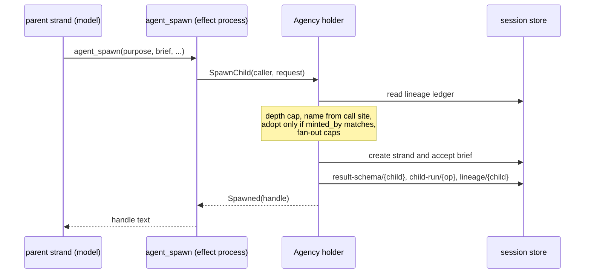
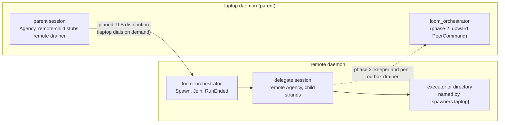
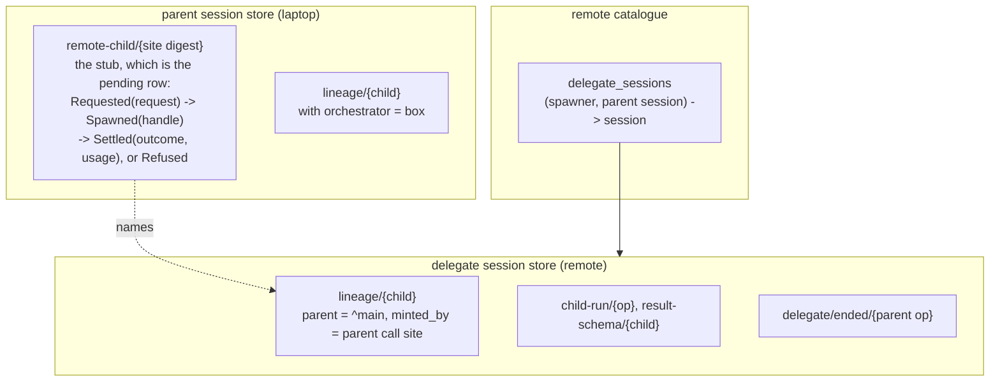
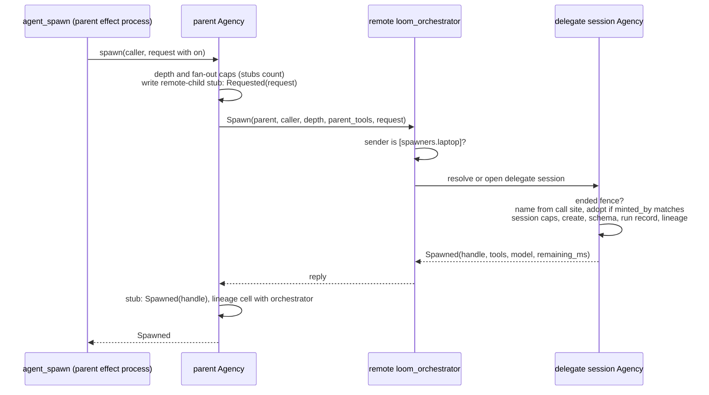
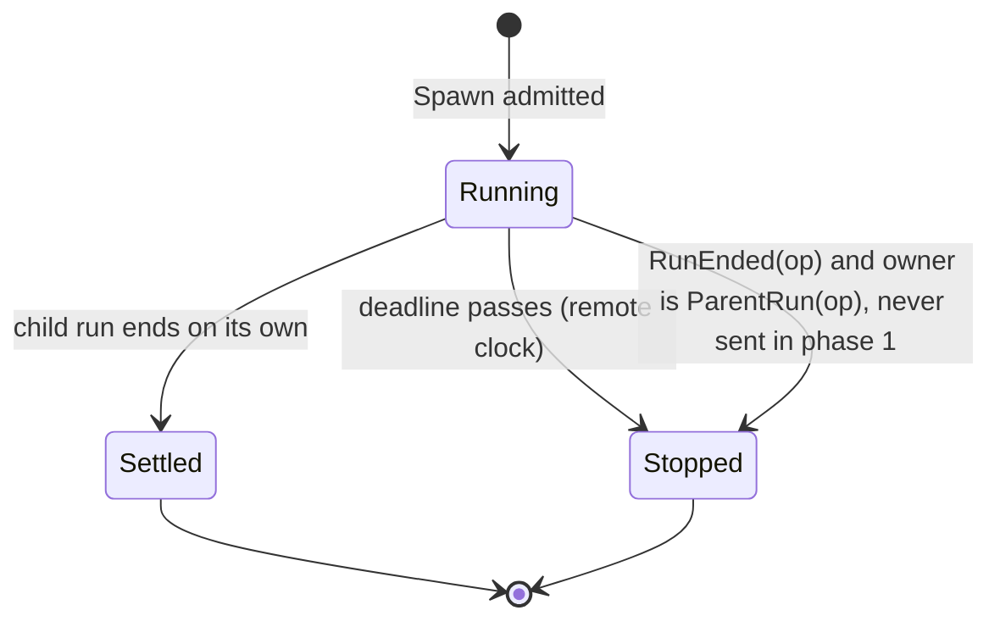

# Subagents on another orchestrator

Status: **direction ruled by the owner, 2026-10-09; phase 1 simplified after
review, 2026-10-11; what ending a turn does to remote children ruled by the
owner, 2026-10-11 (section 6A). Slices S1 to S3 of phase 1 (the policy and the port
messages, the delegate session and the box's Agency, then the laptop's stubs,
drainer and tools) are built; the rest is design. Where S3 had to differ from
what follows, the section says so under "As built in S3".** The wire and durable
formats it adds are drafted in
[protocol-change/084](../../protocol-change/084-remote-subagents.md). It
builds on the distributed runtime of PR #923
([the design note](distributed-runtime.md),
[the architecture page](../architecture/distributed.md),
[protocol-change/078](../../protocol-change/078-distributed-runtime.md)) and
is meant to work with and without the Khepri directory of PR #934
(protocol-change/083).

## 1. The question

The owner asked whether an orchestrator on a laptop could start and direct
subagents on a remote orchestrator, "basically via TLS distribution". Today
it cannot. PR #923 gives a session remote hands (an executor runs its tool
calls), lets sessions on two orchestrators exchange peer mail, and lets an
owner move a session from one orchestrator to another. A subagent is none of
these.

`agent_spawn`, and `strand.spawn` in code mode, create a strand inside the
caller's own session, and the session's Agency (`client/agency`) owns
everything about it: the lineage cell that records who spawned whom
(`runtime/lineage`), the per-run record that carries its deadline and its
stop reason (`runtime/child_run`), the join, the result contract, the rule
that a strand addresses only its parent or a descendant, the depth and
fan-out caps, and reaping when the parent's run ends or the deadline passes.
All of it reads and writes one session store on one machine. And the model
cannot create a session anywhere, because `sessions.create` and `peers.link`
are owner control commands.

This note gives a model a child that runs on another orchestrator, keeps the
local semantics wherever the network allows, and carries the work over the
same pinned TLS distribution that #923's orchestrators already share.

## 2. The decisions in brief

These follow the owner's rulings of 2026-10-09 (section 17). The review of
2026-10-11 removed machinery from phase 1 that the deadlines already make
unnecessary; section 15 says what moved to phase 2.

1. **The transport is TLS distribution.** Spawn, join and run end are new
   messages on the orchestrator port (`remote/orchestrator_port`), beside
   `PeerCommand`, `Import` and `Activate`; the laptop sends the first two in
   phase 1. Delivery that must outlive a
   failure reuses peer mail's `Endpoint`, its split between `Unreachable` and
   `Refused`, and the shape of its drainer (a weft state machine that retries
   durable rows). It does not reuse the peer outbox's rows (section 8.4).
2. **The trust model is #923's.** A pinned distribution peer is fully trusted
   and can call any function on the remote, and the remote can call any
   function on the laptop. The remote's spawn policy bounds an honest peer
   and a misbehaving model; it is not a security boundary against a
   compromised peer (section 5).
3. **The spawn policy lives in the remote's `loom.toml`,** in a
   `[spawners.<name>]` table that names the spawning node and its placement,
   profile, tool ceiling, depth, session cap, deadlines and retention. It is
   the one authority: the laptop's `[orchestrators.<name>]` rows carry no
   spawn switch, and the remote refuses with its reason. The table is
   separate from `[orchestrators.<name>]`, because under #934 every
   orchestrator a member daemon lists must itself be a Khepri member
   (section 9).
4. **A remote child is a strand in a delegate session.** The remote creates
   one delegate session per (spawner, parent session) on the first spawn,
   owned by the remote owner, and its own Agency mints and judges every child
   in it. The parent is not a strand there; it appears as a reserved
   reference.
5. **The model's surface is `agent_spawn` with `on`,** offered only in
   sessions the laptop owner holds alone. `on` lists every
   `[orchestrators.<name>]`. `agent_wait`, `agent_roster` and `result_schema`
   work on a remote child as on a local one. `detach` is implied: a remote
   child is always detached.
6. **Idempotency comes from the call site, on the remote.** The remote's
   Agency derives the child's name from the parent's call site and adopts on
   a name match only when the lineage cell says that call site minted it. The
   stub the parent writes before the first message is itself the pending
   row: it stores the request, routes every retry to the same remote, and a
   drainer resends the `Spawn` from it until the remote answers. Adoption
   makes every resend idempotent, so no status query is needed.
7. **Every remote child has a finite deadline on the remote's clock,** at
   most the policy's `max_within_s`, and is detached: it outlives the parent's
   turn (the owner's ruling of 2026-10-11, section 6A). The laptop sends no run
   end in phase 1. A child that nobody waits for runs to its deadline, and
   because phase 1 does not meter tokens on the remote, a forgotten child spends
   what it spends until then. The parent's fan-out slot does not wait for a
   wait: a child's deadline releases it with no message, and the drainer
   releases it sooner when the child finishes (section 8.4).
8. **The remote's provider keys pay.** Phase 1 reports usage and does not
   meter it: each settled child's usage comes back with its result and counts
   against the parent goal's token budget. Budgets enforced on the remote are
   phase 2 (section 10).
9. **Approvals.** Phase 1 has none; a remote child's refused call settles in
   band. In phase 3 the parent's operator may approve, within a ceiling the
   remote owner sets in the spawn policy.

## 3. What a local subagent is today

A local spawn runs entirely inside the parent session's Agency holder, which
serializes child admission:



Four properties carry over to the remote design and decide most of it.

- **The name is derived, never chosen.** `agency.child_name` builds
  `sub:{parent}/{slug}-{digest}` from the caller's strand, the purpose and a
  digest of the call's durable coordinates (operation, minting step, source
  index). A replay derives the same name.
- **The ledger, not the name, proves ownership.** `adopt` hands an existing
  child back only when its cell's `minted_by` equals the caller's call site.
- **A run record owns cancellation.** `child_run.Run.owner` is
  `ParentRun(op)` for an attached child, and `reap_run(op)` at the parent's
  run end stops every child whose current run that operation owns. A
  deadline in the same record is checked by `reap_overdue` before each wait.
- **A send upward never wakes a finished parent.** `send` refuses an upward
  message to an idle parent with `ParentRunEnded`, because a fresh run with
  no human present is what auto-enqueued child results were rejected over.

## 4. Transport: the orchestrator port

### The messages

The orchestrator port is the one process per daemon, registered as
`loom_orchestrator`, that answers other orchestrators. It already serves
`Owns`, `PeerCommand` and the three move messages. Three constructors join
them in phase 1:

| Message | Answers | Runs |
|---|---|---|
| `Spawn(parent, caller, depth, parent_tools, request, reply)` | the child's handle, or a `SpawnRefusal` | in a task, since the first spawn opens the delegate session |
| `Join(parent, handles, within_ms, reply)` | one `Ready` or `Pending` per handle | in a task, for up to 25 s |
| `RunEnded(parent, operation, reply)` | how many children it stopped; the laptop does not send it in phase 1 (section 6A) | in a task, because it reaches into the delegate session's Agency and waits for its holder |

`parent` is `{session, strand}` on the spawning orchestrator. Every value is
plain data and a reply subject, as on the rest of the port: no closure, port
or atom built from a peer's input. A spawn or a join can take seconds, so each
runs in a task linked to the port and cancelled with the requester, as
`Activate` already does, and an `Owns` question is never kept waiting behind
one. A daemon that accepts no spawns starts the port without a spawn host and
refuses all three, as a daemon that receives no sessions refuses `Import`.
`Release` joins the port in phase 2 (section 8.3).

The port forwards each message to the delegate session's Agency holder,
which serializes spawn admission and the run-end fence in one mailbox.
Unlike a peer-mail delivery, which is refused when its recipient is not
running, these messages may open the delegate session: it exists only to
serve its spawner, and a join on a settled child must be able to read the
child's result after the session was closed, including after the remote
restarted.

### The sending end and its failures

The sending end is modelled on `remote_peer`. A call connects to the pinned
peer if it is not connected, sends the message to the remote's
`loom_orchestrator`, and waits under a deadline. The answer is one of the two
failures `peer_mail.Failure` already separates:

- **`Refused(reason)`** is a definitive answer: the remote looked and said
  no. The model reads it as an ordinary in-band refusal.
- **`Unreachable`** means nobody answered: `noconnection`, `noproc` (no port
  registered, for instance during the remote's boot), or the deadline passing.
  The remote may have acted and lost the reply. What happens next depends on
  the message (section 8).

A reply that arrives after the deadline reaches nobody, as in peer mail. Every
message is idempotent on the remote, so the next attempt gets the stored
answer.

### Who dials whom

The laptop dials, on demand. A laptop behind NAT has no address the remote can
reach, and #923 already has orchestrators dial their peers on demand with no
connection at startup: `remote_peer.over_distribution` connects to the pinned
peer inside each call. In phase 1 every message goes from the laptop to the
remote and every answer returns over the connection that call made, so
nothing needs the connection to stay up between calls and the remote sends
nothing to the laptop on its own. A dropped link costs the next call a
reconnect, and a call made while the remote is unreachable is `Unreachable`.
Phase 1 has no connection keeper.

Phase 2 adds messages the remote originates (upward peer mail, section 8.6).
Those need the laptop connected, so phase 2 adds a keeper on the laptop. While
a parent session holds a live remote child, the keeper reconnects to that
remote every two seconds when the connection drops, in the shape of the link
keeper #934 gives directory members (`directory/member`). It is a weft state
machine per remote orchestrator, started by the first live stub and stopped
when none is left.



## 5. The trust model

This section states plainly what the design assumes, because the spawn
policy looks like an access control and is not one.

**A pinned distribution peer is fully trusted.** This is #923's assumption,
unchanged: a connected node has the full privileges of an Erlang peer and can
spawn processes and call any function on the other node. The closed message
vocabularies, the orchestrator port's included, keep each port to its job and
are not a security boundary. Under #923 the verify function also does not tie
a connection to the node name it claims, so among pinned peers a message's
claimed origin is not proven by the connection. Making a laptop a spawner
means making it a pinned peer of the remote, with all of that.

**Trust is symmetric.** The laptop is a pinned peer of the remote and the
remote is a pinned peer of the laptop, so a compromised remote can call any
function on the laptop daemon: its other sessions and its keys. Spawning on a
remote trusts that remote with the laptop as much as it trusts the laptop with
the remote.

**What the spawn policy is for.** The deadlines, session cap, placement and
tool ceiling in `[spawners.<name>]` are enforced by the remote for a peer
that sends the orchestrator port's messages and nothing else. They bound a
model that spawns too much or for too long, a bug in the laptop's daemon, and
an operator's misconfiguration. They do not bound an attacker who controls
the laptop's VM, because that attacker does not have to send the messages the
policy checks.

| Threat | Bounded by the spawn policy? |
|---|---|
| A model on the laptop starts more children or longer runs than intended | Yes: `max_within_s` and `max_sessions`, and the delegate Agency's own `fan_out` and `session_strands`, each enforced on the remote in one process. Phase 2 adds daily spawn and token budgets |
| A brief carries a prompt injection aimed at the remote child | As for a local child: the tool ceiling and the workspace's sandbox policy bound what the child can do |
| A bug in the laptop's daemon sends malformed, repeated or excessive requests | Yes: the closed vocabulary, idempotent handling and the caps |
| A laptop daemon from another release sends a message the remote cannot match | No new protection: as on the rest of the port, both ends are upgraded together |
| An attacker runs code in the laptop's VM | **No.** The attacker can call any function on the remote: read and prompt every session, use its provider keys, reach its executors, and through #934 change session ownership if the laptop is a member |
| An attacker runs code in the remote's VM | **No.** The same toward the laptop: its other sessions and its keys |
| An attacker copies the laptop's bundle (private key and cookie) | **No.** The copy can join as the laptop. The operator removes the laptop's pin from `[[distribution.peers]]` on every node and restarts them |

So a laptop should be made a spawner only when its owner would also make it
an orchestrator of the deployment, because that is the privilege it gets.
Protocol-change/084 records the stronger alternative that was considered and
rejected: the laptop as a client of the remote's control endpoint with a
scoped principal, where the remote's checks would bind even a compromised
laptop.

**What the remote child itself may do** is a separate question, and there
the usual boundaries hold. The child is a strand of the remote harness: its
tools pass the broker and its effects run in the remote's jail or on the
remote's executor, exactly as for any session there.

## 6. The model's surface

### `agent_spawn` with `on`

`agent_spawn` gains one optional argument, `on`, naming a remote
orchestrator. The names are the laptop's `[orchestrators.<name>]` keys, all
of them, and the tool schema lists them as an enum, the way it lists `model`
names. There is no per-row switch. The remote's `[spawners]` table is the one
authority, and a remote with no table for the laptop refuses the spawn and
says why. With `on` absent the spawn is local and nothing changes. `on` is
offered only in sessions the laptop owner holds alone, using the predicate
default peer links already use (`manager.unshared_sessions`), so inviting a
member into a session withdraws it.

The configuration decoder refuses an orchestrator name that contains `@` or
`#`, because the handle below is parsed by splitting on the last `#` and then
the last `@`.

```json
{"purpose": "run the integration suite",
 "brief": "Run make e2e on the box and report failures.",
 "on": "box",
 "within_ms": 1800000,
 "result_schema": {"type": "object",
                   "properties": {"failed": {"type": "array"}},
                   "required": ["failed"]}}
```

A new tool was considered and rejected. A remote child is waited on, listed
and reaped with the same tools, and a separate tool would make the model
learn a second vocabulary for the same act. `strand.spawn` in code mode gains
the same field through a `with_on` builder on the assignment, in phase 2; the
per-execution spawn ceiling (32) counts remote spawns too.

### What each argument means for a remote child

| Argument | Remote behavior |
|---|---|
| `purpose`, `brief` | As local. The brief is framed with `frame_brief` on the remote. |
| `within_ms` | Absent means the policy's `default_within_s` (30 min by default). A value above `max_within_s` (4 h by default) is refused, not clamped. Converted to an absolute deadline on the remote's clock. |
| `tools` | Narrowed three times: by the request, by the parent's own active tool names, and by the policy's ceiling. The parent's tool names travel in the `Spawn` message, because the remote has no parent strand to read them from. `agent_spawn` is removed unless the policy's depth allows it. The communication floor (`agent_note`, `agent_send`) is kept when the ceiling holds it. |
| `model` | A catalogue name on the remote, validated there. Absent means the policy profile's subagent route. |
| `result_schema` | Parsed on the parent (a malformed schema is the parent's mistake, told in its own turn), enforced on the child's `agent_note` on the remote, and decoded again on the parent when a result comes back. |
| `context` | `"mine"` is refused with `on`. Copying the parent's conversation would ship the transcript to another machine. |
| `detach` | Implied. A remote child is always detached, so the argument has no effect with `on` (section 6A). The child is bounded by its deadline and by the retention sweep. |

### The handle

A remote handle names its orchestrator, so `agent_wait` can route it:
`sub:^main/run-the-integration-suite-7b1c0a4e2d95f318#op_01J…@box`. The
orchestrator is the suffix after the last `@` that follows the last `#`;
neither an operation id nor a minted slug contains `@`, and an orchestrator
name contains neither character. The spelling is provisional. `^main` is
explained in section 7.

### The other tools

- **`agent_wait`** takes local and remote handles in one call and waits for
  all of them against one deadline, as today. Remote handles are asked of
  their orchestrator with one `Join` per orchestrator, each within 25 s, run
  beside the local poll inside the same budget. An `Unreachable` join leaves
  that orchestrator's handles `Pending`, with a sentence saying it did not
  answer.
- **`agent_roster`** lists remote children from the parent's stubs: the
  name, the orchestrator, the handle, and the state last observed (running,
  past its deadline, settled, refused, or unknown when the remote has not
  answered). A child whose deadline has passed is shown as past its deadline
  and not as running, whether or not anything has read how it ended.
- **`agent_send`** downward to a remote child is refused in phase 1 with a
  sentence that names the result and the notes as the way to report. A remote
  child's `agent_send` upward needs no new code to be refused. Its target
  `^main` is a strand that does not exist in the delegate session, so the
  Agency's `send` finds no state for it and answers `ParentRunEnded`, which is
  the right refusal. Only the wording is remote-aware: for a target that
  begins with `^`, the sentence says the parent is on another orchestrator and
  tells the child to report through its final answer, its notes or its
  result. Phase 2 adds both directions (section 8.6).
- **`agent_notes`** reads the parent session's blackboard, as today. A
  settled remote child's notes arrive with its `Ready` result; reading a
  running remote child's notes is phase 2.
- **`todo`** stays local.

## 6A. When the parent's turn ends

The owner ruled on 2026-10-11 that remote children are detached by default
(question 3 in section 17, option b). A remote child outlives the parent's
turn, bounded by its deadline and by the retention sweep.

- **Ending the turn does not stop the children.** The parent's Agency runs
  `reap_run(op)` for the local children as ever, and it sends nothing across.
  `agent_spawn` with `on` sends the request as detached whatever `detach` the
  model gave, so the child has no `ParentRun` owner on the remote, and the
  `on` description tells the model that ending its run does not stop the
  child. The laptop is likely to be closed mid-task, and the work is expensive
  to lose.
- **A child that is never waited on runs to its deadline.** The deadline is the
  policy's `default_within_s` unless the model gave `within_ms`, and at most
  `max_within_s`. Phase 1 has no remote token metering, so a forgotten child
  spends whatever it spends until then. Metering and `Release` (phase 2) are
  what bound it more tightly.
- **A model that wants the answer waits for it.** `agent_wait` on the handle
  reads the result at any later time, in the same turn or a later one, until
  the retention sweep deletes the delegate session.
- **The parent's slot does not wait for the wait.** A `Spawned` stub counts
  against the parent's fan-out caps while its child may be running. The child's
  deadline ends that with no message, and the drainer ends it sooner when the
  child finishes without being waited on (section 8.4).
- **Suspending the laptop does not end the run.** A laptop that sleeps in the
  middle of an `agent_wait` has not ended the run. Only the in-flight `Join`
  task is cancelled. The remote children keep running under their deadlines,
  and the next `agent_wait` on the same handles reads their results.
- **`RunEnded` stays on the port and is not sent.** The message, its handler
  and the ended fence are S2's and stay as built, because phase 2's `Release`
  reuses them. In phase 1 nothing on the laptop sends `RunEnded`: a detached
  child owes the run that started it nothing, so the stubs of a finished run
  stay and the children they record keep running.

## 7. The remote child: a strand in a delegate session

### Three shapes considered

**A strand in an existing session on the remote.** Rejected. The remote's
sessions belong to its owner and its members; a child there would be visible
to them and would share their lineage namespace.

**One new session per child.** Rejected. Each child would need its own session
store, runtime and, for an executor-backed workspace, its own executor scope,
and an executor admits at most 16 scopes that are not cleanly closed. A
fan-out of eight children would take half an executor. Lineage, the caps and
reaping would also have to be rebuilt across sessions.

**One delegate session per (spawner, parent session), with each child a
strand in it.** Chosen. Children of one parent share one workspace and one
executor scope, which is what local children do: they share the parent's
checkout. And the remote's Agency already implements naming, adoption, caps,
the result contract, the wait and reaping over strands in one session, so the
remote side is the local code with a different caller.

### The delegate session

The remote creates the delegate session on the first `Spawn` for a parent
session, through `manager.create_scoped` with the `SessionOnly` memory
domain, and records it in a new catalogue table, `delegate_sessions` (built as
`catalogue_delegate_sessions`, at catalogue version 15), keyed by
(spawner name, parent session id). Every later message for that parent
session is answered from the same row. The spawner name is the remote's
`[spawners.<name>]` key for the sending node. It is an ordinary session of the
remote daemon in every respect not listed here:

- **Owner.** The remote owner. It appears in the owner's session list,
  labelled with the spawner and the parent session's id, and the owner can
  open it, read it and abort its strands.
- **Workspace.** The policy's placement: a registered workspace on an
  executor, a pool, or a directory on the remote. The laptop never names a
  path or an executor.
- **Configuration.** The policy's profile (`[profiles.<name>]`,
  protocol-change/076) seeds the session, so the remote's catalogue, roles and
  pricing apply.
- **Identity of the parent.** The parent strand is not a strand of the
  delegate session. Its children's lineage cells name it as a reserved
  reference, `^{parent strand}` (so `^main`), and `create_strand` refuses a
  name of that form, so the reference can never name a real strand.
  `api.CreateStrandError` has no invalid-name arm today, so this is a new
  arm and a new check, not the reuse of an existing refusal. The addressing
  walk (`lineage.is_descendant`) needs no change: it compares names, and every
  child's chain ends at the reference, which has no cell.
- **Attribution.** A brief carries `PeerOrigin(parent session, parent
  strand)`, the existing origin for a model in another session whose identity
  the host binds.
- **What it refuses.** Moving it (`sessions.move` answers `not_movable`, by
  one arm in the manager's `movable` check that tests a marker in the
  catalogue row). Refusing members of a delegate session is phase 2, with the
  refusal of peer links to or from it other than the ones section 8.6 writes;
  until then the owner can open, read and prompt it, so nothing is protected.

Because the session is created through `manager.create_scoped`, it is created
the same way whether or not #934 has landed. The two PRs can land in either
order: with #934, `create_scoped` is where a session of a member daemon gets
its directory record.

**Lifetime.** A delegate session that is not open, because it was closed or
because the remote restarted, is opened by the next `Join` or `Spawn` for it
(`manager.open`), and runtime recovery resumes the children it holds. So a
remote restart needs no boot-time reopen. A boot sweep deletes delegate sessions whose last contact
from the spawner is older than the spawner's `retain_s`; the default applies
when the spawner's table has since been removed. The decoder keeps `retain_s`
at or above `max_within_s`, so a session past retention holds no child that
could still be running.

### What the remote's Agency does differently

The spawn path is `spawn_on`, and its `reconcile` reads the parent's
configuration while `child_tools` takes the parent's tool list. Neither can
read a parent strand that is not in the delegate session. So a private
`Source` (`Local | Delegated`) is threaded through the Agency, and a spawn that
arrives from the port is `Delegated`, carrying what the `Spawn` message holds.
The caller stays an ordinary `Caller` whose strand is the reference `^main`.
Three things change for it:

1. **Depth** is the depth the parent reports, checked against the policy's
   `max_depth`, instead of a parent cell, because the parent has no cell on
   the remote. The limit is never above the remote Agency's own `depth_cap`, 1
   in phase 1, because a remote child's own spawn is judged against that cap.
2. **The base configuration and the tool list** come from the message and the
   policy. `reconcile` takes the policy profile's configuration instead of the
   parent strand's, and `child_tools` takes the message's `parent_tools`,
   narrowed by the request and the policy's ceiling.
3. **Admission refuses a spawn under an ended parent run.** Before it mints,
   the holder checks for a `delegate/ended/{op}` fence for the call site's
   operation (section 8.3).

The caller's coordinates are the parent's own: strand `^main`, and the
operation, step, source index and minter of the parent's planned call. So
`child_name` and `adopt` run unchanged, and a resent spawn from the same call
site adopts the child it already created. The caps are unchanged too: the
delegate Agency's own `Config.fan_out` and `session_strands` apply to the
children of one delegate session.

## 8. The protocol

### 8.1 Records on each side



On the parent, the `remote-child/{site digest}` fact is the write-ahead stub.
It is reserved (no model tool can read or write it) and is written before any
message is sent. It records the orchestrator, the derived name, and the whole
request: purpose, brief, model, tools, `within_ms`, result schema, `detach`,
the caller's coordinates, the depth and the parent's tool names. So every
retry of that call site goes to the same remote, a remote failure never
becomes a local spawn, and a drainer can resend the spawn without the model.
The parent's lineage cell gains an optional `orchestrator` and is written once
the spawn is answered, so addressing, the roster and the fan-out count see the
remote child as the caller's descendant. A cell that predates the field
decodes as local. The stub is the only pending row (section 8.4).

On the remote, the delegate session holds the real lineage cell, run record
and result schema, written by the same `reconcile` path as a local child,
plus the ended fence described below. The remote catalogue keeps the delegate
session map; the policy itself is configuration.

### 8.2 Spawn



The parent's spawn is `ReplaySafe` and stays so. The spawn call waits up to
30 seconds for each attempt, because the first spawn for a parent session
opens the delegate session, which on an executor placement includes an
attach.

- **`Refused`** settles the spawn with the refusal, and the stub is kept as
  `Refused` with the reason. Nothing was created. The stub is kept whoever
  hears the refusal, the model's effect process or the drainer, because a
  refusal can be transient (a cap that clears, a store that recovers) and a
  second asker of the same call site can still be answered with a child. A
  stub that one asker deleted would leave that child with a lineage cell and
  no stub, so no cap slot, no roster entry and no wait target. A `Refused`
  stub does not count against the caps, the roster shows it as refused, and
  the step from `Refused` to `Spawned` absorbs the race. Replaying the same
  call site returns the recorded refusal.
- **`Unreachable`** is resent with a doubling pause from 50 ms to 2 s, as
  `surface.run` resends a `Run`, until the remote answers or the spawn's
  window of 30 seconds runs out. A resend derives the same name, finds its own
  cell, checks `minted_by` and answers the same handle. When the window runs
  out, the tool answers that the remote did not answer and the child may
  exist, and the stub stays `Requested`. A spawn is never retried against
  another orchestrator.

A `Requested` stub is a pending row, and the remote drainer (section 8.4)
resends its `Spawn` every five seconds from the stored request until the remote
answers. There is no status query. A resent `Spawn` is a complete question:
the remote adopts the child the call site already minted and answers its
handle, or creates it if none exists, and the adoption check on `minted_by`
makes the second answer the same as the first. `Spawned` writes the handle and
the lineage cell and moves the stub to `Spawned`. `Refused` moves it to
`Refused` with the remote's reason, which the roster shows. The earlier draft
had a `SpawnStatus` message and a per-site fence for the case where a status
query could overtake a spawn from a killed process. Nothing queries now, so
that race has nothing to act on.

A `Spawn` sent by an effect process that was then killed can still be in
flight when the process is gone, and the drainer resends it from the stub. The
remote adopts the child the call site already made, so there is still one child.
The race with a `RunEnded` that overtakes a `Spawn` is the ended fence's, on the
remote (section 8.3), and phase 1 does not have it, because the laptop sends no
`RunEnded`.

### 8.3 Reaping

In phase 1 a remote child is stopped by its deadline, which holds on the remote
alone. The remote can also stop it on a `RunEnded`, which S2 built and which
nothing on the laptop sends (section 6A); phase 2's `Release` reuses it.



- **Deadline.** Every remote child has a finite deadline on the remote's
  clock, capped by the policy's `max_within_s`. The remote's Agency checks it
  as `reap_overdue` does today, before each wait. A child with nobody waiting
  on it is stopped by a tick: for each open delegate session, a
  `weft/state_machine` whose periodic timeout calls `reap_overdue` (every 15
  seconds, a provisional constant). This bound holds if the laptop never
  returns, and it holds after a remote restart, because the tick starts when
  the session opens and its first call stops every child already overdue.
- **Parent run end.** Nothing is sent. The parent's run-end hook spawns
  `reap_run(op)` off the driver (`agency.reaping_hooks` uses `spawn_unlinked`,
  so the strand driver never waits) and it stops the local children only. A
  remote child is detached, so no run owns it on the remote. The remote's
  handling of `RunEnded` is built, for phase 2: the holder writes
  `delegate/ended/{op}`, then calls the existing `reap_run(op)`, which stops
  every child whose current run is owned by `ParentRun(op)`. The fence makes a
  parent run aborted in the middle of a spawn safe once a sender exists: if
  `RunEnded` overtakes the `Spawn`, the spawn finds the fence and is refused
  with `ParentRunEnded`. The fence is read at admission and written before
  `reap_run`, both inside the holder, so whichever of the two arrives first
  decides and the other agrees with it. As built in S2, admission reads the fence
  only on the path that would create or finish a child, after the adoption check:
  a resend that finds the child its call site already made is answered with that
  child, fenced or not, since adopting creates nothing the run end could have
  missed. A `RunEnded` for a parent with no delegate session yet creates the
  session, so that the fence exists before a late `Spawn` arrives.

The cases phase 2 handles faster are bounded without it. A deleted parent
session, a spawner removed from the configuration, and a laptop that never
returns leave children that stop at their deadlines, at most `max_within_s`
after they started, and leave delegate sessions that the retention sweep
deletes after `retain_s`. Phase 2 adds `Release(parent_session)`, which stops
every child of a delegate session, detached ones included, and deletes it once
its cleanup is proven; a release row in the laptop's catalogue, written in the
registry turn that deletes a parent session, sent by a daemon-level drainer;
`SpawnerRemoved`, which releases the delegate sessions of a spawner whose
table is gone, at boot; and `child_run.Stop` variants `Released`,
`SpawnerRemoved` and `TokenBudgetSpent`, with the matching model-facing
`Outcome` variants. Phase 1 adds no `Stop` variant: a deadline is
`BudgetExpired`.

### 8.4 The remote drainer

Messages from the laptop can find the remote unreachable, and the laptop can
crash between a durable write and the message it implies. Peer mail solves this
with a durable row written before the first attempt and `peer_outbox_drain`,
a weft state machine per resident session that retries pending rows every five
seconds. Remote subagents use that machine and not that outbox, for three
reasons found in the code:

- `peer_outbox.Row` has a fixed shape: a sending strand, a recipient session
  and exported strand, a message id and a message text.
- The drainer's only action is `peers.resend`, which resolves a recipient
  session and calls `Deliver`.
- `OutboxDue` applies a one hour time to live and settles an older row as
  refused.

A `Spawn` row fits none of these, and widening the row would put
remote-subagent cases into the type that peer mail's receipts and eviction
rules are written against.

Instead the remote row is the stub itself, under a reserved prefix of the parent
session's store:

| Row | Written | Pending while | Sent as | Settled by |
|---|---|---|---|---|
| `remote-child/{site digest}`, the stub | before the first `Spawn` | state `Requested` | `Spawn`, from the stored request | `Spawned`, which writes the handle and the lineage cell; or `Refused`, which records the reason |

The drainer is generalised by one field. `peer_outbox_drain.Options` gains
`pass: fn() -> Backlog`, the function that finds what is owed and attempts it.
The current body becomes the peer-mail instance's pass, and `Backlog` (`Owed`
or `Clear`) becomes public. The daemon starts a second instance, under its own
name in the same restartable service tier, whose pass reads the stubs, skips an
orchestrator that did not answer earlier in the same step as the existing pass
skips a silent session, and attempts the rest with the sending end of section
4. `peer_outbox.Row`, `peers.resend` and
`OutboxDue` are untouched. Writing a pending row pokes the second instance, as
`peers.send` pokes the first.

A `Spawn` is idempotent on the remote: a resent `Spawn` adopts the child it
created. So retries need no receipt of their own. A stub is not refused after an
hour; it is retried until the remote answers, because the child it concerns is
bounded by its deadline. A remote that is gone for good leaves its `Requested`
stubs pending for the life of the parent session, and costs one failed connect
per pass.

**Settling a child that nobody waits on.** A remote child is detached and
usually runs on after the turn that started it, so a parent that never calls
`agent_wait` on it would never learn it finished, and its `Spawned` stub would
hold a fan-out slot for good. Two pieces release the slot, and neither adds a
type or a message.

1. **The deadline is liveness.** `remote_child.is_live(stub, now)` counts a
   `Spawned` stub only until its child's `placed.deadline_ms`. That needs no
   network, so a child on a machine that is down frees its slot on time, and the
   roster shows the child as past its deadline from the same test. The stub's
   deadline is the time left when the answer was read added to that moment on the
   session's clock, so it is later than the remote's own by the time the answer
   took, which errs toward counting the child for a moment too long.
2. **A zero-window join in the drainer's pass.** After the spawn step, the pass
   groups the `Spawned` stubs whose deadline has not passed by orchestrator and
   parent strand, sends one `Join` per group with a window of 0, which the remote
   answers as a read of where each child stands, and records each `Ready` with
   `remote_child.settled`. It does not store the report: a later `agent_wait`
   reads it again from the remote. A pass that leaves any child running reports
   `Owed`, so the drainer ticks every five seconds while children run, and a pass
   with none reports `Clear` and the drainer goes idle with no timer. The Agency
   rings the drainer after each `Spawned` write so that ticking starts. A child
   past its deadline is not asked about, so an unreachable remote does not keep
   the drainer ticking for a child that cannot be running. A refused join is
   logged and not retried within the pass; its slots are released by the deadline.

### 8.5 Waiting

The parent waits with `Join`, a call the remote answers when every handle has
settled or the window ends: the remote runs its own Agency's `wait` for the
parent reference, which checks that every handle is a descendant of
`^{strand}`, and adds the children's usage. The window is at most the parent's
remaining budget and at most 25 seconds, under `agent_wait`'s 30-second
ceiling. A `Ready` answer carries the outcome, the final report, the notes,
the judged result and the child's usage. Waiting twice on the same handle gets
the same answer twice, as locally: a wait is a read. A join that is
`Unreachable` is not queued; the handles are reported `Pending` and the model
may wait again. A join on a delegate session that the remote closed or
restarted opens it first (section 7).

### 8.6 Messaging (phase 2)

Both directions, the keeper of section 4 and the upward peer mail below are
phase 2.

**Downward.** A new constructor, `ChildSend(parent, child, message_id, text,
within_ms)`, delivers into the child through the remote Agency's `send`, so a
send to an idle child starts a run owned by the parent's operation as locally.
The message id is derived from the parent's call site, and the remote stores a
receipt under it, so a resend answers the receipt instead of delivering twice:
peer mail's receipt rule, reused. An `Unreachable` send is queued in the
parent's outbox and drained like a peer-mail row.

**Upward.** A remote child's `agent_send` to `^main` becomes peer mail from
the delegate session to the parent session, unchanged in mechanism. At spawn
the parent's Agency writes a peer grant for the pair (child strand of the
delegate session to the parent strand) with `may_wake = false`. The child's
send then goes through `peers.send` on the remote: an outbox row first, then
`PeerCommand(parent session, Deliver(...))` to the laptop's
`loom_orchestrator` over an `Endpoint` built from the delegate session's
recorded spawner node (`remote_peer.at`), not from a directory lookup. The
parent's Agency admits it with `peer_mail.deliver`: exactly once by message
id, and, because the grant does not allow waking, only as a steer into an open
run.

When the laptop is connected, this is the local guarantee: a parent strand
that has gone idle refuses, and the child reads `Refused` in its own turn.
When it is not, `peers.send` returns `queued`, the remote's drainer retries,
and a delivery that later finds the parent idle is refused and recorded on the
child's outbox row, where the child can read it with `peer.sent_receipt` but
is not told in its turn. That is the weaker guarantee the owner accepted for
phase 2. Phase 1 refuses upward sends entirely (section 6).

### 8.7 Depth and fan-out across machines

Caps are counted on both sides, and each side counts what it can see.

- **On the parent**, `check_capacity` counts remote stubs as live children of
  their parent strand, against the same `fan_out` and `session_strands`, until
  the child's deadline passes or a settlement is observed. This is an explicit change: today
  `check_capacity` counts a ledger cell as live through `is_live`, which reads
  the local `strand.state`, and a remote child has no local strand. The count
  reads stubs that are `Requested`, or `Spawned` with a deadline in the
  future. A stub whose remote has not answered stays counted, which errs toward
  refusing a spawn.
- **On the remote**, the delegate Agency's own `Config.fan_out` and
  `session_strands` bound the live children of one delegate session, and the
  policy's `max_sessions` bounds the delegate sessions a spawner holds. The
  bound across a spawner is `max_sessions` times `session_strands`, and each
  factor is enforced in one process. There is no cross-session live count: it
  would be a read-then-write across holders, and the two existing bounds
  already limit the total. Each delegate session on an executor holds one
  scope, so `max_sessions` is at most 16, the executor's limit.
- **Depth** is carried in the request and checked against `max_depth`. With
  the shipped `depth_cap: 1`, only a strand a human talks to spawns, and a
  remote child's tool set has no `agent_spawn`, so phase 1 has no
  grandchildren anywhere.

## 9. The spawn policy

### Where it lives

The remote's policy for one spawning orchestrator is a `[spawners.<name>]`
table in the remote's `loom.toml`:

```toml
[spawners.laptop]
node = "laptop@100.64.0.5"        # one of [[distribution.peers]]
executor = "box"                  # or pool = "linux", or directory = "/srv/loom/scratch"
workspace = "loom"                # with executor or pool: a registered workspace
profile = "cheap-review"          # a [profiles.<name>] key
tools = ["fs_read", "fs_write", "fs_edit", "grep", "bash", "code_mode",
         "agent_note", "agent_send"]
max_depth = 1
max_sessions = 4                  # at most 16
max_within_s = 14400              # 4 h
default_within_s = 1800           # 30 min
retain_s = 604800                 # 7 days
# approval_ceiling = { ... }      # phase 3
```

Phase 2 adds `max_per_day`, `token_budget_per_day` and `child_token_budget`
(section 10).

The laptop lists the remote as an orchestrator, and needs nothing else:

```toml
[orchestrators.box]
node = "box@100.64.0.9"
```

Every `[orchestrators.<name>]` row is a valid value of `on`. A row that names
a remote with no `[spawners]` table for the laptop makes the spawn refuse, and
the refusal says so. The remote's table is the one authority, so there is no
second switch on the laptop that could disagree with it.

**Configuration rather than the catalogue.** A spawner is a distribution
peer, and peers, executors, pools and orchestrators are already configured in
`loom.toml`, read once at startup and validated by the daemon's strict
decoders. The policy names a profile, an executor or pool and a workspace, all
of which are configuration and can be checked against each other at boot. A
catalogue grant would buy runtime changes and a revocation command, but under
distribution revocation means removing a pin and restarting anyway, so it
would buy little. The catalogue keeps only what changes at runtime: the
delegate session map (and, in phase 2, each spawner's spend).

**A separate table rather than `[orchestrators.<laptop>.spawn]`.** Under
#934, every `[orchestrators.<name>]` node of a Khepri member daemon must
itself be a member (protocol-change/083, on the `[directory]` table). Listing
the laptop there would make it a member of the store that decides session
ownership, with a replica and, for an odd count, a vote, on a machine that
sleeps and roams. `[orchestrators]` also means whom this daemon asks about
sessions and to whom it may move them, neither of which a spawner needs.
`[spawners.<name>]` requires only that its node be a pinned
`[[distribution.peers]]` node, so a laptop can be a spawner of a member daemon
without joining the store. Without #934 the two tables could have been one;
the separate table costs one name and keeps the rule the same in both
deployments.

The decoder refuses a `[spawners]` table whose node is not a distribution
peer or is shared with another table, whose placement does not resolve (or
names more than one placement), whose profile is unknown, whose `max_sessions`
exceeds 16, whose `default_within_s` exceeds `max_within_s`, or whose
`retain_s` is below `max_within_s`. The decoder of `[orchestrators.<name>]`
refuses a name that contains `@` or `#`. `docs/configuration.md` gains the
table when it is built.

### What a remote child may do

| | Remote child |
|---|---|
| Tools | The policy's ceiling, narrowed by the parent's own set and the request. The default ceiling excludes `agent_spawn` (unless depth allows), the peer tools, `schedule_*`, `remember` and skill installation, because each reaches state beyond the delegate session. |
| Workspace and executor | The policy's placement only. Executor-backed placement uses the existing pools and placement rules. |
| Sandbox | The workspace's base policy on the remote. No standing grant from the laptop crosses. |
| Secrets | `[tools] env` resolved on the remote and its executor, as for any remote session. |
| Approvals | Phase 1: none. A refused call parks only when someone is attached to the session (`client/gateway.attached`), nobody is attached to a delegate session, and so the refusal settles in band. The remote owner can attach and approve. Phase 3 adds the parent's operator (section 11). |
| Memory, schedules, peers | None beyond the upward grant of section 8.6. The delegate session's domain is `session_only`, and its owner tools are not in the ceiling. |

## 10. Budgets and credentials

The remote's provider keys pay for remote children. Keys never travel, and
the delegate session's profile resolves its models from the remote's
catalogue.

**Phase 1 reports usage and does not meter it.** The strand driver calls
`effects.Hooks.usage` after each committed cost-ledger row, and the hook must
return promptly and never block, or the driver stops serving `Nudge`,
`RequestAbort` and `PollTick`. A budget check that reads and writes a
catalogue counter does not satisfy that on the driver. So phase 1 puts no
counter on the remote, and the bound on an honest peer is structural: each
child's deadline (at most `max_within_s`), `max_sessions`, and the delegate
Agency's `fan_out` and `session_strands`. That bounds the work in time and in
width, though not in tokens.

**Reporting is per child.** A `Ready` answer carries the child's usage: the
four token buckets and the cost, priced once by the remote's gateway as every
usage row is. The parent records it on the child's stub and never reprices
it. The parent's provider usage ledger records only requests the laptop made,
so remote spend is shown beside it, labelled with the orchestrator, in the
terminal's status bar and the web view. Remote tokens count against a parent
goal's token budget, so a goal cannot escape its budget by delegating.

**Phase 2 meters on the remote.** The policy gains `token_budget_per_day`, an
optional `child_token_budget` and `max_per_day` (spawn admissions per rolling
day), backed by a `spawner_spend(spawner, day, tokens)` catalogue table and a
`TokenBudgetSpent` stop. The delegate session's usage hook would add each
row's tokens to the spend and stop the affected children when a row passes a
budget. It does that off the driver, by handing the row to a process started
with `spawn_unlinked`, as `agency.reaping_hooks` hands `reap_run` off. Because
the check would run per provider request, a child could overshoot by at most
one request.

**Clocks never cross as instants.** `within_ms` crosses as a duration and the
remote builds the deadline on its own clock; a reply reports the remaining
time, and the parent rebuilds a display deadline on its own clock, as
escalations already do between orchestrator and executor.

## 11. Approvals and the human

**Phase 1.** Escalations stay on the remote and settle in band unless the
remote owner is attached to the delegate session. The child reads the refusal
and works around it, as it would locally with nobody watching.

**Phase 3: the parent's operator.** The spawn policy may set an
`approval_ceiling`: the grants the parent's operator may approve for that
spawner's children (for example, network to a listed host, or write access
under the workspace root). With a ceiling set, the delegate session counts as
attached while its spawner's keeper is connected, so a refused call parks. The
remote tells the laptop of the pending escalation with a new message to the
laptop's `loom_orchestrator`, `ChildEscalation(parent, child, escalation)`,
sent from an outbox on the delegate session while the laptop is connected. The
laptop shows it in the parent session's terminal and web view, and the
operator's answer goes back as `Resolve(parent, escalation, decision,
expected_seq)`. The remote admits an approval only when every grant in it is
inside the ceiling; anything wider stays pending for the remote owner. Like
the rest of the policy, the ceiling binds an honest laptop, not a compromised
one.

**Display.** The laptop's terminal and web view show a remote child in the
parent's agent strip and roster with its orchestrator
(`run-the-integration-suite @ box`), its last observed state, its deadline and
its usage. They do not show its transcript in phases 1 to 3: the transcript is
in the delegate session on the remote. The remote owner sees delegate sessions
in their own session list, grouped under the spawner's name, and can open one
like any session.

## 12. Failure behavior

"Unknown" below means the model is told the remote did not answer and the
child may exist; the roster shows the stub as unknown until the drainer
settles it.

| Failure | What the system does | What is seen |
|---|---|---|
| Link cut during `Spawn` (`noconnection`) | `Unreachable`: the spawn is resent with a doubling pause for up to 30 s. The remote adopts on the call site, so a spawn that landed is answered with the same handle. | Within the window, an ordinary spawn. After it, unknown; the drainer keeps resending the `Spawn` from the stub and settles it as spawned or refused. |
| Spawn refused | `Refused(reason)`: definitive. The stub is kept as `Refused`, whoever hears it, and does not count against the caps. | The refusal, naming the cap or rule; the roster shows the stub as refused. |
| Link cut during `Join` | `Unreachable`; the join is not queued. | Handles of that remote are `Pending` with "the remote did not answer". |
| Link cut while a child runs and nobody waits | The drainer's zero-window `Join` is `Unreachable`, the pass stays `Owed` and asks again every 5 s. The child's deadline frees the slot whatever happens to the link. | Nothing; the roster shows the child as running, then past its deadline. |
| Parent orchestrator restarts | Stubs are durable. A spawn in flight is replayed by the planner under the same call site and adopts, and a `Requested` stub is resent by the drainer. The drainer's first pass at session open also asks after every `Spawned` stub. The remote's port tasks see `noconnection` and are dropped. | A replayed spawn returns the same handle. Detached children keep running. |
| Remote orchestrator restarts | During boot the port is not registered (`noproc`), so calls are `Unreachable`. Delegate sessions are not reopened at boot: the next `Join` or `Spawn` opens the session, runtime recovery resumes its children, and the deadline tick stops any that are overdue. Deadlines are absolute on the remote clock, so time spent down counts. | The parent's waits see `Pending` while it is down, then the children's results. |
| Parent run aborted mid-spawn | The effect process is killed after the stub was written. The stub is `Requested` and the drainer resends it; the remote creates the child or adopts the one it made. | The child exists once, detached, and runs to its deadline unless a wait reads it sooner. |
| Spawn reply lost | As a link cut: a resend or a replay adopts. | The same handle, once. |
| Child running after its parent's turn ended, or its parent session deleted | The deadline stops it on the remote whatever the laptop does. | The child's result is kept in the delegate session until the retention sweep deletes it after `retain_s`. |
| Remote down when the parent waits | The join is `Unreachable`; fan-out keeps counting the stubs. | `Pending`, with the remote named. |
| Laptop suspended during `agent_wait` | The run has not ended. The `Join` task is cancelled and the children keep running under their deadlines. | The next `agent_wait` reads their results. |
| Parent session moved | `sessions.move` refuses `not_movable` while the session holds a remote child that is not settled. The check is in the mover's close step (`session_mover`), where the session file is already open to read the stubs. A settled stub moves as history. | The owner waits for or stops the children first. |
| Delegate session moved | Refused: a delegate session is never movable. | `not_movable`. |
| Spawner removed from the remote's configuration | At the next boot the remote refuses the spawner's messages. Its children do not resume, because no `Join` is admitted, and the retention sweep deletes their delegate sessions. | Spawns and joins are refused naming the spawner. |
| Caps reached | Spawns are refused naming the cap: `fan_out`, `session_strands` or `max_sessions`. | The spawn refusal. |
| Mismatched builds | As on the rest of the port: a message the remote cannot match crashes the port, and both ends are upgraded together. | The spawn or join is `Unreachable` until the builds agree. |

## 13. Interplay with what exists

- **Peer mail.** Reused for the sending end: `Endpoint` and the `Unreachable`
  and `Refused` failures shape every call, and the drainer machine is
  generalised by one field and run a second time over the stubs. The outbox
  rows are not reused (section 8.4). In phase 2 the receipt rule makes
  `ChildSend` exactly-once, and upward messages are ordinary peer mail with a
  busy-only grant. One difference: the endpoint to the laptop is built from the
  delegate session's recorded node, not from the session directory, because the
  laptop is not a directory member.
- **Executor pools on the remote.** A policy may name a pool or an executor
  and registered workspace. The delegate session is placed by the existing
  placement code on its first open and keeps that executor, as every remote
  session does. The 16-scope limit is why delegate sessions are per parent
  session and not per child.
- **Khepri (#934).** Without it, nothing changes. With it, the laptop is a
  spawner and not a member: it is in the remote's `[spawners]` and
  `[[distribution.peers]]` but not in `[orchestrators]` or `[directory]
  members`, connects hidden as a non-member does, and holds no replica. The
  delegate session is created through `manager.create_scoped`, so the two PRs
  land in either order. A delegate session placed on an executor is a remote
  session of a member daemon and gets its `{self, serving}` record when it is
  created. Because a delegate session never moves, its record only ever
  changes by create and delete. The laptop finds its delegate sessions by the
  remote it sent to, not through the directory.
- **Session moves.** Section 12: a delegate session is `not_movable` by one
  arm on a catalogue marker, and a parent with live stubs is refused in the
  mover's close step.
- **Code mode `strand.*` on an executor.** A satellite's `strand.spawn` on
  the laptop's executor already reaches the laptop orchestrator through the
  owner port and the Agency. `with_on` (phase 2) adds one field; the executor
  is not involved. A remote child's own `code_mode` runs on the remote's
  executor, and its `strand.*` calls reach the remote orchestrator, where
  `max_depth` decides whether it may spawn.
- **Provisioning.** `loom distribution provision` is one-shot: adding a node
  means provisioning again and reinstalling every bundle. A laptop added as a
  spawner to an existing deployment pays that cost today.
- **Rule Zero and the two channels.** Unchanged. A remote child is an
  ordinary strand in the remote harness, and model-influenced code still runs
  only in jailed satellites.

## 14. Formal model

Phase 1 needs a model for four invariants, because each depends on message
interleavings that tests reach only by luck:

1. **At most one child per call site.** However spawns, resends and run-end
   messages interleave, a call site creates at most one child.
2. **No spawn under an ended run.** Once the remote has been told a run ended,
   no spawn for that run creates a child.
3. **No orphan past its bound.** A child whose owning run has ended, and
   whose end the remote has been told, is stopped; and every run-end row the
   parent wrote is eventually delivered, under fair reconnection. The deadline
   is the bound when the laptop never returns or a row was never written.
4. **A message reaches a live parent at most once.** An upward message is
   admitted into the parent at most once by its id, and only into an open run
   (phase 2).

Under the ruling of 2026-10-11 phase 1 has no sender of `RunEnded`, so the
second and third invariants have nothing on the laptop to constrain until
phase 2 adds `Release`. The `Port` machine below keeps the fence as built, and
whether S5 checks those specs against a modelled sender or leaves them to
phase 2 is S5's to settle.

The proposal is a new P model, `protocol/models/remote-subagents`, rather
than an extension of `remote-execution`, whose machines are the executor
ledger's. It reuses that model's wire, which is distribution's: one queue per
sender and receiver pair, any interleaving across pairs, everything in flight
lost when the connection breaks, and a killed process and its successor being
two senders.

| Machine | Stands for |
|---|---|
| `ParentAgency` | The parent's spawn and its stub; it crashes and restarts from durable state. In phase 2 it also writes the release rows |
| `Drainer` | The parent session's remote drainer, resending `Requested` stubs on `Unreachable` and settling `Spawned` stubs by a zero-window join |
| `SpawnCall` | One effect process sending `Spawn` and resending on `Unreachable`; killed by an abort |
| `Port` | The remote's `loom_orchestrator` and the delegate session's Agency holder: admission with adoption and the ended fence, and `RunEnded`; in phase 2 `Release` and the upward outbox |
| `Child` | A child strand: runs, ends on its own or is stopped; in phase 2 may send upward |
| `Chaos` | Connection drops, crashes on both sides, a parent run ending, an abort during a spawn, a deadline firing |

Phase 1 specs: `AtMostOneChildPerSite`, `NoSpawnUnderEndedRun`,
`EndedRunChildrenStop` (safety, once `RunEnded` is delivered) and
`EveryEndedRunIsTold` (liveness, for rows that were written). Phase 2 adds
`UpwardAtMostOnce` and `UpwardOnlyIntoOpenRun`.

Mutants that must each be caught:

| Mutant | Violates |
|---|---|
| Adopt on a name match without comparing `minted_by` | `AtMostOneChildPerSite` (two call sites share a child) |
| A drainer resend creates a second child instead of adopting | `AtMostOneChildPerSite` |
| Admission does not read the ended fence | `NoSpawnUnderEndedRun` |
| `RunEnded` reaps without writing the ended fence | `NoSpawnUnderEndedRun`, then `EndedRunChildrenStop` |
| The drainer settles a `RunEnded` row on `Unreachable` as if answered | `EveryEndedRunIsTold` |
| A spawn retried against a second orchestrator after a timeout | `AtMostOneChildPerSite`, with two `Port` machines |

Phase 2 adds the mutants for the open-time repair of `RunEnded` rows, the
upward receipt and the upward wake grant: no repair violates
`EveryEndedRunIsTold` for a run whose row was lost to a crash; an upward
message admitted without its receipt violates `UpwardAtMostOnce`; and a grant
that allows waking an idle parent violates `UpwardOnlyIntoOpenRun`.

The model leaves out the policy's caps, the workspace and time other than as
a deadline event. It does not model trust: every machine is honest, which is
the design's assumption.

## 15. Phasing

Each phase ends with something observable, as in the distributed runtime
note.

### Phase 1: spawn and join

Five slices. Each lands on `origin/main` alone, and none needs #934.

- **S1. Policy and messages.**
  - A `[spawners.<name>]` decoder with the keys of section 9: node among the
    distribution peers, one placement, profile, tools, `max_depth`,
    `max_sessions` at most 16, `max_within_s`, `default_within_s` and
    `retain_s`. The `[orchestrators.<name>]` decoder refuses `@` and `#` in a
    name.
  - Three constructors on `orchestrator_port.Message`, `Spawn`, `Join` and
    `RunEnded`, with `SpawnRefusal`.
  - Tests: decoder fixtures, and a port unit test with a fake host.
- **S2. The delegate session and the remote Agency.**
  - The `delegate_sessions` catalogue table, with a session created through
    `manager.create_scoped(SessionOnly)` on the first `Spawn`.
  - A `Source` through `spawn_on` and `reconcile`, and the `^`
    prefix refusal in `create_strand`.
  - The `delegate/ended/{op}` fence, read at admission and written by
    `RunEnded` before `reap_run`.
  - `Join` as `wait` plus usage.
  - Tests: in-VM Agency tests.
- **S3. The laptop side.**
  - The stub written ahead, and the lineage cell with `orchestrator`.
  - `check_capacity` counting stubs.
  - The parameterised drainer with a second instance. (The ruling of
    2026-10-11 removed the `remote-ended` rows `reaping_hooks` was to write.)
  - `agent_spawn` gains `on`. `agent_wait` takes mixed handles, with one
    `Join` per orchestrator within 25 s. `agent_roster` reads from stubs.
  - `context: "mine"` is refused, and the upward refusal gets its wording.
  - Tests: simulated-session tests with a fake endpoint.

  As built in S3, the places where the code differs from the sections above:

  - **The Agency asks through a record, `client/remote_reach.Reach`,** and not
    through the port. The orchestrator port sits above the Agency in the module
    graph, so the Agency cannot import it. The record holds the session id, the
    names `on` may take, `offered` (the owner holds the session alone, asked at
    each spawn because inviting a member changes it) and the two functions, `spawn` and `join`.
    `client/remote/remote_spawner` is the sending end that fills it, over
    `orchestrator_port.ask_spawn` and `ask_join`, which are no longer
    test-only; `ask_run_ended` still is. The failures are peer mail's `Refused(reason)` and
    `Unreachable`, with a refusal rendered as a sentence
    (`remote_spawn.describe_refusal`).
  - **A refusal always keeps its stub.** Section 8.2 as first drafted said a
    refusal removes the stub, and section 8.4 said it records the reason. The
    first build did both: a refusal the model heard deleted the stub, and one
    the drainer learned kept it as `Refused`. The deletion could orphan a child
    when the other asker of the same call site was then answered with one, so
    review removed it. Every refusal now records `Refused` and keeps the stub.
  - **A remote child is always detached.** The owner's ruling of 2026-10-11
    reversed the first build, which reaped remote children at the turn's end
    unless the model passed `detach`. `agent_spawn` with `on` sends the request
    detached, and the laptop sends no `RunEnded`: the `remote-ended/` rows, their
    reserved prefix, the reaper's call and the drainer's run-end pass are gone,
    and `Reach` has two functions. The port's `RunEnded`, its host function and
    the box-side fence stay as S2 built them, for phase 2.
  - **A child that finishes unwaited is settled by the drainer.** Section 8.4
    describes the zero-window join, and `is_live` reads the child's deadline, so
    detached children that nobody waits on do not fill the caps.
  - **A spawn attempt waits only what is left of the window.** `Reach.spawn`
    takes the most the call may wait, so the 30 s window bounds the whole spawn
    and not each attempt.
  - **The suffix of a handle is dropped.** `parse_handle` reads `@{orchestrator}`
    and discards it; the Agency finds a remote handle in the parent's own stubs. A
    suffix a model typed is not evidence of where a child is, and the stub is the
    record the lineage cell and the roster already rest on.
  - **The roster has no separate "spawning" standing.** Its standings are
    unknown (the spawn is not answered, which also covers a spawn still in
    flight, since `agent_spawn` is exclusive), running, past its deadline,
    settled with the outcome, and refused with the reason.
  - **A wait that cannot reach an orchestrator** returns `Pending` with the name of
    the silent orchestrator (`Waited.Pending.unanswered`), and the text says the
    state is unknown. A refused join refuses the wait (`RemoteRefused`).
  - **New refusals** `RemoteRefused(orchestrator, reason)` and
    `RemoteSilent(orchestrator)` carry the two outcomes of a spawn that the Agency's
    own refusals did not. Code mode reads them as unfamiliar codes
    (`remote_refused`, `remote_silent`).
  - **Usage is recorded on the stub and not yet used.** A `Ready` entry stores the
    child's usage on its `Settled` stub. Counting it against a goal's token budget
    and showing it in the status bar, from section 10, are not built.
  - **`sessions.move` does not yet refuse a parent that holds a live stub** (section
    12). It is not in the slice's list.
  - The tools' model-facing descriptions changed (the `on` argument and the
    `agent_wait` handle text). `make prelude-check` is unaffected, because the
    generated prelude is rendered from `packages/cap`, not from these.
- **S4. Deadline tick and retention.**
  - For each open delegate session, a `weft/state_machine` whose periodic
    timeout calls `reap_overdue`.
  - A boot sweep that deletes delegate sessions idle past `retain_s`.

  As built in S4, where the code differs from the sections above:

  - **The tick is the holder's periodic timeout, not a separate state machine.**
    The delegate session's Agency holder is a `weft/actor`, and
    `actor.periodic(every: 15 s, sending: DeadlineTick)` is the fixed-delay shape
    the tick needs, so no second process or state type was added. It is set only
    for a delegate session (`agency.Config.deadline_tick_ms`, filled by
    `main.deadline_tick_of` from the catalogue's delegate row). The cadence is
    fixed and not recomputed from the earliest deadline, because a pass is one
    read of the ledger and the bound a child runs under is its deadline plus at
    most one interval.
  - **The tick starts when the session opens, as section 8.3 says.** A delegate
    session is not reopened at boot (section 7), so a restart arms no timer. The
    next `Spawn` or `Join` for the pair opens the session, recovery resumes its
    children, and the first pass, one interval later, stops the ones already
    overdue. Nothing runs in a closed session, so there is nothing for the boot
    sweep to reap.
  - **The boot sweep only deletes.** `manager.sweep_delegates` removes every
    delegate session whose last contact is older than the spawner's `retain_s`
    (`spawners.default_retain_s` when the table is gone) and that holds no slot.
    It runs once, before the orchestrator port starts, and a failed deletion is
    left for the next boot. There is no periodic sweep.
  - **A directory-member record is not removed.** With #934 landed, deleting a
    remote session also deletes its directory record. The sweep uses the
    registry's local delete only, as no member daemon holds delegate sessions
    until #934 does.
- **S5. A shipped two-orchestrator test and the P model.**
  - The test is modelled on `daemon_shipped_peer_mail_test`. It spawns three
    children, joins them and reads structured results and usage, then kills
    the laptop mid-spawn, cuts the link mid-join, and ends the parent's turn
    with a child running and the link down, and checks that the child outlives
    the turn and is settled when the link returns.
  - The P model holds `AtMostOneChildPerSite` and the drainer's settling
    liveness, with the mutants of section 14 that apply. The run-end specs
    (`NoSpawnUnderEndedRun`, `EndedRunChildrenStop`, `EveryEndedRunIsTold`) wait
    for a sender in phase 2 (section 14).
  - Protocol-change/084 moves to ACCEPTED when S5 is green.

  As built in S5, where the code differs from the text above:

  - **The test is `daemon_shipped_remote_subagents_test`.** It provisions two
    orchestrators with `loom distribution provision` (a membership ledger),
    installs each bundle, and adds only a model URL on both daemons and the
    `[profiles.kid]` and `[spawners.laptop]` tables on the box. The laptop's row
    for the box comes from the ledger. Both models are scripted HTTP peers.
    One laptop session starts three children with `agent_spawn` `on` the box and
    joins the first with `agent_wait`, which returns the report the child wrote.
    The turn ends with the other two running. The second child's shell goes on
    writing its heartbeat after the turn has ended, so a remote child outlives the
    turn. The third child has a three second deadline and nobody waits on it:
    the box logs `operation.aborted` for it from the tick, before the second turn
    starts. The second turn joins both children with one `agent_wait`, which
    reports the second as completed and the third as `wall-clock budget expired`.
    The test runs only when `LOOM_BOOTSTRAP_E2E_SERVER` is set.
  - **A run-end stop is not driven.** The laptop sends no `RunEnded` in phase 1,
    so no daemon can send one to the box, and the shipped test does not exercise
    it. The P model checks the fence and the reaping against a modelled sender.
  - **The three failure cases are not driven.** The shipped test does not kill
    the laptop mid-spawn, cut the link mid-join or end a turn with the link down,
    and it does not enroll a laptop into a running deployment, so it provisions
    both nodes at once. It does not assert structured results or usage. The P
    model covers the first two failure shapes as message loss, an abort of the
    parent's effect processes and a remote restart.
  - **The P model is `protocol/models/remote-subagents`.** It has the machines of
    section 14 except `Child` and the usage, with `Laptop` holding the stubs and
    the drainer, and `SpawnCall`, `Port`, `Wire` and `Chaos` as described there.
    It checks `AtMostOneChildPerSite`, `OwnChildOnly`, `AnswerIsStable`,
    `JoinReportsOwnChild`, `TerminalOnce`, the two liveness specs
    `EveryStubAnswered` and `EveryChildTerminal`, and, against the sender it
    models, `NoSpawnUnderEndedRun` and `EndedRunChildrenStop`. Eight mutants are
    caught. `EveryEndedRunIsTold` and the mutant for a spawn retried against a
    second orchestrator are not modelled; the first needs a laptop that sends and
    keeps a `RunEnded` row, and the second needs two ports.
  - **Observed, not fixed here.** After the tick aborted the third child's run,
    the `bash` process it had started kept writing its heartbeat for at least
    45 seconds. The run was aborted and the tool's effect process exited, but the
    executor never logged the execution as settled. The shipped test therefore
    reads the abort from the daemon's log and not from the heartbeat stopping.

Phase 1 exit: a laptop daemon starts three children on a Linux box daemon over
pinned distribution, joins them and reads their structured results and usage,
and the shipped test's three failure cases each leave every child reported
exactly once or still running toward its deadline. Messaging in either direction and `context: "mine"`
refuse with a sentence, and refused tool calls settle in band.

### Phase 2: the rest of the lifecycle, metering and messaging

- `Release` and a daemon-level drainer for release rows in the laptop's
  catalogue; `SpawnerRemoved`; the boot-time reopen of delegate sessions; the
  open-time `RunEnded` repair; and the `child_run.Stop` and `Outcome`
  variants.
- Metering on the remote: `spawner_spend`, `token_budget_per_day`,
  `child_token_budget`, `max_per_day` and `TokenBudgetSpent`, handed off with
  `spawn_unlinked`.
- The keeper, in the shape of `directory/member` on #934.
- `ChildSend` with receipts, upward peer mail with the busy-only grant,
  reading a running child's notes, and `strand.spawn` with `with_on`.
- The two upward specs and the repair mutant join the P model.

### Phase 3: the parent's operator approves

`approval_ceiling`, `ChildEscalation` and `Resolve`, and their display in the
laptop's terminal and web view.

### Phase 4: observation and reach

Observing a remote child's transcript from the laptop; policies with several
placements, chosen by name; depth across machines, with a remote child
spawning on a third orchestrator.

## 16. What this design gives up

- **A boundary against a compromised laptop, or remote.** The spawn policy
  binds an honest peer only (section 5). A spawner holds the privileges of any
  #923 orchestrator, and its bundle is as sensitive as theirs.
- **Revocation is a configuration change and a restart.** Removing a
  spawner's table refuses its messages at the next boot, and its children stop
  at their deadlines; cutting a compromised laptop off means removing its pin
  on every node.
- **A laptop joins the deployment.** It needs a provisioned bundle, so
  adding one reprovisions every node today.
- **Phase 1 does not meter tokens on the remote.** An honest peer is bounded by
  deadlines, `max_sessions` and the delegate Agency's caps, which bound work in
  time and width and not in tokens. Metering is phase 2.
- **A deleted parent session leaves children until their deadlines.**
  `Release` is phase 2, so in phase 1 they run to their deadline, at most
  `max_within_s`, and the delegate session lasts until the retention sweep.
- **A remote child outlives its parent's turn** (section 6A). A model that
  forgets to wait leaves a child running to its deadline, at most
  `max_within_s`, and phase 1 has no remote token metering, so it spends what it
  spends until then. `Release` and metering are phase 2.
- **Upward messages are weaker than local ones** when the laptop is
  disconnected (section 8.6).
- **Siblings share a workspace.** Two remote children of one parent edit the
  same checkout, as local siblings do. Isolation per child would cost a scope
  each.
- **Transcripts stay on the remote** until phase 4, so the laptop's operator
  sees a remote child's result and notes but not its working.
- **Remote usage is reported, not metered locally.** The laptop trusts the
  remote's account of what a child cost, as it trusts its own gateway's.

## 17. Rulings and what remains open

### Settled by the owner, 2026-10-09

1. **Transport:** TLS distribution, over the orchestrator port, reusing peer
   mail's `Endpoint`, failure split and drainer shape. The trust model is
   #923's; the control-connection alternative is recorded as rejected in
   protocol-change/084.
2. **Child shape:** a strand in one delegate session per (parent
   orchestrator, parent session).
3. **Approvals:** the parent's operator approves within a ceiling the remote
   owner sets, in phase 3. Phase 1 has no approvals and refusals settle in
   band.
4. **Who spawns:** only sessions the laptop owner holds alone
   (`manager.unshared_sessions`).
5. **Remote spend:** counts against the parent goal's token budget.
6. **Upward messages into a finished parent:** the weaker guarantee is
   accepted for phase 2; phase 1 refuses upward sends.
7. **Moving a parent with live remote children:** refused.
8. **TLS pin:** dropped; distribution already pins leaves.
9. **Policy defaults:** `max_within_s` 4 h, `default_within_s` 30 min,
   `retain_s` 7 days.
10. **Where the policy lives:** the owner suggested configuration beside the
    peer table. This design puts it in configuration as a separate
    `[spawners.<name>]` table rather than under `[orchestrators.<laptop>]`,
    for the #934 membership rule in section 9.

### Settled by verification, 2026-10-11

11. **`[spawners.<name>]` as a separate table.** This was the first open
    question of the earlier draft. Protocol-change/083 requires every
    `[orchestrators.<name>]` node of a Khepri member daemon to be a member, so
    nesting the spawner under `[orchestrators]` would make a roaming laptop a
    store member. The separate table is required, not optional.

### Settled by the owner, 2026-10-11

12. **What ending a turn does to remote children (question 3):** option (b).
    Remote children are detached by default and bounded by their deadlines,
    because a laptop is likely to be closed mid-task and the work is expensive to
    lose. The parent's run end stops local children as ever and sends nothing to
    the remote. The ruling replaced the earlier recommendation, (a), under which
    the run end reaped remote children and `detach` was how one outlived the
    turn. Its cost is that a child nobody waits on runs to its deadline with no
    token metering in phase 1 (sections 6A and 16).

### Still open

The question has a recommendation and does not block a slice.

2. **Enrolling a laptop.** Provisioning is one-shot, so adding a laptop as a
   spawner reprovisions every bundle in the deployment. (a) Accept that for
   phase 1. (b) Build incremental node enrollment first. **Recommendation:
   (a)**, with enrollment as its own piece of work if laptops come and go.
