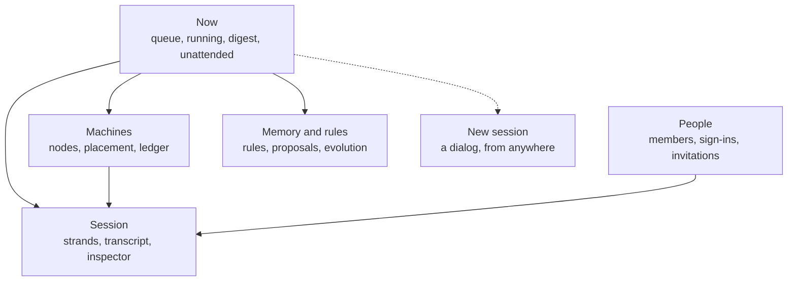

# Web UI redesign: show what only a durable daemon knows

**Status: exploration, for the owner's review. Nothing here is built.** The
mock is [web-ui-redesign-mock.html](web-ui-redesign-mock.html). It builds on
[the web UI note](web-ui.md) and [the web design note](web-design.md), and it
would change two decisions they record: what the home page is (section 7,
choice 1), and the A2 palette (section 9).

Claims about the daemon carry one of three marks:

- **[L]**: seen on a running `loomd` 0.3.2 on 2026-11-01.
- **[S]**: read in source or in `docs/client-protocol.md` in this tree.
- **[A]**: assumed, and not confirmed.

## The argument

The page today is a good session viewer, opened through a new-session form.
Most coding-agent UIs are also a session viewer with a form. What Loom has and
they lack is a process that keeps running, holds a durable record, and knows
about every session, machine and decision at once. The page shows little of
this until a person opens each session.

The proposal is to make the first screen answer four questions. Questions 2 and 4
depend on the daemon itself: survival across a crash, and placement across machines.
Questions 1 and 3 could be answered by any supervisor process that watches several
sessions; Loom answers them with durable records and a stated authority behind them.

1. What is waiting on me, and can I settle it here?
2. What happened while I was gone, including a crash?
3. What is running without me, and what will it spend?
4. Where is each session running, and which sessions does a sick machine affect?

The most useful finding from the live run supports this. A pending approval
survived `kill -9` of the daemon [L]. After the restart its session read `saved`
and the owner's page showed nothing about the approval until the session was
opened [L]. The durable record held the fact, and the UI did not show it.

## 1. What the current UI gets right and wrong

I ran an isolated daemon and drove the page at 1440 and 375 px wide: sessions
with an approval, a sub-agent, a rule proposal, a memory note and queued input,
then a `kill -9` and a restart.

### Right, and worth keeping

- **Approval and proposal cards.** The card names the strand, the command and
  the exact widening, separates model text from the page's words, and holds its
  buttons in `Arming…` for a moment [L]. The proposal card shows its diff in full
  green and says it reaches new sessions only [L].
- **Folded work.** `Worked <1s · 1 step · 1 failed` opens to the command, and
  then to its stderr with links to the full result [L].
- **Placement words on the session row.** `macbook-pro-24 → …/code/retry` and the
  `Agent on` and `Commands on` chips state what no other tool has to state [L].
- **Strand focus.** The composer's `To` chip follows the focused strand, and the
  sub-agent's detail shows task, model, context and running time [L].
- **Honest empty words.** `No uncommitted changes`, `No program yet`, and a
  memory section that says a note's body is not shown [L].
- **`Cmd+K`** lists Home and every session, saved ones included [L].
- **The design rules.** Tinted background and hairline border, red and green
  diffs, no accent bars and no card shadows. The mock keeps these. It replaces the
  A2 colour values, for the reasons in section 9.

### Wrong

- **The home is a form.** With one session waiting on an approval, Home's main
  column reads "What should the agent work on?" [L]. The session list is one
  link down, and the machines are on another page [L].
- **The daemon-wide view is thin.** The list row has a name, a state word and an
  age [L]. The sidebar adds a section per state [L]. Home keeps
  the state word and the approvals count, and drops `last_message`, `model` and
  `glances` [S: `server.gleam`, `web_view/sessions.gleam`]. The code comment records
  this as a choice, that the page learns no more than whether a session works. This
  redesign reverses that choice.
- **A dead daemon reads as `connected`.** After `kill -9` the pill still said
  `connected`, and the approve buttons stayed live, for as long as I watched
  (over a minute, with the port closed) [L]. The server draws the pill, so it
  cannot draw its own death. Lustre's client fires `lustre:close`
  [S: `lustre-server-component.mjs` 5.7.1]. Protocol-change/051 considered that event
  and rejected it, because it cannot tell an ended page from a restarting daemon and
  carries no close code. A stale marker does not need to know why: "not connected,
  buttons off" is true in both cases.
- **Restarting hides everything.** After the restart: `3 saved`, collapsed, no
  mention of a restart, the waiting approval gone from the sidebar [L]. Opening
  the session brought back the approval and the proposal, and opening the
  sub-agent's session showed the sub-agent working again [L].
- **Loss is silent.** Before the crash the strip said `3 received, awaiting
  delivery`; after it, `no pending input`, with no notice [L]. The protocol calls
  this input transient [S: section 4.3.5]. I did not watch the sub-agent's
  remaining run, so I saw the indicator clear and did not see the messages fail
  to arrive.
- **A detached approval reads as a live question.** The card says `main wants to
  run a command`, beside `main: Finished` and a transcript where that call already
  failed [L]. This is by design: the call parks for 5 s, then settles, and a later
  approval sends a notice so that the model can retry [S: `approvals.md`]. The
  words do not say so.
- **The right panel has six tabs and a very long Session tab.** Tabs wrap to two
  rows at 1440 [L]. The Session tab holds identity, people, links, invitation, goal,
  fork, jobs, cost, permissions, proposals and memory in one scroll [L].
- **The chrome costs too much height.** The header takes two rows at 1440, and it
  prints the full workspace path as well as the shortened one [L].
- **The phone layout does not work.** At 375 px, five rows of header and the open
  panel use the screen, the panel scrolls inside itself, and the transcript is
  not visible [L]. A proposal's diff is clipped sideways [L].
- **Numbers lag without saying so.** The memory section said `0 pending
  proposals` beside a card holding one, and corrected itself later [L]. The
  protocol limits that read to once a minute [S: 4.9.33], and the card has its own read with a push, so two reads
  on two cadences disagree. A label should state the read time.
- **Stable address.** With no `--bind`, each restart moved the page to a new port
  (63338, 63908, 64153), so a page left open cannot reconnect [L]. A fixed `--bind`
  should avoid this [A].

## 2. What only a durable daemon can show

This inventory is written for both clients, the web page and the SwiftUI client.
**Exists** means the wire has it today. **Web** says whether the page already
reads it. **Change** means a `protocol-change/NNN.md` is required. A page runs in
the daemon but is still held to protocol-change/051 for each new reach, so a
web-only addendum is listed as `051 addendum`.

Rules for both clients, from the protocol:

- An absent row or field is unknown and is never zero [S: 3.21, 3.29, 3.30].
- Activity is a poll. It takes 24 ids at most, and has no push [S: 3.21].
- Model text is drawn as text and sanitized [S: 5.10].
- `when` on a schedule and `action` on an escalation are never parsed [S: 5.5, 5.10].

### 2.1 Attention

| What it shows | Source | Status |
|---|---|---|
| Sessions that need a person, and how many approvals | `sessions.activity` `state`, `approvals` | Exists [S, L]. Web uses both, and no other field. Members are answered for sessions they hold (050 addendum; section 3.21 still says `forbidden` and is stale). |
| The question itself: tool, preview, widening, digest | `escalation` event, `snapshot` `escalations` on the session socket | Exists per session [S, L]. Needs an attachment. |
| Decide from the first screen | `approve`, `deny` with `expected_seq` and `action` | Exists on the wire [S]. Web: 051 addendum, because the home has no lane. |
| A failed last run with its message | `sessions.activity` `last_outcome`, `last_message`; `strand_result` | Exists [S]. |
| A stopped goal, and why | `goal_get`, `goal_changed` (`status`, `reason`, `because`, `last_check`) | Exists per session [S]. A row without attaching: **Change**. |
| Rule and config proposals | `proposals_get`, `proposals_changed`, `proposal_decide` | Exists, owner only [S, L]. |
| A pending approval on a **saved** session | none. 3.21 never reads a saved session. | **Change**: a count in the catalogue row [L for the gap]. |
| How long a question has waited | none. An escalation has `seq`, and no time [S: 5.10]. | **Change**, or first-seen time, which resets on a new page. |

### 2.2 Time away and restarts

| What it shows | Source | Status |
|---|---|---|
| The daemon restarted | `status.epoch`, `hello` | Exists [S]. The Swift client can compare epochs. The page is server-drawn and the new daemon has no record of the old epoch, so web needs a `web_client` element holding it in the browser, or the restart record below. |
| Sessions state after restart | `sessions.list` `status` | Exists [S, L]. |
| Which sessions were resident before | none | **Change**: a restart record [A: nothing found]. |
| Queued input lost in a crash | none. `pending_inputs` is transient [S: 4.3.5]. | **Change**, or make the queue durable. |
| New entries since a sequence | `catch_up` from a stored `next_seq`, per session | Exists [S]. Attaches to the session. |
| Counts since a sequence, across sessions | none | **Change**: `since_seq` on activity, resident only. |
| Where a person last looked | none. Web can use `localStorage` per browser [S]. | **Change** for a cursor that follows a person. |
| "Read" or "unread" | not knowable. The daemon knows a peer message was stored, and not that anyone read it [S: `web-ui.md` section 2]. | Never claim it. |

### 2.3 Running without a person

| What it shows | Source | Status |
|---|---|---|
| Goal budget, spend, continues, last check | `goal_get` | Exists per session [S]. |
| Schedules: target, owner, fired, wake | `schedules`, `schedule_cancel` | Exists per session [S]. |
| Next fire time | none. `when` is display text [S: 5.5]. | **Change**: add `next_fire_ms`. Needed for any agenda. |
| Jobs that outlive a turn | `live_jobs`, four per strand [S: 4.9.19] | Exists, read only [S]. No wire command stops a job; `job_kill` is a model tool. **Change** for a stop button. |
| Children on other orchestrators | `remote_children`, `child_history` | Exists [S]. Not exercised live. |
| Advisor nudges queued | `advisor_pending` | Exists, read only [S]. |
| All of these across the daemon | none | **Change**: one bounded owner read, or a fan-out by the client. |

### 2.4 Machines and placement

Not exercised beyond one machine: my daemon had no distribution [L]. Every row
below is [S].

| What it shows | Source | Status |
|---|---|---|
| Node state, reasons, build, uptime | `deployment.status` `nodes`, `reasons` | Exists. Web: Admin page. |
| Executor scopes, unclean scopes, ledger bytes | `deployment.status` with `node` | Exists. |
| Which orchestrator serves which executor | `edges` kind `serves`, with session counts | Exists. |
| Where each session runs | `sessions.list` `executor`, `pool`; `sessions.elsewhere` `executor_node` | Exists. |
| Sessions affected by a sick node | join of the two rows above | Exists, as a client join. |
| Moves, and stalled moves | `deployment.status` `moves`; `sessions.list` `moving`, `moved` | Exists. |
| Directory leader and quorum | `directory.status`; reason `directory_quorum_lost` | Exists. |
| Membership ledger heads, last report, holdings | `ledger.status`, `ledger.holdings` | Exists. |
| Daemon capacity | `status` | Exists [L: Admin shows sessions]. |

### 2.5 Authority and spend

| What it shows | Source | Status |
|---|---|---|
| Who decided, on what digest | `escalations_decided`, newest 16 [S: 4.7.1]; `origin` | Exists. **Change** for history past 16. |
| Remembered grants, and forget | `permissions`, `permission_forget` | Exists [S]. |
| Rules, with the session that proposed each | `memory_get` `rules`; a proposal's `source` | Exists [S, L]. |
| What each run receives | `memory_get` `receives` | Exists [S, L]. |
| Sessions a new rule does not reach | `status.resident`. A prompt is pinned for a session's life [S: 4.9.32]. | Exists. For saved sessions, compare `created_at` with the rule's date: a reopened session reuses its pinned prompt [S: `prompt.md`]. |
| The generation a session runs, candidates, evidence | `evolution` action `board`, `evolution_changed` | Exists [S, L]. |
| Session spend, resident | metadata `usage`; `usage` events [S: 4.3.5, 5.9] | Exists. Needs an attachment. |
| Session spend, saved, or across the daemon | none. The ledger sits in each session's own database [S: `durability.md`]. | **Change**: a total in the catalogue row. |
| Spend of a child on another orchestrator | none. `remote_children` `tokens` is context size, not spend [S: 5.2]. | Show as "not reported". |
| Goal cost against session cost | `cost_used` excludes the reviewer [S: 4.9.27] | Exists. Never present the two as equal. |

### 2.6 Inside one session

| What it shows | Source | Status |
|---|---|---|
| Strands, live operation, phase | `snapshot` `strands`, `op_transition` | Exists [S, L]. |
| Glances of working strands from outside | `sessions.activity` `glances` | Exists [S]. Web drops them on Home. |
| Program calls on the program's own clock | entries, `session_view/program_card` | Exists [S]. |
| Conversation tree, lineage, fork, navigate | `history_lineage`, `fork`, `navigate` | Exists [S]. |
| Context by category | `context` | Exists [S, L]. |
| People and roles | `presence`, `sessions.members` | Exists [S, L]. |
| Peer links | `peers.inspect`, `peers.link`, `peers.send` | Exists [S, L for the empty state]. |
| Worktree and commit diffs | `worktree_diff` | Exists [S, L]. |

### 2.7 One shape for both clients

The SwiftUI client's `Mission.attention` in
`loom-desktop/Sources/MissionKit/Attention.swift` already has this shape:
one item per thing waiting, grouped by what it needs, built by a pure function.
The web version belongs in `session_view` or a new portable package, under the
rule that the page grows no session logic of its own. Suggested shared record:

```
AttentionItem {
  kind:     approval | failed_run | goal_stopped | proposal | node_action
            | move_stalled | recovery_blocked | lost_input
  priority: P1 | P2 | P3 | P4
  session:  id and name, or none for a machine
  strand:   name, or none
  residency: resident | saved
  evidence: the facts the decision needs, as model text marked as such
  actions:  closed set the client may offer
  known:    what the client could not read, stated rather than defaulted
}
```

Three differences to settle in the Swift code, which I read and did not change:

- It has no kinds for goals, proposals or machines.
- `liveness` maps `.unknown` to `.idle`, where the protocol treats unknown as a
  separate state.
- A saved session has no activity row and becomes `.off`, so the saved-approval
  gap applies to it as well.

The clients differ in one way. The Swift client may hold a bearer and open a lane
per session. The page keeps no credential in the browser, so the daemon holds any
extra lane on its behalf [S: `web-view.md`].

## 3. The fields used under range

The `/ambition` router picked range. Range asks the user to approve the crew. I
could not ask, so I made the call and record the alternatives here.

**Target:** this note and its mock. **Default field:** product designer.

**Verbs:** let one owner with many long-lived sessions find what needs them and
settle it in seconds; show what is durable and what was lost, without overstating
either; keep every figure honest when a source is absent or stale.

| Field | Procedure | Artifact | Role | Outcome |
|---|---|---|---|---|
| Plant alarm management and ER triage | ISA-18.2 rationalization: an alarm must require an action. Rank by consequence and time. | Signal table with priority and seconds budget | B, agent | Kept |
| Forensic accounting and shift handover | Reconcile each figure to its source; SBAR digest | Reconciliation table, digest definition | B, agent | Kept |
| Process-plant HMI and air traffic control strips | ISA-101: grey when normal, colour for abnormal. One strip per flight in fixed columns, ordered by next action. | Visual rules, strip columns | B, by the lead | Kept |
| Short seller | Attack each claim in the draft from primary sources | Claims list | C, agent | Kept, the adversary. See section 8. |
| Brand designer | Restyle | | | Struck: tone only. The owner later reopened colour, and section 9 answers that with measurement. |
| Game theorist | Multi-party incentives | | | Struck: wrong object |
| Accessibility specialist | Contrast and keyboard audit | | | Cut at first. Section 9 now covers colour and contrast. Tab order and screen readers are still unchecked, and are needed before build. |
| Motion designer | Timed transitions | | | Cut: `web-ui.md` 6.1 already sets motion |

I ran HMI and strips myself, because the input is the visual vocabulary I already
had from the screenshots, and its artifact is the mock itself.

### What each field produced

**Alarm rationalization produced the Needs You queue.** A signal with no required
action is status and stays out of the queue. This took working, idle, usage,
presence and plain node-down off the list, and left this order:

| Priority | Signal | Budget | Must be on the row |
|---|---|---|---|
| P1 | Pending approval, resident or saved | 10 s | Strand, tool, bounded preview, reason, `wanted` verbatim |
| P2 | Failed run; goal stopped by budget, zero progress or an unresponsive reviewer; `recovery_blocked`; lost input | 8 to 10 s | Error code, message or `because`, budget used, last check |
| P3 | Rule or config proposal; finished goal; remote child expired or refused | 5 to 15 s | The diff in full, rationale, source session |
| P4 | Executor `full` or `unclean_scope`; stalled move | 5 s | Node, reason word, sessions affected |

A goal paused by `operator` or `aborted` is the owner's own act, so it is status.
A proposal has no deadline, so it never outranks a blocked strand. The seconds are
estimates [A]; the ranking is the design.

**HMI rules produced the visual language.** This is where the page becomes
quieter. Normal is grey: `Working` carries no colour, and a page with nothing
wrong has almost no colour on it. Colour appears only on what needs action, always
with a word and a shape: amber for a required decision, red for failed or down,
green only for diffs. The mock's Running list shows the effect. The owner's rule
about tint and hairline, and no bars or shadows, fits this directly. Section 9 has
the values.

**Strips produced the Running table.** A row per session with fixed columns: state,
session and branch, doing now, agent → commands, strands, spend. It reads down a
column, and a row's position means the same thing on every row. The order is fixed
by need, then recency, so a row moves only when something changes about it.

**The reconciliation produced the rule that a figure names its coverage.** The
usage ledger is per session and needs an open session. A goal's cost excludes its
reviewer. A remote child's `tokens` is context size. So the spend column can say
`not read`, and there is no single daemon total until the catalogue carries one.

**Handover produced the digest and its limits.** "Since you last looked" reports
stored entries, finished runs, usage delta and decisions after a sequence number.
It never says unread. Sequence numbers are sparse, so it counts entries, not gaps
[S: 1.4]. Decisions are capped at the newest 16.

## 4. Information architecture



- **Now** replaces the form as `/ui/home`.
- **Session** keeps A2's three columns and removes tabs: the strand list moves to
  the left of the transcript, and the right panel becomes an inspector of
  collapsible sections. Authority and context are open by default.
- **Machines** and **People** are today's Admin tabs, promoted. Machines appears
  for one machine too, reduced to one card.
- **Memory and rules** is new as a page. It lifts proposals and rules out of one
  session's tab, which matches how they work: they belong to the workspace, not the
  session.
- **New session** keeps today's form, and opens from a button or `n`.
- **`Cmd+K`** stays as it is.

## 5. Key screens

All three are in the mock. Tags under each block name the source, and blue tags
mark what needs a change. The checkbox in the mock's top bar hides them.

**Now.**

1. A restart notice, only after an epoch change.
2. Needs You, with decisions on the row.
3. Running, as strips.
4. Since You Last Looked.
5. On the side: Running Without You, Machines (a summary that shows only exceptions),
   and Standing Rules.

**Session.** One header row. Strands as a tree, so a sub-agent sits under its parent
and a child on another orchestrator is marked with its host. The inspector's Authority
section lists who decided what, with the digest. Under the composer one line says
queued input is lost in a crash. A detached approval says that the call returned
and that allowing it tells the agent to retry.

**Machines.** Node cards tinted only when degraded or down, each saying what to do
and which sessions it affects. Then a table of where each session runs, and the
ledger. A `down` card says the machine could not be reached, and that its work may
still be running, since that is all the answering daemon knows [S: 3.29].

**Phone.** One column; a stack in the order above. The decision is reachable without
scrolling inside a panel, and targets are at least 36 px. Checked at 375 px: no page
overflow on any screen.

**The connection pill** moves into the browser: a small `web_client` element listens
for `lustre:close` and `lustre:connect` and marks the page stale, disabling buttons,
with no help from the dead server.

## 6. Phased path

| Phase | What | Needs | Protocol |
|---|---|---|---|
| 0 | Truth fixes: stale marker on close, words on a detached approval, one-row header, phone layout, a notice when queued input clears on restart | `web_client`, views | None. The restart notice needs phase 3 to be exact. |
| 1 | Now, read-only. Queue from activity, Running strips with glances, Machines summary. Rows link into sessions. | Widen `listed_sessions.Activity` past one word. Page through ids 24 at a time. A shorter poll than today's 30 s for this page. `deployment.status` on the home is owner-only, as on Admin; activity is not. | A 065 addendum for the home's reach [A: may fit under 065 as is] |
| 2 | Inspector, Memory and rules page, Machines and People promoted | Views over existing reads | None for reads. The proposal queue belongs to the domain, while `proposals_get` runs on a session socket [S: 086], so a page with no session needs an addendum. |
| 3 | Catalogue summary: pending approvals, usage total, last sequence, goal state, written when a session closes and on each change. Restart record. | Storage and manager work. A write path that holds up under a crash, which is the hard part. | **New change.** Largest gap, unlocks saved rows and daemon spend. |
| 4 | Decide on the row | A short-lived lane per session with `approvals > 0`, held by the daemon. Consent binding stays as `operator.drawn` does it. Two limits: `max_pages` is four per principal and scope, so these lanes need their own count; and `ui_relay` caps a lane at Operator, so "Allow for session" needs the owner path of 073. | 051 addendum |
| 5 | Digest | `since_seq` on activity, and a cursor in `localStorage` first | **New change** |
| 6 | Agenda and authority history | `next_fire_ms` on schedules; a bounded daemon-wide read; `escalations_decided` with `after_seq` | **New change** per item |

The order puts truth fixes first since they stand alone. Phase 1 gives most of the
value and changes no wire format. The phases after 3 can be taken in any order.

## 7. Open choices for the owner

1. **Is Now the home?** The form was deliberate (#1032). Alternatives: keep the form
   and put Now behind `Show everything`; or show the form only when nothing is
   waiting or running. I recommend the third on a first run and Now otherwise.
2. **Decide on the row, or jump to the session?** Row decisions cost a lane per
   session, an addendum and work on the limits in phase 4. A one-click jump to the card costs nothing and a page load.
   I would ship the jump in phase 1 and measure.
3. **Reopen after restart: ask, or automatic?** Automatic reopening resumes spending
   with nobody watching. The mock asks. `sessions.md` keeps recovery explicit [S].
4. **Make queued input durable, or report the loss?** Durability removes the failure.
   Reporting adds a record of it. By your complexity rule the first is better if the
   cost is small; I have not costed it.
5. **Catalogue summary write path.** Updating on each change keeps it correct for a
   crash and adds writes to a second database. Updating on close is cheap, and a
   crash leaves it stale, which is the case that matters most here.
6. **Where the shared attention model lives:** `session_view`, or a new portable package
   that the Swift client mirrors by hand.
7. **Fonts.** The CSP has no font source, so the page uses installed fonts or system
   ones [S: `web-ui.md` 6.1]. Serving IBM Plex needs a 051 addendum. It would affect how
   sleek the page looks more than any other single choice. The mock uses the fallback stack.

## 8. What the adversary changed

The short-seller pass checked the draft against source, and I checked its main
findings. Eight changed the note or the mock:

- The "only a daemon" claim was too broad, and now covers two of the four questions.
- Home's dropped fields are a recorded choice to reverse, not an omission.
- Activity is not owner-only, and section 3.21 of the protocol document is stale on this.
- 051 already rejected `lustre:close`. The stale marker now answers its objection.
- An epoch comparison does not work on a server-drawn page by itself.
- The mock offered a job stop button that has no wire command.
- Phase 4 now states the page cap and the role cap.
- A reopened session's pinned prompt moved from assumed to source.

It confirmed the saved-session gap and the Machines fields against sections 3.21,
3.4, 3.29 and 3.30. The alarm rationalization produced the queue's order, and the
reconciliation produced the catalogue summary as the largest gap. The mock has
had a colour and contrast pass (section 9), and no keyboard or screen reader pass.

## 9. Colour: the plant grey palette

The owner invited a new colour scheme for this redesign and left the choice to
this pass. The mock now uses the palette below in place of A2. Both schemes follow
`prefers-color-scheme`, and the mock's Theme button overrides them.

**What it has to do.** A person monitoring many long-running agents must spot what
needs them within seconds, read dense code and transcript for hours, and trust the
status colours, in light and dark.

**Targets.** Body text at least 7:1. Secondary text at least 4.5:1. Status text at
least 4.5:1 on its tinted fill. Diff text at least 7:1. Controls and marks at least
3:1. The owner's rules stand: no left-edge bars, no card shadows, tinted background
and hairline border, red removed and green added.

### The rules the palette follows

- Normal is grey, as in ISA-101 plant displays. A page with nothing wrong has almost
  no colour on it.
- Each alarm hue has one meaning and is used for nothing else. A filled diamond in
  amber means a decision is waiting on this row. A hollow diamond in amber is a
  warning with no decision on the row. A cross in red means failed or down.
- `ok` is grey with a check, because it is normal. Green is for diffs.
- Status never rests on colour alone. Each state has a word and a shape, and each
  diff line has a bold `+` or `-`.
- A strand, advisor or peer hue colours a name and nothing else. It is never a fill.

### Tokens

Names are the `--color-*` names in `web_client.css` without the prefix. Ratios are
the WCAG ratio on the worst surface the mock draws the token on. **Lc** is the APCA
value on that token's worst surface, and is reported but was not a target, except
that secondary text was held to Lc 60.

**Surfaces**

| Token | Light | Dark | Use |
|---|---|---|---|
| `bg` | `#ebecec` | `#17191b` | Page |
| `bg-raised` | `#f8f8f7` | `#1f2224` | Cards, table rows |
| `bg-sunk` | `#e2e3e3` | `#121415` | Selected strand, meter track |
| `code` | `#eff0ef` | `#25282b` | Code blocks |
| `divider` | `#d2d4d4` | `#34383b` | Layout hairlines, decorative |
| `signal-bg` | `#fbeacb` | `#2c1e0c` | Row with a decision waiting |
| `signal-line` | `#e3c183` | `#57401c` | Its hairline |
| `danger-bg` | `#f7cdc9` | `#561e1c` | Failed or down row |
| `danger-line` | `#e5a5a0` | `#80332f` | Its hairline |
| `added-bg` | `#e6f7e2` | `#0e2715` | Added diff line |
| `removed-bg` | `#f6c6c2` | `#642120` | Removed diff line |

**Text and controls, with measured contrast**

| Token | Light | Worst, light | Dark | Worst, dark | Floor |
|---|---|---|---|---|---|
| `fg` | `#17191a` | 11.57 on `removed-bg`, Lc 78 | `#e7e9ea` | 9.68 on `removed-bg`, Lc 86 | 7 |
| `fg-quiet` | `#50565a` | 5.15 on `danger-bg`, Lc 62 | `#bcc2c6` | 7.30 on `danger-bg`, Lc 64 | 4.5 |
| `signal-text` | `#985000` | 4.69 on `bg-sunk`, Lc 63 | `#f5a742` | 7.40 on `code`, Lc 60 | 4.5 |
| `danger-text` | `#800c10` | 7.35 on `danger-bg`, Lc 69 | `#ff7a70` | 5.17 on `danger-bg`, Lc 47 | 4.5 |
| `added-text` | `#176a35` | 5.63 on `bg`, Lc 71 | `#adeb9f` | 10.70 on `code`, Lc 81 | 4.5 |
| `current` (links, focus) | `#0b5cad` | 4.62 on `danger-bg`, Lc 59 | `#7db4f0` | 6.04 on `danger-bg`, Lc 54 | 4.5 |
| `diff-added-text` (new) | `#125a2b` | 7.44 on `added-bg`, Lc 81 | `#adeb9f` | 11.49 on `added-bg`, Lc 82 | 7 |
| `diff-removed-text` (new) | `#7c0b0e` | 7.21 on `removed-bg`, Lc 67 | `#ffb6af` | 7.06 on `removed-bg`, Lc 66 | 7 |
| `diff-context` (new) | `#44494d` | 7.69 on `bg`, Lc 80 | `#bcc2c6` | 8.89 on `bg-raised`, Lc 67 | 7 |
| `control-line` (new) | `#74797d` | 3.04 on `danger-bg` | `#7a8084` | 3.28 on `danger-bg` | 3 |

The body floor was 7:1 for `fg` on every surface. The lowest values above are on
diff fills; on page surfaces `fg` is at least 13.72:1 in light and 12.17:1 in dark.

**Marks, with no words on them**

| Token | Light | Worst, light | Dark | Worst, dark |
|---|---|---|---|---|
| `signal` | `#b05f00` | 3.64 on `bg-sunk` | `#f08a1c` | 6.37 on `bg-raised` |
| `danger` | `#b4141a` | 5.34 on `bg-sunk` | `#dc625c` | 4.53 on `bg-raised` |
| `added` | `#1e8a45` | 3.42 on `bg-sunk` | `#6fcf6a` | 8.24 on `bg-raised` |
| `fg-faint` | `#8b9195` | Marks only, never text | `#6b7175` | Marks only, never text |
| `on-danger` | `#ffffff` | 6.87 on `danger` | `#17191b` | 4.99 on `danger` |

**Identity hues.** Each serves as mark and as text, so `X` and `X-text` hold one
value. All clear 4.5:1 on `bg`, `bg-raised` and `bg-sunk`; the lowest is 4.67 in
light and 5.34 in dark. None is on the alarm hues.

| Token | Light | Dark |
|---|---|---|
| `advisor` | `#6a4aa8` | `#b49ee8` |
| `peer` | `#94357f` | `#dd8ccb` |
| `strand-2` | `#0a6a78` | `#5cc4d4` |
| `strand-3` | `#5a5f8f` | `#8a93c0` |
| `strand-4` | `#7f4a9e` | `#c79ae0` |
| `strand-5` | `#7a5a6a` | `#c4a5b5` |
| `strand-6` | `#4a6572` | `#9ab4c2` |

### Colour vision

Values are the CIEDE2000 distance after the Machado 2009 full-severity simulation.
A larger number means more distinct. There is no standard threshold; I treated
about 10 as the point where small text separates at a glance, which is a judgement.

| Pair | Light, deutan | Light, protan | Dark, deutan | Dark, protan |
|---|---|---|---|---|
| Worst status text pair | 9.4 | 7.0 | 9.9 | 15.0 |
| Worst alarm mark pair | 8.9 | 10.0 | 9.6 | 13.1 |
| Worst tint fill pair | 5.3 | 5.1 | 4.4 | 2.1 |
| Diff text, added and removed | 7.8 | 12.4 | 6.2 | 14.9 |
| Diff fill, added and removed | 6.7 | 9.3 | 11.6 | 3.8 |

These do not clear 10 everywhere. For the three status text colours, a grid search
over hue, lightness and chroma, with a floor on chroma, reached 9.0 in light and 16.7
in dark, so little more was available there. That search is why red is dark
in the light scheme and amber is the brighter of the two: lightness carries the
split that hue cannot. Moving red toward crimson and green toward teal made it
worse (4.0 in light), because the two then sit on the same confusion line.

The tint fills are the weakest result, at 2.1 for dark red and green fills under
protanopia. Those two fills never mean a status at the same time: green is a diff
line and red is a fault. The word, shape and `+` or `-` carry the difference.

### Why it won, and the two that lost

All three were rendered in the mock, light and dark, at 1440 and 375 px, and run
through the same script. Only plant grey went through the later tuning rounds and
the adversary, so its numbers are better partly for that reason. The same grid
search gave the other two a similar ceiling (13.4 to 16.9 with no chroma floor,
against 13.5 for plant grey in light), so colour vision alone did not decide this.

- **Plant grey (chosen).** It comes from high-performance HMI practice, where the
  operator's task is the same as this page's: watch a lot of normal and catch the
  exception. Its neutral surfaces leave the alarm hues nothing to compete with, and
  light `bg` at `#ebecec` avoids white glare during long reading. It looks plain,
  which is intended.
- **Rubric (lost).** Warm paper, black ink and spot colour, from editorial print and
  rubrication. Light was `bg #f5f0e6`, `fg #1c1915`, red `#a32414`, ochre `#6f4f00`;
  dark was `bg #1a1714`. It was pleasant to read and the most attractive of the
  three. It lost for three reasons. Amber sits close to a warm page, so the attention
  tint was the least distinct from its surface in dark (10.7 against plant grey's
  15.3 before tuning). Status text under deuteranopia measured 2.6 in light. Print
  practice assumes one or two inks, and this page needs three alarm meanings. It
  also stays close to A2's warm family, so it is less of a change than the invitation
  allowed. Untuned, it had four contrast failures: two diff text pairs and two marks.
- **High-legibility editor (lost).** Modelled on the Modus themes for Emacs, which
  hold text to 7:1: white and black surfaces, saturated hues. It had the best raw
  contrast, with one failure (the amber mark on `bg-sunk`). Its yellow tint was the
  most visible (20.7 from the page), and that was the problem: two approval rows
  dominated the screen in both schemes, leaving nothing louder for a worse event.
  Pure black dark surfaces with white text also read harsher in the screenshots.
  Status text under deuteranopia measured 0.9 in light. I took its 7:1 diff text from
  it. Values are modelled from memory of those themes and not copied from them.

### What the adversary changed

One adversary attacked the palette from the screenshots, the numbers and the script.
Its findings, and what happened to each:

- **Fixed.** Tab badges were always amber, which hid failures, and now show one badge
  per severity with a shape.
- **Fixed, in part.** A down host appeared in three colours. It is now red everywhere,
  including a tinted row and word in Running. I did not move it to Needs You as
  proposed: section 3 rules that a plain down node has no required action.
- **Fixed.** Dark red read as salmon, weaker than amber. `danger-text` and `danger-bg`
  moved, `signal-bg` darkened, and the cross got heavier. Dark red text still has lower
  Lc than amber (47 against 60), because a lighter red turns pink. Accepted: the fill
  and shape carry the priority.
- **Fixed.** Dark `ok` green was the loudest status on the page. `ok` is now grey.
- **Fixed.** Under deuteranopia the light red row lost its alarm look. Red text and fill
  darkened (distance from raised 5.3 to 9.6).
- **Fixed.** Amber meant both a decision and a warning. The hollow diamond now takes
  warnings, and a degraded node keeps its amber line and loses its fill.
- **Fixed.** Goal Stopped had an amber word and no tint, and tinted rows used the grey
  hairline.
- **Fixed.** Dark `fg-quiet` measured 7.21:1 but only Lc 56 at 12 px. It moved to Lc 67,
  and secondary text now has an Lc 60 floor.
- **Fixed.** Diff context lines missed 7:1 in light, and the script did not check them.
- **Fixed, in part.** Diff fills were close under colour-blindness simulation, and now
  differ more in lightness. Dark protan stays low (3.8), so the bold prefix is required.
- **Fixed.** Button borders were 1.2 to 1.5:1. `control-line` is new, and `divider` stays
  for layout.
- **Fixed, in part.** `strand-3` was close to the link blue and `strand-5` to the alarm
  hues, so both changed value. It proposed dropping `strand-5`, which I did not do,
  since a session can list five strands. `advisor` against link blue stays close under
  colour-blindness simulation (2.3 in light, 1.5 in dark). Accepted: a strand hue is
  always a labelled name.

### How it maps onto the page's tokens

Applying this means editing `packages/web_client/src/web_client.css` and running
`make gen-client`. This note changes no Gleam or CSS outside the mock.

| Today | Change |
|---|---|
| `bg`, `bg-raised`, `bg-sunk`, `code`, `fg`, `fg-quiet`, `fg-faint`, `divider`, `current` | New values, same names |
| `bg-user` | Takes the value of `bg-raised`, as now |
| `signal`, `signal-text`, `danger`, `danger-text`, `on-danger` | New values, same names |
| `added`, `added-text`, `added-bg`, `removed-bg` | New values, same names |
| `advisor`, `advisor-text`, `peer`, `peer-text`, `strand-N`, `strand-N-text` | New values. Each pair holds one value. `advisor` no longer equals `signal`, which settles that open point in `web-design.md` section 5. |
| `pill-wait-bg`, `pill-bad-bg` | Point at `signal-bg` and `danger-bg` in place of a `color-mix` |
| `pill-ok-bg` | Transparent: an `ok` pill is normal, so it has no fill |
| `primary-button`, `shadow-float` | Unchanged |
| New | `signal-bg`, `signal-line`, `danger-bg`, `danger-line`, `diff-added-text`, `diff-removed-text`, `diff-context`, `control-line` |

Four rules in the stylesheet change as well. `.tok-del` and the other diff rules take
`diff-removed-text` and `diff-added-text`, since `danger-text` does not reach 7:1 on
`removed-bg` in dark. Classes that draw `ok` in `added-text` (`.chip-status.done`,
`.step.done .glyph`, `.pc-ok .pc-glyph`) move to `fg-quiet`. Each new token needs an
`inherit` line in the `:host` block and a place in both light blocks. And
`scripts/web_client_contrast_check.sh` needs the new surfaces, with the 7:1 floors.

### What this does not establish

- Simulated colour blindness is a model, and nobody with the condition looked at
  the mock. Neither did anyone read it for hours, so comfort is a judgement from
  the ratios and the screenshots.
- Screenshots came from one display and engine, with the fallback font stack.
- APCA is a draft method; the WCAG ratios are the numbers the targets use.
- The native client will share these token names, but I did not render them in
  SwiftUI, where vibrancy and system materials can change the surfaces.
