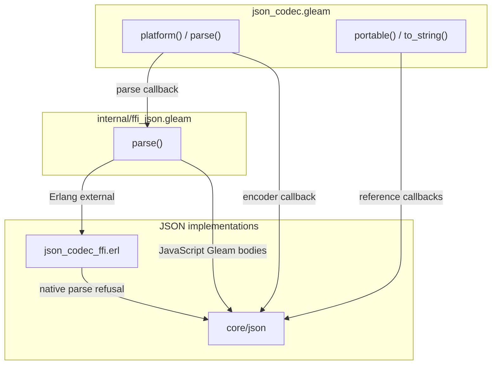
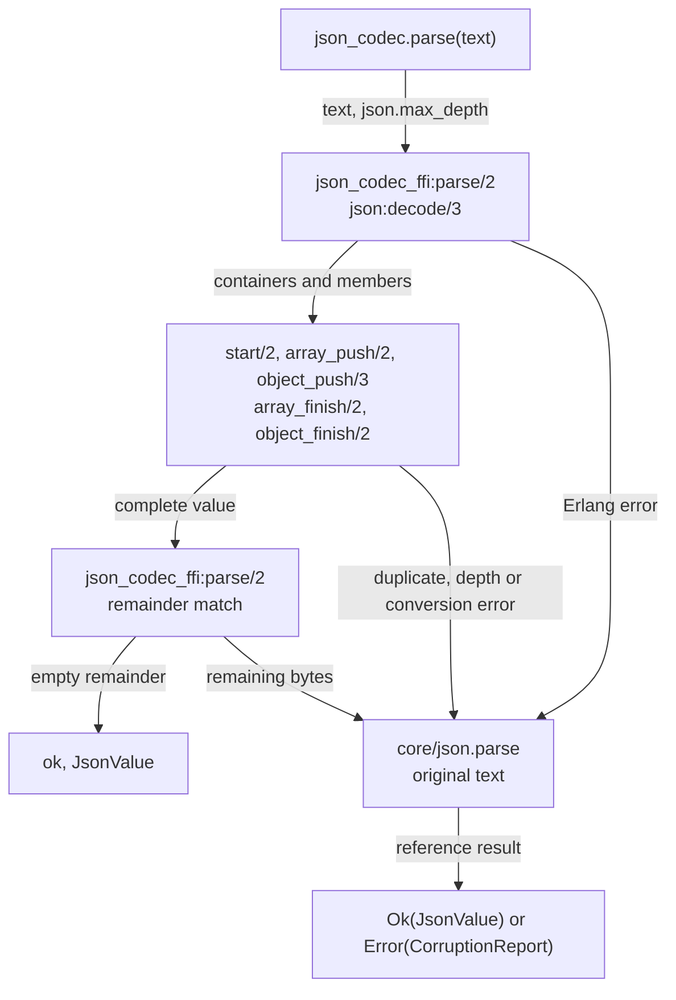

# JSON codec architecture

`json_codec` selects JSON implementations at Loom's byte boundaries while
retaining the ordered values and complete corruption reports defined by
`core/json`. This document describes the package at `61b1f5b18` and its byte-boundary
integrations in this series, for engineers familiar with Gleam and BEAM who
are new to this package. [ADR-023](../../docs/adr/023-platform-json-keeps-the-portable-contract.md)
records the FFI exception and its compatibility requirements.

## Components and selection

`Codec` holds immutable `parse` and `to_string` callbacks. `platform()` selects
the target binding; `portable()` explicitly selects the reference functions.
Production integrations call the convenience functions directly, without
constructing a record for each document or consulting a mutable backend setting.



Only `internal/ffi_json.gleam` declares an external. Its Gleam body is the
JavaScript parser. Encoding calls core directly on both targets. The reference
implementation remains usable on either target, and the pure packages do not
depend on `json_codec`.

| Component | Owns | Does not own |
| --- | --- | --- |
| `json_codec.Codec` | Immutable operation callbacks | Runtime configuration, authority or shared state |
| `json_codec` | Target-selected operations and explicit portable selection | A second value type or schema decoder |
| `json_codec_ffi` | OTP callbacks and temporary traversal accumulators | Persistence, actors or error-report vocabulary |
| `core/json` | `JsonValue`, the reference codec and `max_depth` | Native backend selection |
| Storage, provider and client callers | Typed decoding, I/O, freshness and protocol rules | Native JSON implementation details |

There is no initialization protocol. Selecting a `Codec` produces a value;
calling either operation runs synchronously in the caller. For an explicitly
selected operation:

```gleam
let codec = json_codec.platform()
let decoded = codec.parse("{\"answer\":42}")
```

## Parsing one complete document

`json_codec.parse` passes core's `max_depth` to the native binding. OTP's
`json:decode/3` receives fixed callbacks that construct the generated Erlang
representation of `JsonValue` directly, preserving object field order.



The adapter publishes only a complete native value. Every native refusal
delegates the original text to the reference parser, which can either accept
it or return its exact report, including offsets, context and wording.
Zero-valued floats also take that path: OTP can erase the sign of exponent-only
negative zero before the float callback receives its text. `decode_float/1`
requests the reference parse instead of attempting to reconstruct that text.

1. **Enter.** `start/2` checks the current depth against `max_depth`, whose
   value is 256 entered arrays or objects. A child accumulator starts with
   empty members and an empty duplicate-key map.
2. **Accumulate.** `array_push/2` prepends members. `object_push/3` checks
   decoded keys before prepending fields, so escaped and literal spellings of
   the same key are duplicates. `boolean_value/1` wraps OTP booleans at their
   parent or at the root.
3. **Finish.** The finish callbacks reverse accumulated members and restore
   the parent accumulator supplied by OTP. Strings and numbers already carry
   the corresponding `JsonValue` constructor.
4. **Return.** `parse/2` requires an empty remainder. A nonempty remainder or
   caught Erlang `error` abandons the tentative value and invokes the reference.

The native representation is a handwritten ABI boundary. The compiler does
not check its constructors against Gleam, so the compatibility suite compares
complete values and complete reports against core rather than acceptance alone.

## Encoding exact bytes

`json_codec.to_string` calls `core/json.to_string` on both targets. `Codec`
includes that callback so a caller can select the complete codec through one
value, but platform selection changes only parsing. Ordered fields, hand-built
duplicate keys, float spelling and control escapes therefore retain the
reference encoder's exact bytes.

The encoder remains synchronous and has no independent failure translation.
Both targets expect a well-typed `JsonValue`; schema validation belongs to
callers.

## Ownership and verification

The package owns no process, timer, persistent cache or mutable backend registry.
All callbacks are trusted package code and execute in the caller's process.

| Execution context | Owns during the operation |
| --- | --- |
| Parsing caller | Input, temporary accumulators and duplicate-key maps, returned value or report |
| Encoding caller | Input value, temporary iodata and returned string |

`JsonValue` retains core's binary ownership behavior: a small decoded string
can reference the backing input binary. Lower cumulative heap allocation does
not establish lower retained memory or RSS.

| Target | Selected implementation | Contract check |
| --- | --- | --- |
| Erlang | OTP callbacks, with reference fallback | Same compatibility properties as JavaScript, plus isolated native replay |
| JavaScript | Reference Gleam bodies | Same value, mutation and exact-encoding properties |

[The compatibility suite](test/json_codec/compatibility_test.gleam) runs on both
targets through `scripts/check.sh json_codec`.
[The fixed replay](../../scripts/platform_json_replay.sh) checks raw malformed
bytes, complete reports, exact encoder bytes, binary ownership, native calls,
semantic mutants and matched performance. It also compares real SQLite actors
using saved reference artifacts and the selected implementation.

## Limits

The package does not select codecs from an operator setting, inject callbacks
into existing caller constructors, or validate application schemas. Performance
depends on input shape: reference fallback can parse a refusal twice.
The fixed replay covers selected synthetic shapes rather than every production
distribution. Deployment and live-daemon behavior are outside this package's
contract proof.
