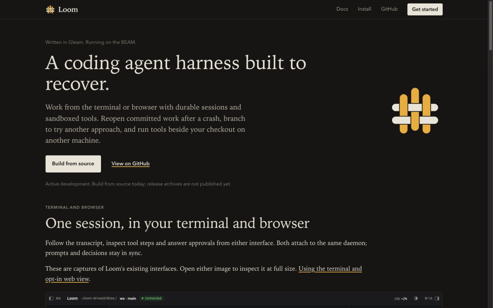
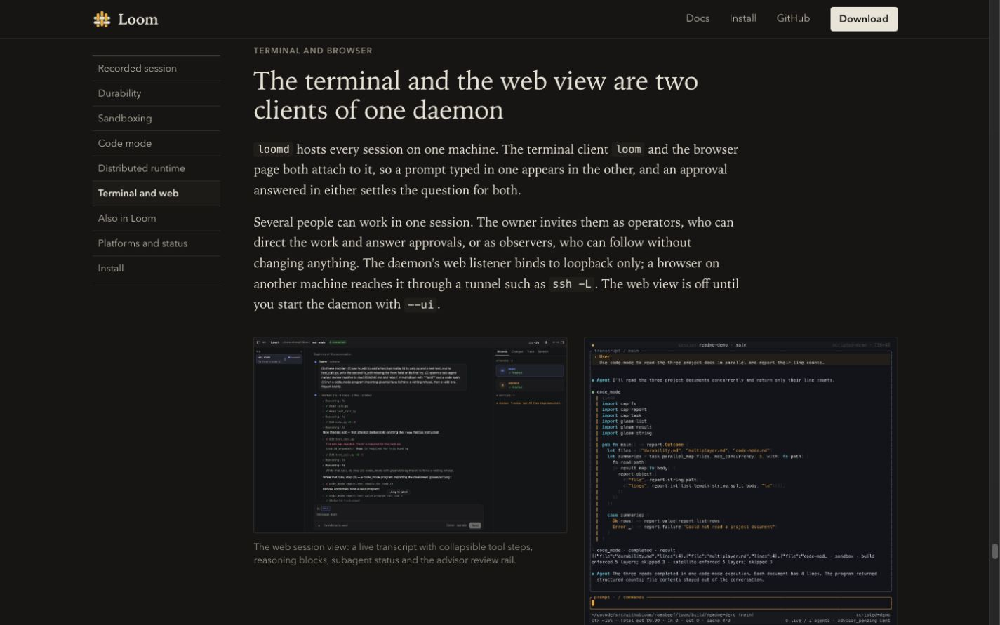
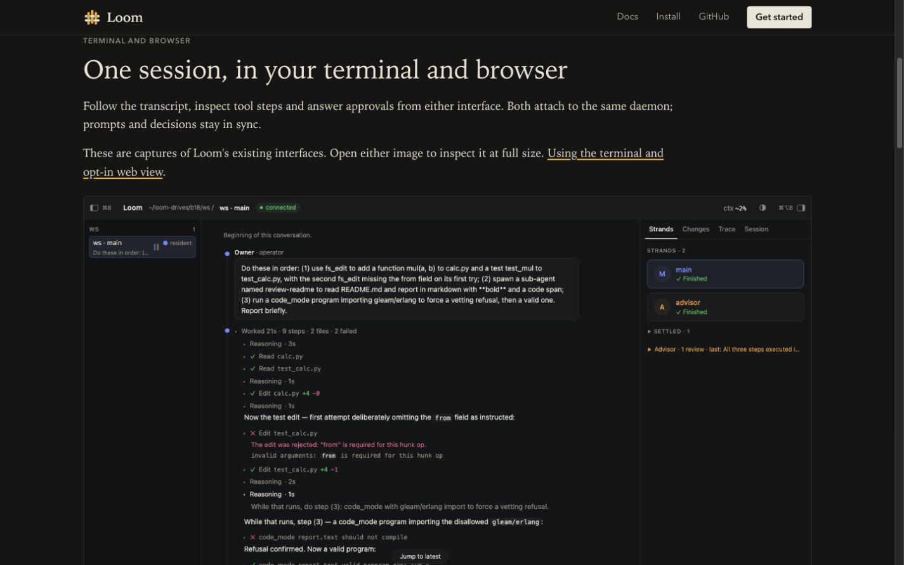
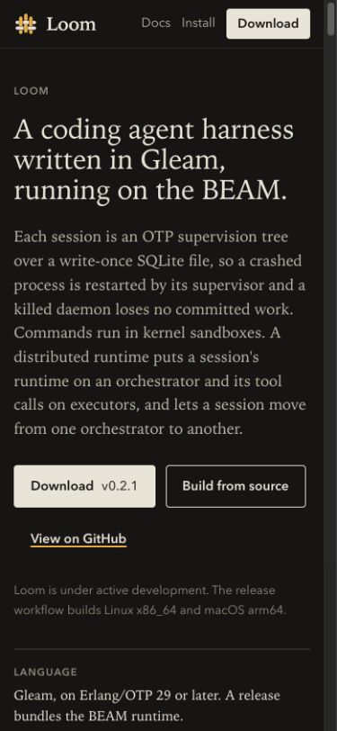
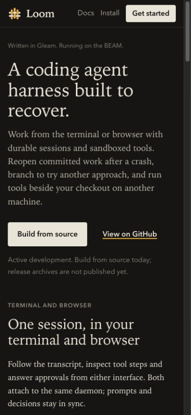
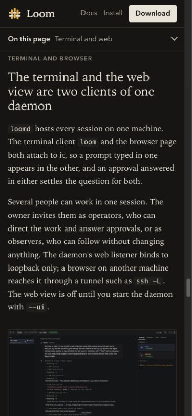
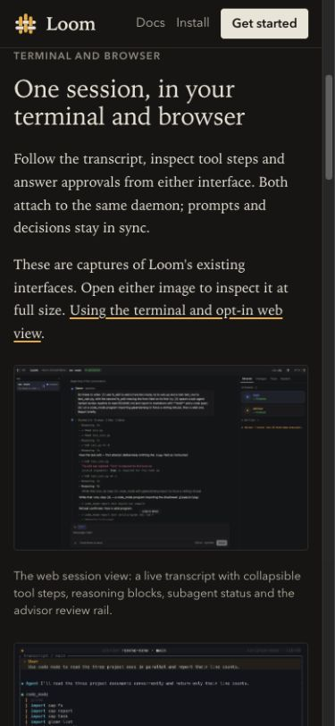

# Homepage comparison and browser QA

Captured October 12, 2026 in the attached Mac's Chrome browser. Before is the live `https://roasbeef.github.io/loom/` page before edits (main `8215026d5`). After is the local `site/dist` build, served on loopback. Desktop viewport: 1440 × 900. Phone viewport: 390 × 844. Both use the same system dark preference. Captures exclude browser chrome and private local content; the product images are the existing public repository assets.

| View | Before | After |
| --- | --- | --- |
| Desktop hero |  |  |
| Desktop product section |  |  |
| Mobile hero |  |  |
| Mobile product section |  |  |

Product captures start at the Terminal and web section after navigation settles. The previous desktop section starts around 24,875 CSS pixels down; the revised section starts around 597. The page is designed to scroll; viewport captures intentionally show a portion of long product images. Both images now link to their full-size files for inspection on a phone.

## QA inventory

- Hero: benefit-first headline, Gleam/BEAM identity, existing woven mark, source-build CTA, development/release status. Reviewed at desktop and phone widths.
- Product: both real images loaded, captions preserved, full-size file links and terminal/web documentation link present. Reviewed at desktop and phone widths. Original warm-paper/light and system-dark colour tokens are unchanged; these new browser captures cover the system-dark theme.
- Navigation: desktop section anchors, phone contents toggle and selection, Docs/Install/Get started links, source-build section deep link, recovery documentation and its crash figure. Existing section ids remain in page order, asserted by page tests.
- Replay: approval blocks Next/Play until an answer; allow-once and deny branches both reach the example passing-test outcome. Deny chooses `CACHE=off`. Enter activates choices; no approval choice is preselected. Restart and direct step selection work. The replay remains a scripted illustration.
- Keyboard: Enter on source-build CTA, Enter on replay controls/approval choices, skip link transfers focus to `main`. Visible focus treatment reviewed on the phone replay controls.
- Copy: the source-build sample's Copy button reports Copied. No install, daemon restart, release, tag or deployment was performed.
- Fit: desktop and phone `scrollWidth` equal `clientWidth`; no unintended horizontal overflow, broken images, distorted aspect ratios or clipped primary CTA were found. The shorter header action fits the phone width.

`make -C site check` passed with 65 tests, format check, copy check and build. The existing JavaScript-target dependency warnings are in `gleam_erlang`/`gleam_otp`; the site source compiles without warnings. Full repository/Linux gates are tracked on the draft PR separately from this site/browser QA.
